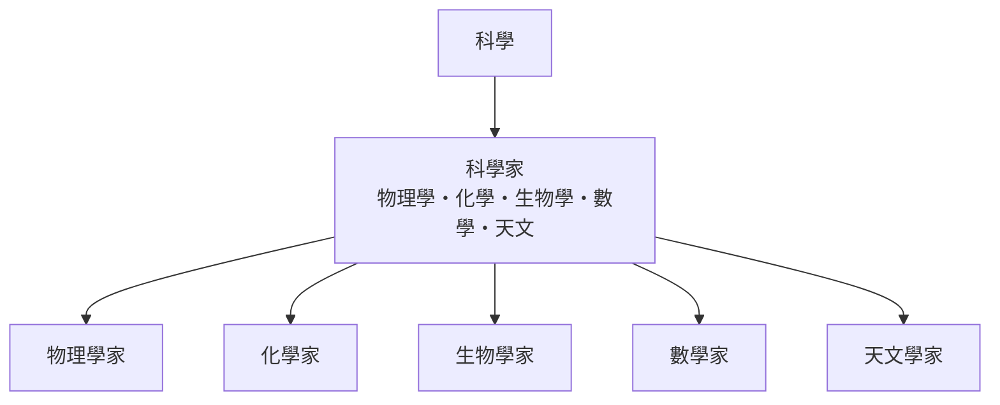

# 科學

> 分類範圍：以自然與社會科學的研究者群像與學科結構為核心的分類部門——物理學家、化學家、生物學家、數學家與天文學家——並說明各學科如何互相驅動。　·　隸屬第一層：[人]　·　相關分類：[科學史]、[數學]、[物理學]　·　子分類總表見 [README]

> 對應維基百科：[中文維基百科：科学](https://zh.wikipedia.org/wiki/%E7%A7%91%E5%AD%A6)　·　[English Wikipedia: Science](https://en.wikipedia.org/wiki/Science)

「科學」在此不是一個單一學科，而是**一套以可反駁、可重複、可量化為特色的求知制度**。科學家這個概念則是這套制度的人力面：每一門科學都有自己擅長的問題、材料與方法，因此也需要不同性格與訓練的研究者。本概念的問題是：**不同科學之間如何分工、又如何被迫互相借用對方的工具**。

## 核心問題：可證偽的共同語言

科學作為制度的最小公約數有三項：

1. **可反駁**：命題必須有可能被觀測推翻，否則只是 belief。
2. **可重複**：別人用同一材料、同一方法應得到相近結果，否則是個人主張。
3. **可量化**：能用數值表達的量，才進得了共同的比較表。

這三項要求解釋了科學的分工方式：物理學提供了測量與數學的語言，化學提供了物質組成的帳本，天文學提供了尺度最大的實驗室，生物學處理生命系統的複雜度，數學家則提供任何領域都能借用的推理工具。

## 因果鏈

1. **測量的標準化**：量測單位的一致（公制、時間標準）讓跨地域、跨世代的結果可以比較。
2. **專業化與學術制度**：學會、期刊與同儕評審把「誰能主張」制度化，爭議因此能在公開場合被處理。
3. **數學的入侵**：物理學率先把定律寫成方程式，生物學在二十世紀下半葉跟進演化與遺傳的數學化。
4. **工具的躍升**：望遠鏡、顯微鏡、粒子加速器與序列定序每一次都把可研究的邊界往外推。
5. **跨學科的分化與回流**：環境、資訊與生命科學在邊界處結合，形成新的科學家群像（例如生態學家、遺傳學家）。

## 子分類的定位與相互驅動

- [科學家] 是這個部門的主軸：不同學科的研究者各有其訓練與性格。
- 物理學家偏向模型的普遍性，化學家偏向物質組成的細節，生物學家偏向系統的複雜性，數學家偏向結構的抽象性，天文學家則把方法推到尺度與時空的極限。

## 範例：一個問題橫跨五個學科

以「半導體為何能導電」為例：

1. **物理學家**用能帶論描述電子的行為，給出載流子濃度的量級。
2. **化學家**分析晶體的成分與摻雜後的鍵結變化，說明為何雜質能提供自由載流子。
3. **數學家**處理擴散方程與電流的解析解，以及元件尺度的極限分析。
4. **天文學家**在極端環境（低溫、高壓）中研究半導體相變，提供材料極性的基準。
5. **生物學家**則在另一個尺度上利用半導體原理做生物感測——同一套物理，跨越五種專業訓練。

## 容易混淆之處

- **科學與科學家不同**：科學是一套制度與方法，科學家是執行它的人；一篇好論文不代表整個領域健康。
- **「科學證明」說過頭**：科學支持的是程度與範圍，不是終極真理。
- **學科邊界是歷史產物**：生物化學、生物物理學的出現說明邊界會移動。
- **科學家不是單一性格**：研究者個體的差異往往大於學科間的差異；以「科學家的性格」做職業勸誘是粗糙的推論。

## 技術要點

- **量測的溯源**：任何數值都要能追溯到校準過的量測鏈；否則比較無從谈起。
- **不確定度的報告**：誤差與信賴區間是結果的一部分，不寫等於隱瞞。
- **模型與尺度**：模型只在特定尺度與近似下成立，跨界套用是常見錯誤。
- **重複與樣本量**：單次結果與重複實驗的差異，往往比理論爭議更決定真相。
- **統計與機率的語言**：p 值、效果量與信賴區間的使用須與研究設計一致。
- **可反駁性檢查**：好的命題應能設計出「若為假則會看到什麼」的實驗。

## 常見的論爭

1. **可反駁性的適用範圍**：複雜系統（如氣候、演化）難以設計單一決定性反駁實驗，方法論仍在調整。
2. **科學的專業化與公眾信任**：專業化提高了水準，也拉大了與公眾的距離溝通成本。
3. **資助結構對研究方向的作用**：研究方向不只由問題重要性決定，也由經費機制的誘因塑造，這是科學社會學的長期爭論。

## 延伸閱讀

- [科學史]：科學制度的演變。
- [數學]：所有科學共用的推理語言。
- [物理學]：量測與模型的示範領域。
- [科學家]：本概念的主軸條目。

## 連結定義

[人]: ../人/README.md
[README]: README.md
[科學史]: ../科學史/README.md
[數學]: ../數學/README.md
[物理學]: ../物理學/README.md
[科學家]: 科學家.md

- **延伸參考**：相關專著與通史，是深入理解本主題的入口。
- **延伸參考**：科學學術史與研究方法專著，是理解本領域的常規入口。
- **延伸參考**：相關科學通史與方法論專著，供進一步查證與延伸。
