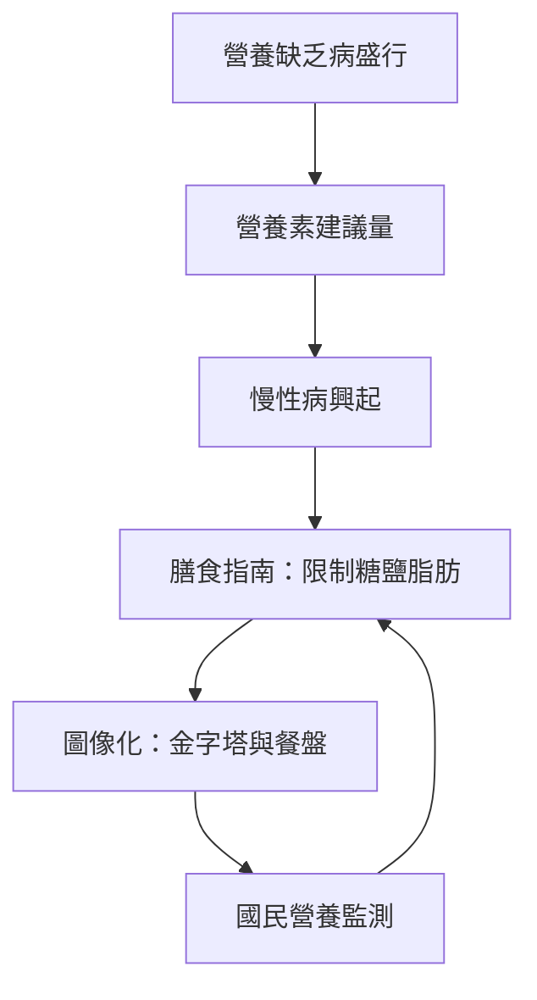

# 膳食指南

> 隸屬：[科技][科技]　·　相關分類：[營養素][營養素]、[食品安全檢驗][食品安全檢驗]　·　狀態：初稿

> 對應維基百科：[English Wikipedia: Dietary guidelines](https://en.wikipedia.org/wiki/Dietary%20guidelines)

膳食指南是由政府或專業機構彙整營養學證據後，以民眾看得懂的語言呈現的飲食建議文件，目的是把「每天該吃多少、怎麼搭配」轉成可操作的規則，用來預防營養不足與肥胖、糖尿病、心血管疾病等慢性病。它不是單一食物的清單，而是一整套「食物類別—份量—頻率」的分配原則。

## 為什麼需要膳食指南

在指南出現之前，人們對「吃什麼才健康」主要依靠傳統與經驗。二十世紀初，營養學界陸續發現維生素與礦物質，確認缺乏特定營養素會導致壞血病、腳氣病、佝僂病等疾病；戰爭與經濟蕭條期間，各國更面臨配給與營養不足的壓力。因此政府開始以科學證據為基礎，制定全國性的飲食建議，先求「吃飽與不缺乏」，再逐步轉向「預防慢性病」。反過來，指南普及後也推動了食品標示、學校午餐設計與營養師制度的發展。

## 核心概念

- **營養素密度**：指每單位熱量所帶來的營養素含量。指南鼓勵選擇高營養素密度食物（如全穀、蔬菜、豆魚蛋肉、乳品），減少「空熱量」（如含糖飲料）。
- **食物分類**：常見分為全榖雜糧、豆魚蛋肉、蔬菜、水果、乳品、油脂與堅果種子六大類，各類提供的主要營養素不同，因此必須搭配。
- **份量與頻率**：把「均衡」量化為每日或每餐的份數，例如蔬菜類每天 3～5 份（煮熟半碗約為一份）、水果 2～4 份。
- **限制項**：食鹽、遊離糖與飽和脂肪是大多數指南共同點名的減量對象；世界衛生組織建議成人每日鈉攝取少於 2000 毫克（約 5 公克鹽）、遊離糖低於總熱量的 10%。

## 具體範例：一天的均衡搭配

以一位輕度活動的成年上班族為例，若總熱量目標約 2000 大卡，可依六大類分配如下：

| 食物類別 | 建議份量 | 實際例子 |
| --- | --- | --- |
| 全榖雜糧 | 3～3.5 碗 | 早餐地瓜粥一碗、午晚餐各一碗糙米飯 |
| 豆魚蛋肉 | 6～7 份 | 午餐滷雞腿一隻、晚餐豆腐半盒與魚半掌心大 |
| 蔬菜 | 3～5 份 | 午晚餐各炒青菜一碗、湯裡再加半碗 |
| 水果 | 2～4 份 | 上午一顆柳丁、飯後半根香蕉 |
| 乳品 | 1.5～2 杯 | 早餐低脂牛奶一杯、睡前無糖優格一杯 |
| 油脂堅果 | 5～6 茶匙 | 烹調用油三茶匙、下午一小把核桃 |

這個安排的意義在於：蛋白質分散在三餐、每餐都有蔬菜、精緻糖幾乎為零。若把早餐的含糖奶茶換成牛奶，就同時完成「減糖」與「補鈣」兩項指南要求——這正是指南設計上「用替換達成目標」的精神。

## 前因後果與互相驅動

1. **瓶頸**：營養不足與傳染病盛行 → 各國建立熱量與營養素建議量（如美國 RDA，1943 年起發布）。
2. **轉折**：慢性病取代營養不足成為主要死因 → 指南從「補足」轉為「限制」，出現脂肪、糖、鹽的上限建議。
3. **量化**：單靠文字民眾難以執行 → 發展出金字塔、餐盤（如美國 MyPlate，2011 年取代金字塔）與扇形圖等圖像化工具。
4. **回饋**：國民營養調查持續監測 → 依實際攝取偏差修訂下一版指南，形成「調查—建議—教育—再調查」的循環。

## 與相鄰分類的關聯

- 與 [營養素][營養素] 的關係：指南是營養素知識的「翻譯者」，把蛋白質、膳食纖維、維生素等抽象指標轉成食物份數。
- 與 [食品安全檢驗][食品安全檢驗] 的關係：指南談「吃多少」，食安檢驗談「能不能吃」，兩者共同構成完整的飲食風險管理。
- 與 [智慧農業][智慧農業] 的關係：指南建議的攝取結構會反向影響農業生產方向，精準農業因此獲得明確的作物與品質目標。
- 與 [蔬菜][蔬菜]、[糧食作物][糧食作物] 的關係：指南中的「每日份數」直接對應這些作物的消費需求，帶動育種與供應鏈調整。

## 容易混淆之處

- 指南是**統計上的最佳平均**，不是個人處方；疾病患者仍需營養師個別調整。
- 「少油鹽糖」不等於完全不吃油脂；必需脂肪酸仍必須由飲食取得。
- 各國指南份數不同是因為飲食文化與體型差異，並非互相矛盾。
- 指南會隨證據更新而修訂，舊版建議（如早期對脂肪的一刀切限制）不必然適用於今日。

## 發展趨勢

近年指南的走向可歸納為三點。第一，從單一營養素轉向「膳食模式」：例如地中海飲食或得舒（DASH）飲食，強調整體搭配而非個別成分。第二，納入永續性考量：北歐國家與部分國際機構已把碳排放、土地與水資源消耗列入建議，使膳食指南與氣候政策開始交會。第三，數位化傳播：份量建議被轉成 App 記錄、條碼掃描與個人化回饋，讓「指南—行為—監測」的循環更即時。反過來，這些工具產生的大量攝取資料，也會成為下一版指南修訂的證據來源。

對讀者而言，最實用的做法是把指南當成「檢核表」：先確認六大類是否都出現在一日三餐中，再檢查含糖飲料與加工肉的頻率，最後用體重與健檢數值回頭驗證。若能持之以恆，指南的精神——均衡、適量、多樣——就能落實為日常習慣。

## 國際案例比較

- **美國《Dietary Guidelines for Americans》**：每五年修訂一次，2020—2025 版強調「依生命階段」給建議，首次涵蓋嬰幼兒。
- **日本《食事バランスガイド》**：以「料理（SV）」為單位，把主食、副菜、主菜與乳品、水果畫成陀螺圖，貼近和食文化。
- **臺灣《每日飲食指南》**：2018 年修訂版將全穀改為「全穀雜糧」、蛋白質來源改為「豆魚蛋肉」，並加入在地食材與素食可行版本。
- **北歐營養建議（NNR）**：明確把環境永續納入建議依據，是「健康飲食同時低碳排」路線的代表。

比較這些版本可以發現：指南不只是營養學結論，也反映當地的農業結構、飲食文化與公共衛生優先順序；因此閱讀任何一版指南時，都應理解其「為誰、為何、在什麼食物環境下」而寫。

## 連結定義

[科技]: ../README.md
[營養素]: ../營養素/README.md
[食品安全檢驗]: ../食品安全檢驗/README.md
[智慧農業]: ../智慧農業/README.md
[蔬菜]: ../蔬菜/README.md
[糧食作物]: ../糧食作物/README.md
