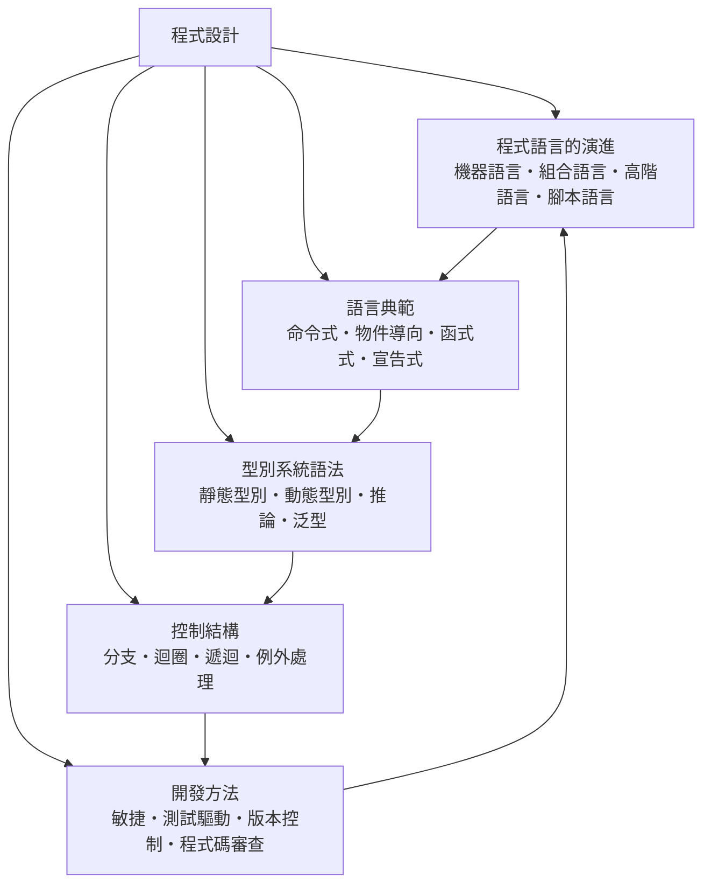

# 程式設計

> 隸屬：第一層 [工]　·　相關分類：[電腦]、[演算法]、[軟體工程]、[資訊安全]　·　子分類總表見 [README]

> 對應維基百科：[中文維基百科：程序设计](https://zh.wikipedia.org/wiki/%E7%A8%8B%E5%BA%8F%E8%AE%BE%E8%AE%A1)　·　[English Wikipedia: Computer programming](https://en.wikipedia.org/wiki/Computer_programming)

程式設計是**把解決問題的思路轉換成機器可執行指令的活動**：它位於演算法與電腦硬體之間，一邊把 [演算法] 的抽象步驟落實成具體語句，一邊把這些語句交給 [電腦] 執行。「程式」一詞的雙關在此顯現——它既是一份給機器的食譜，也是一份給人閱讀與修改的文件。因此程式設計永遠同時面對兩個讀者：不會犯錯也不會通融的處理器，以及會誤解、會疲勞、會離職的人類同事。

## 核心問題

程式設計的核心問題可以濃縮成一句話：**如何讓人腦可掌握的寫法，對應到機器可正確執行的行為**。這個對應包含三層：

1. **語意層**：寫出來的程式「想做什麼」必須與「實際做什麼」一致；語言的型別系統、範式與控制結構都是為了縮小這個落差。
2. **抽象層**：從機器語言到高階語言，每一層抽象都犧牲一點控制力，換取大量的人類生產力；選擇抽象層級就是選擇付出什麼代價。
3. **過程層**：程式不是一次寫完的，它會被閱讀、修改、測試與協作；版本控制、測試驅動與程式碼審查都是讓「過程」本身可靠的技術。

一個可作為量尺的觀察：現代 CPU 一秒可執行數十億條指令，但人類一年只能可靠地寫出數萬行程式碼。程式設計的全部歷史，就是設法放大「人類每小時產生的有效指令數」、同時壓低「每千行程式碼的錯誤數」的歷史。

## 因果鏈

1. **硬體只認機器語言**：最早的程式師直接以二進位與打孔卡下指令，在 1940 年代寫一個程式需數天且極易出錯；瓶頸在「人寫二進位」。
2. **組合語言與符號化**：把機器碼換成人類可讀的助記符號（如 `ADD`、`LOAD`），以組譯器自動翻譯；[葛麗斯·霍普] 等先驅證明了「讓機器替程式師翻譯」可行。
3. **高階語言問世**：[1957年] Fortran 證明編譯器能產生接近手寫組合語言效率的程式碼，從此「描述要做什麼」取代「指揮每一步」；同一時期 [愛達] 世紀前的設想——以符號描述演算法——終於落地。
4. **範式分化**：不同問題催生不同寫法。[丹尼斯·里奇] 的 C（[1972年]）把結構化命令式推向極致，[麥卡錫] 的 Lisp 則把函式與符號運算變成第一等公民；物件導向隨後把「狀態與行為綁在一起」以馴服大型系統的複雜度。
5. **型別系統承擔正確性**：隨著程式規模成長，「編譯期就抓錯」的價值浮現；靜態型別、型別推論與泛型讓語言在「嚴格檢查」與「書寫簡潔」之間取得工程折衷。
6. **開發成為團隊活動**：個人寫程式升級為數十人協作後，錯誤的代價從「自己重寫」變成「拖垮整條生產線」；版本控制、程式碼審查、測試驅動與敏捷方法把工程實務制度化，與 [軟體工程] 的流程觀點接軌。
7. **抽象仍在增加**：腳本語言、雲端平台與 AI 輔助編程持續墊高抽象層；但每一層新抽象都需要被檢驗——效能、安全與可維護性——於是 [資訊安全] 與演算法複雜度的考量被拉回語言設計本身。

## 子分類的定位與相互驅動



- [程式語言的演進] 是**縱軸**：它記錄抽象層如何一層層墊高，也解釋為什麼今天的語言長成現在這個樣子。
- [語言典範] 是**橫軸**：同一個問題可以有命令式、物件導向、函式式與宣告式四種寫法；典範決定了程式的基本「形狀」。
- [型別系統語法] 是**正確性的第一道防線**：型別檢查在程式執行之前就攔截一整類錯誤，是典範與控制結構得以安全組合的基礎。
- [控制結構] 是**行為的最小積木**：分支、迴圈、遞迴與例外處理決定了程式的實際執行路徑，任何典範最終都要落到它們（或其等價物）上。
- [開發方法] 是**人的組織術**：當程式超出單人腦容量，方法論決定團隊能否持續交付；它反過來影響語言與工具的設計（例如為版本控制與持續整合而生的語言生態）。

## 範例：同一個問題的三種寫法

**問題**：計算清單中所有正數的平方和。

**命令式（Python 迴圈）**：

```
def sum_of_squares(nums):
    total = 0
    for x in nums:
        if x > 0:
            total = total + x * x
    return total
```

**函式式（宣告意圖，交給組合子）**：

```
def sum_of_squares(nums):
    return sum(x * x for x in nums if x > 0)
```

**SQL（完全宣告式，只描述「要什麼」）**：

```
SELECT SUM(x * x) FROM numbers WHERE x > 0;
```

三個版本共用同一個 [演算法]（單趟掃描、時間複雜度 $O(n)$ ），但抽象層級遞增：第一個版本手動管理狀態 `total` 與控制流程，第二個版本把「過濾—映射—聚合」交給語言組合，第三個版本只聲明結果的性質，由查詢引擎決定怎麼算。這正是本分類五個子分類在單一例子中的縮影：語言的演進提供了這些寫法，典範決定了它們的形狀，型別系統保證 `x * x` 的運算有意義，控制結構是第一種寫法的骨架，而選擇哪種寫法、如何讓團隊維護它，則是開發方法的課題。

## 容易混淆之處

- **程式設計不等於軟體工程**：前者聚焦「怎麼把想法變成可執行程式」，後者聚焦「怎麼在時間與預算內交付整個系統」；兩者的分工可見 [軟體工程]。
- **程式設計不等於演算法**：演算法是思路，程式是實作；同一個演算法在不同語言與典範下的實作品質可以天差地遠。
- **語法不等於語意**：兩段語法不同的程式可以有相同語意；反之，語法相近的程式（如 C 的 `=` 與 `==`）語意可能完全不同。
- **「會寫」不等於「寫得好」**：可執行只是及格線；可讀性、可測試性與錯誤處理品質才是工程水準的分界。
- **動態型別不等於沒有型別**：Python 的值在執行期同樣有型別，差別只在「何時檢查」。

## 延伸閱讀

- [電腦]：指令集與記憶體模型決定了語言抽象的下限。
- [演算法]：程式承載的內容；效率的理論分析在此。
- [軟體工程]：當程式成為產品，流程與品質管理接管。
- [資訊安全]：緩衝區溢位、注入攻擊都源自語言與執行環境的弱點，安全編碼是程式設計的一部分。
- [數學]：型別理論、λ 演算與語意學的理論根據。

## 連結定義

[工]: ../工/README.md
[電腦]: ../電腦/README.md
[演算法]: ../演算法/README.md
[軟體工程]: ../軟體工程/README.md
[資訊安全]: ../資訊安全/README.md
[README]: README.md
[葛麗斯·霍普]: ../人/工程師/葛麗斯·霍普.md
[1957年]: ../時/1957年.md
[愛達]: ../人/數學家/愛達.md
[丹尼斯·里奇]: ../人/工程師/丹尼斯·里奇.md
[1972年]: ../時/1972年.md
[麥卡錫]: ../人/數學家/麥卡錫.md
[程式語言的演進]: 程式語言的演進.md
[語言典範]: 語言典範.md
[型別系統語法]: 型別系統語法.md
[控制結構]: 控制結構.md
[開發方法]: 開發方法.md
[數學]: ../數學/README.md
