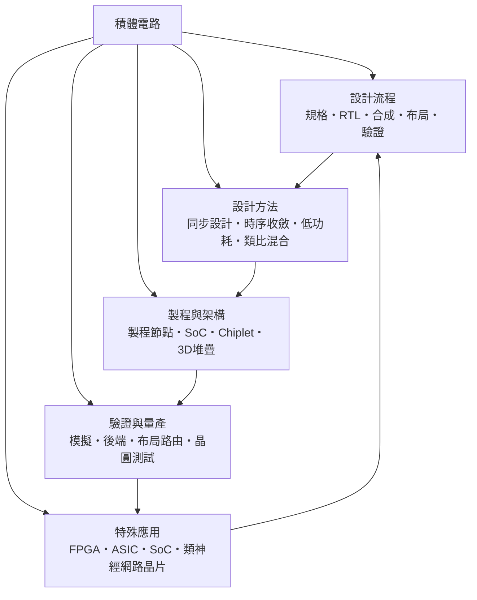

# 積體電路

> 隸屬：第一層 [工]　·　相關分類：[半導體]、[電子工程]、[設計]、[程式設計]　·　子分類總表見 [README]

> 對應維基百科：[中文維基百科：積體電路](https://zh.wikipedia.org/wiki/%E9%9B%86%E6%88%90%E7%94%B5%E8%B7%AF)　·　[English Wikipedia: Integrated circuit](https://en.wikipedia.org/wiki/Integrated_circuit)

積體電路是把**大量電子元件與互連線製作在同一塊半導體晶片上**的技術。一顆現代手機 SoC 內含兩百億顆以上的電晶體，彼此以數奈米寬度的金屬層相連；這種密度之所以可能，是因為製程讓「最小的線寬」與「最小的電壓」同步下降，讓每個電晶體既更小也更省電。積體電路的本質，是**把複雜度從「人工焊接的硬體」轉移成「可複製的製程」**。

這門技術的歷史可以濃縮成兩次躍遷。第一次是 1958 年 [基爾比] 提出「把整個電路的元件做在同一塊材料上」的想法，並在同年製出 [ENIAC] 之前時代難以想像的平面積體電路；第二次是 1960 年代 [諾伊斯] 把「平面製程」與「積體化」結合，使元件與連線都能在同一片晶圓上完成——從此積體電路可以用照相製版大量複製，成本與體積同時崩落。[摩爾] 隨後觀察到的「元件數每兩年翻倍」趨勢，使整個產業鎖定在縮微路線上。

今天的積體電路設計是一種**多目標最佳化**：功能正確、時序收斂、功耗達標、面積夠小、良率可接受、驗證充分，六個條件缺一不可。單純把功能寫出來只完成六分之一；真正的難點在於，面對數十億顆電晶體，人類無法逐顆思考，必須用硬體描述語言、合成工具與形式驗證把「人的直覺」轉成「機器可檢查的證據」。

## 核心問題

1. **如何把想法變成可製造的幾何**：工程師描述的是行為（加法器、狀態機、協定），晶圓上卻是幾何圖形。[設計流程]的每一步——規格、RTL、合成、布局、驗證——都是為了完成這項翻譯。
2. **如何在數千個模組間維持一致**：晶片規模從數千閘門成長到數百億電晶體，人類無法靠逐模組檢查確保正確。[設計方法]提供同步設計、時序收斂與低功耗等紀律，把錯誤率壓在可管理範圍。
3. **如何在有限的面積與散熱能力下容納更多功能**：這推動了[製程與架構]的演進——從單一 SoC 到模組化的 Chiplet 與三維堆疊，用封裝與堆疊取代純粹的平面縮微。
4. **如何在量產前確定它會工作**：模擬、後端布局路由與晶圓測試構成[驗證與量產]的防線，確保設計在真實矽片與真實製程變異下仍然正確。
5. **何時該做 ASIC、何時該用 FPGA**：成本、上市時間、功耗與可修改性互相拉扯，這是[特殊應用]的判斷核心。

## 因果鏈

1. **真空管的體積障礙**：1940 年代最強大的計算機仍需數萬顆真空管體積龐大、發熱驚人，散熱與維護成本成為瓶頸。
2. **電晶體取代真空管**：1947 年點接觸電晶體問世，開關與放大功能被壓進單一固體元件，尺寸與功耗同時下降兩個數量級。
3. **平面製程**：[諾伊斯] 證明可以在矽表面形成氧化層隔離區域，讓平面電晶體與金屬互連可同時製造，為「把整個電路做在一起」鋪平道路。
4. **積體化的提出與實踐**：[基爾比] 在 1958 年提出單片積合所有元件的想法並做出實作，同年 [ENIAC] 的電子計算機顯示市場對小型高速計算的強烈需求。
5. **CMOS 成為預設**：互補金屬氧化半導體的靜態功耗近乎為零，使得同一片晶片上整合數百萬閘門在熱與電力的角度上變得可行，微處理器因此誕生。
6. **系統單晶片的整合**：把 CPU、記憶體控制器、週邊與加速器整合為單一 SoC，減少晶片數與封裝成本，同時縮短片間互連延遲。
7. **縮微逼近物理極限**：當金屬互連寬度小於電子平均自由徑後，電阻與漏電急遽上升，純平面縮微不再能帶來等比例效益，於是轉向 FinFET、環狀閘極與高介值材料。
8. **異質整合取而代之**：Chiplet 與三維堆疊允許不同製程節點的裸片互接，AI 加速器則以數千顆核心追求吞吐量——積體電路從「一個晶片」演化成「一個系統」。

## 子分類的定位與相互驅動

- [設計流程]是**骨架**：定義從想法到晶圓的每一步交接物，每一步的輸出都是下一步的輸入，也是除錯時的第一個問題「這是流程哪一階段的錯」。
- [設計方法]是**紀律**：同步設計與時序收斂規則讓數百億電晶體的行為可預測；低功耗設計把電池容量這個物理限制帶進架構決策。
- [製程與架構]是**物理極限的回應**：當縮微不再線性回報，改用多核心、專用加速器、Chiplet 與堆疊來換取效能。
- [驗證與量產]是**現實的裁判**：模擬找不出所有錯誤，只有把設計放進製程變異與真實封裝中測試，才能知道它是否可用。
- [特殊應用]是**需求的形狀**：ASIC、FPGA、SoC 與類神經網路晶片各自對應不同的市場條件，市場條件又回頭決定設計方法與製程選擇。

## 範例

**範例一：動態功耗預算。** 一個 3 GHz 頻率、供電電壓 $V_{DD} = 0.8$ V 的 CPU 核心，若每個節點的有效電容為 $C = 20$ fF、切換活動率 $\alpha = 0.1$ 、切換頻率等於時脈頻率，單一節點的動態功耗為

$$
P = \alpha C V_{DD}^{2} f = 0.1 \times 20 \times 10^{-15} \times 0.8^{2} \times 3 \times 10^{9} \approx 3.8 \ \mu \text{W}
$$

若核心有一百萬個節點，總功耗約為 3.8 W——這說明為什麼降低供電電壓如此有效：功耗與電壓平方成正比，電壓從 1.0 V 降到 0.8 V 就能省下 36% 的動態功耗。

**範例二：以缺陷密度估良率。** 假設某製程在 $300$ mm 晶圓上的致命缺陷密度為 $0.1$ 個/cm²，晶圓面積約 $706$ cm²，則單片晶粒若面積為 $1$ cm²，其缺陷數期望值約 $0.1$ ，Poisson 模型給出良率

$$
Y = e^{-D_0 A} = e^{-0.1 \times 1} \approx 90.5\%
$$

良率每提高幾個百分點，對數十億顆晶片的產品而言，就是數十億顆晶粒的差額，這解釋了為什麼良率是晶圓廠最核心的經營指標。

**範例三：SoC 的面積分配。** 一顆 5 nm 手機 [SoC] 總面積約 100 mm²，其中 CPU 大核集群約 15 mm²、GPU 約 20 mm²、類神經網路加速器約 15 mm²、記憶體控制器與介面約 10 mm²、其餘為類比、電源管理與填充單元。這種面積分配反映的是市場需求而非技術極限：哪一塊功能最常被使用，哪一塊就該分到更多矽。

## 容易混淆之處

- **製程節點不等於線寬**：「5 nm」是行銷世代名稱，最小金屬間距或鰭寬可能與之相當，但真實數字須看製程設計套件的實際尺寸；不同廠家的同一節點名稱並不等價。
- **時脈頻率不等於效能**：現代處理器靠多核心、寬 SIMD、快取與專用加速器提升效能，單看 GHz 會誤判。
- **SoC 不等於「把所有東西都塞進去」**：整合的前提是各模組之間的介面清晰、驗證充分；盲目整合會讓隔離與除錯變得困難。
- **FPGA 不等於「較慢的 ASIC」**：FPGA 的價值在於可重程式與上市時間， ASIC 的價值在於長期大量生產時的單位成本與能效。
- **類比電路不會自動變好**：數位電路隨製程縮微而加速，類比電路的性能卻受限於雜訊、失真與匹配；這是類比混合訊號設計仍留在大製程節點的原因。
- **驗證通過不等於設計正確**：驗證只能覆蓋被寫進去的假設與激發情境，未建模的環境（實際通道、時序擾動、製程變異）才會在量產後現形。

## 延伸閱讀

- [半導體]：積體電路的材料與製程基礎，含能帶、摻雜、光刻與良率。
- [電子工程]：元件與電路設計，是積體電路設計的語言。
- [設計]：把功能與體驗需求轉為可實作規格的方法。
- [程式設計]與[演算法]：硬體描述語言與演算法映射，決定效能上限。
- [人工智慧]：類神經網路晶片與專用加速器的需求來源。
- [精密儀器]：量測與校準技術，支撐晶片測試與製程監控。
- [資訊安全]：硬體層的信任根，是安全晶片與防側通道設計的基礎。

## 連結定義

[工]: ../工/README.md
[README]: README.md
[半導體]: ../半導體/README.md
[電子工程]: ../電子工程/README.md
[設計]: ../設計/README.md
[程式設計]: ../程式設計/README.md
[演算法]: ../演算法/README.md
[人工智慧]: ../人工智慧/README.md
[精密儀器]: ../精密儀器/README.md
[資訊安全]: ../資訊安全/README.md
[設計流程]: 設計流程.md
[設計方法]: 設計方法.md
[製程與架構]: 製程與架構.md
[驗證與量產]: 驗證與量產.md
[特殊應用]: 特殊應用.md
[SoC]: SoC.md
[基爾比]: ../人/工程師/基爾比.md
[諾伊斯]: ../人/工程師/諾伊斯.md
[摩爾]: ../人/工程師/摩爾.md
[ENIAC]: ../物/ENIAC.md
