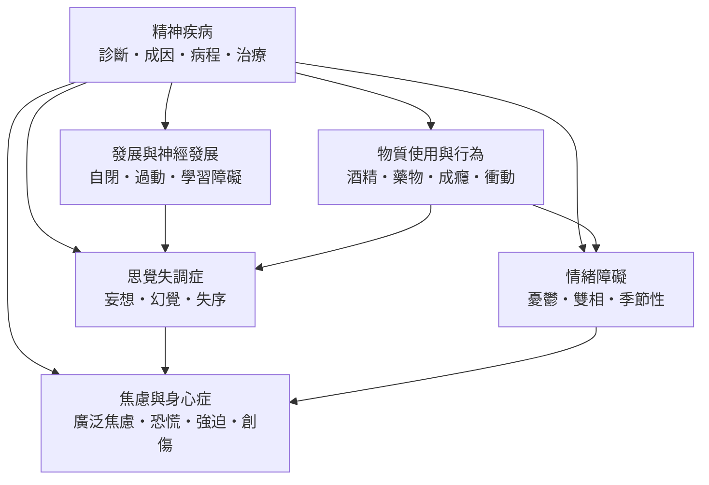

# 精神疾病

> 隸屬：第一層 [醫]　·　相關分類：[精神醫學]、[心理治療]、[神經科學]　·　子分類總表見 [README]

> 對應維基百科：[中文維基百科：精神疾病]　·　[English Wikipedia: Mental disorder]

精神疾病（或稱精神障礙）是**在思考、情緒、行為或人際功能上出現臨床上顯著的干擾，且通常伴隨痛苦或功能損害的一群狀況的總稱**。它不是一種病，而是一張分類地圖：診斷手冊（如 DSM 與 ICD 體系）依症狀群集把它切成數百個類別，本概念再把這張地圖整理成五大區——思考障礙（[思覺失調症]）、情緒障礙、焦慮與身心症、發展與神經發展、物質使用與行為。每個區塊的成因、病程與治療邏輯都不同，共用同一張地圖只是為了讓臨床溝通與研究累積成為可能。

因此，理解精神疾病的第一課是**理解診斷是什麼、不是什麼**：診斷是症狀的組合描述，不是病因的證明；大多數精神疾患沒有單一的生物學檢驗可以確診，診斷的可靠性（不同醫師得出同一結論）遠好於其病因學的明確性。這個落差既是當代精神醫學最大的批評來源，也是神經科學與遺傳學持續投入的理由。

本概念的問題是：**一群曾經被當作道德缺陷、被監禁或被忽視的狀況，如何被命名、被分類、被研究，並逐步獲得治療與權利**。

## 核心問題：診斷的門檻在哪裡

精神疾病的核心難題是**連續與斷點**：憂鬱、焦慮、幻聽樣的體驗在一般人口中呈連續分布，診斷卻必須在連續體上畫一條線。畫線的依據不是症狀的有無，而是三個條件的組合：

1. **症狀群集**：一定的症狀在一定的時間內同時或先後出現（例如憂鬱症要求九項症狀中至少五項、持續兩週以上）。
2. **功能損害**：症狀干擾工作、學業、人際或自我照顧——**痛苦但不失功能與失功能但不自覺，都會落在這個判準的邊界案例裡**。
3. **排除其他解釋**：甲狀腺功能異常、物質作用、腦瘤等身體原因必須先排除。

這個結構解釋了為什麼精神疾病總有灰色地帶，也解釋了為什麼診斷會隨版本改變——線是依臨床實用與研究共識畫的，不是從病因裡讀出來的。

## 因果鏈

1. **收容與監禁時代**：十八世紀以前，精神異常者多被收容在救濟院或被鎖鏈拘束；疾病沒有分類，只有「瘋」與「不瘋」。**沒有命名，就沒有治療可言**。

2. **分類的起點**：十九世紀，法國與德國的精神醫學先驅開始區分不同臨床型態——早發性癡呆（後來的思覺失調症）、躁鬱症與妄想症的三角區分，使「同一間病房裡住著不同的病」第一次被看見。

3. **佛洛伊德與心因性解釋的高峰**：二十世紀上半葉，精神分析把精神疾病解釋為心理衝突的結果，影響遠超治療室——那個時代連精神分裂症都被歸因於母親的教養方式，家屬背負了數十年的錯誤指責。

4. **生物精神醫學的翻轉（1950–1970 年代）**：第一代抗精神病藥物與抗憂鬱劑偶然問世並被證實有效，藥理發現回頭建立疾病的生物學假設（多巴胺假說、單胺假說）；去機構化運動同時把長期住院的病患送回社區。**藥效第一次戰勝了理論的權威**。

5. **診斷標準的操作化（1980 年）**：DSM-III 以明確的症狀清單取代曖昧的理論描述，讓不同醫師對同一病人可以得出相同診斷；診斷信度大幅提升，精神疾病的研究與藥物試驗從此有了共同的對象定義。

6. **神經科學與遺傳學的滲透（1990 年代至今）**：腦造影、基因體研究與大規模流行病學揭示了風險基因、腦網路異常與環境壓力的交互作用；同時也證實**大多數疾患沒有單一病因、診斷類別與生物學邊界不完全重合**。

7. **復元模式與去污名**：病人權利運動與復元模式（recovery model，強調有希望、有意義的生活，而不只是症狀消除）改變了治療目標的定義；精神疾病的污名本身被確立為一種健康危害。

8. **當代的整合挑戰**：共病率高（一個人同時符合多個診斷）、類別之間界線模糊，催生了像「研究領域標準」（RDoC）這樣跳過診斷類別、直接以神經行為維度研究的精神病理學新框架——分類地圖仍在重畫。

## 子分類的定位與相互驅動

- [思覺失調症] 是**思考與現實檢驗的障礙**：妄想、幻覺與思考失序使它成為精神疾病中最核心也最被污名的類別；它的生物學研究（多巴胺假說）是整個生物精神醫學的模範，它的社會處遇（去機構化、復元模式）則是整個領域倫理爭論的震央。
- [情緒障礙] 是**最常見、最可治的區塊**：憂鬱症與雙相情緒障礙的人口盛行率高，且藥物與心理治療的證據都成熟；它也是共病樞紐——焦慮與物質使用常與憂鬱同行。
- [焦慮與身心症] 是**警報系統的失靈**：焦慮本身是正常的生存機制，疾患化在於警報過度、錯誤或無法關閉；身心症則提醒我們，心理與身體的界線在症狀層級本來就是連續的。
- [發展與神經發展] 是**從兒童看見的病理**：自閉症與注意力不足過動在生命早期就顯現，改寫了「精神疾病是成年期疾病」的預設；它們的診斷爭議（擴張的盛行率、神經多樣性觀點）也最能代表分類的社會性。
- [物質使用與行為] 是**行為也能成癮的證據**：從酒精、藥物到賭博，成癮的腦迴路機制相通；它與情緒障礙互為因果——自我用藥與雙向惡化的螺旋是臨床最常見的複合案情。

## 範例：一個診斷背後的三層結構

以「28 歲女性，三個月來每天情緒低落、早醒、食慾差、無法專注工作」為例，看診斷如何被建立與使用：

1. **症狀清單層**：對照憂鬱症的九項症狀——低落情緒、興趣喪失、失眠、食慾改變、精神動作遲滯、疲倦、無價值感、專注力差、自殺念頭——她符合六項且超過兩週。**清單通過，診斷只是「可能」**。
2. **排除層**：甲狀腺功能檢查、藥物史與物質篩檢皆正常——排除了身體病因。這一步常被省略，卻是診斷可靠性的底線。
3. **脈絡層**：進一步會談發現，三個月前她的婚姻結束，且症狀在飲酒後加重。診斷仍指向憂鬱症，但治療計畫必須同時處理酒精使用與失落——**診斷是起點，不是個案的完整描述**。
4. **治療與預後層**：藥物與心理治療並行；四至六週後症狀過半改善屬預期。若兩種抗憂鬱劑足量治療仍無效，則重新檢查診斷（是否為雙相？）——**治療反應本身是診斷的回饋訊號**。
5. **回頭看整層結構**：同一份資料，[情緒障礙] 類別處理診斷與藥物、[焦慮與身心症] 檢查共病、[物質使用與行為] 處理飲酒、[心理治療] 提供介入。**五大子分類不是五種病，而是同一張地圖上不同的放大鏡**。

## 容易混淆之處

- **精神疾病不等於「想不開」**：疾患有生物、心理與社會多層成因，意志力不是治療手段；「振作一點就好」對重度憂鬱如同對骨折說「走兩步就好」。
- **診斷不等於病因**：DSM 類別描述症狀群集，不保證類別內成因一致；兩個同診斷的人可能有不同的病程與最佳治療。
- **人格不等於人格疾患**：後者要求長期、跨情境、僵化且造成損害的模式，不是「個性古怪」。
- **情緒起伏不等於雙相情緒障礙**：診斷需要明確的躁期或輕躁期證據；把情緒波動診斷為雙相會導致不必要的情緒穩定劑使用。
- **污名不等於事實**：思覺失調症的暴力風險被大眾高估——患者更常是暴力的受害者而非加害者；物質使用才是暴力行為更強的關聯因子。
- **盛行率上升不等於「病越來越多」**：診斷標準擴張、覺察提高與求助率上升都是成因，不能直接讀成生物學上的流行。

## 延伸閱讀

- [精神醫學]：診斷與治療的主管學科。
- [心理治療]：非藥物介入的技術體系。
- [神經科學]：精神病理的腦機制研究。
- [遺傳學]：風險基因與基因環境交互作用。
- [流行病學]：盛行率、發生率與危險因子的測量方法。
- [公共衛生]：去污名、預防與心理健康政策的場域。

## 連結定義

[醫]: ../醫/README.md
[README]: README.md
[精神醫學]: ../精神醫學/README.md
[心理治療]: ../心理治療/README.md
[神經科學]: ../神經科學/README.md
[遺傳學]: ../遺傳學/README.md
[流行病學]: ../流行病學/README.md
[公共衛生]: ../公共衛生/README.md
[思覺失調症]: 思覺失調症.md
[情緒障礙]: 情緒障礙.md
[焦慮與身心症]: 焦慮與身心症.md
[發展與神經發展]: 發展與神經發展.md
[物質使用與行為]: 物質使用與行為.md
[中文維基百科：精神疾病]: https://zh.wikipedia.org/wiki/%E7%B2%BE%E7%A5%9E%E9%9A%9C%E7%A2%8D
[English Wikipedia: Mental disorder]: https://en.wikipedia.org/wiki/Mental_disorder
