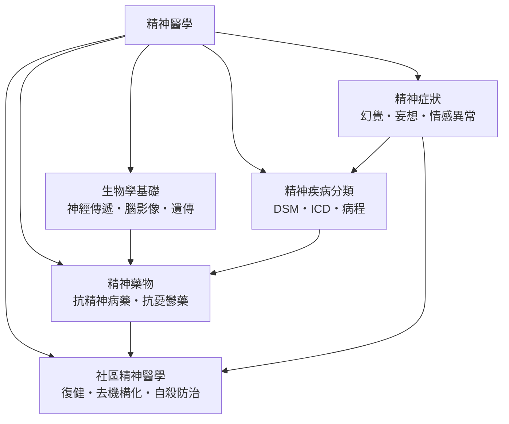

# 精神醫學

> 隸屬：第一層 [醫]　·　相關分類：[心理學]、[神經科學]、[藥理學]　·　子分類總表見 [README]

> 對應維基百科：[中文維基百科：精神医学](https://zh.wikipedia.org/wiki/%E7%B2%BE%E7%A5%9E%E7%97%85%E5%AD%A6)　·　[English Wikipedia: Psychiatry](https://en.wikipedia.org/wiki/Psychiatry)

精神醫學是**以醫學的方式研究、診斷、治療與預防精神疾病的臨床專科**。它處理的對象包括思覺失調、情感疾患、焦慮症、物質使用障礙與失智症等；它的核心問題不是「這個人性格好不好」，而是：**當一組主觀經驗與行為變化持續造成痛苦或功能損害時，醫學上有什麼證據基礎的分類、解釋與處置可以幫助這個人**。

因此，精神醫學與神經學、心理學的分界不在「病是真的還是想出來的」，而在**證據與工具**：神經學以病灶與檢查定位腦損傷，心理學以測驗與實驗研究行為歷程，精神醫學則必須在兩者之間工作——它既要做出可溝通、可比較的臨床診斷，又要在缺乏單一生物標記的現況下，承擔治療決策的責任。這條界線一旦劃定，帶來的是長期的張力：診斷必須夠穩定才能研究，但症狀本身卻連續分布在正常與異常之間。

本概念的問題是：**一門治療「看不見病灶」的醫學專科，如何從收容所的管理技術，長成有分類系統、有藥物、有社區處置網絡的現代臨床學科**。

## 核心問題：沒有檢驗單的診斷

精神醫學的核心問題可以拆成三個層次：

1. **診斷的層次**：多數精神疾病目前沒有像血糖、白血球那樣的確定檢驗。診斷依賴**症狀組合、病程與功能影響**的操作性定義。**診斷不是解釋，只是溝通與研究的座標**。
2. **治療的層次**：[精神藥物]、心理治療與社會復健各有證據與極限。治療決策必須在「症狀改善」與「副作用、生活品質」之間權衡，而不是把數值壓到正常範圍。
3. **倫理的層次**：精神疾病可能影響判斷力，因此非自願治療、危險評估與病人自主構成精神醫學特有的倫理難題。**權力的正當性來自程序，不來自診斷名稱**。

三層的順序也不能顛倒：先有穩定的分類，治療效果才能被比較；先有對副作用的誠實處理，治療關係才能維持；先有倫理程序，任何處置才有正當性。

## 因果鏈

1. **收容所時代的瓶頸（18 世紀前）**：精神失常者多被監禁、鎖鏈或當作道德墮落處理。**瓶頸是：沒有人把「瘋狂」當作可以被醫學對待的對象**。

2. **皮內爾解鎖（[1793年]）**：法國醫師 [皮內爾] 主張精神失常是疾病而非罪惡，將病人自鎖鏈中解放，建立以觀察與照護為基礎的處置。**精神病人第一次成為醫學照顧對象**，道德治療（moral treatment，即以規律生活、工作與尊重為主的照護）成為早期療法。

3. **克雷佩林的疾病分類（19 世紀末）**：德國醫師 [克雷佩林] 以長期追蹤的方式，把症狀各異的病人按**病程與預後**分成「早發性失智」（後來的思覺失調）與「躁鬱精神病」等類別。**診斷從描述症狀升級為預測病程**，這是現代 [精神疾病分類] 的起點。

4. **布洛伊勒與心理層次的引入（20 世紀初）**：瑞士醫師 [布洛伊勒] 提出「思覺失調」一詞，強調思考、情感與行為的「分裂」，並描述正性症狀與負性症狀；同時期 [佛洛伊德] 的精神分析把心理動力帶進精神醫學。**解釋的層次打開了，但生物治療仍近乎空白**。

5. **軀體治療與第一代藥物（1930–1950 年代）**：電痙攣治療、胰島素昏迷與腦額葉手術在缺乏替代方案的年代被嘗試；[1952年] 氯丙嗪（chlorpromazine，第一種抗精神病藥）在法國被用於精神病人並顯著減少躁動與幻覺。**「藥物能改變精神症狀」從此成為可重複的事實**，住院人口開始下降。

6. **去機構化與 [社區精神醫學]（1960–1980 年代）**：藥物、人權思潮與財政壓力共同推動關閉大型精神病院，病人回到社區接受門診與復健服務。**治療場域的遷移逼出新的瓶頸：社區資源與追蹤體系必須跟上**。

7. **操作性診斷與 DSM-III（[1980年]）**：美國《精神疾病診斷與統計手冊》第三版採用明確的症狀清單、病程與排除條件，診斷信度大幅提升。**精神醫學獲得共同語言**，臨床試驗與流行病學研究得以大規模累積。

8. **生物精神醫學與精準化挑戰（1990 年代至今）**：腦影像、遺傳學與神經傳遞研究擴張了 [生物學基礎] 的知識，但也暴露「診斷類別不等於生物實體」的問題；研究轉向症狀維度、大數據與早期介入。**分類的下一步是承認連續性，而非加固邊界**。

## 子分類的定位與相互驅動

- [精神疾病分類] 是**座標系**：它把紛雜的臨床表現整理成可溝通的類別與病程描述。分類的每次修訂都會改變研究的收案條件、保險給付與流行病學數字；**沒有分類，其他子分類的結論無法累積**。

- [精神症狀] 是**觀察層**：幻覺、妄想、情感異常等症狀是診斷的原料，也是跨診斷研究的對象。症狀描述越精確，分類與治療試驗的信號就越乾淨；**症狀層的精緻化是分類改革的前置工程**。

- [生物學基礎] 是**解釋層**：神經傳遞、遺傳與腦影像研究試圖回答「為什麼這些藥有效、為什麼有人發病」。它的每項發現都回頭檢驗分類邊界，並推動 [精神藥物] 的標靶開發；反過來，藥物的作用機轉本身就是最強的生物學線索。

- [精神藥物] 是**介入層**：1950 年代以降的藥物使大規模門診治療成為可能，直接促成去機構化。副作用管理則決定病人是否願意長期服藥；**藥物的可用性重塑了整個照護地理**。

- [社區精神醫學] 是**出口與承接層**：藥物讓病人能離開醫院，社區體系決定他們離開之後過得好不好。復健、危機處理與自殺防治把生物治療的成果轉為生活功能；**社區照護的失敗會立刻以再住院與流浪的形式回頭懲罰整個系統**。

## 範例：一位首次發病的年輕人走完五個子分類

以「一位 22 歲大學生連續一個月聽見批評他的聲音、逐漸不去上課」為例：

1. **先由 [精神症狀] 做觀察**：晤談確認「聲音」是聽幻覺（無外部聲源下知覺到聲音）、內容為批評性；並評估是否有被害 [妄想]、動機下降等負性症狀。**症狀清單先於任何診斷名稱**。
2. **再由 [精神疾病分類] 定座標**：對照 DSM 的思覺失調準則——症狀項目、持續時間（六個月）、功能下降與排除物質因素——做出初步診斷，並記錄病程分期。
3. **由 [生物學基礎] 提供背景**：家族史、物質篩檢與基本檢查排除甲狀腺或藥物造成的類似症狀；腦影像在此階段主要用於排除腫瘤等器質性病因，而非確診。
4. **由 [精神藥物] 啟動治療**：開立第二代抗精神病藥，說明可能的高泌乳素或代謝副作用；兩至四週評估幻覺強度變化，必要時換藥。
5. **由 [社區精神醫學] 接手長期**：症狀穩定後安排復健就學支持、家屬心理教育與危機聯絡管道，並把 [自殺防治] 評估納入每次回診。**前四步決定他「會不會好」，這一步決定他「過得好不好」**。

## 容易混淆之處

- **精神醫學不等於精神分析**：精神分析是解釋與治療傳統之一；現代精神醫學的主流是生物—心理—社會模式，分析式治療只是選項之一。
- **精神病（psychosis）不等於精神疾病（mental disorder）**：精神病指現實檢查受損的一組症狀；焦慮症等常見精神疾病並不含精神病症狀。
- **神經病是口語誤用**：中文口語的「神經病」常指精神疾病；醫學上神經學處理腦脊髓與周邊神經的器質病變，與精神醫學分工不同。
- **診斷有病不等於個案沒有聲音**：診斷是座標，不是身分；治療計畫必須納入病人的偏好與目標。
- **藥物有效不等於病因已解**：抗憂鬱藥改變血清素傳遞與「憂鬱就是血清素不足」並非同一命題；機轉與病因必須分開陳述。
- **去機構化不等於放生**：關閉醫院的目的是以社區服務替代；只關醫院不建社區，歷史上造成的是監獄與街頭的移置。

## 延伸閱讀

- [心理學]、[臨床心理學]：心理評量與心理治療的專業端，與精神醫學共享個案但分工不同。
- [心理治療]：非藥物介入的體系，與 [精神藥物] 構成治療的兩大支柱。
- [神經科學]：為 [生物學基礎] 提供基礎機制研究。
- [藥理學]：藥物動力學與受體藥理的方法學來源。
- [公共衛生]、[醫療衛生政策]：精神衛生體系、給付與去機構化政策的制度脈絡。
- [倫理學]：非自願治療、告知後同意與精神能力評估的倫理基礎。

## 連結定義

[醫]: ../醫/README.md
[README]: README.md
[心理學]: ../心理學/README.md
[神經科學]: ../神經科學/README.md
[藥理學]: ../藥理學/README.md
[臨床心理學]: ../臨床心理學/README.md
[心理治療]: ../心理治療/README.md
[公共衛生]: ../公共衛生/README.md
[醫療衛生政策]: ../醫療衛生政策/README.md
[倫理學]: ../倫理學/README.md
[精神疾病分類]: 精神疾病分類.md
[精神症狀]: 精神症狀.md
[生物學基礎]: 生物學基礎.md
[精神藥物]: 精神藥物.md
[社區精神醫學]: 社區精神醫學.md
[自殺防治]: 自殺防治.md
[妄想]: 妄想.md
[1793年]: ../時/1793年.md
[1952年]: ../時/1952年.md
[1980年]: ../時/1980年.md
[皮內爾]: ../人/醫學家/皮內爾.md
[克雷佩林]: ../人/醫學家/克雷佩林.md
[布洛伊勒]: ../人/醫學家/布洛伊勒.md
[佛洛伊德]: ../人/心理學家/佛洛伊德.md
