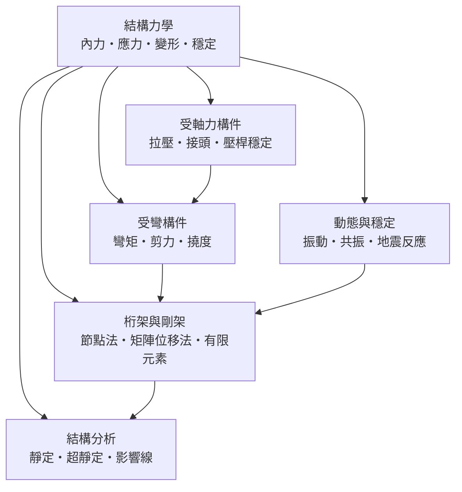

# 結構力學

> 隸屬：第一層 [工]　·　相關分類：[土木工程]、[力學]、[材料工程]、[橋樑]　·　子分類總表見 [README]

> 對應維基百科：[中文維基百科：結構力學](https://zh.wikipedia.org/wiki/%E7%BB%93%E6%9E%84%E5%8A%9B%E5%AD%A6)　·　[English Wikipedia: Structural mechanics](https://en.wikipedia.org/wiki/Structural_mechanics)

結構力學是研究**結構在載荷作用下的內力、應力與變形**的學科。建築物、橋梁、塔架、飛機機身——一切「要承受外力而自身不倒」的人造物，都必須先回答三個問題：內部各處的力有多大（內力分析）、材料會不會被壓壞或拉斷（強度）、結構會不會彎得太厲害甚至突然屈曲（剛度與穩定）。結構力學就是把這三個問題化為可計算的方程，是 [土木工程] 與機械、航空設計的共同地基。

它與 [力學] 的關係是「化約」與「落地」：力學給出質點與剛體的普遍定律，結構力學則把這些定律套到**有形狀、有截面、有接頭**的實際構件上，並引入材料的應力應變關係。因此結構力學站在理論力學與 [材料工程] 的交會處：沒有力學就寫不出平衡方程，沒有材料參數就算不出「多大的力會壞」。

## 核心問題

結構力學的核心可以壓縮成三組條件與一條判據。

1. **平衡**：結構上任一部分都必須滿足力與力矩的平衡。平面問題有三條平衡方程：
   $$
   \sum F_x = 0, \qquad \sum F_y = 0, \qquad \sum M = 0
   $$
   未知內力若不多於方程數，結構是**靜定**的，直接解方程即可；若超過，則是**超靜定**的，必須再引入變形條件。
2. **變形**：力會使構件伸長、彎曲、扭轉。應變 $\varepsilon = \frac{\Delta L}{L}$ 描述伸長率，胡克定律 $\sigma = E \varepsilon$ 把應力與應變用彈性模數 $E$ 連起來。變形條件正是解超靜定結構的鑰匙。
3. **材料**：應力達到屈服強度材料開始永久變形，達到極限強度便破壞；細長桿受壓時即使應力遠低於強度也可能突然側彎——這是穩定問題，歐拉臨界載荷 $P_{cr} = \frac{\pi^2 EI}{L^2}$ 給出判據。
4. **設計判據**：實際設計要求「應力 $\leq$ 容許應力」與「撓度 $\leq$ 容許撓度」同時成立，再乘上安全係數以覆蓋材料離散與載荷不確定性。

這四層的邏輯順序是：先能算出內力（平衡），才能換算應力（材料），才能判斷安全與變形（判據）；而當結構太複雜、方程解不動時，就逼出矩陣位移法與有限元素等數值方法。

## 因果鏈

1. **經驗匠藝的瓶頸**：古代的石橋、木塔靠比例與經驗傳承，尺寸一大就常失敗，且沒人能事先說出「為什麼」。
2. **伽利略的開端**：[1638年] [伽利略] 在《兩門新科學》中首次分析懸臂梁的強度，雖然應力分布的假設不精確，卻開啟了「用計算判斷構件會不會壞」的傳統。
3. **牛頓力學提供引擎**：[1687年] [牛頓] 的運動與平衡定律，使「取出一段構件、列平衡方程」成為標準程序，靜力學從此有嚴格基礎。
4. **材料力學成形**：18 世紀 [歐拉] 在 [1744年] 導出壓桿屈曲公式，19 世紀 [納維] 在 [1826年] 系統建立彈性體的應力應變理論，「力—應力—應變—破壞」的計算鏈條正式閉合。
5. **超靜定與數值化**：鋼構架與 [鋼筋混凝土] 的普及帶來大量超靜定結構，力法與位移法隨之成熟；20 世紀中葉矩陣位移法與計算機結合，發展出有限元素法，使任意形狀的結構都能算。
6. **動力問題登場**：[1940年] 塔科馬海峽橋在風中扭振崩塌，震醒工程界：靜力計算不夠，風振、地震反應與共振必須納入設計，結構動力學因此成為必修。
7. **規範化與監測**：計算能力加上事故教訓，催生了各國結構設計規範、載荷組合與安全係數體系；近年感測器使結構健康監測成為常規手段。
8. **現代推進**：預力混凝土讓長跨橋梁與高層建築成為可能；[防災工程] 把結構力學的地震反應分析推廣到隔震、制震設計；結構最佳化與數位孿生則是當前的研究前線。

## 子分類的定位與相互驅動

- [結構分析] 是**整體層**：把整座橋、整棟樓視為系統，判斷它是靜定還是超靜定、載重走哪條路徑，回答「結構作為一整體怎麼受力」；它為構件設計提供內力輸入。
- [受軸力構件] 是**最簡構件層**：拉桿與壓桿的應力與穩定問題，是所有分析的起點；歐拉屈曲公式使「細長桿受壓」從經驗禁忌變成可計算的臨界值。
- [受彎構件] 是**主力構件層**：梁與板靠彎曲承重，彎矩、剪力與撓度的計算決定了絕大多數樓板與橋梁的斷面尺寸；它與軸力問題組合，就涵蓋梁柱構件。
- [桁架與剛架] 是**組合層**：把構件組成桁架（只受軸力）或剛架（受彎受軸並存），節點法是手算起點，矩陣位移法與有限元素是計算機時代的通用解法，也回過頭把前兩層的構件公式變成元素剛度。
- [動態與穩定] 是**時間層**：載荷隨時間變化（風、地震、機器振動）時，靜力平衡不再足夠，必須分析固有頻率、共振與反應譜；塔科馬橋事件是它成為顯學的直接推手。

五者的先後是嚴格的：先會算單根桿件（軸力、彎矩），才能組成桁架與剛架；先會靜力分析，才談得上動力反應；結構分析則是貫穿各層的整體視角。

## 範例

**範例一：簡支梁的彎矩與撓度。** 一根長 $L = 6\,\mathrm{m}$ 的簡支梁，中央受集中載重 $P = 20\,\mathrm{kN}$ 。

- 支承反力各為 $P/2 = 10\,\mathrm{kN}$ 。
- 中央彎矩： $M = \frac{PL}{4} = \frac{20 \times 6}{4} = 30\,\mathrm{kN \cdot m}$ 。
- 若採用工字鋼截面模數 $S = 500\,\mathrm{cm^3}$ ，中央最大彎曲應力 $\sigma = \frac{M}{S} = \frac{30 \times 10^3\,\mathrm{N \cdot m}}{500 \times 10^{-6}\,\mathrm{m^3}} = 60\,\mathrm{MPa}$ ，遠低於鋼的屈服強度約 $250\,\mathrm{MPa}$ ，強度通過。
- 中央撓度： $\delta = \frac{PL^3}{48EI}$ 。取 $E = 200\,\mathrm{GPa}$ 、 $I = 4390\,\mathrm{cm^4}$ ，得 $\delta = \frac{20 \times 10^3 \times 6^3}{48 \times 200 \times 10^9 \times 4.39 \times 10^{-5}} \approx 0.010\,\mathrm{m} = 10\,\mathrm{mm}$ ，約為跨度的 $1/600$ ，在常見容許值 $1/250$ 至 $1/360$ 之內。

**範例二：壓桿的穩定檢核。** 同樣一根 $L = 3\,\mathrm{m}$ 兩端鉸接的鋼壓桿， $I = 4.39 \times 10^{-5}\,\mathrm{m^4}$ 。歐拉臨界載荷 $P_{cr} = \frac{\pi^2 EI}{L^2} = \frac{9.87 \times 200 \times 10^9 \times 4.39 \times 10^{-5}}{9} \approx 9.6\,\mathrm{MN}$ ；若改為兩端固定，有效長度減半（ $L_e = 1.5\,\mathrm{m}$ ），臨界載荷變成四倍，約 $38.5\,\mathrm{MN}$ 。這說明**接頭約束與長度是細長桿承壓能力的決定因素**，與材料強度無關。

**範例三：桁架的節點法。** 一個 3 公尺高、6 公尺長的三角形屋架，下弦中點受 $10\,\mathrm{kN}$ 向下載重。取中央節點為隔離體：上弦桿與豎桿的夾角為 $45^\circ$ ，由 $\sum F_y = 0$ 得豎桿壓力 $10\,\mathrm{kN}$ ，再由 $\sum F_x = 0$ 得上弦桿壓力 $10\,\mathrm{kN} \times \sqrt{2} \approx 14.1\,\mathrm{kN}$ 。一根桿件十秒可解，一整座桁架就是這樣逐節點推出來的——這正是節點法的價值。

## 容易混淆之處

- **結構力學與結構分析不是同一件事**：結構分析（把整體結構的內力算出來）只是結構力學的一部分；結構力學還包含材料強度、構件截面設計與穩定理論。
- **強度夠不代表穩定夠**：細長壓桿可能在應力遠低於屈服強度時屈曲破壞；強度問題看 $\sigma$ ，穩定問題看 $P_{cr}$ ，兩者要分別檢核。
- **靜定與超靜定的差別不在「複雜」而在「方程數」**：靜定結構用平衡方程即可解；超靜定結構必須加上變形相容條件，且其內力分布與構件剛度有關。
- **撓度與強度是兩個獨立判據**：梁可能強度足夠卻軟得讓人不敢走（撓度超限），也可能很硬但應力已接近屈服。
- **共振不是「振動變大」這麼簡單**：共振是外力頻率貼近固有頻率時反應持續放大的現象；避開頻率、增加阻尼或改變剛度都是對策，塔科馬橋敗在扭轉振動而非單純上下振動。

## 延伸閱讀

- [土木工程]：結構力學最主要的應用場域與上層行業。
- [力學]：牛頓定律與能量方法等理論基礎的來源。
- [材料工程]：鋼材、混凝土等材料的強度與應力應變參數。
- [橋樑]：結構力學最典型的綜合應用對象。
- [鋼筋混凝土]、[預力混凝土]：把計算結果化為實體的兩大材料體系。
- [防災工程]：地震反應分析與隔震、制震設計的應用出口。
- [伽利略]、[歐拉]、[納維]：結構強度與彈性理論的三位奠基者。

## 連結定義

[工]: ../工/README.md
[README]: README.md
[土木工程]: ../土木工程/README.md
[力學]: ../力學/README.md
[材料工程]: ../材料工程/README.md
[橋樑]: ../橋樑/README.md
[防災工程]: ../防災工程/README.md
[鋼筋混凝土]: ../物/鋼筋混凝土.md
[預力混凝土]: ../物/預力混凝土.md
[結構分析]: 結構分析.md
[受軸力構件]: 受軸力構件.md
[受彎構件]: 受彎構件.md
[桁架與剛架]: 桁架與剛架.md
[動態與穩定]: 動態與穩定.md
[伽利略]: ../人/物理學家/伽利略.md
[牛頓]: ../人/物理學家/牛頓.md
[歐拉]: ../人/數學家/歐拉.md
[納維]: ../人/工程師/納維.md
[1638年]: ../時/1638年.md
[1687年]: ../時/1687年.md
[1744年]: ../時/1744年.md
[1826年]: ../時/1826年.md
[1940年]: ../時/1940年.md
