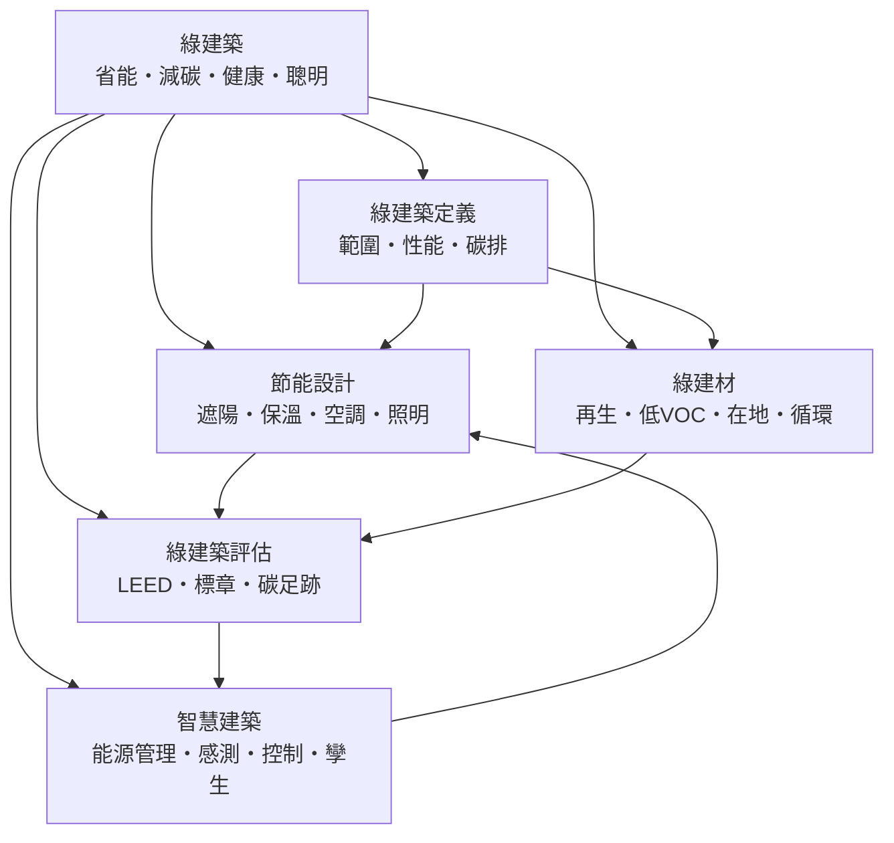

# 綠建築

> 隸屬：第一層 [工]　·　相關分類：[永續發展]、[建築設計]、[都市規劃]、[碳循環]　·　子分類總表見 [README]

> 對應維基百科：[中文維基百科：綠色建築](https://zh.wikipedia.org/wiki/%E7%B6%A0%E8%89%B2%E5%BB%BA%E7%AF%89)　·　[English Wikipedia: Green building](https://en.wikipedia.org/wiki/Green_building)

綠建築是**在建築的全生命週期裡，把消耗的資源與排出的汙染壓到最低，同時維持甚至提升居住品質**的建築實踐。它不是一種特定的建築風格，而是一組量化的設計目標：用電要少、用水要省、材料要可回收、室內要健康、營運要聰明。為了讓「綠不綠」可以被檢驗，綠建築發展出一整套評估體系——美國的 [LEED]、台灣的 [綠建築標章]——把抽象的環保理想轉換成可以打分數的指標。

換句話說，綠建築的核心不是「種很多樹的建築」，而是**被數據驗證過的省能、省水、減碳、健康建築**。一棟貼滿植物卻耗電驚人的大樓不是綠建築；一棟外牆樸素但全年空調電力只有同類建築一半的辦公樓，才是綠建築想做的事。

## 核心問題

綠建築要回答的問題，可以收斂成五個互相咬合的子問題。

1. **建築到底耗掉多少？** 建築部門約占全球最終能源使用的 30% 上下，加上營建產業，與建築相關的二氧化碳排放約占全球總排放的四分之一。要減碳，先要能**測量**：耗電量、耗水量、材料隱含碳，都是必須被量化的對象，這是 [碳排] 的核心。
2. **耗掉的能不能不耗？** 大部分的建築能耗來自空調與照明，而這兩者有相當比例可以被**設計**消滅：好的開窗與 [外遮陽] 能把日射擋在室外，好的 [保溫] 能把冷暖氣留在室內，好的 [照明] 設計能把白天的人工光源整個省掉。這是 [節能設計] 的領域。
3. **非耗不可的部分怎麼省？** 材料本身也有碳：生產一噸 [水泥] 約排放接近一噸的二氧化碳，煉鋼亦然。改用 [再生材料]、[在地材料]，或在設計端落實 [循環設計]，都是在材料層面減碳。
4. **怎麼證明「綠」是真的？** 沒有第三方的檢驗，綠建築就只是行銷詞彙（所謂「漂綠」）。[綠建築評估] 提供打分數的方法學，把能耗、水資源、材料、室內品質等項目換算成等級，[LEED] 與 [綠建築標章] 是其中最有影響力的兩套制度。
5. **建築能不能自己變聰明？** 人不會隨手關燈，空調不會知道會議室沒人。讓建築自己感測、自己排程、自己預測——用 [感測] 收集資料、用 [預約控制] 優化設備運轉、用 [數位孿生] 做虛擬驗證——是 [智慧建築] 要解的問題。

這五個問題彼此牽制：加厚保溫層增加材料碳卻減少營運碳；落地玻璃採光好卻讓空調更耗電；完全依賴自動控制省電，卻可能犧牲使用者對環境的掌控感。**綠建築的本質，就是在「省能、減碳、健康、舒適、成本」五個目標之間，找出一個可被評估體系驗證的平衡點。**

## 因果鏈

1. **能源危機之前，建築只談造價與風格**：在 [1973年] 石油危機之前，空調與照明用電便宜，建築師普遍以大片玻璃、無遮陽的立面追求造型，建築能耗從未被當成設計變數。
2. **石油危機催生節能建築學**：能源價格暴漲使「耗電量」第一次成為設計指標，被動式太陽能設計、加強 [保溫]、控制開窗率等手法在 1970 年代末期快速發展，這是 [節能設計] 作為一門系統知識的起點。
3. **科學界確認全球暖化，焦點從省錢轉向減碳**：1980 至 1990 年代氣候科學確立人為排放與 [全球暖化] 的關聯，建築從「幫業主省電費」升級為「替地球減碳」，[碳排] 與全生命週期評估成為新的語言。
4. **評估制度把綠建築標準化**：英國 1990 年推出 BREEAM，美國在 [1998年] 推出 [LEED]，台灣也在 [1999年] 發出本土的 [綠建築標章]。評估體系讓綠建築可以被認證、被比較、被納入法規與採購，市場於是有了明確的遊戲規則。
5. **綠建材與循環經濟接上線**：材料端的隱含碳與健康風險（如 [低VOC] 揮發性有機物）被納入評估後，[再生材料]、[在地材料] 與 [循環設計] 從理念變成可計分的項目，帶動建材產業的重組。
6. **感測與資通訊讓建築學會自己運轉**：便宜的 [感測]、開放的通訊協定與雲端運算，使 [建築能源管理] 能以分鐘為單位調度空調與照明，[預約控制] 與 [數位孿生] 把節能從「設計好就固定」推向「持續優化」。
7. **淨零目標把綠建築變成義務**：歐盟要求 2020 年後新公共建築達到「近零能耗」，台灣推動建築能效分級與淨零路徑，[聯合國永續發展目標] 在 [2015年] 也把永續城市列入目標。綠建築從加分項變成及格線，評估體系開始往「營運實績」而非「設計承諾」靠攏。

## 子分類的定位與相互驅動

- [綠建築定義] 是**觀念層**：它界定「什麼算綠建築」、「性能指標有哪些」、「碳怎麼算」，是其他四個子分類共同的前提。沒有清楚的定義，後面的設計與評估就沒有共同的標尺。
- [節能設計] 是**物理層**：用遮陽、保溫、空調與照明的設計手段直接削減能耗，是綠建築減碳量最大的來源。它依賴 [熱力學] 與建築物理的知識，也提供評估體系裡分數最重的「日常節能」項目。
- [綠建材] 是**材料層**：把建築的隱含碳與室內健康風險納入管理，與 [節能設計] 互補——一個管營運能耗，一個管生產與拆解。它同時驅動 [循環設計] 與建材產業的綠色轉型。
- [綠建築評估] 是**制度層**：把前兩層的成果換算成等級與標章，讓綠建築可以被市場識別、被法規引用。評估的指標反過來驅動設計與材料的選擇——「怎麼打分數」決定了「大家怎麼蓋房子」。
- [智慧建築] 是**運轉層**：設計決定了建築的理論能耗上限，智慧化決定了實際運轉能否貼近這個上限。感測與控制回過頭來也驗證設計假設，讓下一代的 [節能設計] 有真實數據可用。

五者的關係可用一句話概括：**定義立尺標，節能砍大宗，建材管全身，評估給認證，智慧守實績。**

## 範例

**範例一：台北 101 與台灣綠建築標章的實績。** [台北] 101 在 2011 年取得 [LEED] 既有建築白金級認證，成為當時全球最高的綠建築。其改造包括：把照明全面換成更高效的燈具、優化空調冰水系統的控制邏輯、加裝能源監測系統逐樓層追蹤用電。改造後每年省下約 1,440 萬度電、減少約 7,000 噸二氧化碳排放，省下的電費在數年內回收了改造成本。這個案例說明：**綠建築不只發生在新蓋的大樓，既有建築的「綠改造」往往是減碳量最大的戰場**——因為既有建築占了城市建築量的絕大多數。

**範例二：同一棟辦公樓的三種立面。** 設一棟位於台北、面向西南的十二層辦公樓：

- 方案 A：全落地玻璃、無外遮陽。開窗率 100%，夏季午後空調負荷最高可達每坪 1,200 kcal/hr 以上，全年空調用電可能是方案 C 的近兩倍。
- 方案 B：玻璃加上室內窗簾。日射在進入室內後才被擋下，熱量已留在空間裡，空調仍需把這些熱移除，節能效果有限。
- 方案 C：開窗率降到 45% 並設置深 60 公分的 [外遮陽] 水平板，玻璃改用低輻射（Low-E）鍍膜。外遮陽把日射在**碰到玻璃之前**就擋掉，空調負荷顯著下降，白天的自然採光反而因為減少炫光而更好用。

三案的造價差異通常在一成以內，但三十年生命週期的電費與碳排差距是倍數級的。**這就是 [節能設計] 與 [綠建築評估] 互相驅動的典型：評估體系把「外遮陽」列為計分項，設計者因此願意放棄全玻璃的時髦立面。**

**範例三：一立方米混凝土的兩種碳帳。** 生產 1 立方米普通混凝土約排放 300 至 400 公斤二氧化碳，其中絕大部分來自 [水泥]。若以爐石粉（煉鋼副產品）取代 30% 至 40% 的水泥，碳排放可再降約兩至三成，強度發展早期較慢、後期反而更耐久。把爐石粉混凝土用在兩萬立方米的樓板工程，等於少排放約 1,500 至 2,500 噸二氧化碳——**這筆帳正是 [綠建材] 與 [碳足跡] 計算的日常**，也是 [循環設計] 把工業副產品當資源、把廢棄物變原料的具體成果。

## 容易混淆之處

- **綠建築不是「種滿植物的建築」**：植栽有助於隔熱與調節微氣候，但綠建築的判準是量化的能耗、水資源、材料與室內品質指標；一座綠意盎然卻全年 24 小時中央空調的溫室酒店，通常比一棟樸素的節能住宅更不綠。
- **綠建築不等於貴**：許多核心手段——正確的座向、開窗率、外遮陽、斷熱與自然通風——幾乎不增加成本，只是要在設計早期就決定。需要追加投資的主要是高性能設備與再生能源，而其回收期通常落在 5 至 15 年。
- **設計認證不等於營運績效**：取得 [LEED] 設計分數的建築，實際耗電仍可能高出預測值三成以上，原因包括施工品質、調校不實與使用行為。近年評估體系因此越來越重視「營運階段」的實測數據，這也是 [智慧建築] 的價值所在。
- **隱含碳與營運碳不能只看一邊**：加厚保溫、加大結構斷面會降低營運碳卻增加隱含碳；一棟建築的總碳排是兩者在數十年壽命中的加總，單看任何一項都會做出錯誤決策。
- **節能不等於犧牲舒適**：早期節能建築的確有「悶熱、昏暗」的失敗案例，但那是設計不當而非必然。現代綠建築把室內空氣品質、光環境與熱舒適列為評分項，好的綠建築通常比傳統建築更舒適。
- **智慧化不等於綠化**：大量加裝感測器與螢幕本身也耗電、也生產電子廢棄物；[智慧建築] 是否真的更綠，要看它實際省下的能源是否大於系統自身的成本與能耗。

## 延伸閱讀

- [永續發展]：綠建築所服務的更大目標框架。
- [節能設計]：綠建築減碳量最大的技術支柱。
- [綠建材] 與 [循環設計]：材料端與生命週期端的核心。
- [綠建築評估]、[LEED]、[綠建築標章]：讓「綠」可以被驗證的制度。
- [智慧建築] 與 [數位孿生]：讓設計績效在營運階段兌現。
- [全球暖化]、[碳循環]：綠建築回應的環境科學背景。
- [再生能源]：建築與電網之間的新關係，如屋頂光電。
- [建築設計]、[室內設計]、[傳統民居]：空間與風土智慧的來源。
- [都市規劃]：單棟綠建築放大到街區尺度的場域。
- [水泥]、[玻璃]、[鋼筋混凝土]、[電燈]：綠建築重新檢視的四種基本材料與設備。

## 連結定義

[工]: ../工/README.md
[README]: README.md
[永續發展]: ../永續發展/README.md
[建築設計]: ../建築設計/README.md
[都市規劃]: ../都市規劃/README.md
[碳循環]: ../碳循環/README.md
[全球暖化]: ../全球暖化/README.md
[再生能源]: ../再生能源/README.md
[室內設計]: ../室內設計/README.md
[傳統民居]: ../傳統民居/README.md
[熱力學]: ../熱力學/README.md
[水泥]: ../物/水泥.md
[玻璃]: ../物/玻璃.md
[鋼筋混凝土]: ../物/鋼筋混凝土.md
[電燈]: ../物/電燈.md
[台北]: ../地/台北.md
[建築能源管理]: 建築能源管理.md
[綠建築定義]: 綠建築定義.md
[節能設計]: 節能設計.md
[綠建材]: 綠建材.md
[綠建築評估]: 綠建築評估.md
[智慧建築]: 智慧建築.md
[碳排]: 碳排.md
[外遮陽]: 外遮陽.md
[保溫]: 保溫.md
[照明]: 照明.md
[再生材料]: 再生材料.md
[在地材料]: 在地材料.md
[循環設計]: 循環設計.md
[低VOC]: 低VOC.md
[LEED]: LEED.md
[綠建築標章]: 綠建築標章.md
[碳足跡]: 碳足跡.md
[感測]: 感測.md
[預約控制]: 預約控制.md
[數位孿生]: 數位孿生.md
[聯合國永續發展目標]: ../永續發展/README.md
[1973年]: ../時/1973年.md
[1998年]: ../時/1998年.md
[1999年]: ../時/1999年.md
[2015年]: ../時/2015年.md
