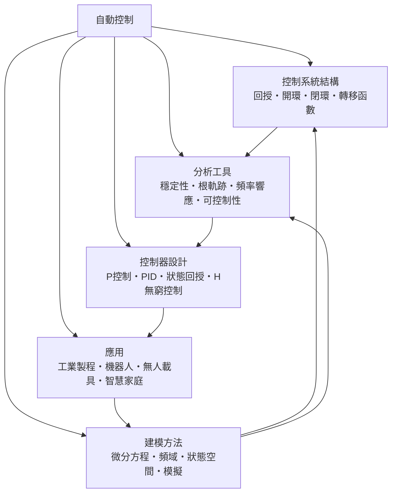

# 自動控制

> 隸屬：第一層 [工]　·　相關分類：[機器人學]、[電機工程]、[機械工程]、[人工智慧]　·　子分類總表見 [README]

> 對應維基百科：[中文維基百科：控制理論](https://zh.wikipedia.org/wiki/%E6%8E%A7%E5%88%B6%E7%90%86%E8%AE%BA)　·　[English Wikipedia: Control theory](https://en.wikipedia.org/wiki/Control_theory)

自動控制研究的是：**如何讓一個系統，在沒有人的即時介入下，維持或達成指定的狀態**。它的基本手法是回授——量測實際輸出、與目標比較、算出修正量、施加到系統上，再重新量測。這一迴路一旦閉合，系統就能主動抵抗干擾、補償誤差，把「開機後靠人盯著」變成「開機後自己站穩」。

這個領域的起點是 [1948年] [維納] 出版的控制論：他把生物體的自我調節現象抽象成機器可以實現的原則，並用「回授」這個詞把工程與生物學接上。第二次世界大戰期間的自動駕駛火控、戰後的化學製程與動力廠控制，則提供了第一批真正的工程需求；[1956年] 之後的狀態空間方法，讓多輸入多輸出的系統第一次有了統一的數學語言；而 1980 年之後的 [電腦] 與 [半導體] 革命，把原本只在大型工廠與飛機上出現的控制器，塞進了汽車、消費電子與機器人裡。

今天自動控制面對的核心瓶頸，是**真實世界的模型從來不準**。負載會變、摩擦係數會變、感測器會壞、人會突然伸手進來。這使得「把系統描述準確再算出一組最佳增益」這種一次性的做法逐漸退場，取而代之的是把不確定性與估計放進迴路裡的現代做法：[建模方法] 描述系統，[分析工具] 檢查穩定裕度與可控制性，[控制器設計] 在限制下求出一組能落地的控制律，而 [應用] 則以真實的失敗代價來裁決哪種方法值得採用。

## 核心問題

1. **系統怎麼描述**：用什麼數學語言才能既準確又可解釋地描述一個物理過程——這是 [建模方法] 的問題，工具從微分方程到頻域到狀態空間再到仿真各有取捨。
2. **資訊如何流動**：量測與指令要走哪些路徑、有沒有延遲、會不會震盪——這是 [控制系統結構] 的問題，區分 [開環] 與 [閉環] 是一切的起點。
3. **閉環會不會壞掉**：閉環最危險的失效不是不動，而是發散或持續震盪——這是 [分析工具] 的問題，核心是 [穩定性] 判準。
4. **怎麼算出一組能用的控制律**：在感測器雜訊、執行器飽和、延遲與算力限制下求出一組可實作的增益——這是 [控制器設計] 的問題。
5. **怎麼證明它真的有效**：理論上的穩定不等於工廠裡的穩定，工況漂移與元件老化都會讓常數增益失效——這是 [應用] 與現場調校要回答的問題。

## 因果鏈

1. **穩定性需求**：早期工業設備靠人工定期調整，效率與安全性都不足，工程界因而尋找能自行修正的裝置。
2. **回授原理的建立**：[1948年] [維納] 把回授與自我調節抽象成跨領域的原則，為整個領域提供了方法論骨架。
3. **頻域方法的成熟**：1930 至 1940 年代的 [奈奎斯特] 判準與 [傅立葉] 轉換，讓線性系統能用頻率觀點分析穩定與頻寬，工業界因此能快速部署 PID 類控制器。
4. **狀態空間方法**：[1956年] 之後，以狀態變數描述系統並提出可控制性與可觀測性判準，處理多輸入多輸出與非線性問題的能力大幅提升。
5. **數位化與微電子**：運算成本崩潰使狀態回授、最佳控制與卡爾曼濾波得以在小型嵌入式系統上執行，控制器從工廠機櫃走進汽車與消費產品。
6. **估計與控制的融合**：由於真實狀態無法直接量測，狀態估計與控制設計的分工（分離原理，由 [卡爾曼] 系統化）成為架構共識，也讓 [機器人學] 的感知層得以用同一套工具處理。
7. **學習方法的介入**：2010 年之後的深度學習讓複雜非線性系統的控制策略可從經驗中學得，模糊控制與 [機器人學] 中的 [強化學習] 是這條路徑的兩個分支。
8. **應用反過來改寫理論**：安全關鍵領域（汽車、航空、化工）的認證要求，逼出可驗證、可追溯的設計方法，例如 $ H_\infty $ 控制與魯棒性分析。

## 子分類的定位與相互驅動

### 控制系統結構

[控制系統結構] 是**骨架層**：它決定量測、比較、計算與執行之間的連線方式，也就是資訊在系統裡怎麼流動。[回授] 是整個領域的心臟，[開環] 與 [閉環] 的差別在於有沒有把輸出接回輸入，[轉移函數] 則是把這個骨架寫成可運算的代數形式。骨架一旦定下來，可用的分析工具與設計方法也就被限定了。

### 建模方法

[建模方法] 是**語言層**：物理過程要能被計算，就必須被翻譯成數學描述。[微分方程] 提供最直接的因果描述，[頻域] 把重點放在輸入與輸出在不同頻率下的關係，[狀態空間] 適合多輸入多輸出與最佳化問題，[模擬] 則用數值方法處理難以解析求解的狀況。模型的詳細程度是一個經濟決定：模型越細，預測越準，但參數估計與即時求解的負擔越重。

### 分析工具

[分析工具] 是**體檢層**：[穩定性] 是最基本的一項判定，[根軌跡] 顯示參數變動時極點如何移動，[頻率響應] 以增益與相位裕度描述穩健性，[可控制性] 與可觀測性則檢查系統是否「能被控制」與「能被知道」。這一層的存在，是因為「設計完成」不等於「可以上線」。

### 控制器設計

[控制器設計] 是**求解層**：[P控制] 最簡單也最穩健；[PID] 是工業上最普及的實務答案；[狀態回授] 能處理多變數耦合並可最佳化； $ H_\infty $ 控制則以最壞情況的增益為目標，用來對抗模型不確定性。設計的產出是一組增益或一組矩陣，但能不能落地取決於 [應用] 的現場條件。

### 應用

[應用] 是**驗證層**：[工業製程] 要求長時間穩定與安全聯鎖；[機器人] 要求在多變環境中保持動態品質；[無人載具] 要求在延遲與失聯下仍安全；[智慧家庭] 則要求低成本與低維護。四種環境的共同點是：理論必須被轉成能在真實機器上長期運轉的參數與程序。

### 五者的相互驅動

骨架給出資訊流向，建模給出可計算的對象，分析給出可上線的判準，設計給出可執行的律，應用以真實代價驗證並回饋新的模型需求。任何一環被簡化（例如忽略飽和或延遲），都會在應用端暴露，代價是整條鏈重做。

## 範例

**範例一：恆溫水箱的 PID 控制。** 加熱水箱要維持設定溫度。比例項讓輸出隨溫度偏差增加，微分項預判溫度變化趨勢，積分項則消除長期殘差。若只有比例控制，水箱在負載改變後會停在新的平衡點而帶著固定誤差；加入積分項才能把誤差壓回零。整個設計過程其實是反覆的：在 [分析工具] 上檢查穩定裕度，調整 [PID] 增益，再在 [建模方法] 描述的真實系統上驗證。

**範例二：汽車的定速巡航。** 駕駛設定時速後，節氣門角度必須隨坡度與載重調整。開環系統在爬坡時會失速；改為閉環後，車速量測與設定值之間的差值即時修正節氣門。這是一個典型的以 [開環] 為基準、再用 [回授] 修正的例子，也是 [應用] 中最貼近日常生活的案例。

**範例三：機器人關節的狀態回授。** 一台六軸手臂追蹤軌跡時，若只對每個關節各自做 PID，關節之間的動力學耦合會讓末端軌跡產生偏差。用 [狀態回授] 把整機動態建成狀態空間模型，再以全狀態反饋求增益，耦合就被一次處理。難題是參數與量測：負載、摩擦與 [陀螺儀] 偏置都需由 [建模方法] 中的辨識或估計取得。

**範例四：化工製程的多迴路協調。** 反應器的溫度、壓力與濃度互相影響，一個迴路單獨穩定不代表全廠穩定。工程上常用 [狀態空間] 強棒控制來處理此類交互作用，並在 [應用] 的現場，以連鎖保護與操作員規程作為最後一道安全防線。

## 容易混淆之處

- **控制不等於自動化**：自動化可以只是一段固定流程的程式；控制的關鍵在於依據量測結果修正。
- **回授不是負回饋**：回授有正有負，負回授用於穩定，正回授可用於再生與振盪產生。
- **穩定不等於可用**：邊界穩定的系統可能需要極大的控制量，實務上不可接受。
- **模型誤差不等於雜訊**：前者是結構性偏差，後者是隨機波動，處理方式完全不同。
- **最佳化只在給定代價函數下成立**：代價函選錯，數學上的最佳解就是工程上的最壞解。
- **控制與學習不是二選一**：學習可以產生控制器，但安全與可驗證性仍需控制理論的框架來兜底。

## 延伸閱讀

- [機器人學]：多關節動態與閉環控制在實體上的應用。
- [人工智慧]：學習式控制與最佳化的現代分支。
- [電機工程]：感測、驅動與訊號處理的硬體基礎。
- [機械工程]：被控對象本身的結構與動力學。
- [半導體]：運算與取樣速率的硬體條件。

## 連結定義

[工]: ../工/README.md
[README]: README.md
[機器人學]: ../機器人學/README.md
[人工智慧]: ../人工智慧/README.md
[電機工程]: ../電機工程/README.md
[機械工程]: ../機械工程/README.md
[半導體]: ../半導體/README.md
[電腦]: ../物/電腦.md
[控制系統結構]: 控制系統結構.md
[建模方法]: 建模方法.md
[分析工具]: 分析工具.md
[控制器設計]: 控制器設計.md
[應用]: 應用.md
[工業製程]: 工業製程.md
[機器人]: 機器人.md
[無人載具]: 無人載具.md
[智慧家庭]: 智慧家庭.md
[回授]: 回授.md
[開環]: 開環.md
[閉環]: 閉環.md
[轉移函數]: 轉移函數.md
[微分方程]: 微分方程.md
[頻域]: 頻域.md
[狀態空間]: 狀態空間.md
[模擬]: 模擬.md
[穩定性]: 穩定性.md
[根軌跡]: 根軌跡.md
[頻率響應]: 頻率響應.md
[可控制性]: 可控制性.md
[P控制]: P控制.md
[PID]: PID.md
[狀態回授]: 狀態回授.md
[強化學習]: ../機器人學/強化學習.md
[維納]: ../人/數學家/維納.md
[奈奎斯特]: ../人/工程師/奈奎斯特.md
[傅立葉]: ../人/數學家/傅立葉.md
[卡爾曼]: ../人/工程師/卡爾曼.md
[陀螺儀]: ../物/陀螺儀.md
[1948年]: ../時/1948年.md
[1956年]: ../時/1956年.md
