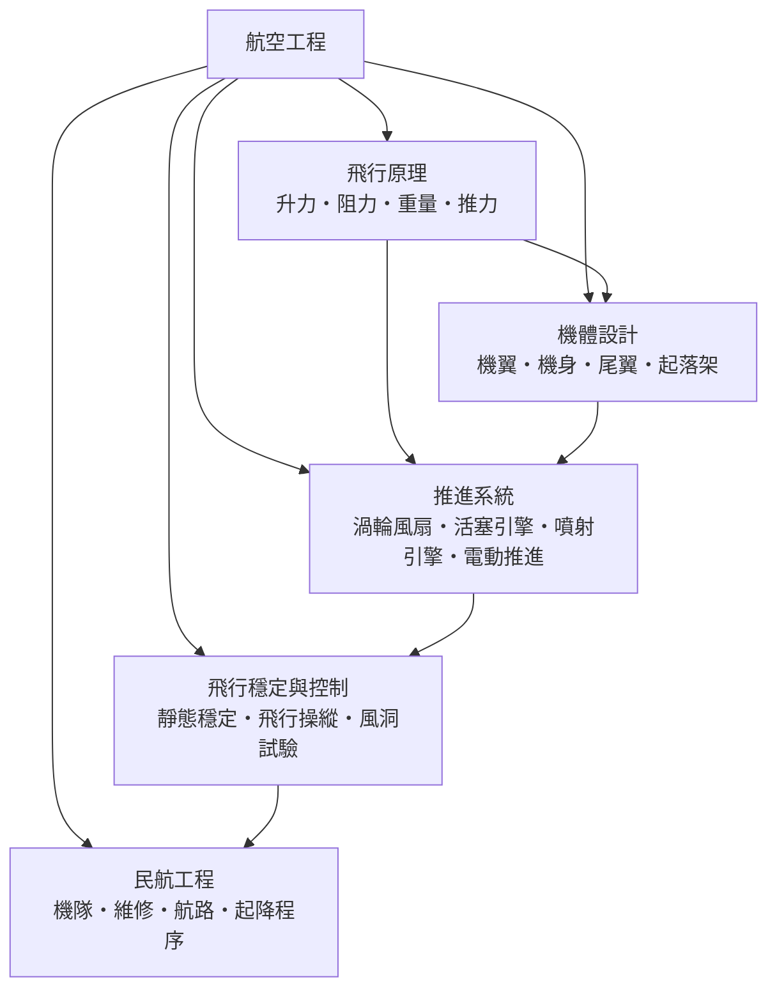

# 航空工程

> 隸屬：第一層 [工]　·　相關分類：[力學]、[流體力學]、[熱力學]、[機械工程]、[材料工程]、[結構力學]、[自動控制]、[電子工程]、[民航]　·　子分類總表見 [README]

> 對應維基百科：[中文維基百科：航空工程](https://zh.wikipedia.org/wiki/%E8%88%AA%E7%A9%BA%E5%B7%A5%E7%A8%8B)　·　[English Wikipedia: Aerospace engineering](https://en.wikipedia.org/wiki/Aerospace_engineering)

航空工程是研究「如何讓載具離開地面、在空中受控飛行，並安全返回」的工程學科。它把 [力學] 與 [流體力學] 的定律限制在人類的結構強度、重量與推力預算之內，再以 [機械工程] 的加工與 [材料工程] 的材料、[結構力學] 的強度分析與 [自動控制] 的回授律，形成一門可以在數十萬分之一秒內閉迴路運作、並把人命交託其上的精密技術。

這個學科最特殊的地方，在於它的每一項設計都是**多重瓶頸的取捨**。飛機要飛得起來，升力必須大於重量；要飛得省油，阻力必須小；要飛得安全，結構必須夠強而重量不能太高；要飛得平穩，操縱與穩定必須互相配合。任何一項都無法單獨最佳化，只能在共同限制下求取平衡。這種「以最弱環節決定系統極限」的思維，是航空工程區別於其他工程分支的根本性格。

航空工程的歷史可以回溯到 20 世紀初。1903 年（見 [1903年]）[萊特兄弟] 的首次動力飛行標誌著 [飛行原理] 從實驗走向理論；1930 年代，氣動外形與結構材料同步成熟，飛機才真正突破「只能飛得像鳥」的階段；1957 年（見 [1957年]）史普尼克一號升空，則把 [推進系統] 與導航控制推進到另一個尺度。此後從民航運輸、衛星、載人到無人機，航空工程的主線從未中斷，只是從「飛得更快」轉向「飛得更省、更安、更安全、更自主」。

## 核心問題

航空工程的核心問題可以濃縮成四個互相牽動的問題。

1. **能不能飛**：空氣作用在機翼上的升力夠不夠？升力公式 $L = \frac{1}{2}\rho V^2 S C_L$ 給出量級答案，其中 $C_L$ 為升力係數、 $S$ 為機翼面積、 $V$ 為對空速度，這是 [飛行原理] 的課題。
2. **飛得動嗎**：引擎能提供多少推力？推力必須同時克服阻力並在起飛時提供足夠的加速，否則再好的氣動外形也無用，這是 [推進系統] 的課題。
3. **結構撐得住嗎**：機身與機翼承受的氣動力、著陸衝擊與疲勞循環，都要在 [材料工程] 與 [結構力學] 的框架內同時滿足，這是 [機體設計] 的課題。
4. **能不能安全地回來**：飛機必須在受擾動後自行回到原來的飛行狀態，這是 [飛行穩定與控制] 的課題；而把這些飛機安全、準時、經濟地排入日常運輸系統，則是 [民航工程] 的課題。

四者的關係是：氣動決定了飛機能飛多快，推進決定它飛多遠，結構決定它飛多高（自重），控制決定它飛多穩，營運決定它飛多便宜。任何一環斷裂，整體功能即告瓦解。

## 因果鏈

1. **飛行的經驗累積**：19 世紀末，人類已能製作滑翔翼並觀察到「空氣在弧形表面上產生升力」的事實，但無法解釋其機制。
2. **萊特兄弟的第一次動力飛行**（1903 年，見 [1903年]）：他們以風洞量測機翼曲率並採用偏轉式舵面控制，第一次證明「飛行」可被工程化，這是 [飛行原理] 的實證起點。
3. **理論的補上**：[流體力學] 的薄翼理論與 [力學] 的多體動力學，把「飛得起來」變成可計算的問題；工程師得以在紙上估算升阻比，再由風洞與試飛校正。
4. **噴射時代**：第二次世界大戰前後，壓氣機與燃燒室技術成熟，[推進系統] 讓飛機突破速度與高度限制，航空工程由土木式工程轉為精密機械與電子工程。
5. **結構與材料的共演化**：鈦合金、複合材料與數值氣動（computational fluid dynamics）讓飛機能造得更輕、更省、更耐熱，機體設計與材料工程互相推動。
6. **電腦與控制的加入**：以 [自動控制] 為核心的增穩系統，讓高速飛機能在亂流中維持飛行，讓人類可以放心地把注意力交給機器，這也帶動了 [自動駕駛] 的出現。
7. **系統與營運化**：從軍用到民航，飛機設計的目標由「極限性能」轉為「安全與成本的最佳化」，於是出現了 [民航工程] 這一支以機隊、維修與航路排程為主的子分類。
8. **新應用的擴張**：衛星、載人航天、無人機與電動垂直起降載具，把航空工程的工具帶進新的應用領域，也帶回新的限制條件。

## 子分類的定位與相互驅動

- [飛行原理] 是**物理底層**：它定義了升力、阻力、重量與推力這四個彼此對抗的量，任何設計方案都必須在這四者的平衡中求生。
- [機體設計] 是**形狀的決定者**：機翼、機身與尾翼的外形決定了上述四量的取值；氣動外形與結構強度的衝突（例如翼根加厚造成的干涉）幾乎所有現代飛機的取捨都源自此。
- [推進系統] 是**能量的轉換器**：它把燃料的化學能轉成推力，決定了飛機的速度上限、航程與噪音，並反過來限制了機體可用的空間與重量。
- [飛行穩定與控制] 是**動態的守護者**：它回答「飛機被擾動後會不會自己回來」，並把靜態穩定、飛行操縱與風洞試驗三種手段組成完整的驗證鏈。
- [民航工程] 是**系統的落點**：它把前述四支的成果轉成每班航班、每座機場與每架飛機的可用性、安全與成本，是航空工程真正服務人群的界面。

五者的順序並非單純的上下游：飛行原理決定邊界，機體設計與推進系統在邊界內爭取最優解，穩定與控制保證方案可用，民航工程則用經濟與法規的尺規篩選最終答案。

## 範例

**範例一：起飛速度的估算。** 一架噴射客機的起飛質量為 $60\,000$ kg，翼展折算的機翼面積約 $120\ \mathrm{m^2}$ ，起飛時襟翼放下使升力係數 $C_L \approx 2.0$ ，空氣密度取海平面值 $1.225\ \mathrm{kg/m^3}$ 。由 $L = W$ 得：

$$
V = \sqrt{\frac{2mg}{\rho S C_L}}
= \sqrt{\frac{2 \times 60\,000 \times 9.81}{1.225 \times 120 \times 2.0}}
\approx 63\ \mathrm{m/s}
$$

這約等於每小時 227 公里，與實際大型客機的起飛速度量級相符。這個計算說明：起飛速度並非由引擎決定，而是由重量、翼面積與升力係數共同決定。

**範例二：巡航時的推力需求。** 同一架飛機在巡航高度（空氣密度僅約海平面的四分之一）以 $250\ \mathrm{m/s}$ 飛行，設阻力係數 $C_D \approx 0.02$ 、有效翼面積 $120\ \mathrm{m^2}$ ，則阻力約為：

$$
D = \frac{1}{2}\rho V^2 S C_D \approx \frac{1}{2}\times 0.35 \times 250^2 \times 120 \times 0.02 \approx 3.3\times 10^4\ \mathrm{N}
$$

若渦輪風扇的推進效率約為 $0.35$ ，則燃油消耗功率約 $9.5\times 10^4$ W ，這說明為何長途航程的飛機必須攜帶大量燃油——燃油本身就是飛機最大的單項重量。

**範例三：靜穩定的判斷。** 若飛機的重心（空速中心）位於升力作用點（氣動中心）之前，則受上擾動後產生的升力增量與尾翼操縱作用會讓飛機自動回到原狀態，稱為靜態穩定；反之重心在前則擾動會不斷放大而導致失速與翻覆。判定重心位置的容許範圍，就是機體設計與飛行穩定兩支分類的接點。

## 容易混淆之處

- **升力不是「被風吹起來的力」**：升力來自機翼周圍的壓力分布與向下偏轉的空氣，方向與飛行方向垂直；它的存在不需要相對風，靜止的空氣中也可以有升力。
- **飛機的速度不是噴射引擎推出來的**：起飛與巡航速度由空氣密度、重量與阻力決定，引擎只負責提供足以維持該速度的推力。
- **重量不是「重的飛機」**：重量是重力作用下的力，單位為牛頓；在設計文件中重量常被當作質量（公斤）記錄，兩者不可混用。
- **風洞試驗不是唯一依據**：風洞只能重現特定雷諾數與馬赫數下的氣流，模型與實機的比例效應必須靠經驗修正與試飛補足。
- **穩定與操縱互相衝突**：過度穩定的飛機轉向遲鈍，過度靈活的飛機容易受亂流擾動；氣動設計本質上是在這兩者間分配代價。
- **民航工程不等於「航空公司管理」**：它關注的是可維修性、可靠度、排班與空域等系統工程問題，營運策略只是其中一層。

## 延伸閱讀

- [力學]：升力、阻力、重量與推力四力的力學基礎。
- [流體力學]：邊界層、渦流與壓力分布的來源。
- [熱力學]：燃燒與渦輪機中熵變的物理。
- [結構力學]：強度、疲勞與有限元素分析的工程應用。
- [自動控制]：增穩、飛行操縱與自動駕駛的理論。
- [民航]、[機場]：航空工程在運輸系統中的下游應用。
- [萊特兄弟]：航空工程的實證起點。
- [馮卡門]：航空工程理論化的關鍵人物。

## 連結定義

[工]: ../工/README.md
[README]: README.md
[力學]: ../力學/README.md
[流體力學]: ../流體力學/README.md
[熱力學]: ../熱力學/README.md
[機械工程]: ../機械工程/README.md
[材料工程]: ../材料工程/README.md
[結構力學]: ../結構力學/README.md
[自動控制]: ../自動控制/README.md
[電子工程]: ../電子工程/README.md
[民航]: ../民航/README.md
[機場]: ../機場/README.md
[自動駕駛]: ../自動駕駛/README.md
[飛行原理]: 飛行原理.md
[機體設計]: 機體設計.md
[推進系統]: 推進系統.md
[飛行穩定與控制]: 飛行穩定與控制.md
[民航工程]: 民航工程.md
[萊特兄弟]: ../人/工程師/萊特兄弟.md
[馮卡門]: ../人/工程師/馮卡門.md
[1903年]: ../時/1903年.md
[1957年]: ../時/1957年.md
