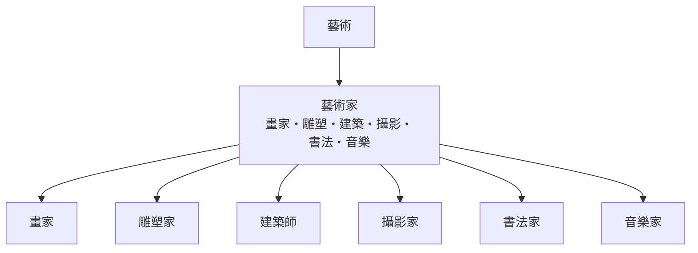

# 藝術

> 分類範圍：以藝術門類與創作者群像為核心的分類部門——畫家、雕塑家、建築師、攝影家、書法家與音樂家——並說明各門類如何共享技法、卻發展出不同的評價制度。　·　隸屬第一層：[人]　·　相關分類：[繪畫]、[雕塑]、[建築設計]、[攝影]　·　子分類總表見 [README]

> 對應維基百科：[中文維基百科：艺术](https://zh.wikipedia.org/wiki/%E8%89%BA%E6%9C%AF)　·　[English Wikipedia: Art](https://en.wikipedia.org/wiki/Art)

藝術部門處理的問題是：**創作、技藝與評價如何構成一個學科之外仍可被研究的領域**。藝術與科學的分界不在材料（繪畫也研究色彩物理），而在目的與制度——藝術的產出不必可重複，其評價來自社群、歷史與市場的協商。本概念的問題是：**各門類共享什麼、又各自發展出什麼**。

## 核心問題：門類之間的共同點與分歧

藝術的門類差異極大，但有三件事共通：

1. **材料與工具的物質性**：顏料、石材、底片、水墨與樂器各自限定了可行的動作。
2. **技法的可傳遞性**：師承、臨摹、研習與學徒制是知識轉移的主要方式。
3. **作品與原作的差異**：藝術品的價值部分來自其不可複製性，這使保存、鑑定與真偽問題成為門類共通的實務。

差異則在**評價制度**：文學靠發表與批評，音樂靠演出與樂評，建築靠委託與使用，視覺藝術靠收藏與展覽。制度不同，藝術家的生計結構也大不相同。

## 因果鏈

1. **技法的累積**：材料與工具的改進（油畫、照相、數位創作）直接改變了可做的作品。
2. **學院與沙龍**：制度化的教學與展出，使風格得以穩定傳承並被命名。
3. **批評與期刊**：評論把風格轉化為可比較的語言，藝術家開始在這套語言裡定位自己。
4. **收藏與市場**：收藏制度既支撐了藝術家的生計，也塑造了什麼被保存下來。
5. **攝影與複製技術**：可複製性挑戰了「原作」的傳統地位，逼出新的評價框架。

## 子分類的定位與相互驅動

- [藝術家] 之下分成六種截然不同的創造者：平面、立体、空間、光學影像、書寫與時間性的聲音。
- 每一門類都有自己的材料學（顏料、石材、底片、紙墨、樂器）與保存學，這是藝術家之間最實際的共同語言。
- 跨門類的流動（建築師作畫、攝影師轉戰影像藝術、音樂家跨界）往往帶來新技法。

## 範例：一件作品的保存與鑑定

以一幅油畫的鑑定為例，看藝術門類共通的制度：

1. **物質檢查**：顏料層的裂隙（龜裂）、底料與畫布的纖維構成，可判斷年代與修補史。
2. **技術對照**：底稿構圖、筆觸與當時的畫室技法一致，可支持年代判斷。
3. **來源紀錄**：收藏印記與流傳文件（清單、拍賣紀錄）構成 provenance，是鑑定的骨架。
4. **風格判斷**：與已知作品比較，評斷是否出自同一工坊或同一時期。
5. **制度結論**：綜合以上形成市場可用的結論——這套流程在雕塑、攝影與書法中幾乎一一對應。

## 容易混淆之處

- **藝術不等於藝術家**：能做出物件的技能與能被判為藝術的物件，是兩回事。
- **風格不等於個人**：風格常是共享慣例，個人是在慣例內偏離的人。
- **市場價格不等於藝術價值**：價格受供需、收藏偏好與洗錢影響，是社會訊號而非美學判斷。
- **傳統與現代不是二元對立**：現代藝術常是對傳統技法的再挪用。

## 技術要點

- **材料學的掌握**：顏料、膠、底子、印品與樂器的性質決定技法上限。
- **保存條件**：溫濕度、光照與污染是保存的第一變數；修復的前提是穩定環境。
- **鑑定的方法序**：物理檢查 → 技術對照 → 來源紀錄 → 風格判斷 → 結論，順序不宜顛倒。
- **複製品的處理**：教育用複製品與原作的關係需要制度化標示，否則容易混淆。
- **數位創作的保存**：檔案格式與硬體淘汰使數位作品的保存需要持續遷移計畫。
- **口述與檔案的互補**：藝術家口述史能補上技藝與動機，檔案則提供制度與交易的脈絡。

## 常見的論爭

1. **藝術品的經濟價值與文化價值**：拍賣價格、國家徵收與文化資產認定之間的落差，是藝術治理的核心矛盾。
2. **數位藝術的著作權與保存**：複製品特性使收藏、保存與版權的框架都需重整。
3. **傳統技藝的存續**：活態傳承需要生計支持，純粹以「保存」為名的措施往往使技藝滅絕。

## 延伸閱讀

- [藝術家]：本概念的主軸條目。
- [繪畫]、[雕塑]、[攝影]、[書法]：各門類的技術與保存。
- [建築設計]：空間性的創作實踐。
- [藝術家群像的評價史]：藝術品評價制度的演變。

## 連結定義

[人]: ../人/README.md
[README]: README.md
[繪畫]: ../繪畫/README.md
[雕塑]: ../雕塑/README.md
[建築設計]: ../建築設計/README.md
[攝影]: ../攝影/README.md
[書法]: ../書法/README.md
[藝術家]: 藝術家.md
[藝術家群像的評價史]: 藝術家.md

- **延伸參考**：相關專著與通史，是深入理解本主題的入口。
