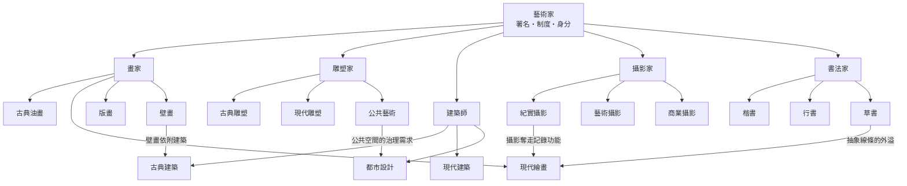

# 藝術家

> 分類範圍：藝術的「製作者」——從事繪畫、雕塑、建築、攝影與書法的創作者；並敘述藝術家身分如何自手工藝匠、宮廷匠師，演為十九世紀的「為藝術而藝術」individual artist，再到二十世紀以後的策展人、明星藝術家與數位創作世代。
>
> 隸屬第一層：[人]　·　相關分類：[繪畫]、[雕塑]、[攝影]、[書法]、[建築設計]、[表演藝術]　·　子分類總表見 [README]

> 對應維基百科：[中文維基百科：藝術家](https://zh.wikipedia.org/wiki/%E8%89%BA%E6%9C%AF%E5%AE%B6)　·　[English Wikipedia: Artist](https://en.wikipedia.org/wiki/Artist)

藝術家（artist）是**以創作視覺或書寫形式作品為主要社會身分的人**。這個身分不是天生的職業類別，而是一段歷史：只有在社會開始把「創作」與「製作」分開、把作品與作者的名字綁在一起時，藝術家才成為可被辨識的角色。

換言之，「藝術家」這個身分本身是一套制度。它回答三個問題：

1. **誰被允許創作？** 早期是匠師（craftsman），受行會與宮廷委託；近代是受過學院訓練、被認可為具有「天賦」的自由創作者。
2. **作品為何是作品？** 何以一幅畫、一座廟、一張照片不只是「好用的東西」，而是能被收藏、評價、遺產化（heritagized）的文化物件。
3. **創作者與觀眾的關係是什麼？** 從師徒、委託人到市場、觀眾群眾，再到大眾媒體與社群平台。

這三個問題正是本概念底下五個子分類的分歧來源：[畫家]、[雕塑家]、[建築師]、[攝影家]、[書法家]各自解決了不同的瓶頸，彼此之間卻一直在互相驅動。

## 核心問題：署名帶來的雙刃劍

藝術家身分的第一個關鍵技術是**署名**（signature）。把名字刻在石頭上、寫在畫布角落、印在版畫下緣，等於宣告「此物出自此人」。

署名帶來的好處是可追溯性與聲譽累積。藝術家累積名聲後，下一件作品在交易與傳播上更有價值，這構成了**藝術經濟的循環**：

$$
\text{署名} \;\Longrightarrow\; \text{可辨識的作者} \;\Longrightarrow\; \text{聲譽累積} \;\Longrightarrow\; \text{更高的交換價值} \;\Longrightarrow\; \text{更多資源與委託}
$$

但同一件事也帶來壞處：**作者身分會壓過作品本身**，並製造對「原創」的過度執著。二十世紀的現成品（readymade）運動正是要拆掉署名權威——杜尚 1917 年把一件小便池簽上「R. Mutt」送去展覽，作品的價值被從「誰做的」轉移到「誰在挑戰什麼」。

第二個核心問題是**藝術與生活的邊界**。當繪畫可以不再裝飾教堂與宮殿、雕塑不再只是神廟的一部分、攝影可以獨立於文字紀錄存在，藝術便必須回答：它存在的理由是什麼？這條追問貫穿了本概念底下的所有子分類，並在各個時代給出不同答案。

## 因果鏈

1. **壁畫、造像與神廟**帶來第一批「有署名或可歸屬某人」的創作：古埃及與古希臘的工匠在作品上留下簽記，羅馬的建築與雕刻則往往以「某某為某某的這種合作」留下銘文。此時創作者仍是**匠師**，身份綁在手藝與行會上，而非個人天賦。

2. **文藝復興的委託制**把個人名字推到前景。佛羅倫薩與威尼斯的大師（達文西、米開朗基羅、拉斐爾、提香）受教會與宫廷委託，其個人風格被辨識、被記錄、被模仿。於是「畫家」從一個職業描述變成一個**可被比較的個人位階**。

3. **油畫顏料與北方繪畫的透明罩染技法**在十五世紀尼德蘭成熟，使畫家能做出可被攜帶、可被保存、可被轉售的獨立畫幅。這條技術紅利讓繪畫從建築的附屬物（壁畫）解放出來，成為可獨立收藏的物件——這正是 [古典油畫] 的起點，也讓 [畫家] 得以成為獨立身分。

4. **國家學院與沙龍**在十七至十八世紀制度化：法國皇家繪畫與雕塑學院（Académie）用定期競賽與「沙龍」審查決定誰能獲得官方委託。藝術家的經濟位置第一次被制度精細化地管理。

5. **攝影的發明（1839 年公布達爾弗式照相法）**造成第一次根本衝擊。攝影能以低成本複製現實，繪畫的「記錄功能」被部分取代。1860 年代起，畫家被迫尋找繪畫**不可被攝影替代**的部分：色彩、筆觸、抽象、觀看方式。這條反作用力一路推動了 [現代繪畫] 的抽象化，也催生了 [藝術攝影] 以攝影本身為媒介語言的分支。

6. **工業化與複製品技術**（蝕刻、木刻、照相製版）讓藝術家不必只有「原作」一種產品。[版畫] 因此成為藝術家能負擔得起的實驗場：同一塊版可以反覆試印不同顏色，藝術家得以在有限成本下比較多個方案。

7. **攝影工業化**則把攝影家一分為三：為報導與社會改革服務的 [紀實攝影]、為博物館與美術館生產原作的 [藝術攝影]、為廣告與商品服務的 [商業攝影]。三者共享同一套技術，卻發展出完全不同的倫理與評價標準。

8. **攝影也解放了雕塑與建築**：當平面影像能記錄遠方的神廟與肖像，雕塑家與建築師不必再是唯一能「讓人看見」的人，而是可以更集中於形式、規模與場所。二十世紀的 [公共藝術] 便建立在這個基礎上：它不再為特定神靈服務，而是面對整個公眾。

9. **藝術家在十九世紀末獲得「為藝術而藝術」的地位**，與此同時 [建築師] 走上一條工程化道路：建築師必須同時是設計者與管理者，於是「建築」從藝術品變成公共投資。

10. **二十世紀末的制度化與全球化**：藝術市場的價格化、雙年展與美術館體系，使得藝術家同時是創作者、經營者與公共發言人。1980 年代後的 [公共藝術] 百分比計畫，把藝術家直接嵌入都市治理。

11. **二十一世紀的數位轉向**：向量繪圖、AI 影像生成、數位平臺的傳播，讓「誰是作者」重新成為爭議焦點——這條線目前仍在發展中。

## 子分類的定位與相互驅動

### 畫家

畫家處理的是**平面上的色彩與線條**，其瓶頸是「二維空間如何承載三維的 illusion 與敘事」。[古典油畫] 用透明罩染與明暗對比解決透視與光澤；[現代繪畫] 用色彩抽象化處理攝影無法給予的主觀感受；[版畫] 把藝術家從單一原作解放出來，讓實驗可以複製；[壁畫] 則把畫家放回建築與公共空間，使繪畫與 [建築師] 直接對話。攝影出現後，畫家的整條技術線被迫重新定位，這是 [攝影家] 對 [畫家] 最大的反向驅動。

### 雕塑家

雕塑家處理**三維體量與佔有空間的方式**，瓶頸是「作品無法複製、只能在特定地點存在」。[古典雕塑] 以人体比例與理想化解決可信度；[現代雕塑] 以直接雕法、組裝與抽象構成解決「手工痕跡是否必須被隱藏」的問題；[公共藝術] 則把雕塑推到都市與社區層級，必須面對維護、安全與公眾參與——這些問題又回頭改變雕塑家的材料與尺度選擇。

### 建築師

建築師處理**集體生活所需的可居空間**，瓶頸是「作品必須被建造、被使用、被維護，且壽命遠長於作者」。[古典建築] 用柱式與對稱建立可被重複的秩序；[現代建築] 用鋼筋混凝土與功能主義回應工業化城市的速度；[都市設計] 把尺度從單棟建築放大到街廓與區域。三者構成「零件—單體—系統」的層次，也是本概念中唯一以「後果」而非「物件」為終點的分支。

### 攝影家

攝影家處理**光學記錄與影像語言**，瓶頸是「機械的記錄性與藝術的表達性之間的矛盾」。[紀實攝影] 站在證據一端，[藝術攝影] 站在形式與觀看方式一端，[商業攝影] 則站在服務與效率一端。攝影的技術門檻低、可複製，迫使藝術家重新經營「不可複製性」——這正是它對所有其他子分類最大的外溢效應。

### 書法家

書法家處理**抽象線條與書寫秩序**，瓶頸是「毛筆的連續運動如何在平面上留下可讀性與美感」。[楷書] 以法度建立可教、可複製的標準，[行書] 在速度與可讀之間取平衡，[草書] 則把抽象推到極致並反向影響了後世其他文化（漢字在日本的平假名、片假名即來自草書）。它是本概念中與筆墨材料耦合最深、最不容易被攝影與數位工具取代的分支。

## 容易混淆之處

- **藝術家不等於名人**。知名度來自市場、傳媒與制度的共同作用，與創作本身的能力無必然關係；19 世紀的印象派畫家當時多被視為不入流。
- **藝術家不等於工匠，工匠也不等於藝術家**。區別在於制度是否賦予「創作」獨立於「製作」的價值；同一個人可以在不同制度下被不同定義。
- **藝術家不等於經紀人或策展人**。經紀人與策展人處理的是流通、敘事與保存，這些是藝術的制度支撐，卻不從事創作。
- **「為藝術而藝術」不等於「藝術不需要社會」**。它主張的是藝術的價值不以外在功能為唯一尺度，而非藝術家可以不回應社會。
- **抽象不等於沒有內容**。[現代繪畫] 的抽象往往來自具體經驗的提煉（塞尚的結構、康丁斯基的色彩音樂性），把它讀成「無意義」是常見誤解。
- **藝術品與工藝品沒有絕對分界**。同一件器物（例如中國的瓷器與日本的茶碗）在不同歷史中曾被歸入不同類別。

## 延伸閱讀與工具支撐

- 藝術品的收藏、登錄與保存由 [典藏] 與 [博物館學] 承接，藝術家的「身後名聲」在這裡被制度化。
- 各類媒介的技術原理分別收在 [繪畫]、[雕塑]、[攝影]、[書法] 與 [建築設計] 之中；本概念專門處理「誰在創作、創作的身分如何被認定」。
- 藝術家與觀眾之間的傳播與展示，與 [設計]、[表演藝術] 有大量方法論共享，尤其是「作品如何被安排在觀眾面前」這件事。

## 連結定義

[人]: ../人/README.md
[README]: README.md
[畫家]: 畫家.md
[古典油畫]: 古典油畫.md
[現代繪畫]: 現代繪畫.md
[版畫]: 版畫.md
[壁畫]: 壁畫.md
[雕塑家]: 雕塑家.md
[古典雕塑]: 古典雕塑.md
[現代雕塑]: 現代雕塑.md
[公共藝術]: 公共藝術.md
[建築師]: 建築師.md
[古典建築]: 古典建築.md
[現代建築]: 現代建築.md
[都市設計]: 都市設計.md
[攝影家]: 攝影家.md
[紀實攝影]: 紀實攝影.md
[藝術攝影]: 藝術攝影.md
[商業攝影]: 商業攝影.md
[書法家]: 書法家.md
[楷書]: 楷書.md
[行書]: 行書.md
[草書]: 草書.md
[繪畫]: ../繪畫/README.md
[雕塑]: ../雕塑/README.md
[攝影]: ../攝影/README.md
[書法]: ../書法/README.md
[建築設計]: ../建築設計/README.md
[表演藝術]: ../表演藝術/README.md
[設計]: ../設計/README.md
[典藏]: ../典藏/README.md
[博物館學]: ../博物館學/README.md
