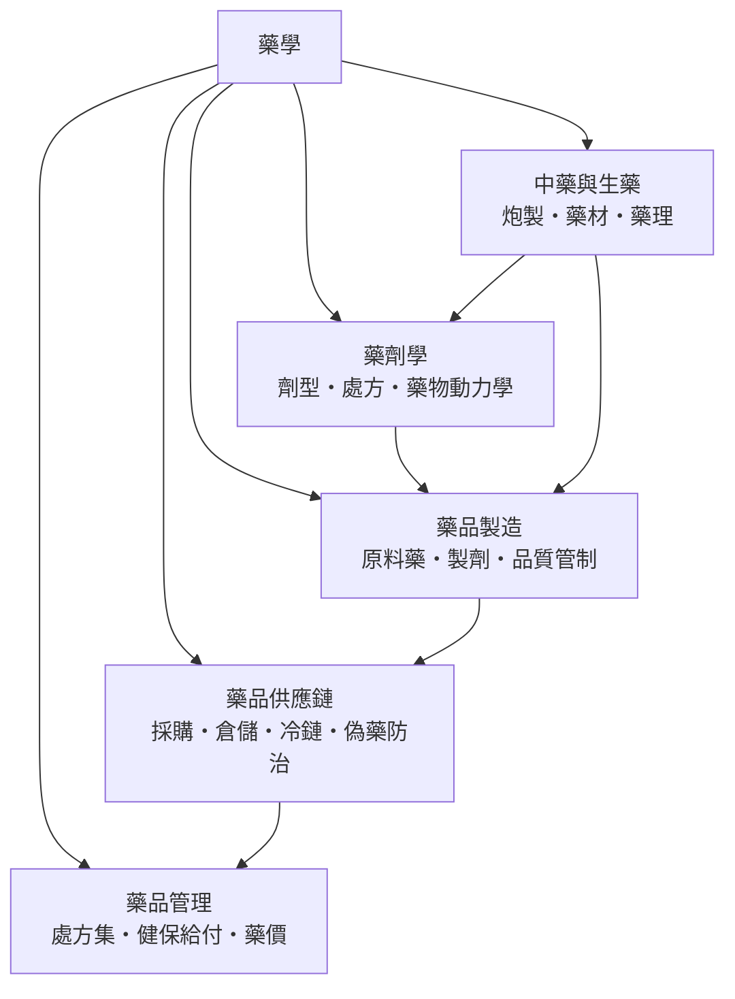

# 藥學

> 隸屬：第一層 [醫]　·　相關分類：[化學]、[中醫學]、[公共衛生]　·　子分類總表見 [README]

> 對應維基百科：[中文維基百科：藥學](https://zh.wikipedia.org/wiki/%E8%8D%AF%E5%AD%A6)　·　[English Wikipedia: Pharmacy](https://en.wikipedia.org/wiki/Pharmacy)

藥學研究**藥物的發現、製造、調劑、管理與使用**，是連接 [化學] 與 [醫] 之間的轉接層：化學回答「這個分子是什麼、怎麼合成」，醫學回答「病人得什麼病」，藥學則回答「用什麼藥、做成什麼形狀、給多少、經過誰的手送到病人身上、如何確保送對」。它的核心公式是藥物在體內的量隨時間的變化，一階動力學下的血中濃度：

$$
C_t = C_0 \, e^{-kt}, \qquad t_{1/2} = \frac{\ln 2}{k}
$$

其中 $C_0$ 是初始血中濃度， $k$ 是排除速率常數， $t_{1/2}$ 是半衰期——給藥間隔與維持劑量都由它決定。藥學與臨床科學最大的不同在於：醫師開方、病人服藥，但**讓藥從工廠走到病人手上還能安全有效**的整條鏈，是藥學的領土。

藥學的源頭與藥草不可分：古代 [中醫學] 的《神農本草經》與蓋倫的藥劑調製，都是以天然物為材料的經驗技藝。19 世紀 [化學] 成熟後，藥師從植物中分離出嗎啡、奎寧、阿斯匹靈的有效成分，藥學才從「調配草木」變成「調配分子」。20 世紀磺胺藥與青黴素問世（見 [1928年] 與 [弗萊明] 的發現），[疫苗] 與 [胰島素] 量產，藥品成為規模化工業產品，藥學也隨之分化出製造、管理、供應鏈等新分支。

## 核心問題

藥學的四個核心問題彼此嵌套。

1. **有效**：藥能不能到達作用部位、維持有效濃度？這由劑型與給藥途徑決定，是 [藥劑學] 的問題。
2. **可造**：有效成分能否穩定、經濟、純度高的大量生產？這由合成路線與製程決定，是 [藥品製造] 的問題。
3. **可管**：藥品的品質、價格、給付與短缺如何被制度管理？這是 [藥品管理] 與 [藥品供應鏈] 的問題。
4. **可溯**：天然藥材與經驗方如何被科學檢驗並標準化？這是 [中藥與生藥] 的問題。

四者的邏輯順序：先確認成分與藥理（有效），才能設計製程（可造）；能製造才有供應（可管）；管理與供應反過來決定病人實際拿到什麼藥（可溯與安全）。傳統藥材問題排在最後不是因為最不重要，而是因為它的檢驗工具——層析、質譜——正是前三問發展出來的儀器。

## 因果鏈

1. **藥草經驗期**：人類以植物、礦物、動物材料治病數千年，《神農本草經》與蓋倫藥劑累積了配方與炮製經驗，但無法解釋「為什麼有效」。
2. **成分分離革命**：1805 年從鴉片分離嗎啡、1820 年分離奎寧，證明藥效來自特定分子；藥師的對象從「藥材」變成「成分」。
3. **合成藥興起**：1899 年阿斯匹靈上市，磺胺藥在 1930 年代證明人工分子可以抗菌；製藥從調劑鋪變成工業。
4. **抗生素時代**：[1928年] [弗萊明] 發現青黴素，1940 年代量產成功，戰傷與傳染病死亡率驟降；藥品供應首次成為國家戰略議題。
5. **劑型與動力學科學化**：20 世紀中葉，藥物動力學把「給多少、多久一次」變成可計算的問題；緩釋、腸溶等新 [劑型] 出現。
6. **法規與品質制度化**：1937 年磺胺酏劑事件造成上百人死亡，促成 1938 年美國《聯邦食品、藥品與化妝品法》；藥品上市前須證明安全與有效，藥政管理成為獨立專業。
7. **供應鏈全球化**：原料藥生產集中到少數國家，運輸與庫存成為藥價與短缺的關鍵變數；[疫苗] 冷鏈在 COVID-19 疫情中成為全民關注的技術。
8. **生物藥與精準藥事**：蛋白質、核酸藥物興起（詳見 [生物製藥]），冷鏈、給付與生物相似藥法規把藥學推向「高價值、高管制」的新階段。

## 子分類的定位與相互驅動

- [藥劑學] 是**使用者介面**：同一個分子做成錠劑、膠囊或注射劑，效果與風險完全不同；它把藥理學的結論翻譯成病人可用的形狀。
- [藥品製造] 是**規模化的樞紐**：實驗室配方要經過 GMP 製程才能成為上百萬人可用的藥；品質管制反過來定義了什麼叫「同一批藥」。
- [藥品管理] 是**制度層**：處方集、健保給付與藥價談判決定哪些藥真的會被使用；沒有它，再好的藥也只是型錄上的一行。
- [中藥與生藥] 是**歷史最長的支線**：[青蒿素] 從《肘後備急方》走向諾貝爾獎（[屠呦呦]，1972 年發現），證明傳統藥材經科學檢驗後能回饋整個藥學。
- [藥品供應鏈] 是**最後一哩**：採購、倉儲、冷鏈與偽藥防治把工廠產品變成藥局貨架上的存貨；COVID-19 疫情證明供應鏈斷裂比研發失敗更常見。

## 範例：一顆藥錠背後的五個子分類

以常見的高血壓藥 amlodipine（氨氯地平）5 mg 膜衣錠為例：

1. **有效成分**：amlodipine besylate，由化學合成製得——這是 [原料藥]（API）的領域。
2. **劑型設計**：做成口服膜衣錠，每日一次；藥物動力學上其半衰期約 30 至 50 小時，遠長於每日給藥間隔，因此血中濃度波動小——這是 [藥劑學] 的計算。
3. **製造**：原料藥與賦形劑混合、造粒、壓錠、包膜，每一批都要檢驗含量均一度與溶離度——這是 [藥品製造] 與品質管制。
4. **管理**：藥進入醫院 [處方集] 需經藥事委員會審查；健保給付價格經藥價調整後可能逐年下降——這是 [藥品管理]。
5. **供應**：從境外工廠出口、報關、進倉、配送到社區藥局，全程記錄批號以備回收——這是 [藥品供應鏈]。

一顆成本不到一元的藥錠，背後是五個子分類、數十個專業分工的接龍；任何一環出錯（含量不對、給付取消、運輸斷裂），病人拿到的就不是「那顆藥」。

## 容易混淆之處

- **藥學不等於藥理學**：藥理學研究藥物與身體的相互作用（藥效、毒性），是基礎科學；藥學是應用與管理科學，藥理只是它借用的理論之一。
- **藥師不等於藥廠**：醫院與社區藥局的藥師負責調劑、諮詢與用藥把關；製藥公司的藥師負責製程、品質與法規註冊。
- **原廠藥與學名藥**：學名藥含有相同有效成分，但必須通過「生體可用率」試驗證明吸收行為一致，不是「影印藥」。
- **副作用與不良反應**：副作用是已知劑量下的預期效應；不良反應（ADR）涵蓋過敏、交互作用等非預期事件，通報與監測是藥師的法定職責。
- **效期不等於突然失效**：藥品效期是「95% 信心下含量仍達標」的統計推算，過效期前後藥效是漸變而非斷崖。
- **中藥「天然」不等於「無毒」**：馬兜鈴酸腎病變即是案例；[中藥與生藥] 的價值正在於把天然材料納入同樣嚴格的品質與安全框架。

## 延伸閱讀

- [化學]：藥物分子的來源與合成基礎。
- [分子生物]：生物藥與標靶藥物的分子機制基礎。
- [生物製藥]：蛋白質、核酸與細胞治療等新世代藥物。
- [中醫學]：[中藥與生藥] 的理論母體。
- [公共衛生]：疫苗政策、用藥可近性與藥價的公共面。
- [內科]：藥物治療的臨床端，與藥師共同承擔用藥安全。

## 連結定義

[醫]: ../醫/README.md
[README]: README.md
[化學]: ../化學/README.md
[中醫學]: ../中醫學/README.md
[公共衛生]: ../公共衛生/README.md
[分子生物]: ../分子生物/README.md
[生物製藥]: ../生物製藥/README.md
[內科]: ../內科/README.md
[藥劑學]: 藥劑學.md
[藥品製造]: 藥品製造.md
[藥品管理]: 藥品管理.md
[中藥與生藥]: 中藥與生藥.md
[藥品供應鏈]: 藥品供應鏈.md
[劑型]: 劑型.md
[原料藥]: 原料藥.md
[處方集]: 處方集.md
[弗萊明]: ../人/生物學家/弗萊明.md
[屠呦呦]: ../人/生物學家/屠呦呦.md
[青蒿素]: ../物/青蒿素.md
[胰島素]: ../物/胰島素.md
[疫苗]: ../物/疫苗.md
[1928年]: ../時/1928年.md
