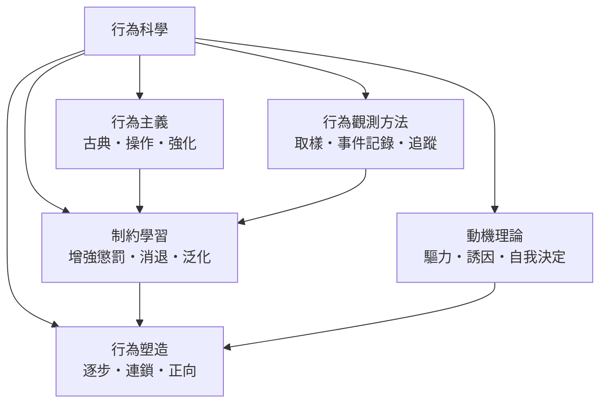

# 行為科學

> 分類範圍：以「可觀察的行為」為研究對象的學科群——行為主義、行為塑造、制約學習、動機理論與行為觀測方法——並說明它如何從實驗室的制約原理走向組織、教育與公共政策。　·　隸屬第一層：[人]　·　相關分類：[心理學]、[認知科學]、[社會心理學]　·　子分類總表見 [README]

> 對應維基百科：[中文維基百科：行为科学](https://zh.wikipedia.org/wiki/%E8%A1%8C%E4%B8%BA%E7%A7%91%E5%AD%A6)　·　[English Wikipedia: Behavioral science](https://en.wikipedia.org/wiki/Behavioral_science)

行為科學把行為當作**可測量、可預測、可塑造**的對象。它源於二十世紀初對心理內省法的不滿：既然科學只能處理公開可觀察的資料，就該從刺激與反應的關係開始研究。本概念要處理的問題是：**當行為被視為科學對象時，人類行動中哪些部分能被解釋、哪些部分被排除了**。

## 核心問題：可觀察性的邊界

行為科學的第一原理是「只研究可觀察的行為」，其代價是三個明確的取捨：

1. **解釋範圍受限**：只描述刺激—反應關係而不追溯內在狀態，某些複雜行為（例如助人行為的動機）難以被完整解釋。
2. **個體差異被平均**：實驗室中的平均反應，掩蓋了人格、環境與文化造成的系統差異。
3. **應用效果強**：正因如此，它的原則在教育、管理、臨床與公共政策上可直接操作，影響遠超其解釋能力。

## 因果鏈

1. **巴夫洛夫的古典制約**：消化反射的實驗顯示「中性刺激」可因配對而取得意義，學習第一次被寫成刺激之間的關係。
2. **桑代克的效果律**：透過迷箱實驗，學習被描述為試誤與強化的結果。
3. **斯金納的操作制約**：以增強與懲罰解釋自發行為的塑造，行為科學由此獲得明確的技術語彙。
4. **行為分析的應用擴張**：兒童治療、課堂管理、組織激勵與廣告設計都採用同一套原理。
5. **內在動機研究的重新抬頭**：自我決定理論等理論指出，僅靠外在獎懲可能削弱動機——應用與理論因此開始拉鋸。

## 子分類的定位與相互驅動

- [行為主義] 是**理論核心**：刺激、反應與學習的基本語彙由此建立。
- [制約學習] 是**機制層**：古典與操作制約的具體規則，是可預測、可複製的部分。
- [行為塑造] 是**技術層**：把制約原理用於訓練與習慣養成的操作手冊。
- [動機理論] 是**修正層**：提醒行為背後有內在歷程，避免把所有行為化約成外在獎懲。
- [行為觀測方法] 是**方法層**：沒有可靠的測量，理論無從檢驗。

## 範例：一項技能的訓練拆解

以訓練搜救犬為例，看行為科學的完整操作鏈：

1. **建立刺激—反應配對**：以固定的獎勵（玩具、食物）與特定指令手勢配對，讓動物學會在提示出現時執行指定動作。
2. **塑造（shaping）**：從完成近似動作開始給予獎勵，逐步提高判準——從「朝目標方向走」到「碰到目標物」，每一個過渡都強化。
3. **連鎖制約**：把「定位→標記→示警」三個動作串成一條鏈，前者的完成成為後者的提示。
4. **消退與保持**：若無獎勵，行為可能停止；因此訓練後期改用間歇性強化，使行為在低頻獎勵下仍維持。
5. **泛化**：在訓練後加入不同地形、不同服裝與不同氣味的測試，確認反應不是只對單一線索有效。
6. **評估**：以事件記錄量化每次任務的完成率與時間，作為後續調整的依據。

## 容易混淆之處

- **行為主義不等於忽視內心**：它主張以可觀察行為作為**科學對象**，不等於認為內心不存在。
- **制約不等於灌輸**：制約是刺激與反應的關係改變，與信念的改變是不同層次。
- **獎勵不是越多越好**：過度獎勵會削弱內在動機，也會讓行為只在有獎勵時出現。
- **動物實驗的外部效度有限**：跨越物種、跨情境的推論需要另外的驗證。

## 技術要點

- **可重複的操作定義**：任何行為類別都必須定義到他人能照做，並能計算觀察者間一致性。
- **增強與懲罰的分類標準**：以行為是否增加為準，而非以刺激是否愉快為準。
- **獎勵延遲**：後果越緊接行為，聯結越強；延遲會削弱學習並增加測量難度。
- **避免過度理由化**：外在獎勵若被體驗為控制，可能取代原有的內在動機。
- **多方法三角驗證**：實驗、觀測與自陳資料互相校正，單一來源難以支撐因果結論。
- **倫理界線**：無法取得知情同意、或被觀察行為具敏感性時，應改用其他方法。

## 常見的論爭

1. **內心過程能否被科學研究**：行為主義排除內在狀態，認知革命則證明它有測量學；方法論的分歧至今仍有影響。
2. **動物實驗的外部效度**：制約原理跨物種的適用範圍，以及用動物模型推論人類行為的界線。
3. **應用與操控的界線**：以行為科學設計環境與制度，何時是效率提升，何時是對自主性的侵犯。

## 延伸閱讀

- [心理學]：行為科學所在的學科框架。
- [認知科學]：解釋行為時常被引入的內在歷程層。
- [社會心理學]：情境與群體對行為的影響。
- [學習與教學]：教學領域的應用延伸。

## 連結定義

[人]: ../人/README.md
[README]: README.md
[心理學]: ../心理學/README.md
[認知科學]: ../認知科學/README.md
[社會心理學]: ../社會心理學/README.md
[學習與教學]: ../教學法/README.md
[行為主義]: 行為主義.md
[行為塑造]: 行為塑造.md
[制約學習]: 制約學習.md
[動機理論]: 動機理論.md
[行為觀測方法]: 行為觀測方法.md
