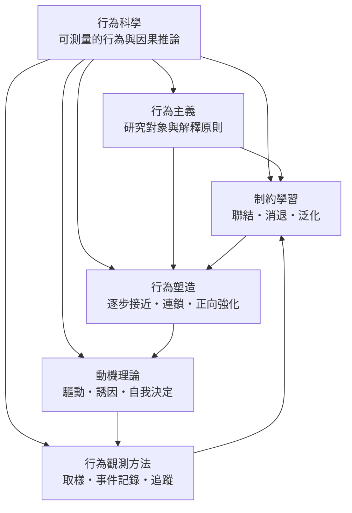

# 行為科學

> 隸屬：第一層 [人]　·　相關分類：[心理學]、[認知科學]、[社會心理學]、[行為經濟]、[發展心理學]　·　子分類總表見 [README]

> 對應維基百科：[中文維基百科：行為科學](https://zh.wikipedia.org/wiki/%E8%A1%8C%E4%B8%BA%E7%A7%91%E5%AD%A6)　·　[English Wikipedia: Behavioural sciences](https://en.wikipedia.org/wiki/Behavioural_sciences)

行為科學是一門**以可觀察、可測量的行為為研究對象**的學科群。它的核心信念是：只要把行為拆成「刺激—反應—結果」的具體關係，諸如學習、動機、偏差與決策這類向來被認為只能內省、只能描述的現象，就能變成有實驗設計、有量化指標、有可重複檢驗的科學對象。這一信念在 1910 年代由 [華生] 明確提出，在 1930 年代由 [桑代克] 與 [巴甫洛夫] 各自以實驗奠定基礎，並在 [斯金納] 的操作制約工作中達到方法上的頂峰。

然而行為科學的歷史，同時也是一部**反覆越界的歷史**。它先是把內省與意識排除在研究之外，卻又不得不承認人類的行為遠比動物複雜；它建立了「刺激—反應」的簡潔模型，卻在 1950 年代末被 [認知科學] 逼著重新接回表徵、記憶與推理；它在組織管理中提出激勵理論，卻在 1980 年代被 [行為經濟] 用來解釋為何「給獎勵反而更差」。**因此本概念的困難從來不是「行為能不能被研究」，而是「哪些行為現象值得用外在變數來解釋，以及解釋的邊界畫在哪裡」。**

## 核心問題

### 一、什麼算作可測量的行為

行為科學的第一道門檻是**操作化**：把抽象名詞轉成可以逐次計數的事件。「攻擊」不是行為，「在 3 秒內推了一下對方的肩膀」才是；「焦慮」不是行為，「對中性刺激的呼吸頻率增加」才是。這個門檻看似嚴格，卻也產生了領域最持久的爭議——**測量會剪裁現象**，把無法數化的意義、意圖與關係排除在資料之外。

### 二、關聯還是由果

行為科學的方法論核心是**實驗設計**：隨機分配、控制組、前後測與統計檢定，允許研究者從「X 與 Y 同時出現」推進到「改變 X 會改變 Y」。但實驗室條件與真實生活終究不同：制約箱裡的老鼠不是飢餓的人，問卷裡的自我報告不是課堂上的舉手。**外部效度**因此是本領域最難防守的部分。

### 三、行為背後有沒有內在歷程

行為主義最初的答案是「沒有需要內在歷程」，或更精確地說「內在歷程即使存在，也不必被假設」。認知革命之後，這一答案被普遍放棄：注意、記憶、表徵與目標都是理解行為的必要成分。取而代之的問題是：**內在歷程與外在變數如何共同決定行為**，以及在什麼條件下，只要外在變數就夠了。

### 四、描述與改變的界線

行為科學不只是描述行為，也設計介入（介入分析、行為契約、教學程式）。這使它帶有工程色彩：目標、行為、強化物、結果，一組可最佳化的變數。於是出現了一個倫理性問題：**當改變行為的技術足夠有效時，「有效」是否足以構成「應該」的理由**。

## 因果鏈

1. **實驗心理學的建立**：19 世紀末的德國實驗室傳統把感覺、知覺與反應時間帶進受控情境，證明心理現象可以用儀器與統計處理。**「心理學可以像物理學一樣做實驗」**這句話，是行為科學能夠成立的前提。

2. **動物的學習實驗（1890 年代）**：[桑代克] 的迷箱實驗記錄了貓逃出時間與錯誤次數的下降，並提出**效果律**——帶來滿足的結果會強化反應。他同時發明**學習曲線**，讓「學會了」變成可畫在紙上的函數。

3. **消化生理學的意外副產品（1900 年代）**：[巴甫洛夫] 在研究狗的消化反射時發現，**中性刺激（鈴聲）只要反覆與食物配對，就能單獨引起唾液分泌**。1904 年的諾貝爾生理學或醫學獎是頒給他的消化生理學研究，而對心理學影響最大的部分卻是那個副產品。

4. **行為主義的宣言（1913）**：[華生] 發表〈心理學如行為學家之所觀〉，主張以可觀察行為為唯一合法的研究對象，把內省與意識逐出科學。**方法論的主張第一次與研究對象的主張合流**，行為科學因此有了名字與立場。

5. **操作制約與強化程式（1930 年代）**：[斯金納] 證明**自發行為**同樣可以被選擇性地塑造，並以 [斯金納箱] 把強化程式（固定與變動的比率、時距）變成可參數化的設計工具。行為科學在這裡獲得可攜、可複製的技術核心。

6. **激勵理論的工程化（1940–1970 年代）**：[馬斯洛] 的需求層次將動機從生理驅動擴展到成長需求，[德西] 的自我決定理論則補上自主與歸屬；組織行為學把這些命題轉成管理介入。到此，**行為科學從實驗室走向組織與教育**。

7. **認知革命的反衝與重新分工（1950 年代末起）**：[認知科學] 證明人類的學習與推理無法只用刺激—反應聯結解釋，語言、記憶與推理必須被建模。行為科學於是被迫回答一個新問題：**制約與觀察學習在認知架構裡佔什麼位置**——答案是從「解釋全部」退居為「解釋其中的聯結層」。

8. **行為經濟與公共政策的合流（1990 年代至今）**：[行為經濟] 證明人在有限理性下的偏誤可被系統描述並在市場中造成可測量的損失；與此同時，行為科學的觀測方法被導入政策評估與健康行為改變。**「以行為為單位」的干預**從實驗室走進公共衛生、教育與產品設計。

## 子分類的定位與相互驅動

- [行為主義] 是**方法論的地基**。它決定什麼東西可以當成研究對象、什麼樣的證據算數，並把「可重複的實驗」確立為領域的合法性來源。**[心理學流派] 與 [心理學方法] 兩條線都從它這裡取得標準**，同時它留下的「內在歷程被排除」的缺口，也正是 [認知科學] 施壓的位置。

- [制約學習] 是**機制的核心**。[古典制約]、[操作制約]、[強化原理] 提供本領域最精確的行為改變模型：刺激如何取得預測價值、反應如何被結果選擇、消退與自發恢復如何暴露「聯結」其實是抑制性的。**它是其他子分類的共同詞彙表**——教學設計、組織制度設計、臨床行為治療都在借用它的術語。

- [行為塑造] 是**制約原理的工程化應用**。當目標行為無法一次出現（不會游泳、不會用筷子、不會寫出完整句子），[逐步接近]、[連鎖制約] 與 [正向強化] 提供一條可操作的分解路徑。**它是理論與真實世界之間的橋**，因為它處理的正是「不會做」到「會做」之間那段最難的歷程。

- [動機理論] 是**方向的解釋層**。[驅力減退說]、[誘因說] 與 [自我決定論] 回答「行為為什麼朝這個方向發動」，並提供了行為科學中少數能跨到組織管理與經濟學的命題。它也是本領域中**最依賴內在狀態**的一支，因此與認知取向的張力最大。

- [行為觀測方法] 是**證據的來源層**。[行為取樣]、[事件記錄] 與 [追蹤研究] 決定了行為資料如何被採集、抽樣與追蹤。**它是最容易被忽略、卻最決定結論可信度的一支**：同一個介入方案，用不同觀測方法會得到完全不同的效果量估計；[霍桑效應] 這類現象提醒我們，觀測本身會改變被觀測的行為。

## 範例：把一個模糊目標變成可測量的行為鏈

以「我要讓學生更願意在課堂上發言」這個典型的教育介入為例，可以看見五個子分類如何依序接手：

1. **先做操作化（用 [行為觀測方法]）**：把「願意發言」改寫為可計數的事件——「在沒有被點名的情況下，於 60 秒內舉手並說出一句完整的話」。用 [行為取樣] 的間歇時間取樣法記錄：每堂課 5 分鐘掃描一次，全課 40 分鐘共 8 個掃描點。假設基線為每堂平均 3 次自發發言（每掃描點約 0.4 次），這個數字之後成為一切比較的基準。

2. **判斷行為是否已被制約（用 [制約學習]）**：若學生在學過「答對會被讚美」之後，仍只有 3 次，這表示發言與結果之間**尚未建立穩定的聯結**，問題不在動機而在條件化。檢查 [泛化與分化] 的層次：只會在數學課發言而在國語課不發言，表示聯結是**情境特異**的，需要把強化在更多情境中配對。

3. **選對介入方式（用 [行為塑造]）**：目標是「說出完整的句子」，而基線幾乎為零，此時不適合直接要求完整發言。改用 [逐步接近]：先獎勵「舉手」，再獎勵「舉手並說出兩個字」，最後才是完整句子。強化程式採**變動比率**（平均每 2 次符合的行為給一次讚美），使學生無法預測何時會被獎勵，因而維持穩定的嘗試率。

4. **決定獎勵的性質（用 [動機理論]）**：若獎勵改用貼紙或記分，而學生原本的發言動機是「被同學聽到有意思的觀點」，則依 [自我決定論]，**掌控性的獎勵會侵蝕自主感**，長期可能使發言量不升反降。此時把獎勵改成資訊性的（具體指出「你剛才的例子很清楚」），並保留學生自選討論主題的權利。

5. **驗證效果與維持（用 [行為觀測方法]）**：介入兩週後重測掃描紀錄，記錄每堂平均發言次數與全班參與人數比例；以 [事件記錄] 記錄每次強化發生的時間點與形式，以 [追蹤研究] 在獎勵撤除後的第 1 週與第 4 週各測一次，看效果是否維持。**撤除階段的數據往往比介入階段更有判斷力**：若第 4 週回到 3 次，說明學習到的只是「為了貼紙」，需要改變獎勵結構；若維持 8 次以上並且出現自發提問，則聯結已內化。

6. **這個案例的教訓**：整個流程中沒有一步是「動機」或「條件反射」單獨解決的。**操作化決定資料的品質，制約原理決定介入的結構，動機理論決定獎勵的形式，觀測方法決定結論的可信度**。這正是 [行為科學] 作為一個概念群而非單一學科的理由。

## 容易混淆之處

- **行為科學不等於行為主義**：行為主義是一套方法論主張（只研究可觀察行為），行為科學則是包含 [動機理論] 與 [行為觀測方法] 等多支的領域；把兩者畫上等號，等於否定了動機研究的存在。
- **「行為」不等於「肌肉動作」**：語言、推理、選擇與情緒表達都是行為；把行為窄化為可見動作，會讓研究對象系統性地偏向簡單反應而失去解釋力。
- **相關不等於因果**：焦慮與成績下降同時出現，不表示焦慮造成成績下降；本領域的因果主張必須由實驗設計或縱貫資料支撐。
- **制約不是洗腦**：制約是聯結的形成機制，本身不含價值判斷；把它與意識形態控制混為一談，會掩蓋教育與臨床中真實的倫理問題。
- **強化不是獎勵**：**強化是行為之後結果對未來頻率的影響**，獎勵只是可能的後果；行為之後給東西並不必然是強化（例如事後補發已不合意的獎品）。
- **正向強化不等於讨好**：正向強化是增加行為的頻率，它同時可以用於值得維持的行為與不值得維持的行為；判準在目標，不在手法。
- **觀測到的改變不等於機制的改變**：行為數據變好可能來自注意力效應、期待效應或測試效應；[霍桑效應] 提醒我們，被觀測本身就會改變行為。

## 延伸閱讀

- [心理學]：行為科學的母體領域與方法學背景。
- [認知科學]：行為科學在認知革命後的重新定位與互補關係。
- [心理學流派]：行為主義、精神分析與認知革命三條路線的分歧。
- [心理學方法]：實驗設計、測量與重複性改革的討論。
- [社會心理學]：從眾、態度與群體行為等社會情境下的行為資料。
- [行為經濟]：有限理性與系統偏誤如何改變經濟學的行為假設。
- [心理治療]：行為取向的臨床應用與其限制。
- [發展心理學]：制約與觀察學習在發展歷程中的年齡差異。

## 連結定義

[人]: ../人/README.md
[README]: README.md
[心理學]: ../心理學/README.md
[認知科學]: ../認知科學/README.md
[社會心理學]: ../社會心理學/README.md
[行為經濟]: ../行為經濟/README.md
[發展心理學]: ../發展心理學/README.md
[心理治療]: ../心理治療/README.md
[心理學流派]: ../心理學/心理學流派.md
[心理學方法]: ../心理學/心理學方法.md
[霍桑效應]: ../心理學/霍桑效應.md
[行為主義]: 行為主義.md
[制約學習]: 制約學習.md
[古典制約]: 古典制約.md
[操作制約]: 操作制約.md
[強化原理]: 強化原理.md
[行為塑造]: 行為塑造.md
[逐步接近]: 逐步接近.md
[正向強化]: 正向強化.md
[動機理論]: 動機理論.md
[驅力減退說]: 驅力減退說.md
[連鎖制約]: 連鎖制約.md
[行為科學]: 行為科學.md
[誘因說]: 誘因說.md
[自我決定論]: 自我決定論.md
[行為觀測方法]: 行為觀測方法.md
[行為取樣]: 行為取樣.md
[事件記錄]: 事件記錄.md
[追蹤研究]: 追蹤研究.md
[華生]: ../人/心理學家/華生.md
[桑代克]: ../人/心理學家/桑代克.md
[巴甫洛夫]: ../人/心理學家/巴甫洛夫.md
[斯金納]: ../人/心理學家/斯金納.md
[斯金納箱]: ../物/斯金納箱.md
[馬斯洛]: ../人/心理學家/馬斯洛.md
[德西]: ../人/心理學家/德西.md
[泛化與分化]: 泛化與分化.md
