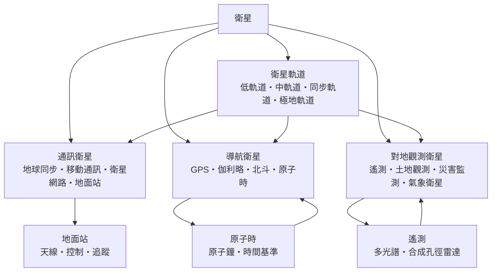

# 衛星

> 隸屬：第一層 [天]　·　相關分類：[天文學]、[物理學]、[力學]、[火箭]、[航空工程]、[導航]、[地球與大氣科學]　·　子分類總表見 [README]

> 對應維基百科：[中文維基百科：衛星](https://zh.wikipedia.org/wiki/%E8%AD%AF%E6%98%9F)　·　[English Wikipedia: Satellite](https://en.wikipedia.org/wiki/Satellite)

衛星是繞著另一個天體運行的人造天體。它把人造物件送上軌道，讓物件脫離地球表面的大氣阻力與地形阻礙，之後只靠重力與慣性維持運動——這是「人造衛星」與「飛機」的根本差別：飛機每秒都要靠空氣與升力撐住自己，衛星則只靠速度與位置。

衛星這個概念的重要性，不在於它是一件太空器，而在於它開闢了一種新的**工作位置**：人類第一次可以把儀器放在地球上空，於是地面觀測、通訊、導航與時間標準這四件事都獲得了一個不受地形、天候與距離限制的落腳點。1969 年的登月之所以能夠發生，前提正是 [1961年] 之後有一套成熟的運載、追蹤與地面控制體系；而這套體系的核心零件就是衛星。

要理解衛星，最好的起點是開普勒定律與牛頓力學。當衛星在高度 $h$ 的圓軌道上運行時，重力提供向心力：

$$
\frac{GM m}{r^2} = \frac{m v^2}{r}
$$

其中 $G$ 為萬有引力常數、 $M$ 為地球質量、 $m$ 為衛星質量、 $r$ 為地心距離。解出軌道速度 $v = \sqrt{GM/r}$ 後，可以立刻得到一個關鍵結論：**軌道越高，速度越慢**。地表附近的近地軌道速度約 $7.9\ \mathrm{km/s}$ ，而地球同步軌道僅需約 $3.07\ \mathrm{km/s}$ 。這個反直覺的關係，正是「高軌省燃料、低軌延遲小」這組取捨的物理根源。

## 核心問題

衛星工程的核心問題可以濃縮成五個互相牽動的問題。

1. **放得上去嗎**：衛星必須被加速到軌道速度而不是「拋得夠高」。對近地軌道而言，所需能量相當於把衛星加速到接近第一宇宙速度，這是 [火箭] 的課題。
2. **留在原位嗎**：軌道是精密平衡的結果，任何速度誤差都會讓衛星漂移到另一條軌道。軌道維持需要姿態控制、推進劑與地面指令，這是 [自動控制] 與 [精密儀器] 的課題。
3. **看得見或聯得上嗎**：衛星的任務是「對外作用」——觀測地球、傳遞訊息、提供時間。這需要天線、電源、資料處理與地面站的完整鏈路。
4. **能活多久嗎**：在近地軌道，大氣阻力會緩慢拉低軌道，壽命從數月到數十年不等；在地球同步軌道，壽命可達數千年，但必須靠定點保持來抵抗太陽輻射壓與月球的潮汐擾動。
5. **值多少錢**：每公斤入軌成本決定了一切商業模式的成立與否，這也是 [材料工程] 與 [電子工程] 持續推進輕量化與高整合度背後的經濟動力。

五者的關係是：火箭決定上限，軌道決定性能，控制決定可靠性，任務載荷決定價值，成本決定規模。任何一環斷裂，衛星事業即無法成立。

## 因果鏈

1. **先有理論**：17 世紀 [伽利略] 與開普勒以觀測確立行星運動的三條定律，牛頓在《原理》中把它們推導成萬有引力與運動定律；衛星在 20 世紀能夠被設計，本質上是把這套數學「反轉」成工程問題。
2. **戰爭的推力**：1957 年 10 月 4 日（見 [1957年]），[科羅廖夫] 主持的團隊以 [斯普尼克一號] 把 58 公分直徑的金屬球送入 65 公里高的軌道，開啟了太空時代；冷戰的軍備競賽提供了持續而龐大的經費。
3. **運載能力的躍升**：從 [拜科努爾] 的 [斯普尼克一號] 到 [卡納維爾角] 的土星五號，運載能力數量級的提升，讓同步軌道衛星、月球探測與載人飛行依序成為可能。
4. **通信與導航的實用化**：1962 年電傳通訊衛星與 1964 年後的同步通信衛星，把洲際電話的成本結構徹底改寫；1961 年起的美軍導航衛星計畫（後成為 GPS 之前身），開啟了衛星導航的時代。
5. **科學用途的擴張**：從探測月球背面，到 1960 年代起的天氣觀測、海洋觀測與地磁監測，衛星成為天文學與地球科學唯一能取得全球一致資料的工具。
6. **微電子與衛星平台化**：積體電路的成熟讓衛星從數噸的專用巨型設備，縮成數百公斤、數千萬美元的標準化平台；[材料工程] 的複合材料與高比能電池進一步壓低每公斤成本。
7. **衛星產業的形成**：通訊、導航、遙測與氣象四大需求各自形成穩定的商業模式，使衛星從一次性科研計畫變成可預購、可續約的基礎設施。
8. **新興用途與星座化**：低軌巨型星座把衛星從「單顆貴重資產」變成「網路節點」，讓 [衛星定位] 與 [太空站] 之間的界線重新被劃定。

## 子分類的定位與相互驅動

- [衛星軌道] 是**物理的落點**：軌道決定了衛星的視角、滯延、覆蓋率與壽命，任何任務需求都必須先轉換成一條軌道參數，才進入其餘設計。
- [通訊衛星] 是**最大的商業分支**：它把「傳送大量資料」的需求攤在長距離線路上，用同步軌道換取固定的天線指向；低軌星座則用數量換取低延遲。
- [導航衛星] 是**最精密的分支**：導航需要幾公尺的定位誤差，因此必須同時解決原子時基準、星曆計算、相對論修正與訊號幾何這些難題。
- [對地觀測衛星] 是**科學與公共服務分支**：它從被動感測到主動雷達，提供了氣象預報、農業估產與災害預警的資料基礎。

四者並列而非上下位，是因為它們共用同一套基礎設施——運載火箭、地面站網、姿態控制與時間同步——卻服務完全不同的使用者。事實上，正是共用帶來了「一星多用」的嘗試（例如導航衛星兼載搜救訊號器），也帶來了頻譜與軌位爭奪等新問題。

## 範例

**範例一：軌道高度與速度、週期的關係。** 對圓軌道，週期為 $T = 2\pi\sqrt{r^3/GM}$ 。以地球的 $GM = 3.986\times 10^{14}\ \mathrm{m^3/s^2}$ 計算：

- $r = 6{,}371 + 400 = 6{,}771\ \mathrm{km}$ （高度 400 km 的近地軌道）： $v \approx 7.67\ \mathrm{km/s}$ ， $T \approx 92.4$ 分鐘。
- $r = 6{,}371 + 35{,}786 = 42{,}157\ \mathrm{km}$ （地球同步軌道）： $v \approx 3.07\ \mathrm{km/s}$ ， $T \approx 23\ \mathrm{h}\ 56\ \mathrm{min}$ ，恰為地球對恆星自轉一圈的時間。
- $r = 6{,}371 + 20{,}200 = 26{,}571\ \mathrm{km}$ （GPS 軌道）： $v \approx 3.87\ \mathrm{km/s}$ ， $T = 12\ \mathrm{h}$ 。

這說明了一件在工程上非常實用的事：**GPS 衛星每半圈繞地球一次，恰好等於地球自轉兩圈的一半**，所以地面上同一顆衛星每天大致在同一時刻升到同一個方位，方便以固定天線連續追蹤。

**範例二：通訊延遲的估算。** 訊號以光速傳播，往返地面與同步軌道的總距離約 $2\times 35{,}786 = 71{,}572\ \mathrm{km}$ ，因此單向往返的延遲約為：

$$
\Delta t = \frac{71{,}572}{299{,}792} \approx 0.239\ \mathrm{s}
$$

也就是說，一顆同步通訊衛星處理一次「地面—衛星—地面」的語音通話，單是傳播延遲就有 0.24 秒，再加上衛星本體的處理與編排。相較之下，低地軌道衛星距離只有 500 至 1,200 公里，往返延遲約 3 至 8 毫秒，這正是低軌星座在視訊與雲端服務上更具優勢的物理原因。

**範例三：太陽同步軌道的存在理由。** 若要讓衛星每天在同一地方時間通過同一地點（例如每天上午 10 整掠過某塊農田），軌道的進動率必須等於地球公轉的平均角速度，約為每年 $360^\circ / 365.25 \approx 0.9856^\circ$ 每天。由攝動方程可知，軌道面進動率取決於軌道半長軸與傾角的組合，結果是必須採用約 700 至 800 公里高度、接近 $98^\circ$ 傾角的**太陽同步軌道**。氣象與土地觀測衛星幾乎都選在這條軌道上，正是為了每天取得光照條件一致、可直接比較的影像。

## 容易混淆之處

- **衛星不是「飛得很高的飛機」**：飛機靠空氣升力維持高度，衛星靠軌道速度；衛星的空氣阻力在近地軌道並不為零，只是相對微弱，它讓軌道在數月到數十年間緩慢衰變。
- **同步軌道不等於同步自轉**：同步軌道只保證衛星繞地球一圈的時間等於地球自轉週期；若軌道傾角不為零，衛星仍會在南北方向上下來回，覆蓋圖形呈「8」字形。真正的地球靜止軌道還要求軌道面位於赤道面且轉動方向與地球自轉一致。
- **通訊衛星與導航衛星的「同步」意義不同**：通訊衛星要求**連續可見**，導航衛星反而刻意用 12 小時軌道讓衛星逐步移出視野，避免單一區域被過度覆蓋。
- **GPS 的精度不是固定的**：一般民用接收機單點定位精度約數公尺至十數公尺，取決於衛星幾何、訊號多路徑與接收機演算法；差分與載波相位技術才可達公分類精度。
- **遙測不是「遠端遙控」**：在衛星領域，遙測（remote sensing）指的是從遠方量測地表特徵，而非把資料傳回地球的遙測遙控。中文常把兩者混用，是本領域最常見的詞彙陷阱。
- **原子鐘在導航衛星上的作用是「時間同步」而非「定位」**：衛星並不知道自己在哪裡，它只會廣播自己的時間與位置；接收機靠四顆以上衛星的時間差算出距離，定位是接收機的工作。
- **太空垃圾是衛星的環境問題而非單一事件**：失效衛星、火箭殘骸與碎片共同構成了近地軌道的擁塞環境，直接限制了可用軌道與壽命設計。

## 延伸閱讀

- [力學]：軌道運動的力學基礎，牛頓定律是全部軌道設計的起點。
- [天文學]：衛星的姿態、指向與觀測目標屬於天體力學與天文觀測的範疇。
- [火箭]：把衛星送入軌道是運載火箭的任務，與載人航天共用同一套技術。
- [航空工程]：與衛星最接近的工程分支，姿勢控制與熱控的思路可直接移植。
- [自動控制]：軌道維持、姿態控制與星座自主編隊的共同基礎。
- [精密儀器]：星敏感器、原子鐘與天線量測技術的來源地。
- [導航]、[衛星定位]：導航衛星的應用端與地面段。
- [地球與大氣科學]、[氣象學]：對地觀測衛星的資料生產者與主要使用者。
- [太空站]、[太空旅行]：與衛星同源的軌道載具族群。
- [相對論]：導航衛星必須修正時鐘因重力與速度造成的差異。
- [馮卡門]：把流體力學帶入衛星氣動與熱設計的關鍵人物。

## 連結定義

[天]: ../天/README.md
[README]: README.md
[天文學]: ../天文學/README.md
[物理學]: ../物理學/README.md
[力學]: ../力學/README.md
[火箭]: ../火箭/README.md
[航空工程]: ../航空工程/README.md
[導航]: ../導航/README.md
[地球與大氣科學]: ../地球與大氣科學/README.md
[自動控制]: ../自動控制/README.md
[精密儀器]: ../精密儀器/README.md
[材料工程]: ../材料工程/README.md
[電子工程]: ../電子工程/README.md
[氣象學]: ../氣象學/README.md
[相對論]: ../相對論/README.md
[衛星定位]: ../衛星定位/README.md
[太空站]: ../太空站/README.md
[太空旅行]: ../太空旅行/README.md
[衛星軌道]: 衛星軌道.md
[通訊衛星]: 通訊衛星.md
[導航衛星]: 導航衛星.md
[對地觀測衛星]: 對地觀測衛星.md
[伽利略]: ../人/物理學家/伽利略.md
[科羅廖夫]: ../人/工程師/科羅廖夫.md
[馮卡門]: ../人/工程師/馮卡門.md
[斯普尼克一號]: ../物/斯普尼克一號.md
[拜科努爾]: ../地/拜科努爾.md
[卡納維爾角]: ../地/卡納維爾角.md
[1957年]: ../時/1957年.md
[1961年]: ../時/1961年.md
