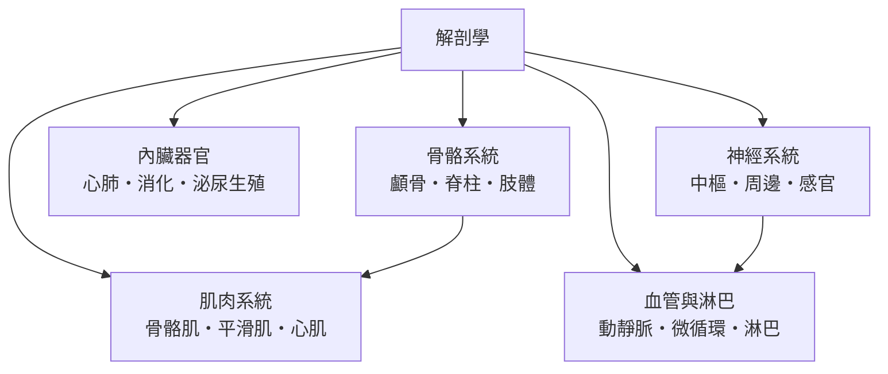

# 解剖學

> 分類範圍：以「身體由什麼構成、如何排布」為核心的形態學部門——骨骼、肌肉、內臟、神經與循環淋巴五大系統——並說明結構與功能的互相塑造。　·　隸屬第一層：[醫]　·　相關分類：[生理學]、[醫學史]、[病學]　·　子分類總表見 [README]

> 對應維基百科：[中文維基百科：解剖学](https://zh.wikipedia.org/wiki/%E8%A7%A3%E5%89%96%E5%AD%A6)　·　[English Wikipedia: Anatomy](https://en.wikipedia.org/wiki/Anatomy)

解剖學研究身體的**構造與位置**：什麼器官在哪裡、由什麼構成、與相鄰結構如何接合。它與生理學是一體的兩面——解剖學回答「是什麼形狀」，生理學回答「如何運作」。本概念的問題是：**看得見的結構，如何一步步被看清楚；而看清楚結構，又如何反過來改變醫學**。

## 核心問題：結構即功能

解剖學的第一原理可以濃縮成一句：**形狀不是裝飾，是功能的展開**。

- 骨骼的中空管狀設計：以最少的材料承受最大的彎矩。
- 小腸的絨毛褶皺：把吸收面積展開到約三百平方公尺。
- 肺泡的蜂窩結構：在有限胸腔容積內裝入約七十平方公尺的氣體交換面。

每一處「設計」都是選擇壓力留下的答案——這也是解剖學與演化學共享的語言。

## 因果鏈

1. **觀察的禁令與突破**：古代解剖以動物屍體推斷人體，錯誤延續千年；屍體解剖的合法化使直接觀察成為可能。
2. **印刷圖譜的標準化**：精細版畫使解剖知識可以被準確傳播——圖譜取代口述，教學脫離「只看一次」的限制。
3. **顯微與組織學**：顯微鏡把解剖推入組織與細胞層級；「器官由組織構成、組織由細胞構成」的層級觀念成形。
4. **造影技術**：X 光、斷層掃描與磁振造影使解剖學**活體化**——醫生第一次可以在病人生前看到內部。
5. **分子與影像導引**：現代解剖學與分子標記、影像導引手術結合；教科書的平面圖譜被三維互動模型補充。

## 子分類的定位與相互驅動

- [骨骼系統] 是**支架**：所有軟組織的座標系。
- [肌肉系統] 是**引擎**：骨骼肌管運動，平滑肌與 [心肌] 管內部動力。
- [內臟器官] 是**工廠**：代謝、消化、排泄與生殖的功能區。
- [神經系統] 是**控制網**：[中樞神經] 決策，[周邊神經] 通訊。
- [血管與淋巴] 是**物流網**：血液運氧與養分，淋巴回流組織液並承擔免疫。

## 範例：一次觸診的解剖學

以醫師檢查一位腹痛病人為例，看解剖知識如何運作：

1. **定位**：右上腹的疼痛先聯想到肝與膽囊；肚臍周圍則考慮小腸——**腹部被幾條水平與垂直線劃分為九區**，每區對應固定的臟器清單。
2. **層次**：觸診壓到的依序是皮膚、皮下脂肪、腹壁肌肉、腹膜、臟器；「壓痛在腹壁還是深部」的判斷完全依賴對層次的掌握。
3. **體表投影**：闌尾的體表投影點（麥氏點）讓醫師用手指定位一個藏在體內的器官。
4. **影像對照**：超音波所見再與解剖分區核對——造影與觸診共用同一套解剖座標。

## 閱讀解剖的三把鑰匙

1. **方位術語**：頭側與尾側、前與後、淺與深——所有描述都在這套座標內；先掌握術語，圖譜才讀得懂。
2. **層次思維**：身體是分層的（皮膚、筋膜、肌肉、腔膜、臟器）；手術入路的設計就是沿層次前進。
3. **比對實物**：圖譜是理想化的人，實體與影像才是變異的人；兩者反覆比對才有真正的空間感。
4. **名稱的語源**：解剖名詞多為拉丁與希臘語根（如「動脈」的字面義是「氣管」，源自古人的錯誤認知）；讀懂語源，名稱就從負擔變成提示。

## 容易混淆之處

- **解剖學不等於屍體解剖**：活體造影與影像解剖已是當代的主戰場。
- **個體差異是真實的**：血管走向、器官位置的變異常見；「教科書解剖」只是眾數。
- **形狀與功能不能單向推論**：知道結構不保證懂功能；生理學的驗證不可省略。
- **解剖名詞有多套傳統**：中醫與西醫的臟器概念不完全對應；比較時須注意語源。

- **與臨床的接點**：每一套解剖都會在某個臨床情境被用到；學習時把結構與「它出問題時會怎樣」綁在一起，記憶會更牢。

## 延伸閱讀

- [生理學]：功能面的姊妹學科。
- [病學]：結構異常的病理分析。
- [醫學史]：解剖學的觀察史。
- [生理學史]：形態與功能的歷史交會。

## 連結定義

[醫]: ../醫/README.md
[README]: README.md
[生理學]: ../生理學/README.md
[病學]: ../病理學/README.md
[醫學史]: ../醫/README.md
[生理學史]: ../生理學/README.md
[骨骼系統]: 骨骼系統.md
[肌肉系統]: 肌肉系統.md
[內臟器官]: 內臟器官.md
[神經系統]: 神經系統.md
[血管與淋巴]: 血管與淋巴.md
[心肌]: 心肌.md
[中樞神經]: 中樞神經.md
[周邊神經]: 周邊神經.md
