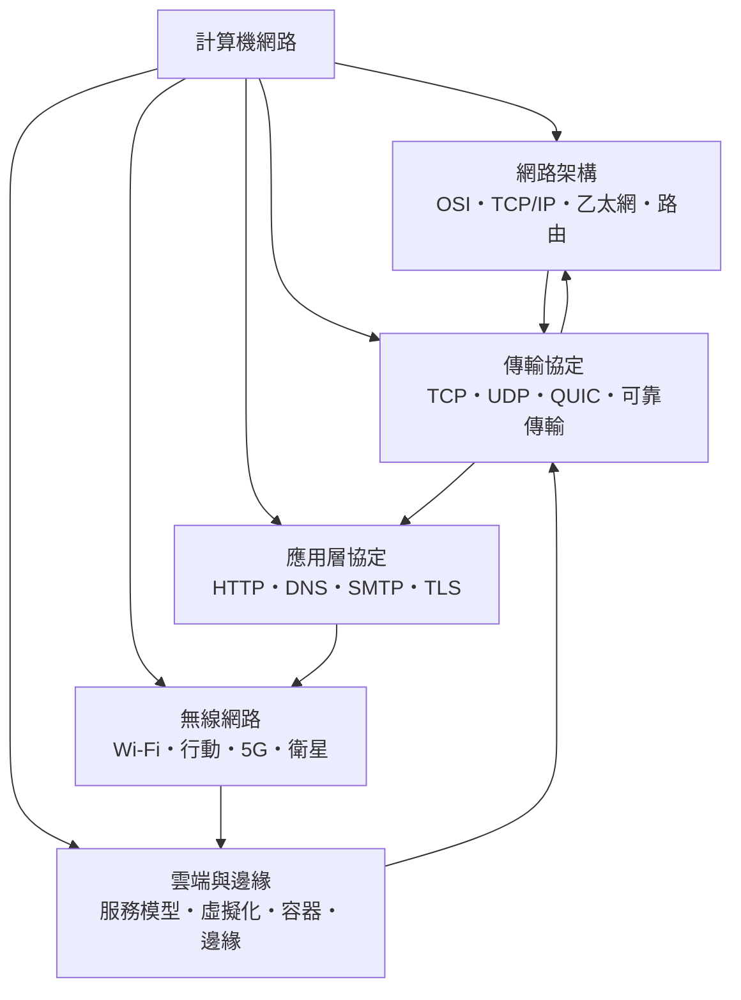

# 計算機網路

> 隸屬：第一層 [工]　·　相關分類：[資訊安全]、[通訊工程]、[軟體工程]　·　子分類總表見 [README]

> 對應維基百科：[中文維基百科：计算机网络](https://zh.wikipedia.org/wiki/%E8%AE%A1%E7%AE%97%E6%9C%BA%E7%BD%91%E7%BB%9C)　·　[English Wikipedia: Computer network](https://en.wikipedia.org/wiki/Computer_network)

計算機網路是**讓分散的計算設備彼此通訊並共享資源的技術與體系**。它的核心問題只有一句：如何讓兩台不在同一台機器上、甚至不在同一個房間的裝置，以可靠且可理解的方式交換資料。

網路的歷史是一段「抽象層層增加」的歷史。[梅特卡夫] 在 1970 年代初提出的 [乙太網] 讓許多電腦共享一條同軸電纜，把問題從「兩點專線」變成「共享媒介上的分組」；[倫納德] 與 [克恩] 在 1970 年代中期提出的 [TCP] 與 [TCP/IP] 則解決了「不同型態的網路如何互連」的問題，確立了分層與端對端的設計原則。此後的三十年，幾乎所有技術進步都發生在既有分層之上：更快的有線與無線鏈路、更可靠的傳輸、更安全的交握、更高的應用層效率。

進入雲端與行動時代後，網路的概念邊界再度外擴：[雲端與邊緣] 這一子分類處理的是運算資源如何被配置與調度，而不只是封包如何流動；[無線網路] 處理的是鏈路如何共享於無限的行動裝置。網路設計的核心挑戰也隨之改變：從「如何把頻寬從 A 送到 B」變成「如何在不可預測的行動性與多租戶環境中，同時滿足頻寬、延遲、可靠性與安全」。

## 核心問題

網路設計可用四個互相拉扯的量來刻畫。

1. **延遲（latency）**：資料從來源到目的地的單程時間。傳輸層與路由設計主要在此較勁。
2. **吞吐量（throughput）**：單位時間內可傳送的資料量，受瓶頸頻寬與壅塞控制影響。
3. **可靠性（reliability）**：在故障、遺失與重排之下，資料仍能正確送達；這是 [可靠傳輸] 的課題。
4. **安全性**：資料不被竊聽、不被竄改、對端身分可被證明；這是 [資訊安全] 與本領域的交界。

這四者無法同時最佳化，這就是網路工程的核心張力。例如 [TCP] 以重傳與視窗控制換取可靠交付，代價是延遲在遺失時可能劇烈上升（這是「TCP 尾延遲」的來源）；[UDP] 放棄可靠性以換取低延遲，於是應用必須自己處理遺失。

另一組張力是**抽象與最佳化**。分層讓不同廠牌的設備能互通，但每層的封裝都有固定成本；端到端原則則主張網路核心只做盡力交付、把聰明放在端點，這個立場在過去四十年被實踐證明是極為成功的，但也留下了今日的安全與中間人問題。

## 因果鏈

1. **類比電話與分時**：1960 年代的調解交換讓遠端通話成為可能，卻是語音專用且集中式的；資料的突發性與數位化需求推動了分組交換的構想。
2. **1969 年 ARPANET 啟用**：分組交換網路的第一個實作，證明多台計算機可以透過共享網路互動；其分層設計與「端對端原則」後來成為網際網路的骨架。
3. **1970 年代的乙太網**：[梅特卡夫] 提出以共享同軸電纜承載分組的區域網路，讓低成本連接成為可能，個人電腦與區域網路由此普及。
4. **1974 年 TCP/IP 論文**：[倫納德] 與 [克恩] 描述以分組交換與分層協定達成互連，明確提出網路核心簡單、端點負責可靠性的主張。
5. **1980 年代的分組交換與路由**：獨立路由的交換器與分層路由協定（如 [路由] 的层次化）使網路規模從數個節點擴展到數萬個節點。
6. **1980 年代末至 1990 年代：應用層的繁榮**：TCP/IP 之下，HTTP、[DNS]、[SMTP] 與 [TLS] 等協定建立起網際網路的應用秩序，DNS 與 HTTP 的普及讓網路從研究網路變成公共基礎設施。
7. **1990 年代至 2000 年代：無線與寬頻**：Wi-Fi 與行動網路讓連線從固定位置解放；連帶帶來 NAT、共享位址與行動性管理等新問題。
8. **2010 年代至今：加密普及與 QUIC**：幾乎所有流量都在加密通道內，使網路核心可觀測性下降，促使 QUIC 把可靠性與加密直接建於使用者空間；雲端與邊緣運算則把網路議題與運算資源調度合流。

## 子分類的定位與相互驅動

- [網路架構] 是**骨架層**：分層模型、鏈路層協定與路由共同決定「資料怎麼在網路上流動」，它是所有其他子分類的共同前提。
- [傳輸協定] 是**可靠性層**：[TCP]、[UDP] 與 [QUIC] 提供端到端的交付語意，並以流量與 壅塞控制 處理共享資源的公平性。
- [應用層協定] 是**語意層**：[HTTP]、[DNS]、[SMTP] 與 [TLS] 定義了資料的意義與交握方式，是使用者直接感知的部分。
- [無線網路] 是**接入層**：[Wi-Fi]、[行動網路]、[5G] 與 [衛星網路] 決定了最後一段鏈路的特性，並把共享、漫遊與排程問題帶進整個體系。
- [雲端與邊緣] 是**部署層**：[雲端服務模型]、[虛擬化]、[容器] 與 [邊緣運算] 決定了運算資源在哪裡，進而決定了資料要 travel 多遠、延遲有多高。

反過來說，應用層的需求會向下推動傳輸層（HTTP/3 需要 [QUIC] 的多路流），傳輸層的假設會向上限制應用層（可靠有序交付使即時語音難以使用），而雲端與邊緣的部署位置則重新定義了哪些鏈路必須被優化。

## 範例

**情境**：一家線上影音服務要讓使用者以低延遲觀看內容，同時不得被竊聽。

1. **接入層**：使用者的流量先進入 [Wi-Fi] 或 [行動網路] 接入，最後一段鏈路是共享且有損的，因此需要自適應位元率與前向錯誤更正來維持穩定畫質。
2. **命名與尋址**：使用者輸入網域名稱，由 [DNS] 解析出服務端的位址；若 DNS 查詢被中間人劫持，使用者會被導向假網站，因此 [DNS] 現今多以 [TLS] 加密傳輸（DNS over TLS 或 over HTTPS）。
3. **端到端加密**：使用者與服務端之間建立 [TLS] 連線，確保內容不被讀取；此步驟的交握延遲對首次載入影響顯著，因此 [QUIC] 把手交握與加密整合以縮短建立時間。
4. **傳輸層**：多路串流需求（多個請求並行、各自獨立丟包重傳）由 [QUIC] 的多路流提供，避免 [TCP] 的「一個分組遺失阻塞整條連線」的隊頭阻塞問題。
5. **內容分發**：為降低延遲與頻寬成本，內容預先放置在靠近使用者的邊緣節點（[邊緣運算]），讓傳輸距離縮短、減少回源流量。
6. **應用層**：以 [HTTP] 傳輸實際的媒體資訊，藉由快取標頭與分塊傳輸控制快取行為與延遲感受。
7. **可靠性與公平性**：在共享鏈路上，傳輸層以流量控制與 壅塞控制 分配容量，避免單一連線佔滿瓶頸。
8. **路由層**：封包在網際網路上經過多個 [路由] 節點轉送，每一跳都依 [路由] 表決定下一站；其正確性與穩定性直接決定延遲與遺失率。

這個情境說明：**使用者感受到的「網路品質」其實是多層設計的乘積**，任何一層的瓶頸都會表現為整體體驗的下降。

## 容易混淆之處

- **網路不等於網際網路**：網際網路只是全球最大的網路，區域網路、企業網路與行動網路皆為網路。
- **頻寬不等於延遲**：頻寬是容量，延遲是距離與處理的函數；提昇頻寬常無法降低延遲。
- **吞吐量不等於頻寬**：吞吐量受最小瓶頸限制，可能遠低於介面頻寬。
- **延遲與頻寬乘積不同於吞吐量**：緩衝區設計會讓「頻寬延遲積」影響串流速度，這在跨洋鏈路上尤為明顯。
- **TCP 與 UDP 不是新舊之分**：兩者是不同用途的並存工具，QUIC 也未取代 TCP。
- **OSI 模型不是 TCP/IP 的對手**：前者是參考模型，後者是實際部署的套組；實務上沒有人完整實作 OSI。
- **路由與交換不同**：路由是路徑選擇，交換是資料轉送；日常語境的「路由器」其實多為多層交換器。
- **容器不等於虛擬機**：容器的隔離是靠共享核心的名稱空間與權限邊界，不是硬體虛擬化。
- **雲端不等於無伺服器**：雲端服務模型中，運算資源的所在地與管理責任才是關鍵。

## 延伸閱讀

- [資訊安全]：網路的對手面與保護機制。
- [通訊工程]：訊號調變、無線通道與光纖等物理層技術。
- [軟體工程]：協定實作與應用建置的方法。
- [電腦]：主機與作業系統如何提供網路服務。
- [電磁學]：訊號在線路與介質中傳播的物理基礎。

## 連結定義

[工]: ../工/README.md
[README]: README.md
[資訊安全]: ../資訊安全/README.md
[通訊工程]: ../通訊工程/README.md
[軟體工程]: ../軟體工程/README.md
[電腦]: ../電腦/README.md
[電磁學]: ../電磁學/README.md
[網路架構]: 網路架構.md
[傳輸協定]: 傳輸協定.md
[應用層協定]: 應用層協定.md
[無線網路]: 無線網路.md
[雲端與邊緣]: 雲端與邊緣.md
[TCP]: TCP.md
[TCP/IP]: TCP/IP.md
[UDP]: UDP.md
[QUIC]: QUIC.md
[可靠傳輸]: 可靠傳輸.md
[HTTP]: HTTP.md
[DNS]: DNS.md
[SMTP]: SMTP.md
[TLS]: TLS.md
[Wi-Fi]: Wi-Fi.md
[行動網路]: 行動網路.md
[5G]: 5G.md
[衛星網路]: 衛星網路.md
[乙太網]: 乙太網.md
[路由]: 路由.md
[雲端服務模型]: 雲端服務模型.md
[虛擬化]: 虛擬化.md
[容器]: 容器.md
[邊緣運算]: 邊緣運算.md
[梅特卡夫]: ../人/工程師/梅特卡夫.md
[倫納德]: ../人/工程師/倫納德.md
[克恩]: ../人/工程師/克恩.md
