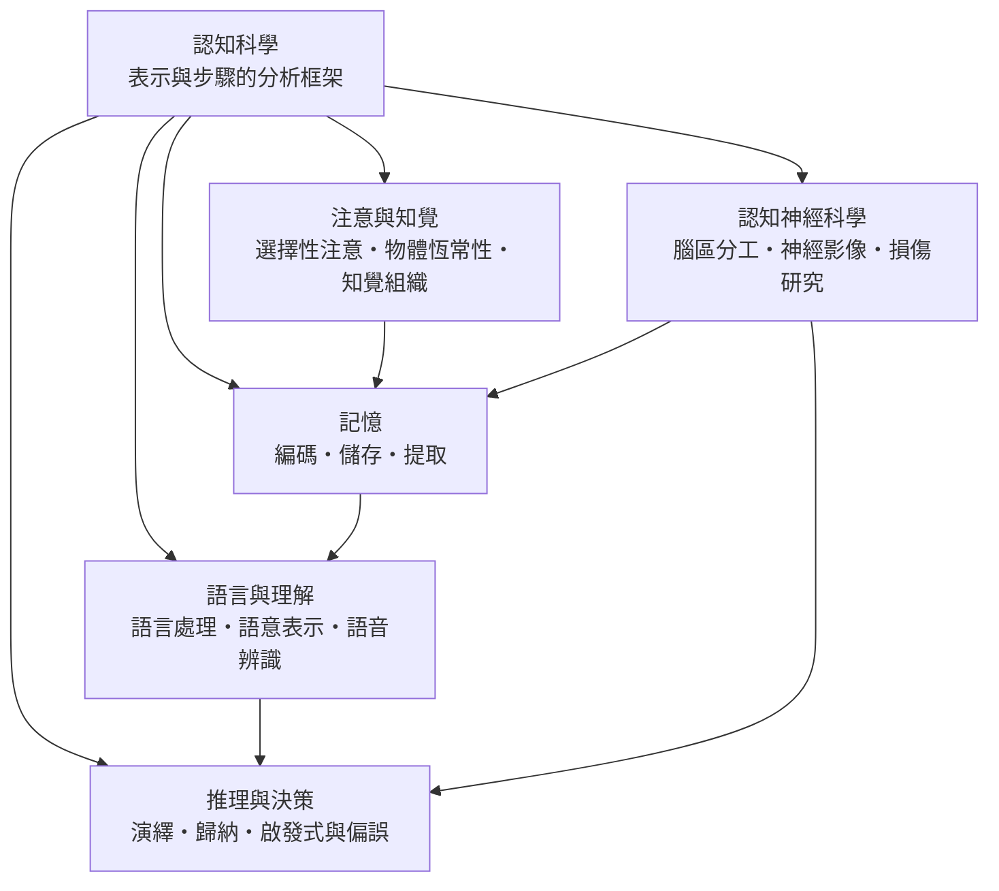

# 認知科學

> 隸屬：第一層 [人]　·　相關分類：[心理學]、[神經科學]、[語言學]、[邏輯學]、[生理學]、[人工智慧]　·　子分類總表見 [README]

> 對應維基百科：[中文維基百科：認知科學](https://zh.wikipedia.org/wiki/%E8%AE%A4%E7%9F%A5%E7%A7%91%E5%AD%A6)　·　[English Wikipedia: Cognitive science](https://en.wikipedia.org/wiki/Cognitive_science)

認知科學是一門**用資訊加工的語言研究心智**的跨學科領域。它的核心主張只有一句：把「思考」當成一個**可以被分解、測量與建模的資訊處理過程**，心智就會從形上學的爭論變成可研究的對象。這句話在 1950 年代中期把心理學、神經科學、語言學、計算機科學與人類學拉進同一個房間，也因此帶來了本世紀最持久的一場方法論危機——**當「認知」被定義成可以形式化的過程，什麼才算是一個好的心理學解釋**。

本概念要回答的問題因此有三層。第一層是**機制層**：人如何接收資訊、如何把資訊組織成記憶、如何在記憶上推理並做出決定。第二層是**解釋層**：這些機制背後有沒有更一般的組織原則——例如語法、邏輯、統計結構——使得行為得以被解釋而非僅被描述。第三層是**邊界層**：當神經元、突觸與損傷證據被納入同一張圖之後，抽象的「資訊處理」與具體的「神經活動」之間，究竟是什麼關係。**這三層不是依次被取代，而是至今互相拉扯**：每一次實驗帶來的新證據，都迫使研究者重新決定要把抽象推到多高、把神經推到多低。

## 核心問題

### 一、什麼算作「解釋」

行為主義時期，一個好的解釋只需要描述刺激與反應的聯結：**做了什麼、在什麼條件下做**。認知革命之後，解釋的門檻提高了——**還必須說出內在的表示形式與處理步驟**。同一個反應正確，可以是因為模型內表示正確；同一個反應錯誤，可以是因為檢索失敗而非知識缺失。沒有這一步，人類學家與臨床醫師描述的「規則」與實驗心理學家測量的「程序」永遠無法對話。

### 二、表徵是什麼樣的東西

認知科學的核心單位是**表徵**（representation）：符號、規則、網狀連結、權重向量或神經元活動模式。表徵的問題形式是：**什麼樣的內部結構，才能在輸入、內在狀態與輸出之間做出正確的轉換**。這讓心智研究與人工系統研究共用同一套術語——機器學習中的權重分佈、語言模型中的詞向量、專家系統中的規則庫，都是同一個問題的工程版本。

### 三、計算的複雜度與生物代價的限制

神經系統不只是在做邏輯推論，它還必須在**有限時間、有限能量、有限神經元**的條件下完成。倒 U 形的喚起—表現曲線、7 個左右的工作記憶容量、序列學習中的遺忘曲線，都不是任意的常數，而是**計算資源受限下的取捨結果**。因此「人為何不做得更好」這類問題，在認知科學裡不是道德指責，而是資源分配的工程問題。

### 四、證據的層級與可重複性

認知科學的經典實驗大多具有「漂亮」與「脆弱」並存的特徵：效應量大、故事清晰，卻常在重複實驗中大幅縮小。**重複性危機**因此不是外來干擾，而是本領域方法論的內在問題：它逼著研究者交代樣本數、排除條件、預註冊與對效應量估計的信心區間。

## 因果鏈

1. **行為主義的邊界**：20 世紀上半葉，隨機化實驗、條件作用與操作制約把心理學推上科學化道路，但也把解釋對象限制在可觀察的行為。主動語與內隱過程因此被排除在科學之外，語言、思維與內省都成了不可研究的對象。

2. **1943 年的神經元模型**：兩位跨領域研究者以邏輯閘門描述神經元，證明「神經元是邏輯元件」在形式上可行；1949 年的海伯學習規則則指出，連結本身的強度可以隨經驗而改變。**心智可以被工程化描述**這個念頭，在此時已具備形式。

3. **1956 年的兩道分水嶺**：達特茅斯工作坊召開，學者正式使用「認知科學」一詞；同年 [米勒] 發表〈魔術數字七〉，用短時記憶容量界定注意的資訊通道上限。**「心智是資訊處理」從隱喻變成可量測的容量數字**。

4. **1957–1958 年的語言與注意革命**：[喬姆斯基] 的句法理論把生成語法與形式語言接上，證明語言能力不能用統計序列解釋；1958 年出版的《知覺與溝通》提出早期選擇的過濾模型，把注意寫成一個帶通量上限的通道。語言與注意因此各自取得獨立的實證地位。

5. **1960 年代的表徵革命**：1960 年的部分報告法實驗測得約 12 個字母的視覺記憶痕跡，[奈瑟] 的《認知心理學》（1967）把整個領域改寫為表示與步驟的分析。加上 1974 年提出的工作記憶多成分模型、以及把注意分成知覺編碼與認知決定兩階段的注意模型，**「多重表徵系統」成為認知研究的標準架構**。

6. **1970 年代的機制分層與偏差發現**：1972 年分別提出記憶的層次處理模型，並區分情節記憶與語意記憶；另一端，[卡尼曼] 與同僚用實驗證明人在基於啟發式的判斷中系統性偏離規範解。**認知科學同時獲得「解釋個體如何運算」與「解釋個體為何出錯」兩套工具**。

7. **1990 年代的成像與整合**：功能性磁共振成像讓「哪個腦區參與哪個任務」成為常規問題，事件相關電位讓單次試誤的時間解析度進入毫秒尺度。認知模型與神經資料第一次能系統性地被放在同一張圖上比對，催生了 [認知神經科學] 作為獨立子領域。

8. **2000 年代至今的挑戰與整合**：重複性危機迫使方法學改革（預註冊、樣本量規劃、多實驗室合作）；另一方面，深度學習在語言與視覺上的成功，使「表徵學習」從心理學的隱喻變成可部署的工程技術，認知科學與 [人工智慧] 形成雙向流動——模型反過來成為人類注意與語意加工的實驗工具。

## 子分類的定位與相互驅動

- [記憶] 是**時間軸上的骨架**。它回答「資訊如何被寫入、保持與取回」，因此其研究結論會被語言學習、推理與注意研究反覆引用：工作記憶容量是注意的上限，提取失敗是推理錯誤的常見來源，遺忘曲線則提供學習安排的量化依據。

- [語言與理解] 是**表徵形式最豐富的領域**。自然語言同時要求音韻、句法、語意、語用四層加工，是檢驗「多層次表徵是否必要」的天然實驗室；它也為整個領域提供了可重複使用的心理語言學典範（反覆呈現、抑制、偽詞判斷）。

- [推理與決策] 把**表示轉換的規則**推到前台：演繹推理考驗形式規則的運用，歸納推理考驗不確定性下的信念更新，而啟發式與偏誤則檢驗「快速而省力」的路徑何時會產生系統性錯誤。三者共用同一套工具——反應時間、正確率與錯誤型態的聯合分析。

- [注意與知覺] 是**瓶頸的來源與守衛**。注意控制什麼能進入有限的處理容量，知覺組織則決定同一份感覺輸入如何被分組為有意義的物件。二者共同設定了其他子分類可用的資源上限，因此在本概念中具有「基礎設施」的地位。

- [認知神經科學] 是**其他四者的證據來源與限制條件**。當一個心理學模型宣稱「注意是有資源的」，成像與損傷研究可以指出資源來自哪些腦區；反過來，當神經資料與心理學效應不一致時，通常要嘛是心理學任務的純度問題，要嘛是腦區功能的過度簡化。**這是本概念中唯一一個會回頭修正其他子分類的子分類**。

## 範例：從一個錯答反推整條鏈

以「為什麼病人認得字形卻讀不出字」這個臨床情境為例，可以看見五個子分類如何依序接手同一個案例：

1. **第一步：用 [記憶] 分層**。病人能正確指出字形、能覆寫、能理解詞義，卻無法把字形對應到讀音。這說明**字形—語意**的路徑完好，**字形—音韻**的路徑受損，因此問題出在編碼階段的語音中介，而不是語意記憶本身（後者保存良好，因為詞義理解無礙）。

2. **第二步：用 [語言與理解] 定位到音韻層**。由於病人保留了詞義與句法能力，損壞範圍被限定在語言系統的**語音編碼與存取**層次，而不是語意表示層。若進一步檢查，發現無法朗讀的詞皆為罕見或不規則詞，則可推論：規則性詞彙可藉由正字法—語音對應規則即時合成，**不規則詞必須依賴已儲存的語音詞形**。

3. **第三步：用 [推理與決策] 解釋患者的代償**。病人會改以語意途徑繞道：讀出同義詞或解釋詞義，並主動要求他人代讀。**繞道行為本身就是推理與目標導向的證據**——它顯示患者的目標系統仍完整，只是工具鏈中缺了一環。

4. **第四步：用 [注意與知覺] 排除感知層**。若字形本身被誤認（例如把「未」看成「末」），問題就落在視覺辨識與注意資源上，而非語言系統。檢查結果顯示字形辨識正確，因此**知覺與注意被排除，語言層的定位得以成立**。

5. **第五步：用 [認知神經科學] 給出生物學對應**。功能性磁共振成像或損傷定位顯示左側頂葉—顳葉交界處的語音讀取區域功能受損，而語意網絡與語法區域大致保留。**損傷研究與神經影像在此互相印證：心理學上切出的功能切面，在生物學上具有可定位的對應物**。

6. **回頭看整體的教訓**：這個案例的完整解答需要五個子分類聯手，但每一個都不能單獨完成——**任何一個子分類單獨的結論都只會是過度簡化的**。這正是 [認知科學] 作為「跨學科領域」而非「學科」的實質：它不是把若干學科放在一起，而是以「表示與步驟」這一套共同語言重新組織它們。

## 容易混淆之處

- **認知科學不等於心理學**：心理學研究行為與經驗的全貌，認知科學只研究可形式化的資訊加工部分；情緒、動機、發展與臨床並非它的核心，雖然它們會被重新表述為資訊加工問題。
- **計算模型不等於心理歷程**：一個模型能擬合資料，不代表它就是人腦的運作方式；反向工程與心理學解釋之間有難以跨越的差距。
- **「注意力」與「警覺」不同**：警覺是廣泛的喚起水平提升，注意則是有選擇的配置；兩者常被混用，導致機制描述失焦。
- **偏誤不等於錯誤**：系統性偏誤描述的是**相對於某個規範基準**的偏移；基準不同，偏誤的定義就不同，這也是偏誤研究在規範性與描述性之間反覆爭論的根源。
- **腦區與功能不是一對一**：多數腦區參與多種功能，任一功能也動員多個腦區；由影像結果推出「某區專門負責某功能」是常見的過度推論。
- **證據量不等於說服力**：大樣本、跨實驗室重複的研究，若效應量很小，其實務意義可能遠低於效應量大但需要特定邊界條件的經典發現。

## 延伸閱讀

- [心理學]：認知科學的主要母體領域。
- [神經科學]：認知歷程的生物學基礎。
- [語言學]：語音、句法與語意理論的來源。
- [邏輯學]：推理規則的形式化傳統。
- [人工智慧]：與認知模型共用表示與學習方法的工程領域。
- [生理學]：注意的喚起與神經傳遞基礎。
- [心理學方法]：本領域方法學改革與重複性討論的入口。

## 連結定義

[人]: ../人/README.md
[README]: README.md
[心理學]: ../心理學/README.md
[神經科學]: ../神經科學/README.md
[語言學]: ../語言學/README.md
[邏輯學]: ../邏輯學/README.md
[生理學]: ../生理學/README.md
[人工智慧]: ../人工智慧/README.md
[心理學方法]: ../心理學/心理學方法.md
[記憶]: 記憶.md
[語言與理解]: 語言與理解.md
[推理與決策]: 推理與決策.md
[注意與知覺]: 注意與知覺.md
[認知神經科學]: 認知神經科學.md
[奈瑟]: ../人/心理學家/奈瑟.md
[卡尼曼]: ../人/心理學家/卡尼曼.md
[認知科學]: 認知科學.md
[米勒]: ../人/心理學家/米勒.md
[喬姆斯基]: ../人/語言學家/喬姆斯基.md
