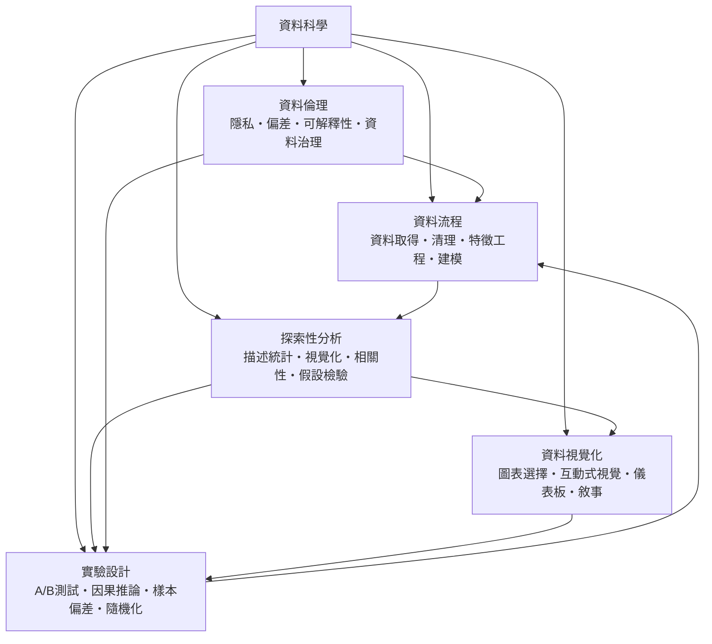

# 資料科學

> 隸屬：第一層 [工]　·　相關分類：[機率統計]、[演算法]、[軟體工程]、[人工智慧]　·　子分類總表見 [README]

> 對應維基百科：[中文維基百科：資料科學](https://zh.wikipedia.org/wiki/%E6%95%B0%E6%8D%AE%E7%A7%91%E5%AD%A6)　·　[English Wikipedia: Data science](https://en.wikipedia.org/wiki/Data_science)

[資料科學]研究的是**如何把資料轉化為可以支持決策的知識**。它不是統計學的別名，也不是「用 Python 寫程式」的同義詞；它的核心對象是一整條從資料產生到決策落地、並且可以被回饋修正的閉環。

這門學科的出現有明確的歷史動因。20 世紀中葉，統計學已經擁有完整的推論理論（[高斯] 的最小二乘、[費雪] 的實驗設計），但資料仍以紙本與小型打孔卡存在，取得與處理成本極高。1950 年代末至 1960 年代初，[電腦] 的出現使「一次處理上百萬筆紀錄」成為可能，於是 [1972年] 前後出現了第一批以資料處理為賣點的商用系統，統計學家與電腦科學家開始在同一張桌子上談問題。

真正的分水嶺是 1990 年代。網際網路帶來行為資料的洪流，商業分析出現明確的職位與方法論；2000 年代中期 Hadoop 與 [2008年] 的 [機率統計] 之外的「資料量即價值」觀念，把資料從企業後勤部門的副產品，提升為資產。到了 2010 年代，[人工智慧] 與 [資料科學] 在實務上互相收攏：模型本身成了管線的一環，而管線的資料品質成了模型效力的上限。

因此資料科學的獨特之處，在於它同時主張三件事：**推論必須嚴謹**（因此大量借用 [機率統計] 的語言）、**流程必須可重現**（因此借用 [軟體工程] 的版本控制與測試紀律）、**產出必須落地為決策**（因此借用 [演算法] 與資料管線的工程約束）。

## 核心問題

資料科學的核心問題可以分成五層，彼此嚴格相依。

1. **資料從哪來、能不能用**：資料取得與清理決定了後續一切的上限，這是 [資料流程] 的問題。
2. **資料裡有什麼**：如何在不預設模型的前提下理解資料的分佈、結構與關聯，這是 [探索性分析] 的問題。
3. **怎麼讓別人看懂**：把結論轉成可被快速吸收的形式，這是 [資料視覺化] 的問題。
4. **看到的差異是真的嗎**：區分「相關」與「因果」，並設計能支持因果推論的實驗，這是 [實驗設計] 的問題。
5. **做這些是否可被接受**：蒐集與使用資料本身涉及個人隱私、群體偏見與責任歸屬，這是 [資料倫理] 的問題。

這五層不是流水帳，而是一個閉環：分析產出的結論若要進入決策，就必須先通過實驗設計的因果檢驗；因果檢驗若要合法，就必須先清理掉會造成偏差的資料；而清理過程本身會重新觸碰隱私與治理的紅線。

一個可量化的中央問題是**訊號雜訊比**：資料量增加會同時帶來有效資訊與雜訊，因此「多收集資料」並不單調地改善答案。

$$
\mathrm{SNR} = \frac{\text{可解釋的訊號}}{\text{不可解釋的變異}}
$$

在低 SNR 的情境中，正確的做法不是更用力地擬合，而是設計更好的 [實驗設計] 與更嚴謹的 [統計推論]。

## 因果鏈

1. **統計學的奠基**：19 世紀的農業試驗需求促成 [高斯] 的最小二乘與 [皮爾生] 的相關係數，確立「資料到推論」的基本語法。
2. **實驗設計的形成**：[費雪] 在 1920 年代把田間試驗的隨機化與區組化系統化，使「因果」不再只是觀察的副產品，而是被刻意製造的。
3. **電子計算的衝擊**：[1936年] [圖靈] 的可計算性定義、[1945年] 儲存程式架構，讓資料可以被批量取得、儲存與重算。
4. **統計的模型化轉向**：20 世紀中期，資料不再只是「用來估計參數的樣本」，而是被用來「挑選並比較模型」，這是 [迴歸分析] 與模型選擇的核心。
5. **網際網路與行為資料**：1990 年代把「人」變成資料來源，隨機實驗與日誌分析成為網路公司的標準配備。
6. **巨量資料的技術前提**：2000 年代的 Hadoop 生態把非結構化資料的儲存成本壓低一個數量級，[資料流程] 從「腳本批次」升級為「可重跑的管線」。
7. **商業分析與方法論產業化**：[1972年] 與後續的 BI 軟體把描述統計與儀表板商品化，資料分析第一次有了職稱、證照與買賣市場。
8. **機器學習的合流**：[人工智慧] 提供更強的預測模型，但也帶來了新的職責——模型需要 [可解釋性]、資料需要 [資料治理]，這些成為資料科學的內在要求而非附加題。

## 子分類的定位與相互驅動

- [資料流程] 是**供給層**：它決定資料的品質與可用性，也是所有下游工作的瓶頸所在。
- [探索性分析] 是**理解層**：它在你還不知道要問什麼時，幫助你形成問題，是資料科學與傳統統計報告的共同起點。
- [資料視覺化] 是**溝通層**：分析的產出不是數字，而是被他人理解、記憶並據以行動的資訊。
- [實驗設計] 是**因果層**：它處理資料科學最容易出錯的地方——把相關當成因果，並設計能真正辨別兩者的機制。
- [資料倫理] 是**邊界層**：它規定哪些資料可以蒐集、如何可以推論、以及誰要為結果負責，是其他四層都必須服從的約束。

## 範例：從一個商業問題走完整條閉環

**問題**：某電商平台想知道「縮短結帳流程會不會提高成交率」。這個問題看起來簡單，但完整流程包含六步。

1. **資料取得**：從事件日誌取出結帳頁載入、欄位填寫、錯誤提示與最終下單的時間戳，並記錄裝置類型與使用者分組。
2. **清理**：剔除測試帳號、找出重複事件、把停留時間上限截斷在 600 秒，並處理叢集式的重複提交。清理後的有效樣本由 412,806 筆降為 398,551 筆。
3. **探索性分析**：描述統計顯示新版流程的中位完成時間為 96 秒（舊版 143 秒），但轉換率僅從 18.2% 升到 18.9%；[相關性] 檢查發現「有填寫優惠碼」的樣本轉換率為 27.4%，這是混淆線索。
4. **建模**：以 [迴歸分析] 建立轉換率對流程版本與優惠碼使用的控制模型，估計流程版本的淨效果為 +0.4 個百分點。
5. **實驗設計**：因為版本是隨機發布的，直接比較即可視為隨機實驗；但老使用者的行為改變（熟悉度效應）構成 [樣本偏差]，因此再做一次分層 [A/B測試]，只在首次使用者上判定效果。
6. **視覺化與敘事**：以 [儀表板] 呈現每日轉換率與信賴區間，並用一段 [敘事] 向高階主管解釋「縮短流程改善了速度，但真正的瓶頸在優惠碼流程」。

事後回看，這個案例最值得記取的是第 3 步：如果只做第 4 步的全體樣本迴歸，就會把優惠碼使用者的行為誤認為流程改版的成果。這正是 [資料倫理] 中 [偏差] 與 [實驗設計] 中 [隨機化] 存在的理由。

## 容易混淆之處

- **資料科學不等於統計學**：統計學提供推論的工具箱，資料科學還包含流程、溝通與決策落地。
- **資料科學不等於大數據**：資料量大不代表能回答問題；資料的相關性與取得成本同樣關鍵。
- **相關不等於因果**：若未控制混淆變數，相關係數只是「還有別的東西在動」的線索。
- **模型準確度不等於商業價值**：離線準確度只預測過去，未必改變未來；上線評估必須以決策指標為準。
- **清理不等於刪除**：清理包含型態統一、缺值處理與單位正規化，刪除資料是最後手段。
- **視覺化不等於裝飾**：每增加一個圖表就增加一份認知負擔，圖表數量應當被節制。
- **可解釋性不等於可讀模型**：線性模型與樹模型各有其解釋成本，不能以模型類型決定是否需要說明。

## 延伸閱讀

- [機率統計]：資料科學的推論基礎。
- [演算法]：特徵工程與模型訓練的計算核心。
- [軟體工程]：管線、測試與版本控制的紀律來源。
- [人工智慧]：模型能力的上限與新的責任問題。
- [資訊安全]：資料蒐集與儲存的安全邊界。
- [數學]：推論所需的離散與連續工具。

## 連結定義

[工]: ../工/README.md
[資料科學]: 資料科學.md
[README]: README.md
[機率統計]: ../機率統計/README.md
[演算法]: ../演算法/README.md
[軟體工程]: ../軟體工程/README.md
[人工智慧]: ../人工智慧/README.md
[資訊安全]: ../資訊安全/README.md
[數學]: ../數學/README.md
[電腦]: ../電腦/README.md
[統計推論]: ../機率統計/統計推論.md
[迴歸分析]: ../機率統計/迴歸分析.md
[資料流程]: 資料流程.md
[探索性分析]: 探索性分析.md
[資料視覺化]: 資料視覺化.md
[實驗設計]: 實驗設計.md
[資料倫理]: 資料倫理.md
[可解釋性]: 可解釋性.md
[資料治理]: 資料治理.md
[偏差]: 偏差.md
[樣本偏差]: 樣本偏差.md
[隨機化]: 隨機化.md
[A/B測試]: A-B測試.md
[儀表板]: 儀表板.md
[敘事]: 敘事.md
[相關性]: 相關性.md
[圖靈]: ../人/數學家/圖靈.md
[費雪]: ../人/數學家/費雪.md
[皮爾生]: ../人/數學家/皮爾生.md
[高斯]: ../人/數學家/高斯.md
[1936年]: ../時/1936年.md
[1945年]: ../時/1945年.md
[1972年]: ../時/1972年.md
[2008年]: ../時/2008年.md
