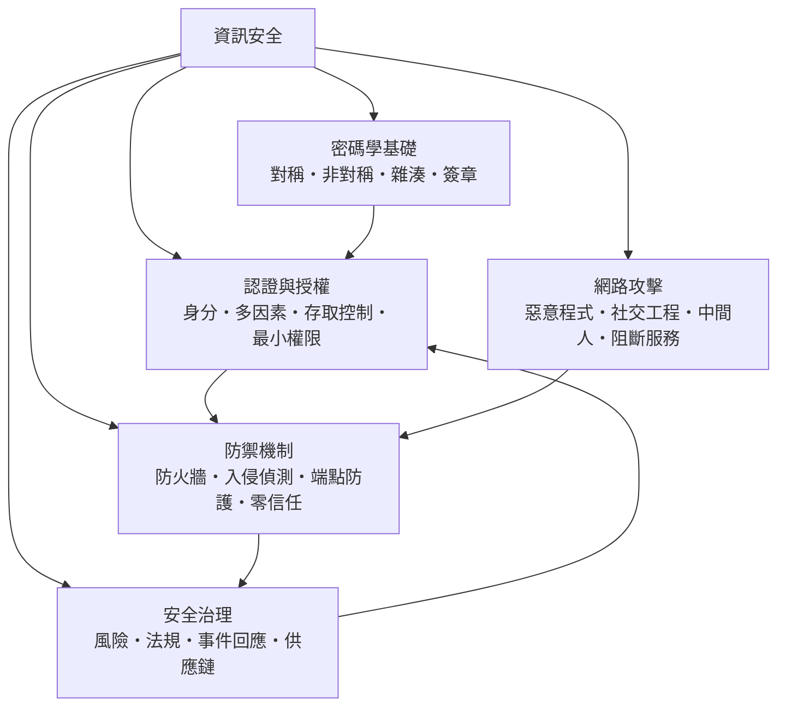

# 資訊安全

> 隸屬：第一層 [工]　·　相關分類：[電腦]、[軟體工程]、[計算機網路]　·　子分類總表見 [README]

> 對應維基百科：[中文維基百科：信息安全](https://zh.wikipedia.org/wiki/%E4%BF%A1%E6%81%AF%E5%AE%89%E5%85%A8)　·　[English Wikipedia: Information security](https://en.wikipedia.org/wiki/Information%20security)

資訊安全研究**如何在有敵意的環境中保護資訊的機密性、完整性與可用性**（俗稱 CIA 三性）。它的出發點很簡單：電腦與網路把資訊變成可以無限複製、瞬間傳送的商品，同時也讓竊取與破壞的成本降到接近零——資訊安全就是把這份風險重新抬起來的工程與治理學科。

它與密碼學的關係常常被誤解：密碼學只是資訊安全的一支工具，真正的安全還需要 [認證與授權] 管好人與程式，需要 [防禦機制] 擋住持續進化的攻擊，也需要 [安全治理] 把風險變成組織的制度決策。換句話說，資訊安全是「數學、系統與組織」三層的疊加。

## 核心問題

資訊安全的核心問題可以用三句話概括。

1. **誰可以看**（機密性）：資料只允許被授權的人讀取。這由加密與 [存取控制] 解決——攻擊者即使拿到檔案，讀到的也只是亂碼。
2. **誰可以改**（完整性）：資料不能被未經授權的人竄改。這由 [雜湊] 與 [數位簽章] 解決——任何一位元的改動都會被偵測出來。
3. **服務還在嗎**（可用性）：系統在需要的時刻必須可用。這由備援、備份與對 [阻斷服務] 攻擊的防護解決。

三性之外還有一條隱含的軸線：**可追究**（accountability）——出事之後要能查出「誰、何時、做了什麼」，這由日誌、稽核與 [事件回應] 承接。安全設計的共同語言是一個簡單不等式：攻擊成本必須大於攻擊收益，而防禦的目標就是把左邊推高、把右邊壓低。

## 因果鏈

1. **資訊理論打底**：[夏儂] 於 1948 年建立資訊理論，證明「一次一密」是唯一達到理論安全的加密法，並指出實務密碼必須依賴計算困難度——這為整門學科定下基調。
2. **電腦普及，威脅升級**：1960 至 1970 年代 [電腦] 進入政府與企業，分時系統讓多人同時用一台機器，[存取控制] 與最小權限原則因此誕生。
3. **公鑰革命**：[迪菲] 與 [赫爾曼] 在 [1976年] 發表公鑰密碼構想，[李維斯特]、[薩米爾] 與 [艾德曼] 於 [1977年] 提出 RSA，把「金鑰如何送到對方手上」這道千年難題解開。
4. **網路把攻擊面拉平**：網際網路興起後，攻擊者不必接觸實體設備即可發動攻擊，[網路攻擊] 從實驗室遊戲變成全球產業。
5. **攻防軍備競賽**：病毒、蠕蟲、勒索程式推動 [惡意程式] 研究，也反向催生 [防火牆]、[入侵偵測] 與 [端點防護]。
6. **人的弱點浮現**：技術防線越強，攻擊者越轉向 [社交工程]——欺騙人比破解演算法便宜，安全於是擴展到組織與制度。
7. **治理與法規化**：大規模資料外洩事件推動個資法、通報義務與 [風險評估] 制度，安全從技術議題變成董事會議題。
8. **零信任與供應鏈時代**：雲端與遠距工作打破內外網邊界，[零信任] 取代「城堡護城河」模型；開源元件供應鏈攻擊則把戰場推到軟體生產線本身。

## 子分類的定位與相互驅動

- [密碼學基礎] 是**數學層**：加密、雜湊與簽章提供了「不用信任信道也能通訊」的數學基礎，一切後續機制都站在它之上。
- [認證與授權] 是**身分層**：密碼學解決機器對機器的祕密，認證解決「我是誰、我能做什麼」，兩者合起來才有完整的存取判斷。
- [網路攻擊] 是**威脅層**：攻擊者的技術演進定義了防禦議程——沒有蠕蟲就不會有防火牆，沒有 [中間人] 攻擊就不會有憑證體系。
- [防禦機制] 是**工程層**：把「敵人會怎麼打」翻譯成部署在網路與端點上的具體控制，並以縱深防禦面對單點失效。
- [安全治理] 是**組織層**：技術永遠不會完美，治理決定風險怎麼評、預算怎麼分、出事怎麼回應，它反過來為其他四層排優先順序。

## 範例

**範例一：HTTPS 網購的完整安全鏈。** 你在瀏覽器輸入信用卡號，這一動作背後疊了五層防護：TLS 以非對稱加密完成金鑰交換（防竊聽）、以 [數位簽章] 的憑證確認伺服器身分（防 [中間人]）、以對稱加密傳輸資料（兼顧速度）、伺服器以雜湊儲存你的帳號密碼（防內部竊取）、以風控系統偵測異常下單（防盜刷）。少了任何一層，交易都會出現可攻擊的縫。

**範例二：勒索軟體事件的治理閉環。** 2017 年的 WannaCry 利用 Windows 漏洞在數天內感染一百五十多國。事件鏈完整示範了本概念的分工：漏洞是 [網路攻擊] 的入口；未及時打補丁是 [端點防護] 失職；危機通報與復原依賴 [事件回應]；事後各國把關鍵基礎設施納入 [法規遵循] 要求；而 [供應鏈安全] 則反思——攻擊者甚至不需要自己找漏洞，買一個「漏洞寶庫」就夠了。

## 容易混淆之處

- **資訊安全不等於密碼學**：強加密擋得住竊聽，擋不住社工欺騙與內部人濫權。
- **「被駭」不一定是入侵**：多數資料外洩起於弱密碼與釣魚信件，而非炫技的零日漏洞。
- **安全不是產品而是過程**：買一台防火牆不會變安全；控制項要持續評估、修補與演練。
- **機密性與可用性會衝突**：加密與嚴格權限讓系統更難用，過度防護反而逼使用者繞道，製造影子系統。
- **病毒與蠕蟲不同**：病毒要宿主檔案才會傳播，蠕蟲自主透過網路散播，防禦重心因此不同。
- **零信任不是「一個產品」**：它是一種架構原則——預設不信任任何位置，每次存取都要驗證。

## 延伸閱讀

- [電腦]：資訊安全所保護的對象與載體。
- [計算機網路]：攻擊面所在，協定與安全機制互相交織。
- [軟體工程]：安全左移，從開發流程降低漏洞密度。
- [離散數學]：密碼學背後的數論與組合結構。
- [演算法]：加密、雜湊與攻擊的計算複雜度基礎。
- [通訊工程]：無線與實體層安全（加密之外的防護面向）。

## 連結定義

[工]: ../工/README.md
[README]: README.md
[電腦]: ../電腦/README.md
[軟體工程]: ../軟體工程/README.md
[計算機網路]: ../計算機網路/README.md
[離散數學]: ../離散數學/README.md
[演算法]: ../演算法/README.md
[通訊工程]: ../通訊工程/README.md
[密碼學基礎]: 密碼學基礎.md
[認證與授權]: 認證與授權.md
[網路攻擊]: 網路攻擊.md
[防禦機制]: 防禦機制.md
[安全治理]: 安全治理.md
[存取控制]: 存取控制.md
[雜湊]: 雜湊.md
[數位簽章]: 數位簽章.md
[阻斷服務]: 阻斷服務.md
[事件回應]: 事件回應.md
[惡意程式]: 惡意程式.md
[防火牆]: 防火牆.md
[入侵偵測]: 入侵偵測.md
[端點防護]: 端點防護.md
[社交工程]: 社交工程.md
[中間人]: 中間人.md
[風險評估]: 風險評估.md
[法規遵循]: 法規遵循.md
[供應鏈安全]: 供應鏈安全.md
[零信任]: 零信任.md
[夏儂]: ../人/工程師/夏儂.md
[迪菲]: ../人/工程師/迪菲.md
[赫爾曼]: ../人/工程師/赫爾曼.md
[李維斯特]: ../人/工程師/李維斯特.md
[薩米爾]: ../人/工程師/薩米爾.md
[艾德曼]: ../人/工程師/艾德曼.md
[1976年]: ../時/1976年.md
[1977年]: ../時/1977年.md
