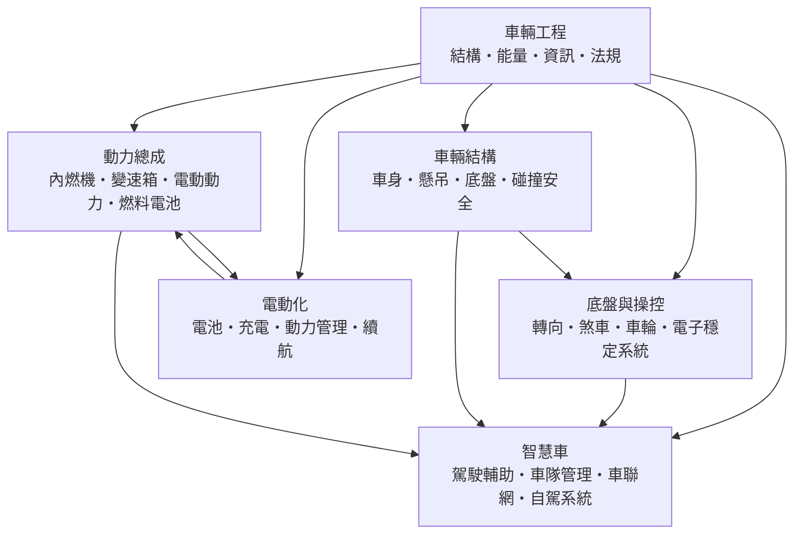

# 車輛工程

> 隸屬：第一層 [工]　·　相關分類：[機械工程]、[汽車工業]、[自動駕駛]　·　子分類總表見 [README]

> 對應維基百科：[中文維基百科：載具](https://zh.wikipedia.org/wiki/%E8%BD%BD%E5%85%B7)　·　[English Wikipedia: Vehicle engineering](https://en.wikipedia.org/wiki/Vehicle_engineering)

車輛工程是研究**如何把能源、材料與資訊組織成一台能在路上安全行進的交通工具**的工程學。它是 [機械工程] 最成熟也最複雜的分支之一：一部乘用車包含上萬個零件、數百個電子控制單元、數十公里的線束，必須在十年或十五年的壽命裡，同時滿足法規、成本、舒適、操控、油耗與安全的彼此衝突要求。

車輛工程的歷史幾乎就是工業革命的汽車版。[1886年] [卡爾·本茨] 取得世界上第一件汽車專利（三輪的 Benz Patent-Motorwagen），[1908年] [亨利·福特] 的 T 型車則把汽車從奢侈品變成量產商品——他帶來的真正革命不是「更快的車」，而是「以流水線生產汽車的方法」，使汽車價格在二十年間下降了一個數量級。此後 [內燃機] 與 [蒸汽機] 時代積累的熱力學、材料與傳動技術，被整合進 [底盤] 、[懸吊] 與 [車身] 這套現代車輛結構之中。

車輛工程的方法論有三個層次：先是**結構層**，決定車輛在被撞擊與被路面激動時會如何變形與受損；其次是**能量層**，決定燃油或電能如何被轉換、調節與回收；第三是**資訊層**，處理感測器如何把車輛狀態送進控制器，再由控制器決定引擎、煞車與轉向的動作。三層相互羈束：車身輕量化會改變底盤剛性需求；煞車的能量吸收能力決定了車重大小的上限；而所有電氣化與駕駛輔助功能，本質上都是在改變資訊層如何使用結構層與能量層的資源。

## 核心問題

車輛工程的核心問題可以分成四組。

1. **能量轉換問題**：動能從哪裡來、如何調節、如何在煞車時回收？這是 [動力總成] 與 [底盤與操控] 的交界。
2. **結構與載荷問題**：車輛在加速、轉彎、煞停與撞擊時承受的力，如何由 [車身] 、[底盤] 與 [懸吊] 分擔而不致失效？這是 [車輛結構] 的問題。
3. **壽命與耐久問題**：零件如何在十萬次煞停、數十萬公里碎石路與高低溫之間存活？這牽涉 [疲勞] 、[公差] 與材料選擇。
4. **法規與風險問題**：車輛如何在真實世界中對行人、其他駕駛與乘員負責？這由 [碰撞安全] 與 [駕駛輔助] 共同承擔。

四組問題互相牽制。舉例而言：把煞車系統改為 [電動動力] 混合的再生煞車可以省下燃料並降低煞車碟的熱負荷，但城市走走停停的路況下，電池的放電功率不足以單獨承擔，此時摩擦煞車仍必須保留足夠的尺寸與冷卻能力。這種「不能只算理想狀態」的約束，是車輛工程與純理論工程的差別所在。

## 因果鏈

1. **內燃機的瓶頸**：19 世紀末的汽車靠 [蒸汽機] 時代的鍋爐與 [內燃機] 起步，重量大、功率低、振動劇烈，因此只能作為「馬車的替代品」而無法普及。
2. **流體力學與材料力學的工程化**：車身外形的風阻、底盤的轉向與承載，都要求把 [力學] 、[流體力學] 與 [材料力學] 從教科書推導轉為可計算的設計準則，汽車工業因此成為理論工程學最忠實的工業化者。
3. **傳動與底盤的標準化**：變速箱、[車輪與輪胎] 與軸系的標準化，使不同廠牌的零件可以互換，維修網路與零件市場得以成形。
4. **安全法規的建立**：隨交通意外成為公共衛生問題，各國逐步建立強制安全標準（如碰撞測試的假人與评级制度），把 [碰撞安全] 從工程師的良知變成上市的門檻。
5. **量產與成本工程**：福特式流水線要求零件可互換、公差可管理、裝配時間可壓縮，於是 [公差配合] 與標準化零件體系成為車輛工程的核心方法。
6. **電子化與軟體介入**：電子燃油控制、ABS、變速箱控制與 [電子穩定系統] 讓車輛從「機械裝置」變成「機電系統」，此時的功能驗證不再只靠試車，而要靠 [電子工程] 與 [自動控制] 的工具鏈。
7. **電動化的轉向**：電池的重量、能量密度、成本與充電時間，強迫工程師重新分配車輛佈局並把動力、煞車與熱管理整合，這正是 [電動化] 分類存在的理由。
8. **智慧化與自駕**：感知、運算與通訊進入車輛後，[車聯網] 與 [自駕系統] 成為新的設計層次，也帶來資訊安全與法規歸屬的新問題。

## 子分類的定位與相互驅動

- [車輛結構] 是**承載層**：車身、底盤與懸吊決定了車輛在各種載荷下的剛性與變形行為，是碰撞安全的物理前提，也是重量控制的主要來源。
- [動力總成] 是**能量層**：內燃機、變速箱與電動系統把燃料的化學能或電池的電能轉為車輪上的扭矩，其輸出特性決定了整車的駕駛感。
- [底盤與操控] 是**執行層**：轉向、煞車與輪胎是把駕駛意圖轉成車輛運動的最後一環，電子穩定系統則把這三者納入即時閉迴路。
- [電動化] 是**轉型層**：它不只是換掉引擎，而是重組能量流、供熱方式與基礎設施，並且對續航與充電體驗施加了新的產品定義。
- [智慧車] 是**資訊層**：駕駛輔助、車隊管理、車聯網與自駕系統把車輛從孤立的機械裝置，接入感知、運算與網路。

驅動關係是層層相扣的：結構層決定了底盤與懸吊能承受的力，能量層決定了動態特性，資訊層則只能在前兩層允許的範圍內發揮。沒有足夠的煞車能力，任何 [駕駛輔助] 的煞車功能都只是宣傳；沒有穩定的結構，自駕系統的感知與規劃再好也無處施力。

## 範例

**範例一：煞車距離的估算。** 一台時速 $100\,\mathrm{km}$ 的乘用車在乾燥瀝青路面煞停。車速 $v = 27.8\,\mathrm{m/s}$ ，若總反應時間為 $1.0\,\mathrm{s}$ ，反應距離為

$$
d_1 = v t = 27.8 \times 1.0 \approx 27.8\,\mathrm{m}
$$

制動階段若輪胎與路面間的摩擦係數 $\mu \approx 0.9$ ，由動量與摩擦力的關係得減速度 $a = \mu g \approx 8.8\,\mathrm{m/s^2}$ ，制動距離

$$
d_2 = \frac{v^2}{2a} = \frac{27.8^2}{2 \times 8.8} \approx 44\,\mathrm{m}
$$

總距離約 $72\,\mathrm{m}$ 。這說明兩件事：其一，煞車距離隨速度平方成長，因此在限速降低的路段，事故風險下降得非常快；其二，煞車系統的能力上限由 [車輪與輪胎] 與路面的摩擦係數決定，而不是只由煞車碟的面積決定。

**範例二：電動化後的重量分配。** 一台 $1500\,\mathrm{kg}$ 的燃油車，引擎與變速箱共重約 $250\,\mathrm{kg}$ ，集中於前軸；改為電動車後，軸間馬達與電池合計約 $400\,\mathrm{kg}$ ，但電池可平鋪於底板，因此前後軸配重由接近 $60:40$ 變成約 $50:50$ 。這個改變同時改變了車輛的側傾中心、懸吊調校與操控特性——同一副底盤因為配重改變而需要重新設計 [懸吊] 的阻尼與 [轉向] 的比值。

**範例三：續航的估算與其侷限。** 一台配備 $60\,\mathrm{kWh}$ 電池的電動車，實測市區平均耗電約 $18\,\mathrm{kWh}/100\,\mathrm{km}$ ，理論續航約 $333\,\mathrm{km}$ ；高速 $120\,\mathrm{km/h}$ 巡航時因風阻與滾阻上升，耗電可能達 $25\,\mathrm{kWh}/100\,\mathrm{km}$ ，續航降到約 $240\,\mathrm{km}$ 。若加入暖氣或空調，冬季續航還可能進一步下降 $20\%$ 至 $30\%$ 。這正是 [續航] 條目強調「續航是一組條件下的估計值，而不是車輛的固定屬性」的原因。

## 容易混淆之處

- **汽車工程與車輛工程不完全等同**：前者多指乘用車與商用車的整車開發，車輛工程則涵蓋鐵路車輛、工程車、機車與飛行器等更大範圍。
- **底盤與車身不是分開的兩塊**：現代乘用車多採承載式車身，底盤與車身是一體的結構件；「底盤」在工程上更接近「行走系統與承載結構的總稱」。
- **續航下降不一定是電池老化**：高速、暖氣、低胎壓、滿載與高駕駛風格都會縮短續航，判斷老化應以等速基準測試為準。
- **煞車失靈不等於沒有摩擦力**：多數「煞車失靈」案例其實是煞車碟熱衰退（fade）或輪胎抓地力在積水、結冰時下降，兩者的解法不同。
- **碰撞測試等級不等於真實事故的嚴重程度**：測試是重複性高的標準化情境，而真實事故的撞擊角度、速度與車重組合千變萬化。
- **駕駛輔助不等於自動駕駛**：目前量產系統多為第二級（部分駕駛任務自動化），駕駛員仍須持續監看並隨時接管。

## 延伸閱讀

- [機械工程]：車輛工程的上位分類，提供力學、材料與製造的通用語言。
- [汽車工業]：車輛的量產、供應鏈與產業競爭面向。
- [自動駕駛]：車輛資訊層的最終形態之一。
- [自動控制]、[電子工程]：駕駛輔助與電子穩定系統的理論基礎。
- [材料工程]：車身輕量化與電池外殼的材料來源。
- [流體力學]：風阻、空調流路與冷卻系統的理論基礎。
- [工業革命]：汽車與大眾運輸出現的更廣歷史脈絡。
- [卡爾·本茨]、[亨利·福特]：兩位奠定汽車工業初期形態的人物。

## 連結定義

[工]: ../工/README.md
[README]: README.md
[機械工程]: ../機械工程/README.md
[汽車工業]: ../汽車工業/README.md
[自動駕駛]: ../自動駕駛/README.md
[汽車]: ../物/汽車.md
[電動車]: ../物/電動車.md
[內燃機]: ../物/內燃機.md
[蒸汽機]: ../物/蒸汽機.md
[力學]: ../力學/README.md
[流體力學]: ../流體力學/README.md
[熱力學]: ../熱力學/README.md
[材料工程]: ../材料工程/README.md
[電子工程]: ../電子工程/README.md
[電機工程]: ../電機工程/README.md
[自動控制]: ../自動控制/README.md
[基礎設施工程]: ../基礎設施工程/README.md
[運輸網絡]: ../運輸網絡/README.md
[工業革命]: ../工業革命/README.md
[卡爾·本茨]: ../人/工程師/卡爾·本茨.md
[亨利·福特]: ../人/工程師/亨利·福特.md
[1886年]: ../時/1886年.md
[1908年]: ../時/1908年.md
[車輛結構]: 車輛結構.md
[動力總成]: 動力總成.md
[底盤與操控]: 底盤與操控.md
[電動化]: 電動化.md
[智慧車]: 智慧車.md
[底盤]: 底盤.md
[懸吊]: 懸吊.md
[車身]: 車身.md
[碰撞安全]: 碰撞安全.md
[變速箱]: 變速箱.md
[電動動力]: 電動動力.md
[燃料電池]: 燃料電池.md
[轉向]: 轉向.md
[煞車]: 煞車.md
[車輪與輪胎]: 車輪與輪胎.md
[電子穩定系統]: 電子穩定系統.md
[電池]: 電池.md
[充電基礎設施]: 充電基礎設施.md
[動力管理]: 動力管理.md
[續航]: 續航.md
[駕駛輔助]: 駕駛輔助.md
[車隊管理]: 車隊管理.md
[車聯網]: 車聯網.md
[自駕系統]: 自駕系統.md
[疲勞]: ../機械工程/疲勞.md
[公差]: ../機械工程/公差.md
