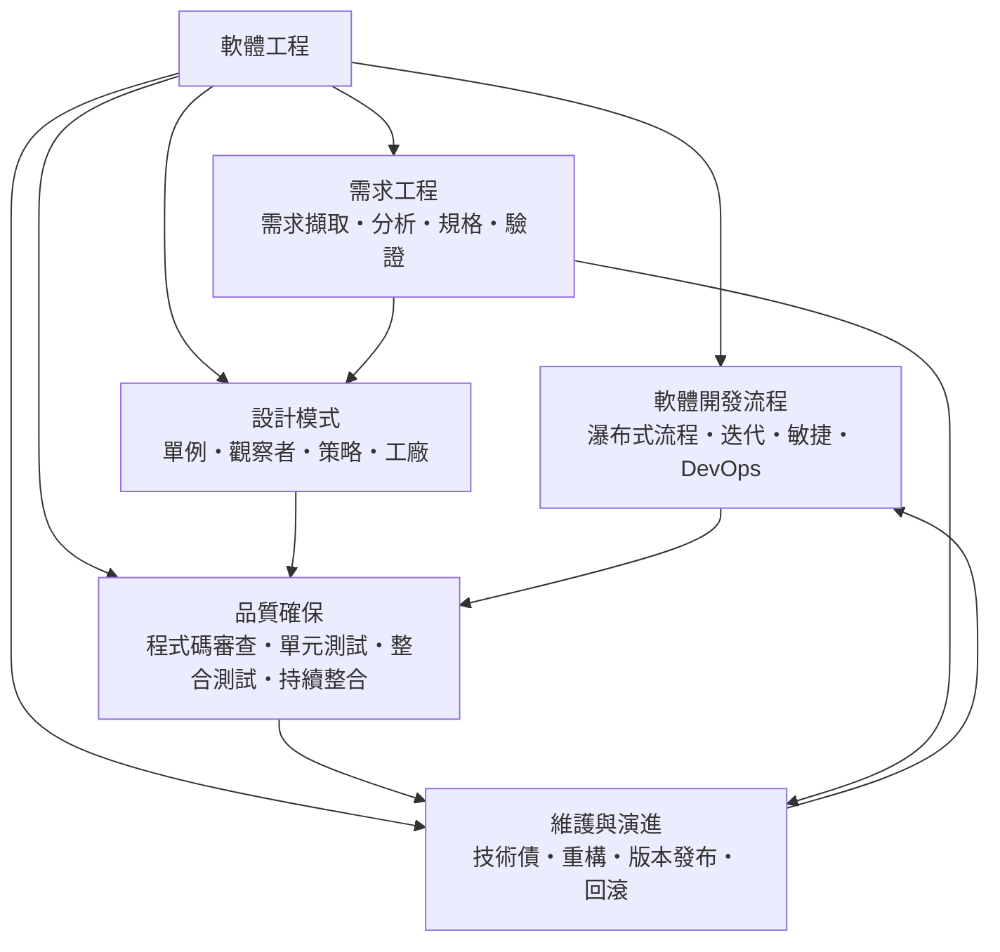

# 軟體工程

> 隸屬：第一層 [工]　·　相關分類：[程式設計]、[演算法]、[資訊安全]、[資料科學]　·　子分類總表見 [README]

> 對應維基百科：[中文維基百科：軟體工程](https://zh.wikipedia.org/wiki/%E8%BD%AF%E4%BB%B6%E5%B7%A5%E7%A8%8B)　·　[English Wikipedia: Software engineering](https://en.wikipedia.org/wiki/Software_engineering)

軟體工程研究的是**如何把一群想法穩定地變成可運作、可維護、值得信賴的軟體**。它的對象不是單一程式，而是涵蓋需求、設計、實作、測試、發布與維護的整條生產鏈，以及這條鏈上的人、工具、文件與流程。

「軟體危機」是這門學科之所以存在的直接原因。1960 年代末，硬體成本急降、軟體規模膨脹，專案卻普遍延期、超預算、品質低落。人們發現，程式設計的方法（例如結構化設計）解決不了「專案管理」與「品質保證」的問題。於是軟體工程被定義成一門「把系統化、可量化、可重複的做法應用到軟體開發」的學科——其定義中的「工程學」二字，指的正是可重複的流程與可量化的指標，而非天才的靈光。

[馮·諾伊曼] 在 1945 年提出的「儲存程式」架構，讓軟體第一次可以被寫入機器並重複執行；[湯姆林·湯姆森] 等人於 1940 年代末在曼徹斯特造出第一台可用程式控制的電子儲存程式機器，證明「軟體可以取代硬體線路」；[葛麗斯·霍普] 則在 1950 年代提出把程式寫成與機器無關的高階語言並交給編譯器處理的想法。於是「寫程式」與「造機器」分離，軟體工程才真正有了一個可以系統化研究的對象。

## 核心問題

軟體工程的核心問題可以分為四層，彼此嚴格相依。

1. **要做什麼**：使用者的需求是什麼？如何把它變成可檢查的規格？這是 [需求工程] 的問題。
2. **要怎麼做**：程式碼與架構應該長什麼樣子，才能讓變更容易、缺陷更少？這是 [設計模式] 與 [軟體開發流程] 的問題。
3. **如何知道做對了**：沒有量測就沒有管理，沒有驗證就沒有信心。這是 [品質確保] 的問題。
4. **做完之後怎麼辦**：軟體不是一次性交付物，而是要在多年內持續修改的活體。這是 [維護與演進] 的問題，也是研究證明成本多集中在此的領域。

四層之下的基本度量可以寫成一個簡化的成本模型：

$$
C_{\text{total}} = C_{\text{dev}} + C_{\text{test}} + C_{\text{maint}} , \qquad C_{\text{maint}} \approx 0.6 \sim 0.8 \, C_{\text{total}}
$$

這個式子不是自然定律，而是經驗比例的摘要。它表達的判斷是：**在需求與設計階段花的一小時，可以省下維護階段的數十小時**，因此「前期投入」在工程上具有槓桿效果。

## 因果鏈

1. **硬體與軟體的分離**：[馮·諾伊曼] 的儲存程式架構讓同一台機器能靠更換程式改變行為，軟體第一次成為可獨立生產與交換的產品。
2. **第一代程式語言與編譯器**：[葛麗斯·霍普] 主張以高階語言描述邏輯、把機械細節交給編譯器，使開發者得以從位元操作中解放。
3. **結構化程式設計與模組化**：以單一進入點、單一出口的模組封裝流程，把「 spaghetti 式程式碼」的維護難題局部化解。
4. **軟體危機與軟體工程的誕生**：1960 年代末大型專案的失敗，讓業界意識到需要流程、文件與度量，而非只靠個人技巧。
5. **物件導向與設計模式**：[艾倫·凱] 推動以物件與訊息組織程式；[巴巴拉·利斯科夫] 提出替換原理，設計模式則把常見的物件協作結構命名、描述並目錄化。
6. **測試與持續整合的制度化**：從手動點擊測試走向自動化的 [單元測試] 與 [持續整合]，缺陷發現時間由「發布前」提前到「每次提交」。
7. **敏捷與迭代**：面對需求高度不確定性的專案，[敏捷] 以短週期、可交付、可回饋的循環取代一次性的大計畫。
8. **DevOps 與平台化**：將開發與維運合併為同一條持續交付流水線，部署頻率由季度提升到每日，成為 雲端運算時代的預設工作方式。

## 子分類的定位與相互驅動

- [需求工程] 是**最上游**的子分類：錯誤的需求無法靠更好的程式碼補償，因此它決定了後續所有工作的上限。
- [設計模式] 是**語言層的解法庫**：它把「常見的物件如何協作」抽象成可重用的名稱，使經驗可以累積而不必靠個人記憶。
- [軟體開發流程] 是**節奏層**：它決定需求、程式碼與測試在時間軸上如何排列，也決定回饋迴路的長短。
- [品質確保] 是**證據層**：沒有自動化的驗證證據，流程就只能依賴權威與信任，缺陷則留到使用者手中才爆發。
- [維護與演進] 是**時間層**：它處理軟體在交付後數年、數十版的生命週期，也是 [技術債] 累積與償還的場所。

五者構成一個閉環：流程決定節奏，節奏決定品質證據的產生速度；證據反過來餵回需求與設計；維護中暴露的問題又成為下一輪流程改進的輸入。

## 範例：把一個需求變成可發布的版本

**場景**：某零售業者要讓顧客在手機上查看訂單狀態。若只交出一支「能顯示訂單」的程式，缺陷會在真實流量下爆發。完整的軟體工程流程如下。

1. **需求擷取**：訪談客服與倉管，記錄兩類主要情境——「訂單尚未出貨」與「訂單已寄出但未收到簽收」。這些情境被寫成使用者故事而非功能清單。
2. **需求分析**：把故事拆成資料模型（訂單、訂單項目、物流事件）與流程（查詢 → 過濾 → 呈現），並找出「訂單狀態」定義不一致這個真正的瓶頸。
3. **規格**：寫成可檢查的驗收條件，例如「當物流事件時間戳晚於訂單建立時間時，狀態顯示為已出貨；查詢回應時間在 200 毫秒內達成率不低於 99%」。
4. **設計**：以 [工廠] 模式讓「不同物流商的狀態代碼」各自 encapsulate 成轉換器，避免 if-else 散落在畫面層；快取策略則用 [策略] 模式切換。
5. **實作與單元測試**：狀態轉換器以表格驅動測試覆蓋每一組代碼組合，確保邊界情況（取消、補寄、遺失）也被處理。
6. **程式碼審查**：審查重點放在「狀態定義是否唯一來源」與「時間比較是否用同一時區」，這正是前一步分析指出的瓶頸。
7. **持續整合**：每次提交自動跑單元測試與整合測試，並在部署前用合成資料做一次煙霧測試。
8. **版本發布與回滾**：先以小流量灰度發布，監測錯誤率；若門檻被突破即執行 [回滾]，避免小數據量的長尾問題擴大。

這個流程的價值不在於步驟多，而在於每一個步驟都留下**可檢查的產物**：訪談記錄、模型、驗收條件、測試、審查意見、監測面板。任何一步被省略，風險就會被推遲到下一個環節，最後以事故的形式一次償還。

## 容易混淆之處

- **軟體工程不等於「寫程式」**：寫程式只是其中一環，需求、測試、維護佔用的時間往往更多。
- **流程與方法論不同**：方法論是一套信念（例如「迭代勝於瀑布」），流程是這套信念在專案中的具體排程安排。
- **敏捷不等於「不做文件」**：敏捷要求的是「可用、可追溯的最小文件」，不是沒有文件。
- **測試覆蓋率不等於品質**：覆蓋率只說明程式碼被執行過，不保證斷言正確或情境齊全。
- **設計模式不是萬靈藥**：在簡單問題上套用模式會增加間接層，這是常見的過度設計。
- **DevOps 不等於「買工具」**：沒有工程文化配合的自動化，只會把混亂加速。
- **技術債不等於「工程師的錯」**：在趕時間時累積短債是理性策略，問題在於從不償還。

## 延伸閱讀

- [程式設計]：軟體工程所依賴的語言與抽象基礎。
- [演算法]：複雜度分析決定了工程方案的上限。
- [資訊安全]：安全需求必須在需求階段就納入，而非上線前補做。
- [資料科學]：資料管線、實驗設計與模型部署同樣遵循軟體工程的紀律。
- [人工智慧]：模型訓練、評估與上線構成另一條特有的軟體工程生命週期。
- [數學]：離散數學為驗證、複雜度與形式化方法提供工具。

## 連結定義

[工]: ../工/README.md
[README]: README.md
[程式設計]: ../程式設計/README.md
[演算法]: ../演算法/README.md
[資訊安全]: ../資訊安全/README.md
[資料科學]: ../資料科學/README.md
[人工智慧]: ../人工智慧/README.md
[數學]: ../數學/README.md
[需求工程]: 需求工程.md
[設計模式]: 設計模式.md
[軟體開發流程]: 軟體開發流程.md
[品質確保]: 品質確保.md
[維護與演進]: 維護與演進.md
[技術債]: 技術債.md
[單元測試]: 單元測試.md
[持續整合]: 持續整合.md
[敏捷]: 敏捷.md
[工廠]: 工廠.md
[策略]: 策略.md
[回滾]: 回滾.md
[馮·諾伊曼]: ../人/數學家/馮·諾伊曼.md
[湯姆林·湯姆森]: ../人/工程師/湯姆林·湯姆森.md
[葛麗斯·霍普]: ../人/工程師/葛麗斯·霍普.md
[艾倫·凱]: ../人/工程師/艾倫·凱.md
[巴巴拉·利斯科夫]: ../人/工程師/巴巴拉·利斯科夫.md
