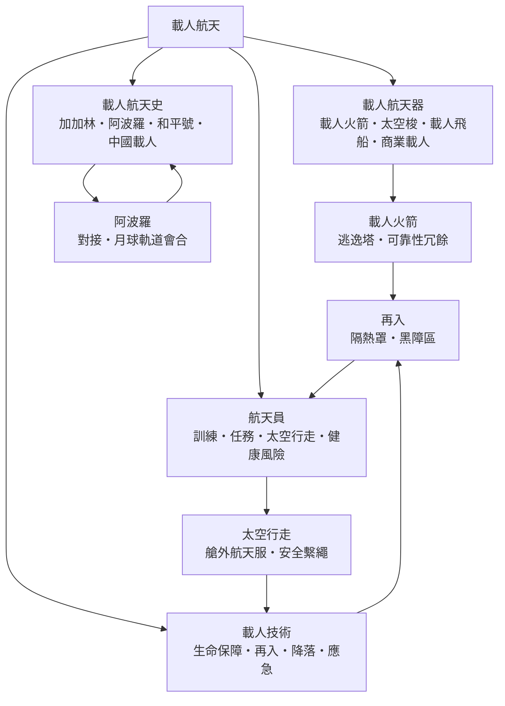

# 載人航天

> 隸屬：第一層 [天]　·　相關分類：[火箭]、[航空工程]、[太空站]、[太空旅行]、[生理學]、[力學]　·　子分類總表見 [README]

> 對應維基百科：[中文維基百科：载人航天](https://zh.wikipedia.org/wiki/%E8%BD%BD%E4%BA%BA%E8%88%AA%E5%A4%A9)　·　[English Wikipedia: Human spaceflight](https://en.wikipedia.org/wiki/Human_spaceflight)

載人航天是把人送上太空、讓人在太空環境中生存、工作並安全返回的整套工程與活動。它與無人航天（例如 [衛星]）的根本差別只有一個字：**人**。人一旦進入飛行器，可靠性標準、生命保障、應急救生與返回技術就全部升級——機器壞了可以損失資料，人壞了就是災難。因此載人航天的歷史，本質上是一部「把風險一項一項從人身上移走」的工程史。

1957 年 10 月 4 日（見 [1957年]），[斯普尼克一號] 證明運載火箭可以把物體送入軌道；三年半之後的 1961 年 4 月 12 日（見 [1961年]），[加加林] 在 [科羅廖夫] 的團隊打造的東方一號上繞地球一圈、108 分鐘後安全返回，證明人可以在軌道上存活。此後的六十餘年裡，載人航天從兩國競賽的宣傳工具，逐步變成常態化的近地軌道作業（太空站）與正在重啟的深空探索（重返月球、火星任務規劃）。

## 核心問題

載人航天的工程問題可以濃縮成五條互相牽制的鏈條。

1. **送得上去嗎**：把飛船加速到近地軌道速度（約 $7.8\ \mathrm{km/s}$ ）需要 [火箭] 提供約 9 至 10 km/s 的速度增量（含重力與空氣阻力損失）；載人火箭還要求發動機、分離與飛控的可靠性遠高於無人火箭。
2. **活得下去嗎**：太空是真空、輻射與極端溫度環境，飛船必須提供氣壓、氧氣、二氧化碳移除、溫度控制、飲水與食物，並處理排泄物——這是生命保障系統的課題。
3. **安全回得來嗎**：返回時飛船以約 7.8 km/s 衝入大氣，動能轉為熱能，隔熱罩表面溫度可達一千餘攝氏度；再入角度偏差過大會燒毀或彈出大氣，這是載人航天最剛性的技術門檻。
4. **出事怎麼辦**：從發射台到入軌的每一秒都要有救生手段，例如逃逸塔在兩秒內把返回艙拉離火箭；在軌道上則要有備用系統與應急返回流程。
5. **人還能工作嗎**：失重使體液上湧、骨質每月流失約 1%、肌肉萎縮、太空輻射累積劑量；任務越長，人的健康與士氣越成為系統設計的核心變數。

這五條的順序不可顛倒：火箭是地板，生命保障是牆，返回與應急是屋頂，人的能力決定樓能蓋多高。

## 因果鏈

1. **火箭先於人**：二戰後彈道飛彈技術被兩大陣營繼承，R-7 洲際飛彈的改型把 [斯普尼克一號] 送入軌道；沒有軍事火箭就沒有太空時代，這是載人航天的第一推力。
2. **第一人與第一反應**：1961 年 [加加林] 繞地一圈，三週後美國謝潑德完成亞軌道飛行；冷戰宣傳使載人航天獲得不成比例的鉅額預算。
3. **登月作為極限壓力測試**：甘迺迪在 1961 年提出登月目標，[肯尼迪太空中心] 與土星五號因此被建造出來；1969 年 7 月 20 日（見 [1969年]）阿波羅 11 號登月，把導航、對接、生命保障與返回技術同時推向極限。
4. **從競賽到常駐**：登月競賽結束後，雙方各自轉向近地軌道——美國建太空實驗室並發展可重複使用的太空梭，蘇聯建成長期駐人的 [和平號] 空間站，載人航天從「里程碑」轉為「日常作業」。
5. **國際合作**：1998 年起多國共建國際太空站，2000 年 11 月起持續有人駐守至今；冷戰對手在軌道上互相依存，成為載人航天政治形態的轉折點。
6. **商業化重啟**：2011 年太空梭退役後，美國一度只能租用聯盟號飛船；2020 年 5 月 SpaceX 載人龍飛船把太空人送上國際太空站，商業公司首次承擔載人運輸，單座成本顯著下降。
7. **中國獨立體系**：2003 年 10 月 15 日 [楊利偉] 乘神舟五號進入軌道，使中國成為第三個獨立載人航天的國家；其後天宮空間站建成，形成又一條完整的載人技術鏈。
8. **重返月球與深空**：阿提米絲計畫以重返月球為目標，把載人航天推向長期駐月與後續火星任務的準備階段；瓶頸從「能不能到」轉為「能不能長期待」。

## 子分類的定位與相互驅動

- [載人航天器] 是**硬體的載體**：從一次性載人飛船到部分可重複使用的太空梭，再到商業公司的可回收飛船，硬體路線的每一次改變都重新定義了成本與安全之間的取捨。
- [航天員] 是**這個領域的中心變數**：選拔、訓練、在軌任務與健康風險，決定了「人」在系統中是資產還是負擔；太空行走更是把人的能力延伸到飛行器之外。
- [載人技術] 是**底層的共同基礎**：生命保障、再入防熱、精準降落與應急救生這四項技術，任何載人飛行器都繞不開，也互相供養——逃逸塔依賴再入技術，再入依賴降落技術。
- [載人航天史] 是**經驗的沉澱**：加加林與阿波羅證明了什麼可行，聯盟 1 號與阿波羅 1 號的火災證明了什麼會致命；歷史教訓直接寫進了今日的安全規範。

四者並非獨立章節，而是一個閉環：歷史事故催生技術規範，技術規範塑造飛行器設計，飛行器設計決定航天員的任務內容，任務經驗又回流為新的歷史。

## 範例

**範例一：東方一號的一次完整任務鏈。** 1961 年 4 月 12 日莫斯科時間 09:07，R-7 運載火箭自 [拜科努爾] 發射；東方一號入軌近地點約 169 公里、遠地點約 327 公里，週期約 89 分鐘。[加加林] 全程幾乎是「乘客」——自動控制為主，手動控制需輸入密碼解鎖（以防失能誤觸）。返回時服務艙分離失敗數分鐘，返回艙在劇烈擺動後終於分離，隔熱罩承受再入加熱，最後在約 7 公里高度拋傘，加加林依設計在約 4 公里高度彈射跳傘降落。整個任務把「發射—入軌—生命保障—再入—降落」五環一次走通，成為後世載人任務流程的模板。

**範例二：為什麼載人火箭需要逃逸塔。** 聯盟號與阿波羅時代的飛船都在頂端裝了固體火箭逃逸塔：一旦運載火箭在發射台或上升段爆炸，逃逸塔在數秒內點火，把返回艙拉離火球，再由降落傘回收。1983 年 9 月 26 日，聯盟 T-10a 在發射台上起火，逃逸系統在爆炸前兩秒觸發，兩名航天員安全落地——這是史上最接近災難也最成功的救生案例。SpaceX 的載人龍則改用「推進式逃逸」：飛船自帶八台發動機全程可逃逸，不受逃逸塔「高空拋塔後無保護」的限制。

**範例三：再入的角度窗口。** 返回艙以約 7.8 km/s、相對水平面約 -1.5 度的角度進入大氣邊界。若角度淺於約 -1 度，飛船會像打水漂一樣彈出大氣；若深於約 -2 度，減速過載與熱流超出人體與隔熱罩的承受範圍。可用窗口因此只有約半度寬，對應兩百多公里的「走廊」。這解釋了為何載人返回對導航與制導精度的要求是所有航天環節中最嚴格的，也解釋了阿波羅從月球返回（速度約 11 km/s）為何需要「跳躍式再入」來拉長減速過程。

## 容易混淆之處

- **載人航天不等於載人火箭**：火箭只是上升段；載人航天涵蓋在軌生存、艙外活動與安全返回，返回與生命保障的技術難度常高於上升。
- **太空梭不是「更好的飛船」**：它是部分可重複使用但系統更複雜的載具；挑戰者號（1986）與哥倫比亞號（2003）各損失七人，說明複雜性本身即是風險來源。
- **逃逸系統不是降落傘**：降落傘負責最後的減速回收，逃逸系統負責把艙體脫離危險；兩者常被混為一談。
- **失重不是「沒有重力」**：近地軌道高度上地球重力仍有地表的九成左右，失重是自由落體狀態；持續失重才造成骨鈣流失與肌肉萎縮。
- **黑障不是系統故障**：再入時電漿鞘包圍返回艙使無線電中斷數分鐘，屬正常物理現象；把黑障誤判為「失去聯絡即失事」是常見誤解。
- **商業載人不是「不安全」**：NASA 以載人認證（Crew Certification）與飛行終止測試約束商業載具，SpaceX 載人龍的安全設計門檻（如逃逸全程可用）在若干面向高於太空梭。

## 延伸閱讀

- [火箭]：運載能力是載人航天的地板，逃逸與冗餘設計皆由火箭決定。
- [太空站]：長期駐人的在軌平台，是載人航天常態化的產物。
- [太空旅行]：商業載人的消費端延伸，與本概念共用飛行器與安全標準。
- [航空工程]：返回艙的氣動外形、過載與熱防護直接借用航空工程的工具。
- [力學]：軌道交會對接與再入彈道都建立在牛頓力學與攝動理論上。
- [生理學]：失重、輻射與密閉環境對人體的影響是任務規劃的硬約束。
- [衛星]：測控、通訊與導航衛星是載人任務的地面支援神經系統。
- [加加林]、[楊利偉]、[科羅廖夫]：推動第一人上太空與第三國獨立載人的關鍵人物。
- [和平號]、[阿波羅計畫]：兩大載人體系的代表性成果。

## 連結定義

[天]: ../天/README.md
[README]: README.md
[火箭]: ../火箭/README.md
[航空工程]: ../航空工程/README.md
[太空站]: ../太空站/README.md
[太空旅行]: ../太空旅行/README.md
[生理學]: ../生理學/README.md
[力學]: ../力學/README.md
[衛星]: ../衛星/衛星.md
[載人航天器]: 載人航天器.md
[航天員]: 航天員.md
[載人技術]: 載人技術.md
[載人航天史]: 載人航天史.md
[加加林]: ../人/宇航員/加加林.md
[楊利偉]: ../人/宇航員/楊利偉.md
[科羅廖夫]: ../人/工程師/科羅廖夫.md
[和平號]: ../物/和平號.md
[阿波羅計畫]: ../太空旅行/阿波羅計畫.md
[斯普尼克一號]: ../物/斯普尼克一號.md
[拜科努爾]: ../地/拜科努爾.md
[肯尼迪太空中心]: ../地/肯尼迪太空中心.md
[1957年]: ../時/1957年.md
[1961年]: ../時/1961年.md
[1969年]: ../時/1969年.md
