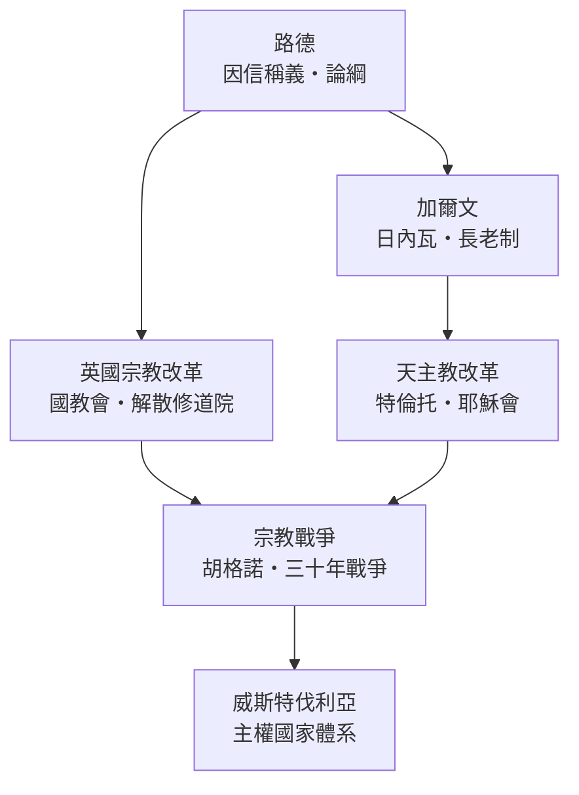

# 宗教改革

> 隸屬：[近代史] › [近代史]　·　狀態：初稿

> 對應維基百科：[中文維基百科：宗教改革](https://zh.wikipedia.org/wiki/%E5%AE%97%E6%95%99%E6%94%B9%E9%9D%A9)　·　[English Wikipedia: Reformation](https://en.wikipedia.org/wiki/Reformation)

宗教改革指 16 世紀歐洲基督教秩序的大分裂：1517 年[馬丁路德]發表《九十五條論綱》反對贖罪券，此後[加爾文]在日內瓦建立改革教會，英國以亨利八世的婚姻案走上國家教會路線，[天主教改革]則以特倫托會議重整舊教。

改革的技術條件是印刷術：1450 年代古騰堡活字印刷使小冊子成本驟降，路德的德文著作在 1517 至 1520 年間印行逾三十萬份，成為史上第一場「媒體事件」。

其政治後果比神學更深：宗教戰爭（法國胡格諾戰爭、三十年戰爭）的僵局逼出 1555 年奧格斯堡和約與 1648 年威斯特伐利亞和約，「教隨國定」與主權國家原則確立，普世教會秩序讓位給國家本位。

## 技術與理論的關聯

- 神學核心是「因信稱義」：救恩來自信仰與上帝恩典，不靠善功與聖禮壟斷，這直接否定了贖罪券與教會中介的經濟基礎。
- 聖經翻譯（路德德文聖經，1522 至 1534 年）使平信徒直接讀經，方言禮拜與識字教育同步擴張。
- 教產重分配：新教地區沒收修道院財產（英國 1536 至 1541 年解散約八百所修道院），資本流入商業與土地市場。
- 印刷監管成為新課題：帝國查禁令、特倫托的《禁書目錄》（1559 年）顯示教俗權力都試圖管理資訊流。
- 宗教難民與城市：日內瓦、荷蘭、胡格諾法國的難民網絡帶動技術與資本遷徙，阿姆斯特丹因此崛起。
- 三十年戰爭（1618 至 1648 年）使德意志人口銳減三成以上，和約把宗教問題「凍結」進國家框架，是現代國際體系的起點。

## 孫分類

| 孫分類 | 狀態 |
| --- | --- |
| [馬丁路德] | 初稿 |
| [加爾文] | 初稿 |
| [天主教改革] | 初稿 |

## 範例

《九十五條論綱》的傳播速度可量化：1517 年 10 月 31 日路德寄出論綱（傳統敘述稱貼於維滕貝格城堡教堂門上），兩週內傳遍德意志各城，兩個月內已有印刷版流通全歐——在沒有郵政廣告的時代，這是印刷術對羊皮紙時代的直接勝利。路德自己說：「我只是教導、佈道與寫作，是印刷術使一切自行傳播。」

英國解散修道院（1536 至 1541 年）是宗教改革的資產負債表：約八百所修道院、價值約一百三十萬鎊的年收入被王室沒收，土地以低價售予鄉紳與商人。這批「新財主」在都鐸末年的政治與此後的內戰（[英國革命]）中都成了關鍵玩家——教產重分配直接改寫了英國的階級地圖。

## 前因後果

- 前因：教會腐敗（贖罪券）與人文主義校勘（伊拉斯謨）準備了輿論，印刷術提供載體。
- 瓶頸：信仰生活的中介成本高，德意志諸邦對羅馬財政輸出不滿。
- 解法：以「唯獨聖經」繞過教會階層，以諸侯保護落地（1555 年教隨國定）。
- 後果：宗教戰爭後主權國家體系確立，識字與方言文化擴張，教產與難民網絡滋養了[革命時代]與[工業化]的資本與人力。

## 與相鄰分類的關聯

- 與[馬丁路德]的關係：路德是改革的神學起點與媒體明星。
- 與[加爾文]的關係：加爾文派提供制度化的教會模型與國際網絡。
- 與[天主教改革]的關係：舊教的重整是改革的另一面，兩者共同定形了現代基督教版圖。
- 與[革命時代]的關聯：宗教戰爭教會歐洲「多元共存」的唯一出路是國家主權，此後革命的對象轉為君主。
- 與[宗教學]的關聯：宗派分化與信仰個人化是宗教社會學的經典案例。

## 容易混淆之處

- 路德最初並不要「另立教會」：1517 年的訴求是學術辯論與財政改革，分裂是十年間政治化後的結果。
- 改革不只屬於德意志：瑞士、低地、英國、北歐各有路徑，「宗教改革」是家族相似而非單一運動。
- 農民戰爭（1525 年）顯示改革有激進社會版本，路德選擇站在諸侯一邊——改革運動內部同樣分裂。

## 技術要點

- 年表以事件為錨：1517 論綱、1521 沃爾姆斯敕令、1525 農民戰爭、1534 英國最高首腦法、1545 特倫托、1555 奧格斯堡、1618 至 1648 三十年戰爭。
- 印刷書目錄（VD16 等）可量化改革文獻的出版與流通，是「媒體革命」說的證據基礎。
- 教會訪視記錄與宗教法庭檔案重建地方信仰生活的轉變速度。
- 教產讓渡契約追蹤資本流向，連接宗教史與經濟史。
- 難民遷移記錄（胡格諾、加爾文派）追蹤技術擴散（鐘錶、絲織、印刷）。
- 和約文本學（奧格斯堡、威斯特伐利亞）是國際法起源研究的核心材料。

## 常見的論爭

- 「印刷術造成改革」的因果強度：技術決定論與社會網絡說（城市、帝國騎士、大學的既有網絡）之辯。
- 改革是否「現代化」的推手：韋伯新教倫理說至今被檢驗與修正，經濟史計量結果分歧。
- 特倫托會議的定性：單純的「反宗教改革」，或本就啟動於前的天主教內部革新（Catholic Reformation），學界偏向後者。

## 延伸閱讀

- [馬丁路德]：改革的起點人物。
- [加爾文]：改革教會的制度化。
- [天主教改革]：舊教的回應。
- [近代史]：所屬概念總覽。

## 連結定義

[近代史]: 近代史.md
[馬丁路德]: 馬丁路德.md
[加爾文]: 加爾文.md
[天主教改革]: 天主教改革.md
[英國革命]: 英國革命.md
[革命時代]: 革命時代.md
[工業化]: 工業化.md
[宗教學]: ../宗教學/README.md
