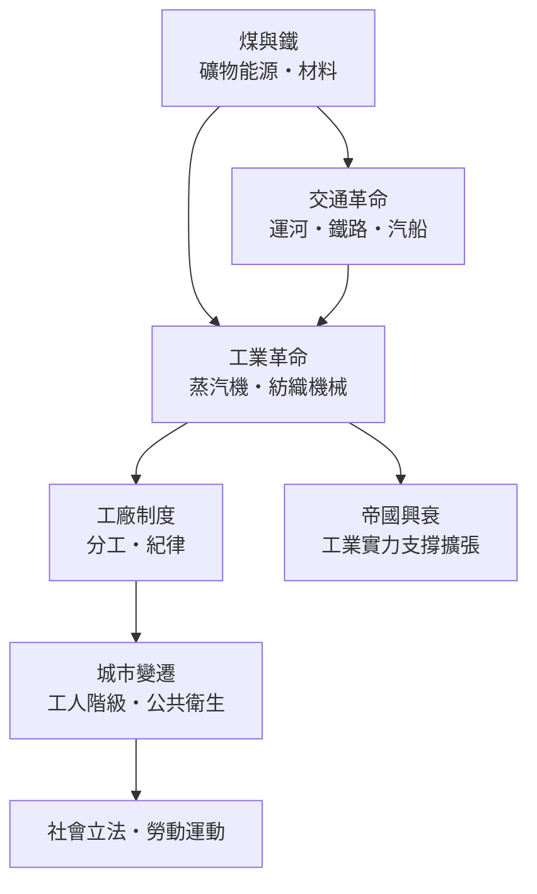

# 工業化

> 隸屬：[近代史] › [近代史]　·　狀態：初稿

> 對應維基百科：[中文維基百科：工业化](https://zh.wikipedia.org/wiki/%E5%B7%A5%E4%B8%9A%E5%8C%96)　·　[English Wikipedia: Industrialisation](https://en.wikipedia.org/wiki/Industrialisation)

工業化是生產方式從有機能源（人力、畜力、水力、薪柴）轉向礦物能源（煤、後及石油）與機械的過程，1760 年代首見英國，1850 年代後擴散至比利時、法國、德國、美國與日本。

它不是單一發明的故事，而是要素組合的結果：煤與鐵提供動力與材料，[工業革命]的機械提供生產力，[工廠制度]提供組織，全球殖民地市場提供需求與原料。

社會後果同樣深刻：[城市變遷]製造了工人階級與都市問題，階級政治、工會與社會立法（英國 1833 年工廠法等）由此而生；社會學、馬克思主義與現代經濟學都是對工業化的理論回應。

## 技術與理論的關聯

- 能源轉換是定義軸：英國煤產量 1700 年約三百萬噸、1800 年逾一千萬噸、1860 年逾八千萬噸，煤取代薪柴成為經濟的基礎能源。
- 交通革命與生產革命互相餵養：運河（1761 年布里奇沃特運河）、鐵路（1825 年斯托克頓—達靈頓、1830 年利物浦—曼徹斯特）與汽船使原料與成品的運輸成本驟降。
- 金融與制度條件：[英國革命]後的議會信用、專利制度（瓦特專利，1769 年）與合夥法使長期投資可行。
- 擴散的節奏：比利時（1820 年代）→ 法國（緩慢專業化）→ 德國（以鐵路與化工追趕，1870 年代超越英）→ 美國（以規模與標準化領先）→ 日本（明治維新，1868 年起國家主導）。
- 社會立法同步：英國 1833 年工廠法限制童工、1848 年公共衛生法、1870 年代起德國俾斯麥社會保險（1883 至 1889 年），國家職能因此擴張。
- 勞動運動與思想：盧德運動（1811 至 1816 年）、憲章運動（1838 至 1848 年）、馬克思《資本論》（1867 年）——工人階級的政治與理論化同步成形。

## 孫分類

| 孫分類 | 狀態 |
| --- | --- |
| [工業革命] | 初稿 |
| [工廠制度] | 初稿 |
| [城市變遷] | 初稿 |

## 範例

英國棉紡業的數字可量化這場革命：1760 年英國棉布產值約六十萬鎊，1800 年逾千萬鎊，1850 年棉紡業僱用人口逾五十萬、出口占英國總出口近半。原料來自美洲奴隸種植園，市場一部分在印度（達卡手工棉紡業被競爭擊垮）——棉紡業是「工廠＋奴隸種植園＋帝國市場」三位一體的第一個產業。

德國的追趕展示「後發工業化」模式：普法戰爭（1870 至 1871 年）後德國以鐵路網、銀行融資與大學實驗室（合成染料、電氣）重點突破，到 1913 年德國鋼產量超越英國近兩倍。國家、銀行與大學的三方聯動，是英國模式之外的另一條路，也是 20 世紀後發國家的參考書。

## 前因後果

- 前因：[革命時代]的財政與財產權制度、[殖民路線]的積累與全球市場、煤田地質的幸運組合。
- 瓶頸：有機能源的產出上限（馬爾薩斯陷阱）與手工生產的規模極限。
- 解法：礦物能源＋機械＋工廠組織，把產出上限從土地移到技術與資本。
- 後果：階級社會、都市化與社會立法重構國家職能；工業實力差距成為[帝國興衰]的軍事基礎，也埋下 20 世紀全球不平等與世界大戰的伏筆。

## 與相鄰分類的關聯

- 與[工業革命]的關係：技術軸的核心條目。
- 與[工廠制度]的關係：組織軸——技術若無組織不會變成產能。
- 與[城市變遷]的關係：空間與社會軸。
- 與[帝國興衰]的關聯：工業化國家以武力與鐵路展開新一輪擴張。
- 與[社會學]的關聯：階級、都市與異化理論直接來自工業化經驗。

## 容易混淆之處

- 工業革命不是「一下子」：英國的實質工資在 1780 至 1820 年代停滯甚至下降，改善要到 1840 年代後。
- 煤不是唯一解釋：制度、市場與人力資本同樣必要，荷蘭有煤不足而未工業化、比利時煤豐而先起。
- 工業化不等於去農業化：1850 年英國仍是農業大國，農業改良（諾福克輪作）是工業化的前提而非對立面。

## 技術要點

- 量化基礎：工資與物價序列（Allen 的「幸運 vs 制度」計量）、煤鐵棉產量統計。
- 專利與企業檔案追蹤技術擴散路徑（瓦特專利的訴訟史是制度經濟學經典案例）。
- 工廠法視察報告與議會調查（1830 年代 Sadler 委員會）是勞動條件的一手史料。
- 人類測量（入伍士兵身高序列）用生物標準重建工業化初期的健康變化。
- 城市死亡率與霍亂地圖（斯諾 1854 年寬街 pump 調查）是公共衛生史的量化起點。
- 比較工業化研究（格申克龍的後發優勢說）以銀行—國家—大學的角色差異解釋路徑分歧。

## 常見的論爭

- 為何是英國：煤與工資的「幸運組合」說（Allen）、制度說（諾思）、殖民地積累說、文化說（韋伯後繼）長期競爭。
- 生活水準之謎：工業化早期工人是否變窮（樂觀派 vs 悲觀派）的計量爭論持續至今。
- 「大分流」何時發生：彭慕蘭主張 1800 年前後，修正派以工資與生產力資料主張更早。

## 延伸閱讀

- [工業革命]：技術軸。
- [工廠制度]：組織軸。
- [城市變遷]：社會軸。
- [近代史]：所屬概念總覽。

## 連結定義

[近代史]: 近代史.md
[工業革命]: 工業革命.md
[工廠制度]: 工廠制度.md
[城市變遷]: 城市變遷.md
[帝國興衰]: 帝國興衰.md
[革命時代]: 革命時代.md
[殖民路線]: 殖民路線.md
[英國革命]: 英國革命.md
[社會學]: ../社會學/README.md
