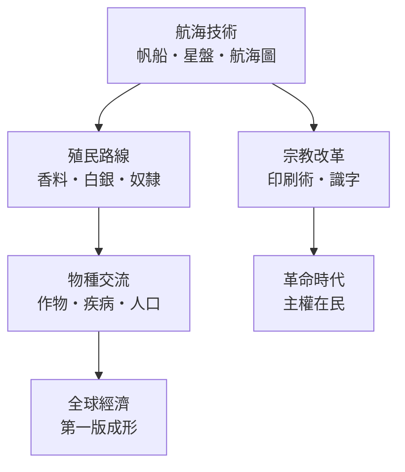
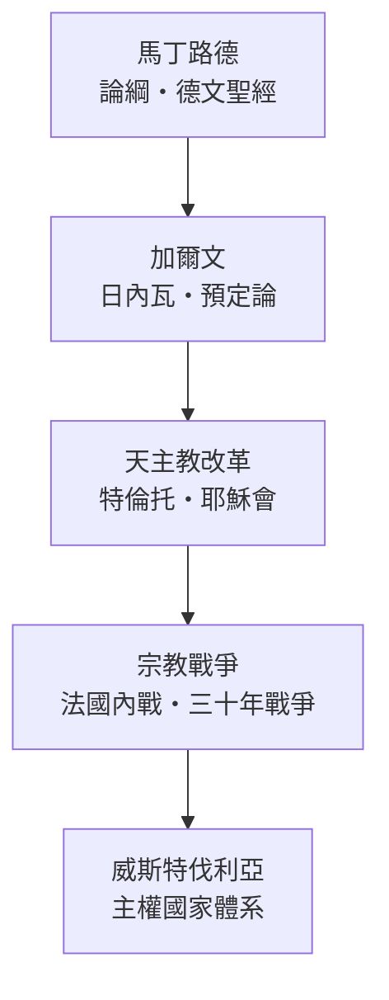
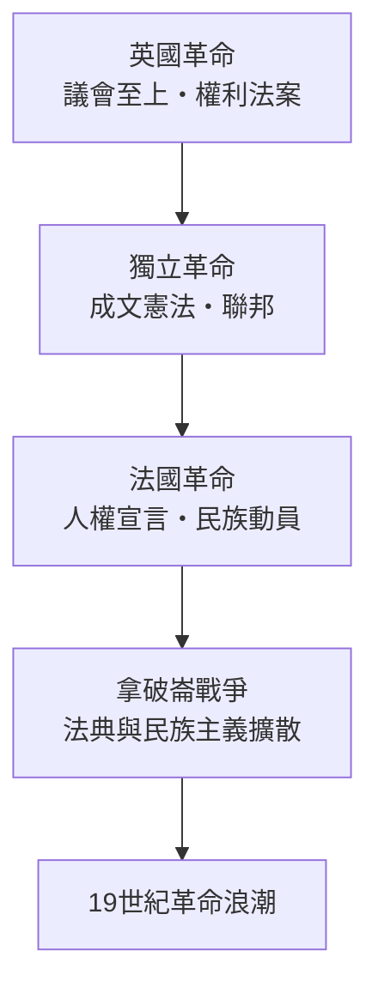
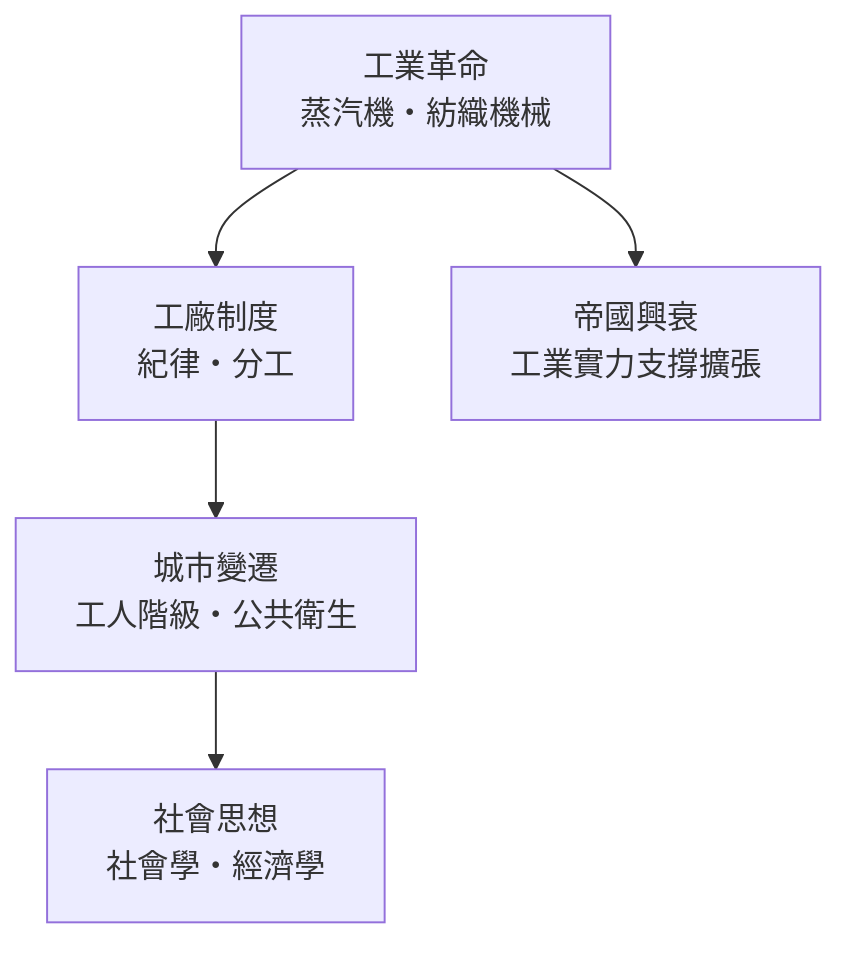
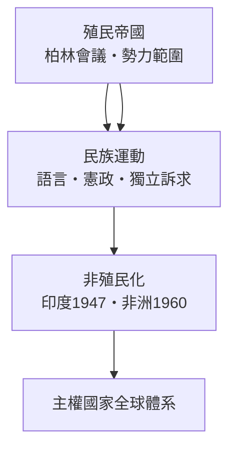

# 近代史

> 隸屬：第一層 [事]　·　相關分類：[世界史]、[宗教學]、[政治革命]、[經濟學]　·　子分類總表見 [README]

> 對應維基百科：[中文維基百科：近代史](https://zh.wikipedia.org/wiki/%E8%BF%91%E4%BB%A3%E5%8F%B2)　·　[English Wikipedia: Early modern period](https://en.wikipedia.org/wiki/Early_modern_period)

近代史大致涵蓋 15 世紀末至 19 世紀末：從[地理大發現]與[宗教改革]，經[革命時代]與[工業化]，到[帝國興衰]與民族國家體系成形。它接續[中古世界]的三體系互動，把舊大陸的區域秩序改寫為全球性的海洋經濟、主權國家與工業資本主義。與[世界史]的長時段框架相比，近代史聚焦「全球化第一次成型」的機制；與[政治革命]聚焦革命事件不同，本概念把革命視為政治整合技術與經濟結構變遷的節點。

## 核心問題

近代史的第一個問題是**連接**：如何把歐亞非美四洲納入同一張貿易與資訊網？答案是遠洋航海、殖民地與全球物種交換。第二個問題是**正當性**：君權、教會與傳統秩序如何在印刷術與識字擴散下重組？答案是[宗教改革]與[革命時代]的主權重構。第三個問題是**動力**：如何讓生產擺脫有機能源與手工的限制？答案是[工業革命]的機械、礦物能源與工廠制度。三個問題互相驅動：全球市場擴大需求，需求拉動生產革命，生產革命又要求新國家與新帝國來保護市場。

## 因果鏈

1. 1453 年君士坦丁堡陷落與陸上商路受阻，加上航海技術累積，葡萄牙與西班牙率先向大西洋尋路，[地理大發現]展開。
2. 1492 年[哥倫布]抵達美洲，[物種交流]重寫兩半球的農業與人口，白銀與香料貿易催生第一個全球經濟。
3. 印刷術（1450 年代古騰堡活字）使文書成本驟降，[馬丁路德]的論綱於 1517 年貼出後數週傳遍德意志，[宗教改革]證明資訊技術可以拆解千年宗教秩序。
4. 宗教戰爭與威斯特伐利亞和約（1648 年）確立主權國家原則，政治單位從教廷普世主義轉為國家本位。
5. 貿易盈餘、海軍與議會財政使英國率先突破財政瓶頸，1769 年瓦特改良蒸汽機，[工業革命]把礦物能源引入生產，[工廠制度]與[城市變遷]隨之而來。
6. 1776 年美國獨立、1789 年[法國革命]把主權在民寫進政治實踐，[革命時代]使民族國家成為普世模板。
7. 工業化國家以軍事與金融優勢展開[帝國興衰]的新一輪擴張，1885 年柏林會議瓜分非洲是其高峰。
8. 被統治社會以[民族運動]回應，19 與 20 世紀之交[非殖民化]的觀念與組織條件逐漸成熟，近代史的問題清單移交給 20 世紀。

## 子分類的定位與相互驅動

### 地理大發現

[地理大發現]是近代史的第一引擎：[航海技術]（卡拉維爾帆船、星盤與航海圖）使遠洋可計畫，[殖民路線]（香料、白銀、奴隸三角貿易）使遠洋有利潤，[物種交流]（馬鈴薯、玉米、天花）則重塑兩半球的生態與人口。它解決了[中古世界]陸上商路被中介的瓶頸，也製造了歐洲與全球不平等的第一版格局。

### 宗教改革

[宗教改革]展示資訊技術與信仰秩序的碰撞：[馬丁路德]以德文小冊子繞過拉丁教會階層，[加爾文]以日內瓦為模範城市建設教會制度，[天主教改革]以特倫托會議（1545 至 1563 年）重整紀律。宗教戰爭的僵局逼出主權國家原則——政治不再需要宗教統一，這是[革命時代]的前提。

### 革命時代

[革命時代]（約 1640 至 1804 年）把主權從君主轉到「民族」：[英國革命]確立議會至上與有限君權，[獨立革命]示範殖民地可以依契約理論建國，[法國革命]把主權在民、公民平等與民族動員推向極端。它解決了舊制度（Absolutism）的財政與正當性危機，也輸出了此後兩百年的政治語言。

### 工業化

[工業化]是生產方式的革命：[工業革命]以蒸汽機與紡織機械突破有機經濟的能源瓶頸，[工廠制度]把勞動時間與空間紀律化，[城市變遷]把人口聚到前所未有的規模。它解決了人口成長與資源約束的馬爾薩斯陷阱，同時製造了階級社會與工人運動，是 19 世紀社會思想（社會學、經濟學）誕生的直接土壤。

### 帝國興衰

[帝國興衰]是近代史的收束：[殖民警與帝國]（殖民帝國）以柏林會議與勢力範圍把全球瓜分完畢，[民族運動]以語言、歷史與憲政訴求動員被統治者，[非殖民化]則在兩次大戰削弱帝國母國後把這些訴求兌現。它結束了近代史開啟的殖民體系，也把主權國家體系推到全球。

## 範例

以[革命時代]為例可見近代史的典型因果：[法國革命]的導火線是財政——援助美國獨立戰爭使王室破產，1789 年召開三級會議，[路易十六]被迫與第三等級談判；巴士底監獄被攻陷（7 月 14 日）、《人權與公民權宣言》（8 月）接連出場，1793 年[路易十六]被處決，1794 年[羅伯斯庇爾]的恐怖統治反噬自身，1799 年[拿破崙]霧月政變收場。十年之內，歐洲最強王權從絕對君主變成民族國家的實驗場，而《拿破崙法典》（1804 年）又把這場實驗的制度成果輸出全歐。

再以[工業革命]為例：瓦特於 1769 年取得分離冷凝器專利，把紐科門機的燃料效率提高四倍以上；1780 年代起紡織業（水力紡紗機、動力織機）與蒸汽機合流，曼徹斯特在半世紀內從兩萬人的城鎮變成三十萬人的棉紡之都。人口、能源與組織三要素同時改變——這就是近代史與古代一切的差別。

## 容易混淆之處

- **「近代」斷代不統一**：歐洲史常以 1500 年前後起算，中國史「近代」常自 1840 年起，本概念採全球史的 15 世紀末起點。
- **宗教改革不等於只是宗教**：它同時是印刷業、國家財政與教產再分配的經濟事件。
- **工業革命不是單一發明**：蒸汽機只是其中一環，煤、棉、殖民地市場與金融制度缺一不可。
- **「殖民帝國」與「殖民警與帝國」**：後者是本倉庫登記的孫分類名稱（`levels.py` 既有條目），指同一主題。

## 延伸閱讀

- [世界史]：近代在長時段中的位置。
- [宗教學]：改革時代信仰形態的總覽。
- [政治革命]：革命事件與領袖的專題總表。
- [經濟學]：工業化與市場社會的理論工具。

## 連結定義

[README]: README.md
[事]: ../事/README.md
[世界史]: ../世界史/README.md
[宗教學]: ../宗教學/README.md
[政治革命]: ../政治革命/README.md
[經濟學]: ../經濟學/README.md
[中古世界]: ../古代史/中古世界.md
[地理大發現]: 地理大發現.md
[航海技術]: 航海技術.md
[殖民路線]: 殖民路線.md
[物種交流]: 物種交流.md
[宗教改革]: 宗教改革.md
[馬丁路德]: 馬丁路德.md
[加爾文]: 加爾文.md
[天主教改革]: 天主教改革.md
[革命時代]: 革命時代.md
[英國革命]: 英國革命.md
[獨立革命]: 獨立革命.md
[法國革命]: 法國革命.md
[工業化]: 工業化.md
[工業革命]: 工業革命.md
[工廠制度]: 工廠制度.md
[城市變遷]: 城市變遷.md
[帝國興衰]: 帝國興衰.md
[殖民警與帝國]: 殖民警與帝國.md
[民族運動]: 民族運動.md
[非殖民化]: 非殖民化.md
[哥倫布]: 地理大發現.md
[路易十六]: ../人/政治人物/路易十六.md
[羅伯斯庇爾]: ../人/政治人物/羅伯斯庇爾.md
[拿破崙]: ../人/政治人物/拿破崙.md
