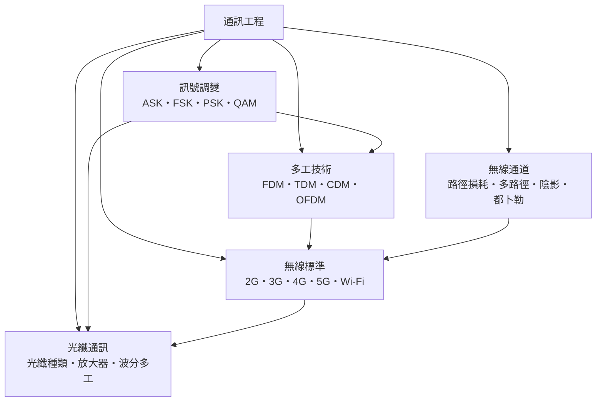

# 通訊工程

> 隸屬：第一層 [工]　·　相關分類：[電子工程]、[電機工程]、[計算機網路]、[半導體]　·　子分類總表見 [README]

> 對應維基百科：[中文維基百科：通訊工程](https://zh.wikipedia.org/wiki/%E9%80%9A%E4%BF%A1%E5%B7%A5%E7%A8%8B)　·　[English Wikipedia: Telecommunications engineering](https://en.wikipedia.org/wiki/Telecommunications_engineering)

通訊工程研究**如何把訊息從一處可靠、迅速、有效地送到另一處**。它的核心不是「把電送過去」這種平凡的事實，而是三個互相牽動的難題：頻道資源有限、傳輸環境不可靠、接收端事先不知道送什麼。第一個難題逼出了**調變**與**多工**——把資訊塞進載波的某個屬性、把多個使用者的訊息疊在同一條管道上；第二個難題逼出了**通道模型**與**錯誤控制**——先量化衰減與多路徑，再設計足以抵禦它們的編碼；第三個難題逼出了**標準**——讓不同製造商的設備能互相對話。

這門學科的數學核心在 1948 年由 [香農] 確立。他證明：在頻寬 $B$ Hz 的通道上，若訊噪比為 $S/N$ ，資訊傳輸速率的絕對上限是

$$
C = B \log_2\left(1 + \frac{S}{N}\right)
$$

這個公式至今是所有通信系統的預算表：頻寬擴大十倍，容量大致增加十倍（高訊噪比時）；訊噪比改善十倍，容量只增加約 $3.3$ bit/s/Hz 。[奈奎斯特] 的取樣定理則給出另一條硬上限——取樣率至少是訊號最高頻率的兩倍。這兩條定理把「能不能通」變成可計算的工程問題。

通訊工程與 [電子工程] 的分工在於「鏈路的哪一段」：電子工程負責造出收發機的電路，通信工程負責把這些電路組織成能跨越距離的系統，並以理論保證這件事做得到。從 1837 年的[電報]、1900 年代的[雷達]與[收音機]、1966 年 [休斯] 等人推動的 [1948年] 網際網路實驗，到今日的光纖到府與 5G 行動寬頻，技術手段不斷更替，但「在有限資源下可靠傳遞資訊」這個核心命題從未改變。

## 核心問題

1. **如何讓訊號離開發射端**：人類的聲音與影像不能直接送上天線，必須先轉換成電訊號，再以某種方式「載」在適合傳播的高頻載波上——這是[訊號調變]要解決的問題。
2. **如何讓多個使用者共用一個頻段**：頻譜是公共財且不增變，若每個使用者都用獨立頻道，頻譜立刻耗盡——這是[多工技術]的問題，答案包括頻分、時分、碼分與正交頻分。
3. **如何預測訊號到達時變成什麼樣子**：無線訊號會被建築物吸收、被反射、被繞射、被移動物體拉動頻率——[無線通道]提供衰減、多路徑、陰影與[都卜勒]四種基本現象的量化描述。
4. **如何讓不同世代與不同廠商的設備互通**：頻段、訊框結構、編碼、功率控制、安全機制全部要寫成規格書——[無線標準]就是這些規格的集合體。
5. **如何在長距離、大容量上傳輸**：無線頻譜可用寬度有限，長距離又難免衰減——[光纖通訊]用光纖把頻寬推到兆位元級別，是骨幹網的答案。

五個問題依序相依：沒有調變就沒有可傳的訊號；沒有多工，頻譜無法共享；沒有通道模型，就無法判斷解調器要對抗什麼；沒有標準，設備無法互通；而光纖不是另一種理論，而是同一套理論在更好的物理層上的實現。

## 因果鏈

1. **有線電報的開端**：1830 年代電報把訊息編碼成脈衝序列並在線上傳送，證明「離散符號」可以代替「連續語音」——這是數位通訊的起點。
2. **馬克士威預言電磁波**：1865 年 [馬克士威] 的方程組預言光與無線電同源，1887 年 [赫茲] 以實驗證實電磁波存在，工程問題於是轉為「如何產生與接收特定頻率的波」。
3. **載波與調變**：無線電報直接以通斷載波表示訊息，即最早的 ASK 調變；人聲要廣播，必須先把聲音變成頻譜搬移過來的訊號，AM 調變出現。
4. **噪聲與資訊論**：1920 年代無線電普及後，靜態雜訊與衰落成為瓶頸；[香農] 在 1948 年給出容量上限並證明只要編碼率低於此上限就能可靠傳輸，錯誤控制從「重發」升級為「編碼」。
5. **頻譜共享的需求**：固定頻道用盡後，行動電話無法為每個使用者配一條專線；FDMA、TDMA、CDMA 依序登場，把同一頻段切給大量使用者。
6. **數位化與光纖**：1980 年代光纖與雷射二極體成熟，頻寬從 MHz 級跳到 GHz 級，骨干成本大幅下降；同時數位訊號處理讓解調器可以在軟體中重組，OFDM 這類多載波技術得以實現。
7. **無線標準化與世代交替**：2G、3G、4G、5G 的演進並非單純追求更快，而是把頻譜效率、延遲、連線密度與覆蓋方式重新組合；每一代都建立在前一代的理論與通道模型上。
8. **光纖到府與雲端**：光纖從骨干延伸到住宅，配合無線最後一哩，行動網路成為預設的接取方式；雲端運算與邊緣運算又把「通訊」與「計算」重新綁在一起。

## 子分類的定位與相互驅動

- [訊號調變]是**符號層**：決定一個符號能帶多少位元，以及在什麼樣的通道下會失真。它是所有其他子分類的共同前提。
- [多工技術]是**資源層**：回答「同一段頻譜如何服務多個使用者」。它把調變好的符號組織成幀與資源塊，其結果直接決定頻譜效率。
- [無線通道]是**物理層**：提供衰減、多路徑、陰影與頻移的數學模型，是解調器與編碼器設計的依據；模型不準，設計就會失敗。
- [無線標準]是**系統層**：把前三者的成果固定成規格，讓不同廠商的晶片與網路互通；標準的每一條參數都能追溯到調變與通道模型。
- [光纖通訊]是**物理層的升級**：光纖提供近乎無衰減的巨大頻寬，使多工技術能發揮到極致，同時也讓骨幹與接入的設計原則徹底不同於無線。

## 範例

**範例一：頻寬與容量預算。** 一條 $B = 20$ MHz 的無線通道，實測訊噪比 $S/N = 100$ （即 20 dB）。由香農公式，理想容量上限為

$$
C = 20 \times 10^6 \times \log_2(1 + 100) \approx 133 \times 10^6 \ \text{bit/s}
$$

也就是理論上約 133 Mbit/s。實際系統只能做到其中一部分，因為還要扣除訓練訊號、導引訊號、同步與保護時段的開銷——這就是「頻譜效率」在工程實務中的意義。

**範例二：ASK 與 FSK 的頻寬代價。** 以位元速率 $R_b = 1$ Mbit/s 傳輸，ASK 需要頻寬 $B \approx 2R_b = 2$ MHz（以 BFSK 的非相干形式估算，頻寬約為 $2R_b$ ）；若改用 16 進位 FSK（每個符號承載 4 位元），符號速率降到 $250$ kbaud，所需頻寬也隨之降到約 $500$ kHz。頻寬是無線頻譜中唯一稀缺的資源，因此「用更複雜的調變換取更少的頻寬」是整門學科的主軸。

**範例三：光纖的衰減預算。** 標準單模光纖在 1310 nm 波長的衰減約 $0.35$ dB/km。若訊號經過 80 km 中繼，損耗為 $28$ dB；若雷射輸出功率為 $0$ dBm，接收端只剩 $-28$ dBm，再扣除 3 dB 的連接器與分路損耗，可用功率約剩 $-31$ dBm。在 1550 nm 波長、每通道速率 100 Gbit/s 的系統中，鏈路設計必須確保接收機的靈敏度優於此值——這說明光纖系統的瓶頸通常不在頻寬，而在光功率預算與放大器佈局。

## 容易混淆之處

- **通訊工程不等於電子工程**：電子工程著重電路與元件，通訊工程著重跨越介質的資訊傳遞；前者是後者的供應者，但兩者的設計指標不同。
- **頻寬與傳輸速率不是同一件事**：頻寬是通道能容納的頻譜範圍（Hz），速率是每秒送出的位元數（bit/s）；採用 QAM 等高階調變並加密碼率，速率可以超過香農式「每赫茲 1 bit」的直覺。
- **多工不等於多路徑**：[多工技術]是「多個使用者共用頻譜」的機制；[多路徑]是「同一個訊號沿不同路徑抵達」的物理現象，兩者只是碰巧用了相似的名稱。
- **頻段不等於頻寬**：「2.4 GHz 頻段」是頻譜的位置，「20 MHz 頻寬」是頻譜的寬度；前者不能單獨決定速度。
- **光纖比「沒有衰減」好**：光纖仍有衰減、色散與非線性效應，只是每公里的損失極小，因此長距離仍需中繼與放大。
- **5G 的高頻段不是免費的**：頻率越高，電容性衰減與穿透能力越差，基站密度需求隨之上升；高頻段的優勢是可用頻寬而非覆蓋半徑。

## 延伸閱讀

- [電子工程]：提供收發機前端、功率放大器、混波器與類比數位轉換器等硬體。
- [電機工程]：天線、射頻功率放大、供電與基地台基礎設施。
- [計算機網路]：通訊工程提供位元的傳輸方式，網路工程處理位元的路由與協定。
- [半導體]：射頻前端與基頻處理晶片的實體基礎。
- [物理學]與[光學]：電磁波傳播與光纖中的光學原理。
- [衛星]：以軌道資源換取全球覆蓋的通訊型態。
- [演算法]：編碼、訊號處理與資源分配的演算法化。

## 連結定義

[工]: ../工/README.md
[README]: README.md
[電子工程]: ../電子工程/README.md
[電機工程]: ../電機工程/README.md
[計算機網路]: ../計算機網路/README.md
[半導體]: ../半導體/README.md
[物理學]: ../物理學/README.md
[光學]: ../物理學/光學.md
[衛星]: ../衛星/README.md
[演算法]: ../演算法/README.md
[訊號調變]: 訊號調變.md
[多工技術]: 多工技術.md
[無線通道]: 無線通道.md
[無線標準]: 無線標準.md
[光纖通訊]: 光纖通訊.md
[多路徑]: 多路徑.md
[都卜勒]: 都卜勒.md
[香農]: ../人/工程師/香農.md
[奈奎斯特]: ../人/工程師/奈奎斯特.md
[休斯]: ../人/工程師/休斯.md
[馬克士威]: ../人/物理學家/馬克士威.md
[赫茲]: ../人/物理學家/赫茲.md
[電報]: ../物/電報.md
[雷達]: ../物/雷達.md
[收音機]: ../物/收音機.md
[1948年]: ../時/1948年.md
