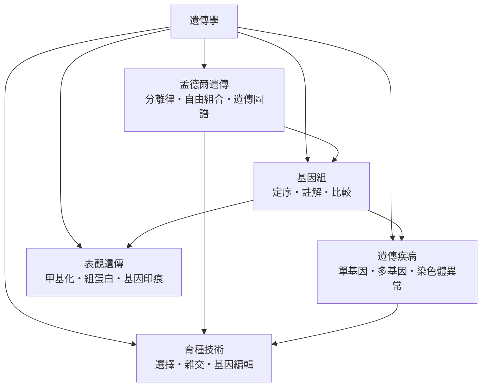

# 遺傳學

> 分類範圍：以「遺傳資訊如何被編碼、傳遞、表達與改寫」為核心——從孟德爾的比例律到基因組的序列、從表觀遺傳的化學標記到育種與基因編輯的實務。　·　隸屬第一層：[人]、[理]　·　相關分類：[分子生物]、[生物學]、[生命週期]、[人種演化]　·　子分類總表見 [README]

> 對應維基百科：[中文維基百科：遺傳學](https://zh.wikipedia.org/wiki/%E9%81%97%E4%BC%A0%E5%AD%A6)　·　[English Wikipedia: Genetics](https://en.wikipedia.org/wiki/Genetics)

遺傳學研究的是**同一套資訊如何在世代之間流動**：哪些特徵會被傳下去、傳給誰、傳多少，以及分子層次上究竟是什麼東西在被傳遞。它回答的問題有三層——**規律**（怎樣傳）、**物質**（什麼在傳）、**機制**（如何調控與改寫）。本概念的問題是：**當「遺傳」從一種觀察印象變成可測量、可解釋、可操作的對象，人類對生物的認識與介入能力分別被推到了哪裡**。

## 核心問題：三個層次與一條主線

### 一、規律層：怎樣傳

第一個問題是描述性的：**同一對親代交配，後代的比例是否可預測**。答案是肯定的，但只在特定條件下成立——必須區分顯性與隱性、必須知道親代是否為純系、必須處理多基因的機率而非直覺。典型的 $3:1$ 比例之所以有力，是因為它不依賴任何關於分子機制的預設：只要假設存在不可見的因子、且在形成配子時分離，就必然導出這個數字。比例本身就是機制的證據，這是 [孟德爾遺傳] 留下的方法論傳統。

### 二、物質層：什麼在傳

第二個問題是物質性的：**承載遺傳的分子是什麼**。[DNA] 是答案，但它不是一開始就被接受的答案。1944 年以前，學界仍認為蛋白質才是遺傳物質；直到細菌的轉化實驗、噬菌體感染實驗相繼完成，加上雙螺旋結構被提出並給出鹼基配對的複製機制，DNA 的地位才確立。**物質基礎一旦確立，整個學科就從「記錄比例」轉為「解讀機制」**，這是本學科最重要的分水嶺。

### 三、表達層：如何調控

第三個問題是「**有了基因不等於有功能**」。基因何時開啟、開啟多少、在哪些組織開啟，由 DNA 甲基化、組蛋白修飾、染色質三維結構等化學標記決定，這些標記不改變鹼基序列卻能改變表現型，構成 [表觀遺傳] 的領域。這一層解釋了為何同卵雙胞胎可以有重大差異，也解釋了為何細胞分化能在基因組大致相同的前提下發生。

### 一條主線

三層並非並列，而是**前後相繼的瓶頸解法**：沒有比例律就不知道要找什麼；沒有 DNA 就無法解釋比例；有了 DNA 卻解釋不了同卵雙胞胎的差異，才逼出表觀遺傳。而每一層都各自長出應用分支：比例律支撐 [育種技術] 中的選擇與雜交，DNA 層面支撐 [基因組] 的定序與註解，表觀層面則支撐環境與基因交互作用的研究。

## 因果鏈

1. **混合遺傳的直覺與它的失敗**：19 世紀主流認為子代是父母性狀的「折衷」，像紅白花授粉後只開粉紅花。但如此一來，隔代之後差異會迅速消失，與觀察到的穩定差異不符——**遺傳的離散性問題**浮出水面。

2. **1865 年的比例與被忽略的三十年**：[孟德爾] 以豌豆雜交得到可預測的比例，並在 1866 年出版；但當時缺乏基因概念與統計框架，讀者無法看出比例的普遍性，成果被冷落三十五年。這段歷史提醒我們：學術出版不保證成果被看見，**框架的成熟與成果的成熟必須相遇**。

3. **1900 年的重新發現與染色體遺傳學說**：三位學者各自獨立重現孟德爾比例，並回到布爾諾查考舊文。染色體行為與孟德爾比例被對應起來，遺傳學第一次有了細胞學的物質基礎。

4. **1913 年的連鎖與基因圖譜**：果蠅實驗發現部分性狀不再呈自由組合，而是成群遺傳。連鎖現象證明基因位於染色體上，且可用重組率測量基因間的相對距離，**遺傳圖譜**由此誕生，遺傳學從「基因存在嗎」轉向「基因在哪裡、多遠」。

5. **1930 年代的統計化**：費歇等人以超幾何分布檢驗比例，並建立族群遺傳學的數學框架；同時哈威與霍爾丹把孟德爾遺傳與自然選擇理論合併。**選擇不再需要以個體為單位**，而可以在等位基因頻率層次運算，演化論於是獲得遺傳學的骨架。

6. **1944–1953 年：遺傳物質的確認與雙螺旋**：噬菌體實驗標示 DNA，DNA 結構的提出則立即解釋了複製為何可以精確進行，並提供鹼基序列作為資訊載體的概念。此時遺傳學的問題形式從「比例」徹底轉為「序列」。

7. **1970 年代：重組 DNA 技術與基因定序**：限制性內切酶與連接酶使人類能夠在體外操作 DNA；定序技術則讓「讀出」變為常規。**基因可以被剪接、轉移、讀出**，遺傳學自此具有工程學性質。

8. **1990–2003 年：人類基因組計畫與基因組學**：[人類基因組計畫] 完成約 30 億鹼基對的定序，之後多種生物相繼定序。人類有約兩萬個蛋白質編碼基因，卻有約 98% 的序列不直接編碼蛋白質——「基因組」這個詞的內涵因此從「基因的清單」變成「整體的序列地圖」。

9. **2000 年後：表觀遺傳與基因編輯**：高通量定序讓 DNA 甲基化組、組蛋白修飾組得以被全面描繪，「表觀基因組」成為獨立層次；同時 [CRISPR] 使定點改寫序列成本大幅下降，遺傳學的終點從「解釋」延伸至「設計」。

## 子分類的定位與相互驅動

- [孟德爾遺傳] 是**規律層與方法論的起點**：它提供了「用可預測的比例來定義因子」這套操作方式，並以連鎖與遺傳圖譜把抽象因子落到染色體上。它供應的是**提問方式**，而非分子答案。

- [基因組] 是**物質層的成熟形態**：當序列可以被完整讀出，遺傳學的問題就從「這個性狀怎麼傳」變成「哪些鹼基差異造成了這個性狀」。定序與註解把比例律的抽象模式轉成具體的分子清單。

- [遺傳疾病] 是**應用的壓力測試**：疾病是遺傳學最殘酷的實驗室，它同時檢驗分類是否夠用——單基因模式解釋了 [囊性纖維化] 這類孟德爾式疾病，卻解釋不了多基因疾病與染色體異常，因此逼迫學科引入新的模型。

- [表觀遺傳] 是**表達層的解釋者**：當序列已知的個體仍表現出不同疾病風險或不同表型，答案只能在序列之外的調控層。它與 [基因組] 互為表裡：基因組是「什麼」，表觀遺傳是「何時開啟」。

- [育種技術] 是**下游的實作面**：選擇育種、雜交育種與基因編輯，把前述三層知識轉成可交付的品種與品系。它們不斷回饋新問題——要育種就得知道哪些位點值得選，而這正是 [基因組] 與 [表觀遺傳] 回答的。

## 範例：從一張家族病史走完五個子分類

以一對育有兩名子女、孩子反覆肺部感染與胰臟外分泌功能異常的夫妻為例，看五個子分類如何依序接手同一個案例：

1. **第一步：用 [孟德爾遺傳] 建立假說**。夫妻雙方皆無呼吸道症狀，孩子卻有嚴重肺部感染，提示**體染色體隱性遺傳**。若致病等位基因頻率為 $q$ ，則帶因者機率為 $2pq$ ；在有近親關係的族群中，致病等位基因頻率 $q$ 較高，因此子代同時帶有兩個致病等位基因的機率為 $q^2$ 。這一步把「家族模式」翻譯成**可檢驗的機率**。

2. **第二步：用 [基因組] 定位**。患者的外顯子定序顯示第 7 號染色體上某基因的第 21 號外顯子缺失三個鹼基（最常見的 ΔF508 型變異，在歐洲族群患者中約占七成）。定序把「隱性遺傳」從一個模式收斂成**一個具體的鹼基層級事實**。

3. **第三步：用 [表觀遺傳] 補充**。即使帶有兩個變異等位基因，患者的表現型仍高度變異——部分與該基因啟動子區域的甲基化程度有關，呼吸道感染次數與這一區域的表觀狀態相關。這解釋了「相同基因型、不同嚴重度」的落差。

4. **第四步：把案例放回 [遺傳疾病] 的分類學**。這個疾病被歸為**單基因疾病**：致病位點單一、遺傳模式明確、可做家族風險評估；相對地，糖尿病與高血壓等屬於多基因疾病，染色體數目或結構異常則是第三類，機制與遺傳模式皆不同。

5. **第五步：連到 [育種技術] 與治療**。以家畜為例，這類突變是育種中要**保留**的等位基因（例如某些抗病性）；而在人體中，基因治療的目標則是修正序列或補償功能。同一份序列資訊，因為用途不同而被讀成相反的方向。

6. **回頭看資料的累積**：整個案例從診斷到風險評估，都依賴 1990–2003 年間累積的序列資料。沒有 [人類基因組計畫] 這類基礎工程，第五步根本無從談起——**基礎研究的產出在此以資料庫的形式被臨床消耗**。

## 容易混淆之處

- **遺傳不等於先天**：先天指在胚胎期就存在，遺傳指源自基因序列；許多先天異常由環境暴露或隨機發育誤差造成，與序列變異無關。
- **基因不是「決定命運的按鈕」**：多數性狀是許多基因加上環境的加權結果，行為與能力的遺傳率估計多半在 0.3 到 0.8 之間，且隨環境改變而改變。
- **等位基因頻率是族群量，不是個人量**：描述族群的數字不應直接套用到個人風險；風險評估必須結合家系、外顯率與年齡。
- **表觀遺傳不等於序列改變**：甲基化不改變鹼基序列本身，兩者是不同層級的資訊，但在實驗中有時難以區分（序列變異也可能影響甲基化）。
- **孟德爾比例在小樣本中會偏離**：顯性、顯性不完全、外觀與生理效應分離、環境影響等，都會讓實際比例偏離理論的 $3:1$ ；「不符合比例」不等於「法則錯了」。
- **基因組大小與基因數不成正比**：某些物種基因數少卻有龐大重複序列；「多」與「重要」是兩件事。

## 延伸閱讀

- [分子生物]：DNA 複製、轉錄與蛋白質合成，遺傳資訊的分子執行層。
- [生物學]：遺傳學在生物學整體方法論中的位置。
- [生命週期]：遺傳與發育的接點——基因何時被開啟。
- [人種演化]：遺傳變異與族群遷徙如何塑造人類的分布。
- [科學家]：從孟德爾到分子生物學家的研究群體脈絡。

## 連結定義

[人]: ../人/README.md
[理]: ../理/README.md
[README]: README.md
[分子生物]: ../分子生物/README.md
[生物學]: ../生物學/README.md
[生命週期]: ../生命週期/README.md
[人種演化]: ../人種演化/README.md
[科學家]: ../科學家/README.md
[孟德爾遺傳]: 孟德爾遺傳.md
[基因組]: 基因組.md
[遺傳疾病]: 遺傳疾病.md
[表觀遺傳]: 表觀遺傳.md
[育種技術]: 育種技術.md
[DNA]: DNA.md
[人類基因組計畫]: 人類基因組計畫.md
[CRISPR]: ../分子生物/CRISPR.md
[孟德爾]: 孟德爾.md
[囊性纖維化]: 囊性纖維化.md
