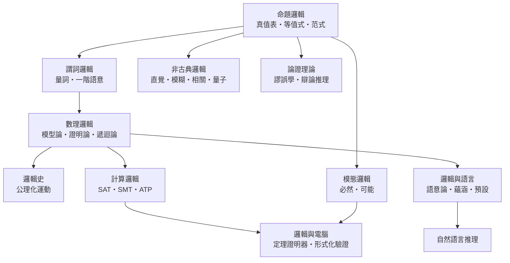

# 邏輯學

> 分類範圍：形式推理的規則、語意與有效性判準；並敘述邏輯如何自希臘三段論起，經公理化運動、被不完備性定理劃下邊界，再反過來驅動 SAT/SMT 求解器與今日硬軟體的形式化驗證。
>
> 隸屬第一層：[文]　·　相關分類：[哲學]、[語言學]、[數學]、[電腦]　·　子分類總表見 [README]

> 對應維基百科：[中文維基百科：邏輯學](https://zh.wikipedia.org/wiki/%E9%80%BB%E8%BE%91)　·　[English Wikipedia: Logic](https://en.wikipedia.org/wiki/Logic)

## 核心問題：把「推論」變成可判定的對象

邏輯不研究命題是否為真，而研究**推論形式是否必然成立**。判定準據是有效性（validity），而不是真實性（truth）；這個分離是邏輯成為「推理的科學」的起點。

以推論系統 $\Gamma$ 與命題 $\varphi$ 為例：

- **語法後果**：若存在有限推導序列 $\Gamma \vdash \varphi$ ，則稱 $\varphi$ 為 $\Gamma$ 的定理。
- **語意後果**：若對每個解釋 $I$ ，只要 $I \models \psi$ 對所有 $\psi \in \Gamma$ 成立，就有 $I \models \varphi$ ，則稱 $\varphi$ 為 $\Gamma$ 的邏輯後果。

可靠性（Soundness）與完備性（Completeness）兩條定理正好把兩者接起來：

$$
\Gamma \vdash \varphi \;\Longrightarrow\; \Gamma \models \varphi
\qquad\text{（可靠性）}
$$

$$
\Gamma \models \varphi \;\Longrightarrow\; \Gamma \vdash \varphi
\qquad\text{（完備性）}
$$

「公理化 + 有效性 + 完备性」這三件事一旦綁在一起，邏輯便取得兩項決定性優勢：可以**機械化地**檢查推論，也可以在**有限對象**上窮舉完畢。

## 三條線索與彼此的驅動關係

邏輯的內部發展不是線性的，而是三條需求互相拉鋸的結果：**語意**要回答「真的意思是什麼」、**證明**要回答「怎麼一步步推出來」、**計算**要回答「能不能自動判定」。三者彼此設限，也彼此推動。

因果鏈條可以簡述為：

1. **亞里士多德的三段論**給出第一批可檢查的推論規則，卻只處理主詞—謂詞形式，無法表達「所有人」與「某個人」的量化，這一缺口直接催生了 **Frege 的量化邏輯**。
2. **Hilbert 的公理化綱領**要求把數學完全形式化為形式系統，因而需要證明「系統內每一步都可靠」——這正是**證明論**與**模型論**分工的源頭。
3. **Gödel 不完全性定理**證明任何足夠強且可有效公理化的系統都無法在內部證明自身一致性，等於宣告「通吃一切的形式化」不可能；研究因此轉向**受限片段的可判定性**。
4. **Church 與 Turing 的不可判定性**說明一階邏輯不存在通用判定程序，於是「能被電腦自動處理的邏輯」必須降格為**有限片段**：SAT 及其擴充 SMT。
5. **Cook-Levin 定理**證明 SAT 是 NP-完全問題，確立了 SAT 作為「強式語言」的地位——凡是能編譯成 SAT 的問題都自動獲得可用的求解器；這條工程紅利又回頭改寫了硬體與軟體的驗證方式。
6. **模態邏輯**引入 $\Box$ 與 $\Diamond$ ，把「必然／可能」形式化，直接支撐 Hoare 邏輯、時序邏輯與硬體描述語言的驗證。
7. **模糊邏輯**則是反方向的驅動：工程上需要可調的、連續的真值，於是迫使數學側接受多值邏輯，挑戰了以二值為前提的整體傳統。

## 子分類的定位與相互驅動

### 命題邏輯

把陳述視為不可再分的原子，只保留真值與連接詞 $\neg, \wedge, \lor, \to, \leftrightarrow$ 。它的力量來自**有限性**：真值表可窮盡，故等價關係可完全判定，例如 $P \to Q \equiv \neg P \lor Q$ 。分佈律 $P \lor (Q \land R) \equiv (P \lor Q) \land (P \lor R)$ 使公式可化為合取范式 $\varphi \equiv \bigwedge_i \bigvee_j l_{ij}$ ，這正是 SAT 求解器的輸入格式，也是「命題邏輯 → 計算邏輯」的第一座橋。

### 謂詞邏輯

加入量詞 $\forall, \exists$ 與個體變數後，表達力足以描述數學中的「對所有 $x$ 存在 $y$ 」這類結構，但也帶來不可判定性（Church 定理）。它的核心貢獻是**語意與證明的分離**：語意透過模型語意把公式解釋為對論域元素的斷言，證明則透過自然演繹與序列演算給出可檢查的推導規則。現代 SAT/SMT 求解器正是「命題邏輯的效率」加上「謂詞邏輯的表達力」的折衷產物。

### 模態邏輯

以 $\Box$ 與 $\Diamond$ 表達必然與可能，並以可能世界語意解釋： $M, w \models \Box \varphi$ 當且僅當所有 $w$ 可達的世界都滿足 $\varphi$ 。這套裝置把「時間先後」「規範約束」「認識狀態」寫成算子，使邏輯從純數學走進工程：時序邏輯成為硬體描述語言的語意基礎，Hoare 邏輯以 $P \land \{Q\} C \{R\}$ 的斷言形式承載程式驗證。

### 非古典邏輯

放棄二值與排中律的嘗試各有工程與哲學動機：直覺邏輯為建構數學提供基礎，模糊邏輯以 $[0, 1]$ 的真值與模糊集合滿足工程控制需求，相關邏輯以共享資訊刻畫語意，悖論邏輯處理真矛盾，量子邏輯則因量子邏輯閘的投影測量語意而生。它們共同把「邏輯 = 二值推論」的等式拆開，也迫使語意論與模型論重新界定。

### 數理邏輯

以模型論（結構、解釋、滿足）、證明論（Hilbert 系統、自然演繹、序列演算）與遞迴論（可計算性、可判定性）三者為骨幹。Gödel 不完全性定理表明：對任一足夠強且遞迴可公理化的理論 $T$ ，存在命題 $G$ 使得 $T \nvdash G$ 且 $T \nvdash \neg G$ 。這條定理不是終點而是分流點——它把研究導向受限片段的可判定性與交互式證明，也構成 Lean、Coq 等形式化平台的理論底座。

### 邏輯史

亞里士多德的三段論提供第一套有效推論規則，Frege 引入量化與 lambda 演算開啟現代邏輯，Hilbert 確立公理化綱領，塔斯基以語意定義「真」，哥德爾以兩道定理劃下公理化的邊界。歷史的教訓是：**每一次技術突破都來自放寬某個既有的假設**（單一主詞—謂詞、二值真值、單一語言）。

### 計算邏輯

把邏輯轉成可執行的工程：SAT求解以 DPLL 與 CDCL 為主軸，SMT 在此基礎上加入等值理論（算術、陣列、位元向量、未解釋函式），自動定理證明器（如 E、Vampire）結合啟發式搜尋與策略推理，邏輯程式語言（Prolog、Datalog）則讓 Horn 子句形式的推論直接落地為程式。Cook-Levin 的 NP-完全性結果說明 SAT 是「弱」語言卻「強」能力，這正是它被視為通用求解器的理由。

### 論證理論

回應自然語言與法律推理：論證不是形式推導，而是有前提、主張與推理規則的整體結構。Toulmin 模型描述論證的組成部件，謬誤學整理常見無效推理，辯論推理（argumentation frameworks）以攻擊關係比較多個論證的可接受性，舉證責任則處理「誰必須先說服誰」的規範負擔。

### 邏輯與語言

自然語言的意義需要組合性原則（compositionality）才能被形式化，自然語言推理（NLI）資料集把「前提是否蘊涵假設」化為可計算的蘊涵關係；預設邏輯處理「所有鳥都會飛」這類帶例外的事實，語用學則解釋說話者意圖與上下文。邏輯在此由「語法規則」轉為「語用推論」。

### 邏輯與電腦

定理證明器（Coq、Lean、Isabelle）讓數學命題本身成為可檢查的物件；形式化驗證以 Hoare 邏輯、分離邏輯與模型檢驗把錯誤攔在開發期；型別系統則是邏輯在程式語言中最成功的工程化實例——從 simply typed lambda calculus 到 dependent types，型別檢查器本質上就是一個自動化的證明檢查器。三者共同構成「以邏輯取代測試」的現代軟硬體工程路線。

## 條目索引

- [命題邏輯]、[謂詞邏輯]、[模態邏輯]、[非古典邏輯]、[數理邏輯]、[邏輯史]、[計算邏輯]、[論證理論]、[邏輯與語言]、[邏輯與電腦]
- [真值表]、[等值式]、[命題公式]、[范式]、[三段論]
- [一階邏輯]、[量詞]、[謂詞演算]、[模型語意]、[變元消去]
- [必然性]、[可能性]、[模態算子]、[可能世界語意]、[道義邏輯]
- [直覺邏輯]、[模糊邏輯]、[相關邏輯]、[悖論邏輯]、[量子邏輯]
- [模型論]、[證明論]、[遞迴論]、[可判定性]、[不完全性定理]
- [亞里士多德]、[弗雷格]、[塔斯基]、[哥德爾]、[希爾伯特]
- [SAT求解]、[SMT]、[邏輯程式語言]、[自動定理證明]
- [謬誤學]、[論證有效性]、[辯論推理]、[舉證責任]
- [語意論]、[蘊涵]、[預設]、[自然語言邏輯]、[語用學]
- [定理證明器]、[形式化驗證]、[型別系統]、[程式驗證]

## 連結定義

[文]: ../文/README.md
[哲學]: ../哲學/README.md
[語言學]: ../語言學/README.md
[數學]: ../數學/README.md
[電腦]: ../電腦/README.md
[README]: README.md
[命題邏輯]: 命題邏輯.md
[謂詞邏輯]: 謂詞邏輯.md
[模態邏輯]: 模態邏輯.md
[非古典邏輯]: 非古典邏輯.md
[數理邏輯]: 數理邏輯.md
[邏輯史]: 邏輯史.md
[計算邏輯]: 計算邏輯.md
[論證理論]: 論證理論.md
[邏輯與語言]: 邏輯與語言.md
[邏輯與電腦]: 邏輯與電腦.md
[真值表]: 真值表.md
[等值式]: 等值式.md
[命題公式]: 命題公式.md
[范式]: 范式.md
[三段論]: 三段論.md
[一階邏輯]: 一階邏輯.md
[量詞]: 量詞.md
[謂詞演算]: 謂詞演算.md
[模型語意]: 模型語意.md
[變元消去]: 變元消去.md
[必然性]: 必然性.md
[可能性]: 可能性.md
[模態算子]: 模態算子.md
[可能世界語意]: 可能世界語意.md
[道義邏輯]: 道義邏輯.md
[直覺邏輯]: 直覺邏輯.md
[模糊邏輯]: 模糊邏輯.md
[相關邏輯]: 相關邏輯.md
[悖論邏輯]: 悖論邏輯.md
[量子邏輯]: 量子邏輯.md
[模型論]: 模型論.md
[證明論]: 證明論.md
[遞迴論]: 遞迴論.md
[可判定性]: 可判定性.md
[不完全性定理]: 不完全性定理.md
[亞里士多德]: 亞里士多德.md
[弗雷格]: 弗雷格.md
[塔斯基]: 塔斯基.md
[哥德爾]: 哥德爾.md
[希爾伯特]: 希爾伯特.md
[SAT求解]: SAT求解.md
[SMT]: SMT.md
[邏輯程式語言]: 邏輯程式語言.md
[自動定理證明]: 自動定理證明.md
[謬誤學]: 謬誤學.md
[論證有效性]: 論證有效性.md
[辯論推理]: 辯論推理.md
[舉證責任]: 舉證責任.md
[語意論]: 語意論.md
[蘊涵]: 蘊涵.md
[預設]: 預設.md
[自然語言邏輯]: 自然語言邏輯.md
[語用學]: 語用學.md
[定理證明器]: 定理證明器.md
[形式化驗證]: 形式化驗證.md
[型別系統]: 型別系統.md
[程式驗證]: 程式驗證.md
