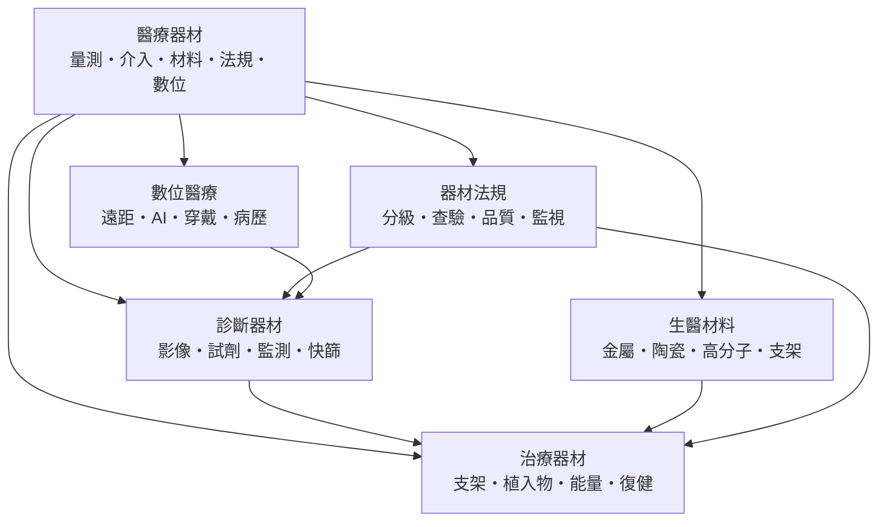

# 醫療器材

> 隸屬：第一層 [醫]　·　相關分類：[生理學]、[病理學]、[材料學]、[醫療衛生政策]　·　子分類總表見 [README]

> 對應維基百科：[中文維基百科：醫療器材]　·　[English Wikipedia: Medical device]

醫療器材是指用於人體疾病診斷、治療、監護、緩解或補償生理結構功能的儀器、設備、材料與軟體，但不同於 [藥理學] 所研究的化學藥品——藥物靠化學作用達成效果，器材則靠**物理、機械、材料或資訊的作用**。它回答的問題是：當身體出錯時，除了吃藥，我們還能用什麼「看得見、摸得著、量得出」的工具去發現問題、修補問題或替代功能。本概念的五個子分類正好對應器材的生命週期：怎麼偵測（[診斷器材]）、怎麼介入（[治療器材]）、用什麼做（[生醫材料]）、怎麼管（[器材法規]）、以及怎麼連上資訊世界（[數位醫療]）。

## 核心問題：從量測到介入的工程鏈

醫療器材的中心模型是：**生理訊號 → 量測與成像 → 判讀與決策 → 介入與治療 → 追蹤與回饋**。

1. **生理訊號**：身體本來就在輸出資訊——心電、腦電、血壓、體溫、血糖、音波與影像，只是它們微弱、嘈雜且包藏在體內。
2. **量測與成像**：感測器與成像系統把這些訊號放大、濾波並轉成人可讀的形式，例如把微伏級的心電訊號放大成波形圖。
3. **判讀與決策**：數值與影像要變成診斷，需要正常範圍與判讀規則；例如成人安靜心率約每分鐘 $60 \sim 100$ 次，超出區間只是線索而非結論。
4. **介入與治療**：決策之後，器材以機械（支架）、能量（雷射）、替代材料（人工關節）或程式（心律調節器）作用於身體。
5. **追蹤與回饋**：介入後的再量測形成閉迴路，糖尿病連續血糖監測加胰島素幫浦就是「量測—決策—給藥」的完整回饋系統。

這條鏈的瓶頸不斷移動：早期瓶頸是「看不見體內」，X 光與超音波解決了成像；接著瓶頸是「進不去體內」，導管與微創手術解決了路徑；現在的瓶頸是「判讀太慢、個人化不足」，這正是 [數位醫療] 與人工智慧切入之處。

## 因果鏈

1. **聽診與量測的起點**：十九世紀聽診器與血壓計把「病人的敘述」變成「可量測的徵象」，醫學第一次擁有了物理儀器化的診斷工具。
2. **X 光打開身體**：X 光使人不必開刀就能看見骨折與肺部陰影，此後超音波、電腦斷層與磁振造影逐層遞進，成像成為診斷器材的主幹。
3. **檢驗試劑與實驗室化**：生化與免疫檢驗把「血液中的線索」量化，診斷從單一器官的觀察擴展到全身代謝狀態的讀取。
4. **材料的突破**：金屬、陶瓷與高分子材料的生物相容性研究，讓器材可以長期留在體內而不被排斥，植入物產業因此成型。
5. **法規體系的建立**：器材從「工匠製品」變成「受管制的產品」，分級管理、上市前查驗與上市後監視構成現代 [器材法規] 的骨架。
6. **微創與介入治療**：支架、導管與內視鏡讓「治療」不必開膛破肚，治療器材與診斷器材在導管技術上合流。
7. **數位化與連網**：感測器微型化、無線通訊與雲端運算，使器材從醫院走進口袋，遠距監測與 [穿戴裝置] 改變了照護的場域。
8. **智慧判讀**：機器學習開始承擔影像篩檢與風險預測，器材的核心價值從「硬體規格」轉向「軟硬整合的臨床證據」。

## 子分類的定位與相互驅動

- [診斷器材] 是**眼睛**：先看見問題，治療才有標的；影像設備與檢驗試劑的進步直接拉動介入治療的精度。
- [治療器材] 是**雙手**：支架與導管、植入物與能量器械把診斷結論轉成實際的解剖與生理改變。
- [生醫材料] 是**根基**：任何接觸血液或組織的器材都受材料性質約束；材料不過關，設計再好都會失敗。
- [器材法規] 是**閘門**：分級決定審查強度，品質系統與上市後監視把個案風險變成系統性的學習。
- [數位醫療] 是**神經**：把分散的量測、判讀與醫囑連成閉迴路，也把器材的使用證據回流給法規與研發。

## 範例：心導管與冠狀動脈支架的完整旅程

以冠心病的支架治療為例，五個子分類在同一個病人身上接力：

1. **診斷**：病人胸痛，心電圖與心肌酵素檢驗提示缺血；冠狀動脈攝影（診斷導管加顯影劑）把狹窄位置直接顯像。
2. **治療**：氣球導管撐開狹窄處，隨後置放藥物塗布支架，把塌陷的血管壁機械性地撐住。
3. **材料**：支架以鈷鉻合金製成，金屬必須兼具支撐力、X 光顯影性與長期抗疲勞；塗層高分子要緩慢釋放抗增生藥物。
4. **法規**：此類高風險器材屬最高等級分類，上市前須提出臨床試驗證據，上市後還要登錄長期追蹤結果。
5. **數位**：術後以可穿戴裝置監測心律與活動量，異常資料經遠距平台提醒個案管理師，形成閉迴路照護。

## 容易混淆之處

- **器材不等於藥品**：判準是作用原理——靠化學代謝作用的是藥品，靠物理或機械作用的是器材；兩者界線上的組合產品（如藥物塗布支架）需要法規特別處理。
- **診斷器材的數值不是診斷本身**：血糖 300 mg/dL 是量測結果，「糖尿病」是醫師綜合病史、多次量測與其他證據後的判斷。
- **等級高不等於品質好**：法規分級衡量的是**風險**與審查強度，不代表第三等級器材一定比第二等級更有效。
- **生物相容性不是絕對安全**：任何材料都可能對特定個體造成反應，相容性指的是在預期用途與接觸時間下的風險可接受。
- **軟體也是器材**：具診斷或治療決策功能的軟體在多數法規下視為醫療器材，不能因為它是程式就免於查驗。

## 延伸閱讀

- [生理學]：器材量測的對象，所有生理訊號的來源。
- [病理學]：診斷器材試圖看見的「病變」是什麼。
- [材料學]：生醫材料的上游科學。
- [精密儀器]：感測與量測工程的工程基礎。
- [人工智慧]：AI 輔助判讀的演算法來源。
- [醫療衛生政策]：法規與給付如何決定器材的可近性。

## 連結定義

[醫]: ../醫/README.md
[README]: README.md
[生理學]: ../生理學/README.md
[病理學]: ../病理學/README.md
[材料學]: ../材料學/README.md
[醫療衛生政策]: ../醫療衛生政策/README.md
[藥理學]: ../藥理學/README.md
[精密儀器]: ../精密儀器/README.md
[人工智慧]: ../人工智慧/README.md
[診斷器材]: 診斷器材.md
[治療器材]: 治療器材.md
[生醫材料]: 生醫材料.md
[器材法規]: 器材法規.md
[數位醫療]: 數位醫療.md
[穿戴裝置]: 穿戴裝置.md
[中文維基百科：醫療器材]: https://zh.wikipedia.org/wiki/%E5%8C%BB%E7%96%97%E5%99%A8%E6%A2%B0
[English Wikipedia: Medical device]: https://en.wikipedia.org/wiki/Medical_device
