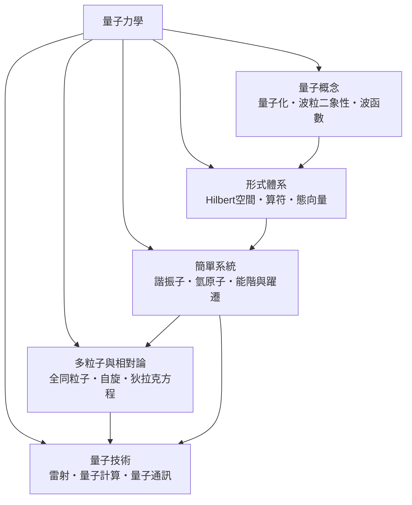

# 量子力學

> 隸屬：第一層 [理]　·　相關分類：[物理學]、[力學]、[電磁學]　·　子分類總表見 [README]

> 對應維基百科：[中文維基百科：量子力學]　·　[English Wikipedia: Quantum mechanics]

量子力學是描述**微觀世界**的物理理論：原子、電子、光子等尺度下的物質與能量行為。它的中心物件是**波函數** $\Psi$ ，其演化由薛丁格方程支配：

$$
i \hbar \frac{\partial}{\partial t} \Psi = \hat{H} \Psi
$$

其中 $\hbar \approx 1.055 \times 10^{-34}$ 焦耳·秒是約化普朗克常數， $\hat{H}$ 是能量算符。 $|\Psi|^2$ 給出粒子出現在某位置的機率密度——量子力學因此是**機率性**的理論，這與古典力學「知道初始條件就能完全預測未來」的世界觀根本不同。

量子力學的出現不是哲學偏好，而是被實驗逼出來的。1900 年 [普朗克] 為了解釋黑體輻射光譜，不得不假設能量以 $E = h \nu$ 的離散份額交換；[愛因斯坦] 在 1905 年用光量子解釋光電效應；[玻爾] 在 1913 年用量子化軌道解釋氫原子光譜。到 1925 至 1927 年間，[海森堡] 的矩陣力學與 [薛丁格] 的波動力學先後成形，[狄拉克] 再把它們統一成今天的抽象形式。整段歷史的主軸是：**古典物理在原子尺度全面失效，必須換一套語言**。

## 核心問題

量子力學要回答四個層層相依的問題。

1. **狀態如何描述**：一個系統在某一刻「是什麼狀況」？答案不是一組位置與速度，而是一個態向量（波函數）。態是疊加的：系統可以「同時處於多個狀態」，直到被測量。
2. **狀態如何演化**：態隨時間怎麼變？答案是薛丁格方程，一條線性、決定論的方程——演化本身完全不神祕，神祕的是測量。
3. **測量發生什麼事**：測量位置會得到什麼？答案只有機率分布；測量後態「塌縮」到某個本徵態。測量的本質至今仍有詮釋之爭（[測量問題]）。
4. **哪些量可以同時確定**：位置與動量不能同時任意精確，滿足不確定性關係 $\Delta x \, \Delta p \geq \hbar / 2$ 。這不是儀器不夠好，而是自然的內稟性質。

這四個問題的順序不可顛倒：先有態的語言（[波函數]、[態向量]），才能寫演化方程；先有演化方程，才能談測量與不確定性。

## 因果鏈

1. **黑體輻射的紫外災難**：古典統計預測高頻輻射能量無限大，與實驗完全矛盾。1900 年 [普朗克] 假設能量量子化 $E = h \nu$ ，光譜公式第一次與實驗吻合。
2. **光電效應與光量子**：1905 年 [愛因斯坦] 指出光是粒子（光子），每個光子能量 $E = h \nu$ ，成功解釋為何光的頻率低於門檻值時再強也打不出電子。
3. **氫原子光譜的量子化軌道**：1913 年 [玻爾] 假設電子軌道角動量只能取 $n \hbar$ 的離散值，精確重現氫原子譜線波長。
4. **物質波的提出**：1924 年德布羅意提出電子也有波長 $\lambda = h / p$ ，1927 年電子繞射實驗證實（[波粒二象性]）。
5. **矩陣力學與波動力學**：1925 年 [海森堡] 建立矩陣力學；1926 年 [薛丁格] 寫出波動方程並證明兩者等價。量子力學的數學基礎至此確立。
6. **機率詮釋與不確定性**：1926 年玻恩提出 $|\Psi|^2$ 的機率詮釋；1927 年 [海森堡] 導出不確定性原理，古典決定論在微觀領域被正式放棄。
7. **相對論性推廣**：1928 年 [狄拉克] 方程把量子力學與狹義相對論結合，預言自旋與反物質，1932 年正電子被發現。
8. **技術收割**：能階與躍遷理論催生雷射（1960 年）；穿隧效應催生掃描穿隧顯微鏡（1981 年）與量子計算的硬體構想（[量子技術]）。

## 子分類的定位與相互驅動

- [量子概念] 是**現象層**：量子化、波粒二象性與波函數是所有後續理論的實驗動機與直覺基礎。
- [形式體系] 是**語言層**：把現象整理成 Hilbert 空間中的向量與算符，使量子力學可以嚴格計算。沒有這套語言，[簡單系統] 的能階根本算不出來。
- [簡單系統] 是**練習場**：諧振子與氫原子是少數能精確求解的系統，它們的解（能階、躍遷規則）直接解釋了原子光譜與化學鍵。
- [多粒子與相對論] 是**推廣層**：全同粒子與自旋解釋了週期表的結構；狄拉克方程把理論帶入相對論領域並預言反物質；量子場論則把量子化推廣到場本身。
- [量子技術] 是**出口**：雷射、掃描穿隧顯微鏡、量子計算與量子通訊把百年理論變成工程。

## 範例：一維無限深位井的能階

一個質量 $m$ 的粒子被關在寬度 $L$ 的盒子裡（牆上位能無限大）。解薛丁格方程得波函數 $\Psi_n(x) = \sqrt{2/L}\, \sin(n \pi x / L)$ ，能量：

$$
E_n = \frac{n^2 h^2}{8 m L^2}, \qquad n = 1, 2, 3, \ldots
$$

**代入數字**：取電子（ $m \approx 9.11 \times 10^{-31}$ kg）關在 $L = 1$ 奈米的盒子中， $h \approx 6.626 \times 10^{-34}$ 焦耳·秒，則

$$
E_1 = \frac{(6.626 \times 10^{-34})^2}{8 \times 9.11 \times 10^{-31} \times (10^{-9})^2} \approx 6.0 \times 10^{-20} \text{ 焦耳} \approx 0.38 \text{ 電子伏特}
$$

第二能階 $E_2 = 4 E_1 \approx 1.51$ 電子伏特，兩能階差約 1.13 電子伏特，對應波長約 1100 奈米的近紅外光——這正是量子點與奈米結構呈色的物理原理。同一公式也說明**為何我們看不見宏觀物體的量子化**：若把 $L$ 換成 1 公分、 $m$ 換成一顆塵埃，能階間距小到完全連續，古典極限自然浮現。

## 容易混淆之處

- **量子力學不等於「一切都不确定」**：演化方程是完全決定論的；機率只出現在測量結果上。
- **不確定性原理不是測量擾動**： $\Delta x \, \Delta p \geq \hbar/2$ 是態本身的性質，與技術好壞無關。
- **波函數不是物質波在空間中的「實際形狀」**：它是組態空間上的複數函數；對多粒子系統，它活在 高維空間，不直接是三維波。
- **疊加不是「同時在兩地被看到」**：疊加態在被測量前沒有確定的位置值，測量結果才隨機取一。
- **量子力學與量子場論不同**：後者把場量子化、粒子數可變，是更上層的理論（[量子場論]）。
- **薛丁格的貓不是量子效應**：宏觀疊加會因退相干極快消失，貓是教學比喻而非可實現的系統。

## 延伸閱讀

- [物理學]：量子力學所屬的母學科。
- [力學]：古典力學，量子力學的對照組與極限情形。
- [電磁學]：量子電動力學的古典起點。
- [數學]：Hilbert 空間與算符的數學源頭。
- [熱力學]：黑體輻射問題原屬熱統計，是量子的起點。
- [元素週期表]：量子數與電子組態的直接成果。

## 連結定義

[理]: ../理/README.md
[README]: README.md
[物理學]: ../物理學/README.md
[力學]: ../力學/README.md
[電磁學]: ../電磁學/README.md
[數學]: ../數學/README.md
[熱力學]: ../熱力學/README.md
[元素週期表]: ../元素週期表/README.md
[量子概念]: 量子概念.md
[形式體系]: 形式體系.md
[簡單系統]: 簡單系統.md
[多粒子與相對論]: 多粒子與相對論.md
[量子技術]: 量子技術.md
[波函數]: 波函數.md
[測量問題]: 測量問題.md
[態向量]: 態向量.md
[量子場論]: 量子場論.md
[波粒二象性]: 波粒二象性.md
[普朗克]: ../人/物理學家/普朗克.md
[愛因斯坦]: ../人/物理學家/愛因斯坦.md
[玻爾]: ../人/物理學家/玻爾.md
[海森堡]: ../人/物理學家/海森堡.md
[薛丁格]: ../人/物理學家/薛丁格.md
[狄拉克]: ../人/物理學家/狄拉克.md
[中文維基百科：量子力學]: https://zh.wikipedia.org/wiki/%E9%87%8F%E5%AD%90%E5%8A%9B%E5%AD%A6
[English Wikipedia: Quantum mechanics]: https://en.wikipedia.org/wiki/Quantum_mechanics
