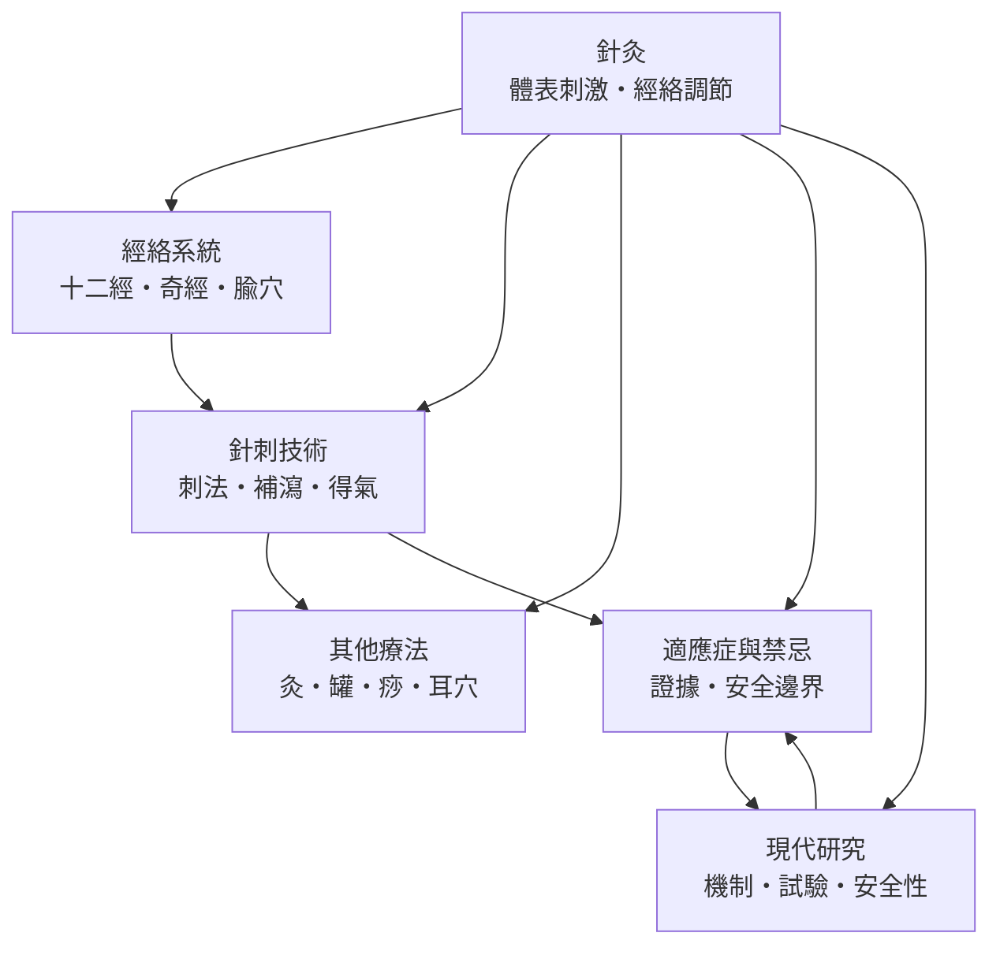

# 針灸

> 分類範圍：以細針刺激體表特定點位、以灸熱溫養經絡的治療體系——經絡腧穴的定位網路、進針行針的操作技術、灸法拔罐等姊妹療法、適應症與安全邊界，以及現代對其作用機制與療效的科學研究。　·　隸屬第一層：[醫]　·　相關分類：[中醫學]、[神經科學]、[生理學]　·　子分類總表見 [README]

> 對應維基百科：[中文維基百科：针灸](https://zh.wikipedia.org/wiki/%E9%92%88%E7%81%B8)　·　[English Wikipedia: Acupuncture](https://en.wikipedia.org/wiki/Acupuncture)

針灸是中醫學中以**體表刺激**治病的分支：不經消化道給藥，而是以針、熱、壓力作用在身體表面約三百多個定位點（腧穴）上，透過 [經絡系統] 的理論解釋其遠隔效應。「針」與「灸」原是兩種技術——針刺用毫針，灸法用艾絨燃燒的溫熱——長期並用而合稱針灸。本概念處理的問題是：**在藥物缺乏或不宜使用的時代，如何用體表的物理刺激達成全身性的治療效果，以及這套技術如何通過現代醫學的檢驗**。

## 核心問題：遠隔刺激為何能治病

針灸的核心命題是「遠隔效應」：刺激足部或手部的點位，能影響頭部或內臟的功能。古代理論以 [經絡系統] 解釋——氣血沿經絡運行，腧穴是氣血輸注的節點，刺激節點可調整整條路線；現代研究則以神經節段、內源性鴉片肽與結締組織力學等機制提供部分解釋。兩套解釋的對照與競爭，構成本概念最活躍的研究地帶。

## 因果鏈

1. **技術先於理論**：新石器時代的砭石與青銅時代的金屬針，說明刺血、排膿等原始操作遠早於理論；經驗累積了「刺激哪裡會影響哪裡」的對應表。
2. **經絡理論的整理**：《黃帝內經·靈樞》把散落的點位經驗組織成經絡學說，[皇甫謐] 於西晉整理《針灸甲乙經》，確定三百四十九穴的名稱、定位與主治，針灸第一次有了統一標準。
3. **腧穴網路的擴充與歸範**：唐代的《銅人針灸圖經》與針灸銅人把腧穴做成三維教具，考試與教學有了實體標準。
4. **操作技術的精細化**：宋元以後手法分類日益繁細——進針、捻轉、提插、補瀉，技術從「刺到」進化為「怎麼刺」。
5. **西學衝擊與存續**：十九世紀末針灸在東亞被邊緣化，卻因 cost 低廉在基層與軍隊醫療中存續；二十世紀中葉在制度化重建中復興。
6. **針刺麻醉的插曲**：1970 年代中國以針刺輔助外科麻醉引起世界矚目，雖未成為主流，卻把針灸研究帶進神經科學實驗室。
7. **機制研究的展開**：內啡肽與針刺鎮痛的關聯（1970 年代）、腦功能影像與針刺激活的關聯（2000 年代），使針灸成為傳統醫學中研究密度最高的領域。
8. **國際制度化**：多國建立針灸執照制度，世界衛生組織對針灸師的訓練時數提出建議標準；歐美臨床指引把針灸列為慢性下背痛等疼痛狀況的非藥物選項之一，同時指出整體證據強度有限——爭論由「是否承認」轉向「證據等級」。

## 子分類的定位與相互驅動

- [經絡系統] 是**地圖**：十二經脈、奇經八脈與腧穴構成定位網路，所有取穴與手法都在這張地圖上作業；地圖的精確度直接決定治療的可重複性。
- [針刺技術] 是**操作層**：進針的角度深度、捻轉提插的手法、得氣的判斷與留針時間——同一張地圖上，技術差異就是療效差異。
- [其他療法] 是**姊妹技術**：灸法補針刺所不能（溫熱入裡），拔罐與刮痧處理體表氣血，耳穴把全身映射到耳廓——它們與毫針共享經絡理論但各有適應範圍。
- [適應症與禁忌] 是**臨床邊界**：哪些病症證據充分、哪些情況絕對禁針，是技術能否被信任的前提。
- [現代研究] 是**檢驗與推廣層**：機制研究解釋原理，臨床試驗確立證據等級，兩者共同決定針灸在現代醫療中的位置，並反向修正傳統的操作與取穴。

## 範例：一個針灸療程的完整迴路

以慢性下背痛（針灸證據等級最高的適應症之一）為例：

1. **地圖**：依 [經絡系統] 辨證取穴——膀胱經的委中、腎經的太溪，加上局部阿是穴。
2. **技術**：毫針直刺，捻轉至得氣（病人有痠脹感），留針約 20 至 30 分鐘，期間行針一至二次。
3. **其他療法**：寒濕偏重者配合 [灸法] 溫煦腎俞，或加 [拔罐] 緩解肌肉緊張。
4. **適應症與禁忌**：排除椎間盤嚴重病變等須外科處理的情況；病人未服 [抗凝禁忌] 藥物，可安全進針。
5. **現代研究**：隨機對照試驗顯示針刺對慢性下背痛的療效優於常規照護，但與假針刺的差異較小——研究結果直接影響保險是否給付與醫囑是否推薦。

## 容易混淆之處
- **針灸與推拿不是同一件事**：推拿以手法作用於軟組織，針灸以針與熱作用於腧穴；兩者常併用但屬不同技術傳統。
- **電針不等於更強的針**
- **「一次見效」不是普遍經驗**：慢性病的針灸療程常以數次至十數次計，療效評估應以療程為單位。
- **療效因人因證而異**：同一病症在不同證型下的反應差異，正是辨證取穴存在的理由，也提醒勿以單一病例外推。

- **針灸不等於「哪裡痛扎哪裡」**：遠隔取穴（如左病右治、上病下取）是經絡理論的特色，局部阿是穴只是取穴的一種。
- **得氣不等於痛**：得氣是痠麻脹重的特殊感覺，痛感通常表示進針不當；把「扎得痛才有效」視為誤解。
- **針刺麻醉不是麻醉**：現代臨床上針刺用於鎮痛輔助與減少麻醉藥用量，單獨以針刺取代麻醉藥物並非主流做法。
- **安全性的前提是一次性無菌針**：乙肝等針具交叉感染是歷史上真實的風險，現代規範的一次性針具是安全紀錄的前提，不能省略。
- **經絡未被解剖學證實不等於針刺無效**：療效證據與機制確認是兩個層次；針灸的研究現況正是「效果部分確立、機制仍未完全說明」。

## 延伸閱讀

- [中醫學]：共享理論基礎的上層體系。
- [神經科學]：針刺鎮痛機制的研究主體。
- [生理學]：內環境調節與內源性鎮痛系統。
- [公共衛生]：針灸在衛生體系中的制度化。

## 連結定義

[醫]: ../醫/README.md
[README]: README.md
[中醫學]: ../中醫學/README.md
[神經科學]: ../神經科學/README.md
[生理學]: ../生理學/README.md
[公共衛生]: ../公共衛生/README.md
[經絡系統]: 經絡系統.md
[針刺技術]: 針刺技術.md
[其他療法]: 其他療法.md
[適應症與禁忌]: 適應症與禁忌.md
[現代研究]: 現代研究.md
[灸法]: 灸法.md
[拔罐]: 拔罐.md
[抗凝禁忌]: 抗凝禁忌.md
[皇甫謐]: ../人/醫學家/皇甫謐.md
