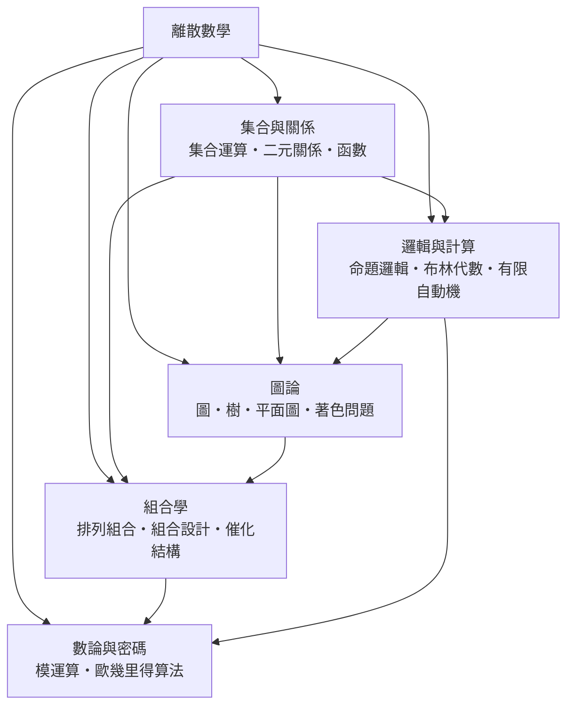

# 離散數學

> 隸屬：第一層 [理]　·　相關分類：[數學]、[代數]、[邏輯學]　·　子分類總表見 [README]

> 對應維基百科：[中文維基百科：離散數學](https://zh.wikipedia.org/wiki/%E7%A6%BB%E6%95%A3%E6%95%B0%E5%AD%A6)　·　[English Wikipedia: Discrete mathematics](https://en.wikipedia.org/wiki/Discrete_mathematics)

離散數學研究**由彼此分開的元素所組成的對象**：有限的集合、離散的點格、用邊相連的圖、以及只取真或假值的邏輯式。它的技術特徵是「可數」——一切都可以一項一項列出，因此計算往往是指數等級甚至更快的。

離散數學的歷史大半是「把無限化為有限」的歷史。[高斯] 用圖形解決正十七邊形作圖問題時，本質上是在處理代數方程根與對稱群；[康托爾] 用對角線法證明實數集不可數時，把「無窮」變成可比較的對象；[歐拉] 對哥尼斯堡七橋問題的分析，開啟了 [圖論] 的分支。而 [圖靈] 在 1930 年代用「可計算的步驟」定義計算本身，把離散的符號操作與連續的物理過程清楚地分開。

20 世紀以來，離散數學從「數學中的支流」變成「工程與科學的基礎設施」：電路的邏輯設計、資料庫的查詢最佳化、密碼學的公鑰系統、網路的路由協定、排程問題的求解——它們共享同一套語言：把連續的實務問題轉成有限的、可以窮舉或搜索的結構。

## 核心問題

離散數學的核心問題可以分為三層。

1. **結構的描述**：對象長什麼樣、有哪些性質？這是 [集合與關係] 的問題，語言是集合、關係與函數。
2. **結構的行為**：結構之間如何連接、資訊如何流動？這是 [圖論] 的問題，語言是頂點與邊。
3. **結構的計算與表示**：怎麼數、怎麼排、怎麼編碼？這是 [組合學] 的問題，語言是生成函數與設計理論。

三層之下還有兩條橫向的軸線：[邏輯與計算] 處理「什麼是可計算的、怎麼證明」；[數論與密碼] 處理「整數的算術如何支撐編碼與保密」。前者是方法論的基礎，後者是最直接的應用出口。

## 因果鏈

1. **古典的組合算術**：中國的 [九章算術] 已包含組合數與鴿籠原理的雛形，《算法統宗》等著作則把算法整理成可操作的程序。
2. **歐拉與圖的萌芽**：1736 年 [歐拉] 分析哥尼斯堡七橋問題，開啟了以「頂點與邊」思考結構的方式。
3. **組合恒等式的建立**：[帕斯卡] 的三角與 [費馬] 的通信確立了二項係數的遞迴，19 世紀 [高斯] 的計算日誌把生成函數發揚光大。
4. **集合論的誕生**：[康托爾] 在 1870 至 1890 年代建立集合、基數與序型概念，並以對角線法證明不可數性。
5. **邏輯的符號化與圖論的成長**：[德摩根] 提出邏輯代數的雛形，布魯克斯等人的工作使圖論成為獨立分支，20 世紀初 [哈密爾頓] 引入的哈密爾頓迴路成為圖論的重要對象。
6. **可計算性與演算法**：1930 至 1940 年代 [圖靈] 定義圖靈機，圖靈停機問題不可判定，離散計算的極限因此被刻畫清楚。
7. **組合設計理論**：施泰因系統研究有限射影平面與區組設計，組合設計成為處理「對稱與均衡」的數學語言。
8. **電腦時代的應用**：布林代數支撐數位電路，模運算支撐公鑰密碼，圖論支撐網路拓樸，離散數學由支流成為主流。

## 子分類的定位與相互驅動

- [集合與關係] 是**語言層**：集合運算、二元關係與函數提供了描述一切離散結構的基本詞彙。
- [圖論] 是**結構層**：頂點與邊是描述「誰與誰相連」的最簡模型，能表達網路、排程、依賴與拓樸。
- [組合學] 是**計算層**：它研究「有多少種」與「如何安排」，是設計理論、編碼理論與演算法複雜度的共同源頭。
- [邏輯與計算] 是**方法論層**：它處理命題的真值、布林的代數運算，以及「可計算」的邊界。
- [數論與密碼] 是**應用層**：整數的模算術把組合與邏輯的成果轉化為可用的編碼與保密機制。

## 範例：從七橋問題到橋的數目

**問題**：柯尼斯堡有七座橋連接四塊陸地（Königsberg 的四個陸地 A、B、C、D），橋的連接關係是：AB、AC、AD、BC、BD、CD 各一條，另有一條橋連接 A 與另一陸地 E。求每座橋恰好走一次、回到起點的走法是否存在。

1. **轉成圖**：把陸地視為頂點，橋視為邊，得到一個有 5 個頂點、7 條邊的無向圖。
2. **用度數判必要性**：一條歐拉回路必須經過每個頂點偶數次（除起終點外，進出次數相等）。此圖中各頂點度數為
   $$ \deg(A) = 4,\ \deg(B) = 3,\ \deg(C) = 3,\ \deg(D) = 3,\ \deg(E) = 1 . $$
   B、C、D 與 E 的度數皆為奇數，因此不可能存在歐拉回路。
3. **結論**：[歐拉] 的答案是「不可能」。這是圖論史上最著名的一次「用一個簡單判準否定一類猜想」。
4. **一般化的判準（Euler 定理）**：連通無向圖存在歐拉回路，若且唯若所有頂點度數皆為偶數；存在歐拉路徑（不必回到起點）若且唯若恰有零個或兩個奇度頂點。
5. **計算的升級**：要數出歐拉回路的條數，可用 Best 定理（對有向圖）或矩–樹定理（Matrix–Tree theorem）計算有向圖中歐拉回路數。
6. **延伸**：若橋可重複走，問題變成中國郵差問題（route inspection），此時最小重複次數可由奇度頂點間的最小權完美匹配求得——這已是組合最佳化問題。

第二個例子說明離散結構與連續結構的分工。若要知道「這個函數有多少個零點」，在 [微積分] 中是一個連續的問題；而要知道「這個整數方程有多少組整數解」，在 [數論] 中則是離散的。兩者的方法截然不同：前者用極限與介值定理，後者用模運算與因數分解。學科之間的分工，正是「連續對離散」這一切口。

## 容易混淆之處

- **離散數學不等於「數學的離散版本」**：它有自己的問題意識與方法，例如以結構分類取代數值計算。
- **圖與幾何圖形不同**：圖論中的圖不關心位置、角度與長度，只關心鄰接關係。
- **樹是圖的特例**：樹是無圈連通圖，其特點可由「邊數 = 頂點數 − 1」刻画。
- **命題邏輯與一階邏輯不同**：前者不含量詞，無法表達「存在某個數使得……」。
- **模運算與一般算術不同**：在模 $n$ 下， $a$ 與 $a + n$ 不可區分，這正是密碼學能運作的原因。
- **組合學與組合數學不同**：後者偏重生成函數與漸近分析，前者偏重計數結構與設計。

## 延伸閱讀

- [數學]：離散數學所屬的整體。
- [代數]：離散結構的代數語言。
- [邏輯學]：離散數學的方法論支柱。
- [演算法]：離散方法在計算領域的應用。
- [資訊安全]：模運算與組合設計的實用出口。

## 連結定義

[理]: ../理/README.md
[README]: README.md
[數學]: ../數學/README.md
[代數]: ../代數/README.md
[邏輯學]: ../邏輯學/README.md
[演算法]: ../演算法/README.md
[資訊安全]: ../資訊安全/README.md
[集合與關係]: 集合與關係.md
[圖論]: 圖論.md
[組合學]: 組合學.md
[邏輯與計算]: 邏輯與計算.md
[數論與密碼]: 數論與密碼.md
[微積分]: ../微積分/README.md
[數論]: ../數學/數論.md
[九章算術]: ../數學/九章算術.md
[高斯]: ../人/數學家/高斯.md
[康托爾]: ../人/數學家/康托爾.md
[歐拉]: ../人/數學家/歐拉.md
[圖靈]: ../人/數學家/圖靈.md
[帕斯卡]: ../人/數學家/帕斯卡.md
[費馬]: ../人/數學家/費馬.md
[德摩根]: ../人/數學家/德摩根.md
[哈密爾頓]: ../人/數學家/哈密爾頓.md
