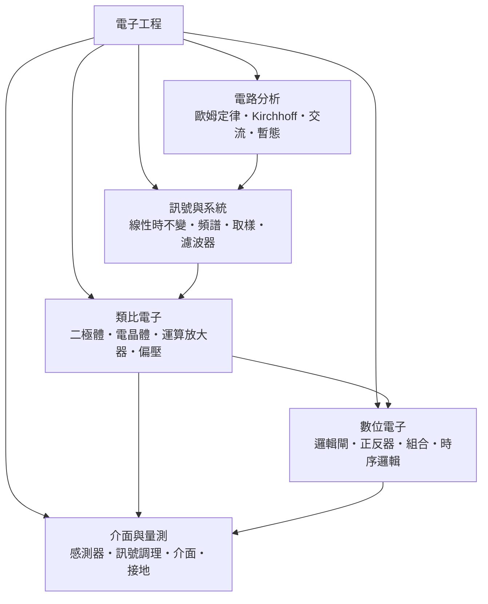

# 電子工程

> 隸屬：第一層 [工]　·　相關分類：[電磁學]、[電機工程]、[積體電路]　·　子分類總表見 [README]

> 對應維基百科：[中文維基百科：電子學](https://zh.wikipedia.org/wiki/%E7%94%B5%E5%AD%90%E5%AD%A6)　·　[English Wikipedia: Electronics](https://en.wikipedia.org/wiki/Electronics)

電子工程研究**電子（以及電洞）在真空、氣體與固體中的受控行為，並利用這種行為來處理訊號、傳遞資訊與執行運算**。它與 [電機工程] 的分工在於功率尺度：電機工程處理千瓦級的發電、輸電與馬達，電子工程處理毫瓦到瓦級的訊號與邏輯。一個手機充電器裡同時存在兩者——變壓與整流屬於電機（電力電子），而充電晶片內的偵測、判斷與保護邏輯則屬於電子。

電子工程的中樞是一句話：**用極小的能量控制極大的能量**。一個只有 $1 \times 10^{-4}$ W 量級輸入的電晶體，可以控制數瓦的輸出電流，這種「閥門」性質讓微弱訊號得以放大、開關得以用電壓指揮。因此它的第一組核心公式是描述線性電路的兩條定律：[歐姆定律] 與 [Kirchhoff] 定律。前者給出 $V = IR$ ，後者保證流入節點的電流總和為零：

$$
\sum_{k} I_k = 0 \qquad \text{（任一節點）}, \qquad \sum_{j} V_j = 0 \qquad \text{（任一迴路）}
$$

有了這兩條定律，任何複雜電路都能被拆解、計算與設計；再加上 1947 年 [蕭克利]、[巴丁] 與 [布拉頓] 在 [貝爾實驗室] 發明的電晶體，以及 1958 年 [基爾比] 與 1959 年 [諾伊斯] 各自提出的積體電路構想，電子工程在半世紀內從真空管機櫃走進了指甲大小的晶片，催生了 [積體電路] 與整個 [電腦] 產業。

## 核心問題

電子工程的核心問題可以拆成四層，由下而上彼此支撐。

1. **電流如何流動**：給定電路（電阻、電容、電感、電源），各支路的電壓與電流是多少？這是 [電路分析] 的問題，工具是歐姆定律與兩條基爾霍夫定律。
2. **訊號如何被描述**：真實訊號不是定值電壓，而是隨時間變化的波形。如何把它看成不同頻率的組合、如何取樣、如何濾除不要的成分？這是 [訊號與系統] 的問題。
3. **如何放大與開關**：二極體與電晶體是非線性元件，如何用它們把微弱訊號放大千百倍、把電流變成可開關的閥門？這是 [類比電子] 的問題。
4. **如何運算**：把高、低電壓定義為 1 與 0，用電晶體搭出邏輯閘，再由邏輯閘搭出能記憶、能計數的電路——這是 [數位電子] 的問題，也是所有 [電腦] 硬體的起點。

貫穿四層的是同一個需求：**資訊必須被搬運、整形與儲存，而搬運過程要盡量不失真、不受雜訊污染**。前兩層給出「看得懂訊號」的數學，後兩層給出「動得了訊號」的元件。

## 因果鏈

1. **電學定律成型**：1827 年 [歐姆] 量出電壓與電流的比例關係，1845 年 [Kirchhoff] 建立節點與迴路定律，電路從經驗拼接變成可以計算的數學物件。
2. **電報與無線電的需求**：十九世紀末電報、電話與無線電勃興，工程師必須處理隨時間變化的訊號，交流分析（[相量] 法）與濾波理論因此發展，[訊號與系統] 的數學骨架成形。
3. **真空管時代**：1904 年弗萊明發明真空二極體、1906 年德福雷斯特加上第三極做成三極管，人類第一次能用電壓「隔空」控制電流；放大器與振盪器問世，收音機普及。
4. **真空管的瓶頸**：真空管體積大、耗電、易碎、壽命短，早期計算機用了一萬八千根管子，故障幾乎天天發生——「更小的開關」成為整個行業的夢。
5. **電晶體問世**：1947 年 12 月，[巴丁] 與 [布拉頓] 在 [貝爾實驗室] 做出點接觸電晶體，[蕭克利] 隨後建立接面電晶體理論；固體取代真空，開關尺寸瞬間縮小百倍。
6. **積體化**：1958 年 [基爾比] 在鍺片上做出第一塊積體電路，1959 年 [諾伊斯] 以平面製程在矽上實現連線版本，[晶圓代工] 與晶片產業由此起步。
7. **摩爾定律驅動的指數成長**：1965 年 [摩爾] 觀察到晶片上電晶體數每年翻倍（後修正為約每兩年），製程節點一路從微米推進到奈米，電晶體單價跌了千萬倍。
8. **數位霸權與萬物相連**：放大與開關的低成本讓數位邏輯壓倒類比系統，微處理器、記憶體、感測器全面晶片化；今天一部手機內含上百億顆電晶體，電子工程成為資訊文明的物質基礎。

## 子分類的定位與相互驅動

- [電路分析] 是**共同語言**：無論處理的是音訊還是時脈，工程師第一步都是把電路化成節點與迴路、用歐姆定律與基爾霍夫定律解出電壓電流。它是後續所有子分類的前置技能。
- [訊號與系統] 是**數學望遠鏡**：頻譜把波形拆成頻率成分，線性時不變系統理論告訴我們放大器與濾波器如何改變每個頻率——它把「這顆電晶體放大器聽起來如何」變成可計算的問題。
- [類比電子] 是**元件的舞臺**：電晶體需要適當的 [偏壓] 才能工作，[運算放大器] 把它包裝成幾乎理想的模組；類比電路負責真實世界（聲音、溫度、光）與數位世界之間的轉換。
- [數位電子] 是**可靠性的勝利**：把電壓只分成高低兩態，雜訊容忍度大幅提升，邏輯閘層層堆疊成算術單元與 [正反器] 記憶體——它反過來要求類比部門提供乾淨的電源與時脈。
- [介面與量測] 是**內外橋樑**：[感測器] 把物理量轉成電訊號，[訊號調理] 把它整形到可用範圍，介面電路與接地設計則決定雜訊是進得來還是被擋在門外。它把整個學科接到真實世界。

## 範例

**範例一：分壓電路。** $5$ V 電源串接 $R_1 = 4\ \text{k}\Omega$ 與 $R_2 = 1\ \text{k}\Omega$ ，由 [電路分析] 的分壓公式， $R_2$ 上電壓為 $V = 5 \times \frac{1}{4+1} = 1$ V。這個 $1$ V 正是感測器介面最常見的取樣基準：改變 $R_2$ 為 $2\ \text{k}\Omega$ ，輸出就變成 $5 \times \frac{2}{6} \approx 1.67$ V。

**範例二：共射極放大器。** 電晶體以 [偏壓] 供應集極電流 $I_C = 1$ mA，接一枚 $R_C = 5\ \text{k}\Omega$ 的集極電阻；此時小訊號增益約為 $A_v = -g_m R_C$ ，而 $g_m = I_C / V_T \approx 1/26\ \text{mS} \approx 38.5$ mS，故 $A_v \approx -192$ 。輸入 $10$ mV 的交流訊號，輸出約為振幅 $1.9$ V 的反相放大訊號——放大器就是這樣用毫伏級輸入控制伏特級輸出。

**範例三：取樣與重建。** 想把 $20$ kHz 以內的音訊數位化，依取樣定理需以 $f_s > 2 \times 20$ kHz 的頻率取樣；CD 選了 $44.1$ kHz。每個樣本用 16 位元記錄，一分鐘雙聲道資料量為 $44100 \times 16 \times 2 \times 60 \approx 8.5 \times 10^7$ 位元，約 $10$ MB——這組數字說明了為何 [數位電子] 的運算與儲存能力決定了消費電子的形態。

## 容易混淆之處

- **電子工程不等於電機工程**：電機以瓦到百萬瓦為尺度，處理發電與輸電；電子以毫瓦到瓦為尺度，處理訊號與邏輯。電力電子是兩者的交接地帶。
- **放大器不是「變出能量」**：放大器的輸出能量來自電源，輸入訊號只是控制閥門；沒有電源，再強的訊號也不會被放大。
- **數位不是無雜訊，而是容忍雜訊**：邏輯閘的高、低電壓各有容許區間，只要雜訊不超過雜訊邊界，訊號就能被無損再生；這是數位系統可靠的真正原因。
- **類比沒有被淘汰**：自然界是連續的，任何數位系統的前後端（感測、濾波、功率驅動、射頻）仍由類比電路完成；「數位取代一切」是常見誤解。
- **直流與交流分析用的是同一套定律**：交流分析並不另立定律，而是用 [相量] 與阻抗把交流問題化成「另一種代數」的直流問題。
- **積體電路不是電子工程的全部**：印刷電路板、連接器、電源、散熱與電磁相容設計同屬電子工程；晶片只是最精緻的一層。

## 延伸閱讀

- [電磁學]：電路行為的物理根據，從電場、磁場到訊號輻射都由它解釋。
- [電機工程]：功率尺度上的姊妹學科，電源設計是兩者的交會處。
- [積體電路]：電子工程最主要的產出物，設計與製程的總成。
- [半導體]：電晶體與二極體的材料科學基礎。
- [通訊工程]：訊號與系統理論的最大應用場，調變與通道編碼皆以濾波、取樣為前提。
- [自動控制]：回授概念源自放大器設計，控制器最終也要用電子電路實現。

## 連結定義

[工]: ../工/README.md
[README]: README.md
[電磁學]: ../電磁學/README.md
[電機工程]: ../電機工程/README.md
[積體電路]: ../積體電路/README.md
[半導體]: ../半導體/README.md
[通訊工程]: ../通訊工程/README.md
[自動控制]: ../自動控制/README.md
[電腦]: ../電腦/README.md
[電路分析]: 電路分析.md
[訊號與系統]: 訊號與系統.md
[類比電子]: 類比電子.md
[數位電子]: 數位電子.md
[歐姆定律]: 歐姆定律.md
[Kirchhoff]: Kirchhoff.md
[相量]: 交流分析.md
[偏壓]: 偏壓.md
[運算放大器]: 運算放大器.md
[介面與量測]: 介面與量測.md
[正反器]: 正反器.md
[感測器]: 感測器.md
[訊號調理]: 訊號調理.md
[歐姆]: ../人/物理學家/歐姆.md
[蕭克利]: ../人/物理學家/蕭克利.md
[巴丁]: ../人/物理學家/巴丁.md
[布拉頓]: ../人/物理學家/布拉頓.md
[基爾比]: ../人/工程師/基爾比.md
[諾伊斯]: ../人/工程師/諾伊斯.md
[摩爾]: ../人/工程師/摩爾.md
[晶圓代工]: ../半導體/晶圓代工.md
[貝爾實驗室]: ../研究機構/README.md
