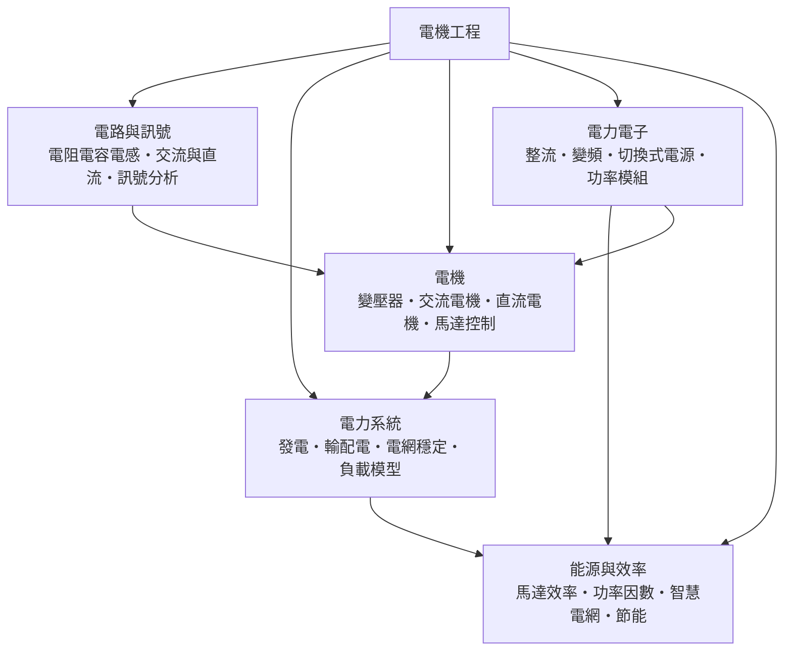

# 電機工程

> 隸屬：第一層 [工]　·　相關分類：[電磁學]、[電子工程]、[機械工程]、[自動控制]　·　子分類總表見 [README]

> 對應維基百科：[中文維基百科：電機工程學](https://zh.wikipedia.org/wiki/%E9%9B%BB%E6%A9%9F%E5%B7%A5%E7%A8%8B%E5%AD%B8)　·　[English Wikipedia: Electrical engineering](https://en.wikipedia.org/wiki/Electrical_engineering)

電機工程研究的是**電能如何被產生、傳輸、轉換、調控，最後被使用**的整套工程問題。它以 [電磁學] 的場與電路理論為物理基礎，卻與 [電子工程] 分工不同：電子工程處理的是訊號的產生與處理，電機工程處理的是功率較大、能量守恆必須精確計算的系統。
這個界線不是任意的。現代電力系統的輸電電壓可達 765 kV，一台大型渦輪發電機的輸出超過 500 MW，而一顆手機晶片的功率只有數瓦——相差六個數量級，因此兩者的設計準則、器件與分析方法都徹底分家：電機工程用 [電磁學] 的場理論配合 [變壓器]、[交流電機] 的機器理論，電子工程則用半導體物理與 [數位電子] 的邏輯設計。
電機工程的歷史是一條「能量」的歷史線。19 世紀初蒸汽機推動工業化，人類急需可遠距傳輸、可調壓、可調速的動力，[詹姆斯·瓦特] 的改良蒸汽機開啟了工業革命，也逼出了第一代發電機；[法拉第] 的電磁感應定律使「機械能變電能」成為可能；[馬克士威] 的方程組讓交流電可以用數學描述；[愛迪生] 在 [1882年] 建立珍珠街發電站，讓城市用電成為制度；[特斯拉] 的多相交流系統解決了遠距輸電的致命障礙——電壓可以變高、電流可以變小，於是功率可以跨州流動。
今天電機工程面對的瓶頸不再只是「把電送到」，而是「在大量再生能源、電動交通與數位負載並存之下，讓電網仍然穩定、可靠且有效率」。這也是 [電力系統] 、[電力電子] 與 [能源與效率] 這三個子分類存在的理由。

## 核心問題

1. **如何把電送到需要的地方**：發電、升壓、輸電、降壓、配電，每一段都要在效率、成本與可靠性之間取捨，核心是 [輸配電] 與 [變壓器] 的設計。
2. **如何把電變成想要的形態**：交流變直流、直流變交流、電壓升降、頻率改變，都由 [電力電子] 的 [整流] 、[變頻] 與 [切換式電源] 負責，其效率直接決定整機的發熱與體積。
3. **如何把電變成轉動**：電機能量與機械能量的轉換由 [電機] 的電磁感應原理支撐，[馬達控制] 決定它跑得多快、能不能反轉。
4. **如何讓電網不出事**：發電與用電必須即時平衡，這就是 [電網穩定] 與負載模型的問題；頻率飄移、電壓崩塌、連鎖跳電都屬於此。
5. **如何不浪費電**：[功率因數] 偏低會讓電網虛耗，馬達效率與節能則直接決定工業用電與運輸用電的總成本，[智慧電網] 讓這些數字可以被即時管理。
6. **如何處理訊號化的電力**：現代電力設備需要感測、通訊與保護，[電路與訊號] 的方法提供了量測與保護的語言，這條線把電機工程與 [電子工程] 重新接起來。

## 因果鏈

1. **蒸汽機與工廠的動力需求**：19 世紀初的工業化需要連續、可調、可遠距配送的能量，蒸汽機只能把能量送到同一個廠區，動力分配的問題懸而未解。
2. **發電機誕生**：[法拉第] 於 [1831年] 發現電磁感應，旋轉線圈切割磁通即可把機械能變成電能，發電機的雛型出現。
3. **直流配電時代**：[1879年] [愛迪生] 製成實用燈泡，[1882年] 在[紐約]珍珠街建立中央發電站，直流低壓配電成為第一代電力系統，但用電距離被發電機的距離限制住。
4. **變壓器解決電壓**：變壓器利用電磁感應把電壓升降，讓高壓輸電成為可能，同時解決了直流無法升壓的物理限制。
5. **多相交流與電網成形**：[特斯拉] 提出的多相交流系統配合變壓器，使發電廠可以遠離用電中心，「中央電站＋高壓輸電網」的架構成為事實上的世界標準。
6. **馬克士威統一理論**：[馬克士威] 的方程組讓交流電路可以用阻抗、相位與頻率完整描述，穩態交流分析從此成為可計算的學科。
7. **電力電子改變用電方式**：以閘極晶體管為代表的切換器件，讓整流、變頻與穩壓可以主動控制，功率可被「塑形」，不再受頻率與相位擺布。
8. **數位化與系統化**：同步相量量測、微電網與 [智慧電網] 把電網從靜態資產變成可觀測、可最佳化的即時系統，同時帶來 [自動控制] 與通訊在電力系統中的落地壓力。

## 子分類的定位與相互驅動

### 電路與訊號

[電路與訊號] 是**語言層**：它把 [電磁學] 的定律壓縮成工程可用的 $V = RI$ 、阻抗與頻率語言，既是電力計算的基礎，也是保護與量測的基礎。沒有這一層，[變壓器] 的等效電路、[變頻] 的開關模型都無從寫出。

### 電力系統

[電力系統] 是**規模層**：它討論的是發電、傳輸與負載之間的動態平衡，[電網穩定] 是其中最核心的子題，因為一次連鎖跳電可以在數分鐘內席捲整個區域。它同時是這一門學科唯一的「系統級」視角。

### 電機

[電機] 是**轉換層**：[變壓器] 改變電壓、[交流電機] 與 [直流電機] 改變運動形態，兩者都用同一條電磁感應定律，因此共享同一套等效電路語言。它是電能與機械能之間唯一的實體橋樑。

### 電力電子

[電力電子] 是**主動層**：它用功率半導體主動塑造波形，讓電流的相位與頻率可被命令，這是傳統被動式電網做不到的事。它讓前面幾層從「描述既有系統」升級為「設計新系統」。

### 能源與效率

[能源與效率] 是**目標層**：前面四個子分類都是手段，最後都要回答「每一度電做了多少有效功、花了多少錢」，[功率因數] 與馬達效率是兩個最常被低估的數字。它回頭決定了研發與投資的優先順序。

### 五者的相互驅動

[電路與訊號] 給出計算方法，[電機] 與 [電力電子] 給出可調的執行元件，[電力系統] 提供真實的運行條件，[能源與效率] 則以經濟與環境指標回頭篩選哪些方案值得推廣。這條閉環使電機工程成為一門「理論—元件—系統—指標」完整咬合的學科。

## 範例

**範例一：城市配電的變壓器降壓。** 一台單相配電變壓器把 $10.5$ kV 降為 $220/110$ V，額定容量 $200$ kVA，若二次側負載功率因數為 1，一次側電流約為

$$
I = \frac{S}{\sqrt{3}\,U} = \frac{200 \times 10^3}{\sqrt{3}\times 10.5 \times 10^3} \approx 11.0\ \text{A}
$$

降壓的好處是電流變小，輸配電線的損耗 $I^2R$ 因此大幅下降——這正是 [輸配電] 與 [變壓器] 存在的經濟理由。

**範例二：馬達效率與功率因數的實測。** 一台 15 kW 三相感應馬達實測輸入功率 $17.4$ kW、電流 $29$ A、線電壓 $380$ V，則功率因數為

$$
\cos\phi = \frac{P}{\sqrt{3}\,U\,I} = \frac{17.4 \times 10^3}{\sqrt{3}\times 380\times 29} \approx 0.87
$$

效率則為 $15/17.4 \approx 86\%$ ，而偏低的功率因數會讓同一條饋線多發熱；若加上功率因數校正電容，把功率因數提升到 0.95 以上，饋線的電流可以下降，線損與電壓降同步改善。

**範例三：輸電線的損電比例。** 一條 500 kV、輸送 1000 MW 的線路，若每相電阻為 $6\ \Omega$ ，電流約為

$$
I = \frac{P}{\sqrt{3}\,U\cos\phi} \approx \frac{10^9}{\sqrt{3}\times 500 \times 10^3\times 0.98} \approx 1180\ \text{A}
$$

三相總損耗為 $3I^2R \approx 25$ MW，也就是送電量的 2.5% ；若電壓再提高到 1000 kV，電流減半，損耗只剩四分之一——這是 [智慧電網] 與超高壓輸電設計的核心經濟學。

## 容易混淆之處

- **電機工程與電子工程的界線不是「高壓低壓」那麼簡單**：一台工業馬達的驅動器同時含有大功率 [電力電子] 與微控制器，分工依「處理的是功率還是訊號」而定。
- **變壓器不變頻**：變壓器只能改變電壓與電流的比例，頻率由電源決定；要改頻率必須靠 [變頻] 這類主動器件。
- **「發電」不等於「發電廠」**：發電指的是能量轉換的過程（機械能、化學能、光能到電能），發電廠只是其中一種實現。
- **功率因數不是效率**：功率因數描述的是相位差（電流落後電壓的角度），效率描述的是有功功率與輸入功率的比例；一臺高效率馬達完全可能有很差的功率因數。
- **電網穩定不等於頻率穩定**：頻率穩定是其中最基本的一環，角度穩定、暫態穩定與電壓穩定同樣是 [電網穩定] 的組成部分。
- **直流不等於沒有感應效應**：直流線路仍有電阻與電感，只是頻率為零時感抗趨近於零，因此直流配電在長距離上反而更簡單。

## 延伸閱讀

- [電磁學]：電機工程的物理基礎，提供場、電磁感應與交流理論。
- [電子工程]：處理功率較小的訊號與資訊系統，與電機工程在保護與量測上密切交接。
- [機械工程]：提供原動機、機構與材料，決定發電機與馬達的機械負載特性。
- [自動控制]：電網穩定、馬達控制與智慧電網的動態行為都由控制理論處理。
- [熱力學]：發電、輸電與高功率電子器件的散熱問題最終都受熱力學約束。
- [半導體]：功率半導體是 [電力電子] 的心臟，其材料決定了 [功率模組] 的體積與效率。

## 連結定義

[1831年]: ../時/1831年.md
[1879年]: ../時/1879年.md
[1882年]: ../時/1882年.md
[紐約]: ../地/紐約.md
[README]: README.md
[交流電機]: 交流電機.md
[切換式電源]: 切換式電源.md
[功率因數]: 功率因數.md
[功率模組]: 功率模組.md
[半導體]: ../半導體/README.md
[工]: ../工/README.md
[愛迪生]: ../人/工程師/愛迪生.md
[整流]: 整流.md
[數位電子]: ../電子工程/數位電子.md
[智慧電網]: 智慧電網.md
[機械工程]: ../機械工程/README.md
[法拉第]: ../人/物理學家/法拉第.md
[熱力學]: ../熱力學/README.md
[特斯拉]: ../人/物理學家/特斯拉.md
[直流電機]: 直流電機.md
[能源與效率]: 能源與效率.md
[自動控制]: ../自動控制/README.md
[詹姆斯·瓦特]: ../人/工程師/詹姆斯·瓦特.md
[變壓器]: 變壓器.md
[變頻]: 變頻.md
[輸配電]: 輸配電.md
[電力系統]: 電力系統.md
[電力電子]: 電力電子.md
[電子工程]: ../電子工程/README.md
[電機]: 電機.md
[電磁學]: ../電磁學/電磁學.md
[電網穩定]: 電網穩定.md
[電路與訊號]: 電路與訊號.md
[馬克士威]: ../人/物理學家/馬克士威.md
[馬達控制]: 馬達控制.md
