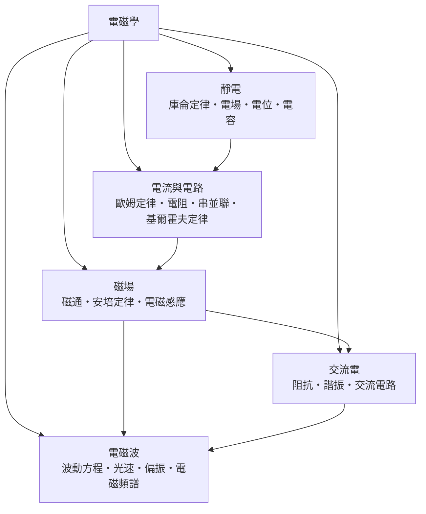

# 電磁學

> 隸屬：第一層 [理]　·　相關分類：[物理學]、[電子工程]、[電機工程]　·　子分類總表見 [README]

> 對應維基百科：[中文維基百科：電磁學](https://zh.wikipedia.org/wiki/%E7%94%B5%E7%A3%81%E5%AD%A6)　·　[English Wikipedia: Electromagnetism](https://en.wikipedia.org/wiki/Electromagnetism)

電磁學研究**電荷的靜止與運動如何產生力、場與波**。它的中樞是一組四條方程——[馬克士威] 於 1865 年寫下的方程組（此處以真空、無源情形的微分形式呈現）：

$$
\nabla \cdot \vec{E} = 0, \qquad
\nabla \cdot \vec{B} = 0, \qquad
\nabla \times \vec{E} = -\frac{\partial \vec{B}}{\partial t}, \qquad
\nabla \times \vec{B} = \mu_0 \varepsilon_0 \frac{\partial \vec{E}}{\partial t}
$$

這組方程把電與磁統一成一個整體，並且預言：變動的電場與磁場會互相激發，以波的形式以光速 $c = 1/\sqrt{\mu_0 \varepsilon_0}$ 傳播——光因此被證明是一種電磁波。

電磁學的歷史是「分久必合」的歷史。18 世紀，[庫侖] 用扭秤測出靜電力的平方反比定律；19 世紀初，[安培] 發現電流會產生磁效應，[法拉第] 於 1831 年發現電磁感應，證明磁也能生電；最後 [馬克士威] 把所有經驗定律整理成對稱的方程組，[赫茲] 於 1887 年以實驗證實電磁波存在，為無線電通訊鋪路。今天從電力系統、收音機到光纖通訊，全是這套理論的應用。

## 核心問題

電磁學的核心問題可以分為四層，彼此層層相依。

1. **靜止電荷之間的力**：兩個點電荷之間的作用力如何計算？這是 [庫侖定律] 的問題，答案是 $F = \frac{1}{4\pi\varepsilon_0}\frac{q_1 q_2}{r^2}$ 。
2. **場的語言**：電荷不「超距」作用，而是在空間中建立 [電場] 與 [磁場]；場如何由電荷與電流分佈決定？這由馬克士威方程組回答。
3. **電流的流動**：電荷在導體中如何形成 [電流與電路]？這由 [歐姆定律] $V = IR$ 與 [基爾霍夫定律] 處理，是工程實務的日常工具。
4. **變動場的互生與波動**：變動的磁場生電場、變動的電場生磁場，兩者互相激發即成 [電磁波]；這是 [交流電] 與無線通訊的理論基礎。

四層的邏輯順序是：先有靜電力，才有場的概念；先有電流的磁效應與電磁感應，才有完整的方程組；有了方程組，才預言並證實電磁波。

## 因果鏈

1. **摩擦起電與靜電力**：18 世紀對靜電的定性認識累積，1785 年 [庫侖] 以扭秤實驗確立平方反比定律，靜電學從此可定量計算。
2. **電池的發明**：1800 年 [伏打] 發明電池，人類第一次擁有穩定電流，電學研究從「一瞬間的放電」變成「持續的過程」。
3. **電與磁的相遇**：1820 年 [奧斯特] 發現電流使磁針偏轉；[安培] 隨即在幾個月內建立電流磁效應的數學理論（[安培定律]）。
4. **磁生電**：1831 年 [法拉第] 發現 [電磁感應]——變動的磁通量會感應出電動勢，發電機與變壓器的原理就此誕生。
5. **場的概念**：法拉第以「力線」直覺地引入場的想法，[馬克士威] 把它翻譯成嚴格的數學，並補上「位移電流」一項，使方程組對稱完備。
6. **預言電磁波**：1865 年馬克士威從方程組推出波動方程，算出的波速與光速吻合，提出「光是電磁波」的大膽假說。
7. **實驗證實**：1887 年 [赫茲] 以火花放電迴路產生並接收了電磁波，量得波速等於光速，馬克士威理論全面勝利。
8. **工程與相對論**：電磁波催生無線電、廣播與雷達；同時馬克士威方程組在所有慣性系中形式不變，直接啟發了 [愛因斯坦] 於 1905 年提出 [相對論]。

## 子分類的定位與相互驅動

- [靜電] 是**起點**：庫侖定律給出第一條定量定律，電場與電位把「力」升級為「場」，[電容] 則是儲存電能的第一個元件。
- [電流與電路] 是**工程語言**：電池問世後，持續電流成為現實，歐姆定律與基爾霍夫定律把電磁學變成可以設計電路的工具。
- [磁場] 是**統一的樞紐**：電流的磁效應與電磁感應合起來，證明電與磁是一體的兩面，直接導致馬克士威方程組。
- [交流電] 是**技術出口**：感應定律使發電機與變壓器成為可能，交流輸電與 [諧振] 電路奠定電力工業與無線電的基礎。
- [電磁波] 是**理論皇冠**：從方程組推得的波動方程統一了光與電磁，[電磁頻譜] 成為通訊、遙測與 [光學] 的共同舞台。

## 範例

**範例一：兩個點電荷的靜電力。** 電荷 $q_1 = 2 \times 10^{-6}$ C 與 $q_2 = -3 \times 10^{-6}$ C 相距 $r = 0.1$ m。由 [庫侖定律]：

$$
F = \frac{1}{4\pi\varepsilon_0} \frac{|q_1 q_2|}{r^2}
= 8.99 \times 10^9 \times \frac{6 \times 10^{-12}}{0.01}
\approx 5.39 \ \text{N}
$$

力為吸引力（異號電荷）。這個數字說明靜電力遠比重力強：同樣距離下，兩顆質子間的靜電力是重力的大約 $10^{36}$ 倍。

**範例二：簡單電路的歐姆定律。** $12$ V 電池接上 $R = 4\ \Omega$ 的電阻，電流 $I = V/R = 3$ A，功率 $P = IV = 36$ W。若串聯再接一個 $8\ \Omega$ 電阻，總電阻 $12\ \Omega$ ，電流降為 $1$ A——這就是 [串並聯] 與 [歐姆定律] 的日常計算。

**範例三：電磁波的波長。** 調頻廣播電台頻率 $f = 100$ MHz，波長 $\lambda = c/f = (3 \times 10^8)/(1 \times 10^8) = 3$ m；手機通訊取 $f = 2$ GHz 則 $\lambda = 0.15$ m。天線尺寸通常取波長的四分之一，這解釋了為什麼不同頻段需要不同大小的天線。

## 容易混淆之處

- **電場與磁場不是同一種場**：電場由電荷（不論靜止或運動）產生，磁場只由運動電荷（電流）或變動電場產生；磁單極至今未被發現，故 $\nabla \cdot \vec{B} = 0$ 。
- **電動勢不是力**：感應電動勢的單位是伏特，它是「單位電荷所得的能量」，不是牛頓。
- **「電壓」與「電位差」**：口語的電壓指兩點間的電位差；單獨一點的「絕對電位」必須先約定參考點（通常取無窮遠或接地）。
- **安培定律與安培力**：安培環路定律描述磁場沿迴路的環積分；「安培力」則指載流導線在磁場中所受的力 $F = BIL\sin\theta$ ，兩者同名不同物。
- **電磁波不需要介質**：與水波、聲波不同，電磁波在真空中傳播，這是它與機械波的根本差別。
- **位移電流不是真電流**：馬克士威補進方程組的「位移電流」是變動電場的等效項，不涉及電荷的實際移動。

## 延伸閱讀

- [物理學]：電磁學所屬的母學科，[古典物理] 的三大支柱之一。
- [電子工程]：把電磁學落實為電晶體、放大器與數位系統的工程學科。
- [電機工程]：電力系統、馬達與輸電網的工程學科。
- [光學]：光是電磁波的一段，幾何光學與波動光學皆是電磁學的支流。
- [量子力學]：原子中的電子行為需用量子理論描述，電磁學是其古典極限。
- [相對論]：馬克士威方程組的時空對稱性是狹義相對論的起點。

## 連結定義

[理]: ../理/README.md
[README]: README.md
[物理學]: ../物理學/README.md
[古典物理]: ../物理學/古典物理.md
[電子工程]: ../電子工程/README.md
[電機工程]: ../電機工程/README.md
[光學]: ../物理學/光學.md
[量子力學]: ../量子力學/README.md
[相對論]: ../相對論/README.md
[靜電]: 靜電.md
[庫侖定律]: 庫侖定律.md
[電場]: 電場.md
[電容]: 電容.md
[電流與電路]: 電流與電路.md
[歐姆定律]: 歐姆定律.md
[串並聯]: 串並聯.md
[基爾霍夫定律]: 基爾霍夫定律.md
[磁場]: 磁場.md
[安培定律]: 安培定律.md
[電磁感應]: 電磁感應.md
[交流電]: 交流電.md
[諧振]: 諧振.md
[電磁波]: 電磁波.md
[電磁頻譜]: 電磁頻譜.md
[庫侖]: ../人/物理學家/庫侖.md
[安培]: ../人/物理學家/安培.md
[法拉第]: ../人/物理學家/法拉第.md
[馬克士威]: ../人/物理學家/馬克士威.md
[赫茲]: ../人/物理學家/赫茲.md
[伏打]: ../人/物理學家/伏打.md
[奧斯特]: ../人/物理學家/奧斯特.md
[愛因斯坦]: ../人/物理學家/愛因斯坦.md
