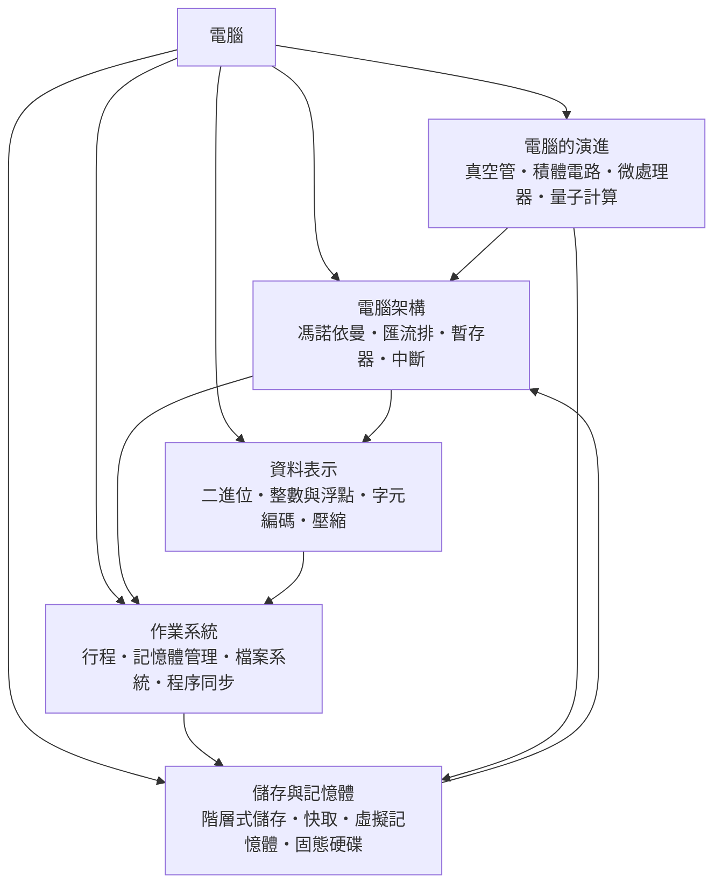

# 電腦

> 隸屬：第一層 [工]　·　相關分類：[電子工程]、[程式設計]、[演算法]　·　子分類總表見 [README]

> 對應維基百科：[中文維基百科：電子計算機](https://zh.wikipedia.org/wiki/%E7%94%B5%E5%AD%90%E8%AE%A1%E7%AE%97%E6%9C%BA)　·　[English Wikipedia: Computer](https://en.wikipedia.org/wiki/Computer)

電腦是**能依儲存的指令自動處理資訊的通用機器**。它的技術特徵可以用一句話概括：把「計算」從專用機械變成可程式化的通用過程——同一套硬體，載入不同的程式就能算彈道、記帳、排版或播放影片。這種通用性來自一個關鍵設計：程式與資料一起放在記憶體裡，機器本身不固定任何一種計算。

在 [1946年] 的 [ENIAC] 之前，每一種計算機幾乎都是專用的：加法機只會加法，打孔卡分類機只會分類。要改變機器的行為，得重新接線或更換齒輪。[馮·諾伊曼] 與 [圖靈] 在 1940 年代確立的「儲存程式」架構打破了這個限制，使電腦從計算工具升級為**資訊的通用處理器**。此後七十年，電腦的發展幾乎都是同一個主題的變奏：讓資訊流動更快、儲存更密、能耗更低。

本分類下的子分類按「由內而外、由底層到歷史」排列：[電腦架構] 描述機器的骨架；[資料表示] 描述資訊如何在骨架上編碼；[作業系統] 描述誰來管理骨架上的資源；[儲存與記憶體] 描述資訊住在哪里、住得多快；[電腦的演進] 把前面所有主題放回歷史時間軸。

## 核心問題

電腦的核心問題可以分為三層。

1. **如何讓機器可程式化**：機器如何在不改動硬體的情況下改變行為？答案是儲存程式：指令也是資料，取指、解碼、執行的循環可以不斷重複。這是 [電腦架構] 與 [馮諾依曼] 的主題。
2. **如何表示與處理資訊**：文字、聲音、影像、數值如何變成統一的位元？答案是二進位編碼：整數、浮點數、字元、壓縮碼，全部是位元的約定。這是 [資料表示] 的主題。
3. **如何管理共享資源**：多個程式同時使用一台機器的處理器、記憶體與磁碟，如何互不干擾又高效？答案是作業系統：抽象（行程、檔案、虛擬記憶體）加上策略（排程、置換、分配）。這是 [作業系統] 與 [儲存與記憶體] 的主題。

三層之下還有一條縱向的軸線：[電腦的演進]。每一層技術都不是一夕完成的，而是沿著「真空管 → 電晶體 → [積體電路] → [微處理器] → 並行與量子」的路徑逐代替換，每次替換都重新定義上一層問題的解法。

## 因果鏈

1. **專用機械的瓶頸**：十九世紀的加法器、分析機與打孔卡系統都是為單一用途設計；改用途就得改機器，通用性等於零。
2. **可計算性的界定**：1936 年 [圖靈] 用圖靈機刻畫「什麼是可計算的」，證明一台足夠通用的機器可以模擬任何計算過程——通用性在理論上成為可能。
3. **儲存程式架構**：1945 年 [馮·諾伊曼] 提出 EDVAC 報告，把指令存進記憶體，使程式可以像資料一樣被讀取、修改與載入；[1946年] 完工的 ENIAC 仍需接線改程式，1949 年的 EDSAC 已是真正的儲存程式機器。
4. **電子元件的升級**：[真空管] 讓運算速度從機械的每秒數次跳到每秒數千次，但功耗與故障率限制了規模；[積體電路] 與 [微處理器] 把整台機器縮進一片晶片，[摩爾] 觀察到的密度增長定律驅動了半世紀的規模化。
5. **作業系統的誕生**：當機器昂貴而使用者眾多，讓人輪流操作就太浪費；批次監督程式演化成作業系統，用 [行程] 與 [中斷] 機制讓多個任務共享 CPU。
6. **記憶體階層的出現**：CPU 變快之後，記憶體跟不上速度；[快取]、[虛擬記憶體] 與 [階層式儲存] 讓「小而快」與「大而慢」協同運作，程式設計師幾乎感覺不到差異。
7. **網路化與行動化**：電腦連上 [計算機網路] 後成為通訊終端；[微處理器] 進入手機與感測器，計算無所不在。
8. **並行與量子時代**：單核效能趨於飽和後，多核與異構計算接棒；[量子計算] 則試圖用疊加與糾纏處理特定問題類別，可能改寫密碼與模擬的遊戲規則。

## 子分類的定位與相互驅動

- [電腦架構] 是**骨架層**：定義取指、解碼、執行的循環與資料移動的通道，一切軟體的假設都建立在它之上。
- [資料表示] 是**編碼層**：把物理上的高低電位翻譯成人類可理解的數值、文字與媒體，是硬體與軟體的合約。
- [作業系統] 是**管理層**：在骨架上動態分配資源，把「一台機器」變成「許多並行的行程各拿一片資源」。
- [儲存與記憶體] 是**時空層**：資訊以不同速度與容量存在不同層級，管理層的許多複雜度都是為了掩飾這個落差。
- [電腦的演進] 是**歷史層**：記錄上述每一層如何被下一代技術重寫，並指出下一步的候選（量子計算、非揮發性記憶體）。

## 範例：一次簡單的加法，機器走過的全程

以 C 語言的一行 `c = a + b;` 為例（a、b 為 int，值 3 與 5），追蹤它在電腦各層的旅程：

1. **編碼層**：原始碼被編譯成機器指令，例如 x86 的 `add eax, ebx`，二進位編碼為一串位元；3 與 5 以二補數表示為 `00000011` 與 `00000101`。
2. **儲存層**：變數 a、b 起初在磁碟上的執行檔裡，作業系統載入程式時把資料段放進主記憶體；執行前它們很可能已被搬進 [快取]。
3. **架構層**：CPU 取指單元從指令快取讀出 `add` 指令，解碼器判定為 ALU 加法運算，控制單元經 [匯流排] 把暫存器 eax、ebx 的值送往算術單元。
4. **運算**：ALU 在一個時脈週期內完成加法，結果 `00001000`（即 8）寫回 eax；若溢位旗標升起，[中斷] 或例外機制會通知作業系統。
5. **管理層**：若這段程式與其他行程並行，作業系統的排程器決定它何時取得 CPU；虛擬記憶體機制把它使用的位址翻譯成實體位址，與其他行程隔離。
6. **輸出層**：程式最後把結果寫入檔案或畫到螢幕，這又是一連串經過檔案系統與驅動程式的資料搬移。

一行程式碼跨過了 [資料表示]、[儲存與記憶體]、[電腦架構] 與 [作業系統] 四層——這正是本分類五個子分類必須一起閱讀的原因。

## 容易混淆之處

- **電腦不等於計算器**：計算器是專用的，電腦是可程式化的通用機器；通用性來自儲存程式。
- **記憶體與儲存不同**：記憶體（RAM）斷電即失，儲存（磁碟、固態硬碟）斷電仍存；日常語言常把兩者混為一談。
- **馮諾依曼架構不是唯一架構**：哈佛架構把指令與資料記憶體分開，DSP 與微控制器常用它。
- **量子計算不是更快的電腦**：它只對特定問題（如質因數分解、量子系統模擬）有優勢，不是全面取代。
- **CPU 快不等於程式快**：程式效能常卡在記憶體與 I/O，這是 [階層式儲存] 存在的原因。

## 延伸閱讀

- [電子工程]：電腦所依賴的電路與元件技術。
- [程式設計]：驅動電腦的語言與方法。
- [演算法]：電腦執行的計算步驟的理論。
- [計算機網路]：讓多台電腦協同的技術。
- [資訊安全]：電腦系統的防護設計。

## 連結定義

[工]: ../工/README.md
[README]: README.md
[電子工程]: ../電子工程/README.md
[程式設計]: ../程式設計/README.md
[演算法]: ../演算法/README.md
[計算機網路]: ../計算機網路/README.md
[資訊安全]: ../資訊安全/README.md
[電腦架構]: 電腦架構.md
[資料表示]: 資料表示.md
[作業系統]: 作業系統.md
[儲存與記憶體]: 儲存與記憶體.md
[電腦的演進]: 電腦的演進.md
[馮諾依曼]: 馮諾依曼.md
[匯流排]: 匯流排.md
[中斷]: 中斷.md
[快取]: 快取.md
[虛擬記憶體]: 虛擬記憶體.md
[階層式儲存]: 階層式儲存.md
[行程]: 行程.md
[積體電路]: ../積體電路/README.md
[微處理器]: 微處理器.md
[量子計算]: 量子計算.md
[1946年]: ../時/1946年.md
[ENIAC]: ../物/ENIAC.md
[馮·諾伊曼]: ../人/數學家/馮·諾伊曼.md
[圖靈]: ../人/數學家/圖靈.md
[摩爾]: ../人/工程師/摩爾.md
