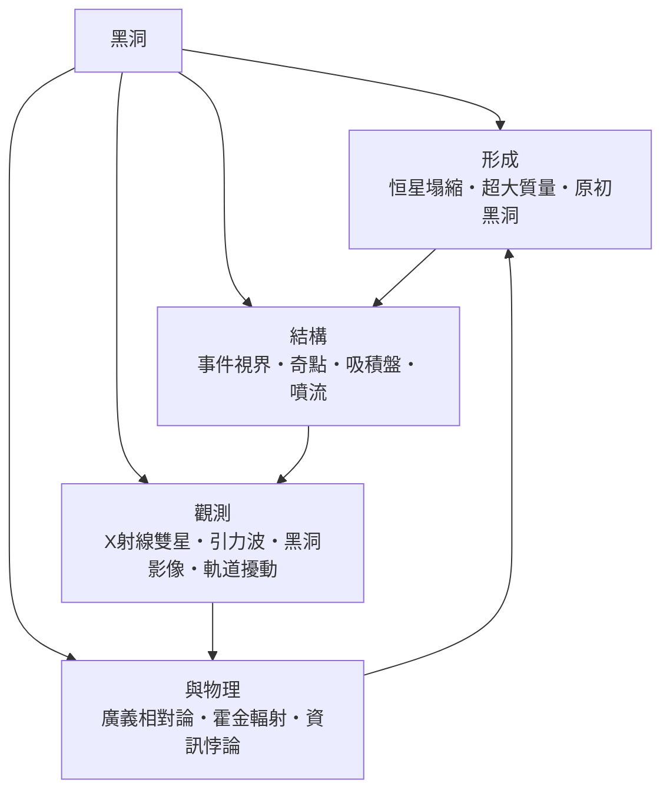

# 黑洞

> 隸屬：第一層 [天]　·　相關分類：[相對論]、[天文學]、[宇宙大爆炸]　·　子分類總表見 [README]

> 對應維基百科：[中文維基百科：黑洞](https://zh.wikipedia.org/wiki/%E9%BB%91%E6%B4%9E)　·　[English Wikipedia: Black hole](https://en.wikipedia.org/wiki/Black_hole)

黑洞是**廣義相對論預言的天體：它的質量集中在極小的空間內，使得任何物質與光都無法從其邊界之內逃逸**。它不是「吸力很強的天體」——吸力強的天體到處都是——而是一個**區域**：一旦跨過那個叫做事件視界的面，就再也沒有任何訊息能回到外界。

「黑洞」一詞由 [惠勒] 在 1967 年前後推廣，但相關物理自 1916 年 [史瓦西] 求出第一個精確解就已開始。他當時甚至不願相信自己的解。1929 年 [哈勃] 測得星系退行速度與距離成正比，把相對論的解從書桌推向天文台；此時黑洞仍只是理論中難以接受的解。到了 [愛因斯坦] 時代，這個解被當作「不合理的」數學產物擱置了半個多世紀，直到 1960 年代的吸積盤與 X 射線雙星觀測，才讓它從數學怪獸變成天文學家能搜尋的目標。

黑洞的重要性不在於它是「最極端的天體」，而在於它是**理論物理學的試金石**：凡是能解釋黑洞的理論，必須同時處理強引力、量子力學與熱力學。這正是「黑洞悖論」成為現代物理核心危機的原因。

## 核心問題

黑洞概念要回答的核心問題可以分成三層：

1. **什麼條件會讓時空被「挖空」？** 判準是史瓦西半徑 $ r_s = \frac{2GM}{c^2} $：若天體的半徑小於這個值，它就被自己的時空曲率關在內部。以太陽質量代入，$ r_s $ 約 3 公里；地球質量對應約 9 毫米——可見「黑洞」是密度問題，不是體量問題。
2. **邊界之內有什麼？** 廣義相對論的解在 $ r = 0 $ 處有曲率奇異，稱為 [奇點]；而事件視界之外的解本身完全光滑。問題在於：量子力學不允許奇點存在，兩者不能同時正確。
3. **信息去了哪裡？** 落入黑洞的粒子信息，按量子力學的幺正演化不該消失；但按 [霍金輻射] 的計算，黑洞蒸發後信息似乎被抹去。這就是 [資訊悖論]，也是弦論、圈量子重力等新架構的試金石。

## 因果鏈

1. **牛頓的預言**：18 世紀的力學即已算出，若天體質量足夠大，其逃逸速度可超過光速；18 世紀已有人提出「暗星」的構想，此時的相對論解仍只是紙面上的數學。
2. **廣義相對論的誕生**：[愛因斯坦] 於 1915 年給出引力的場方程，讓「逃逸速度」不再是牛頓式的直覺，而可以精確計算。
3. **第一個解**：[史瓦西] 在 1916 年求出球對稱解，發現半徑 $ r_s $ 處的奇異面。當時物理界無法接受，視為數學瑕疵。
4. **被遺忘三十年**：直到 1930 至 1960 年代，人們才逐漸意識到恆星晚期塌縮與吸積 [X射線雙星] 的能量來源需要 [事件視界] 這類結構。
5. **名稱的誕生**：[惠勒] 於 1967 年推廣「黑洞」一詞，使之取代「塌縮星」等含混說法。
6. **理論的深化**：[霍金] 於 1974 年提出黑洞具有溫度並會蒸發，把量子力學與熱力學引入事件視界。
7. **觀測的爆發**：2015 年 [2015年] 首次偵測到兩個黑洞併合的 [引力波]；2019 年 [2019年]，[事件視界望遠鏡] 公布 M87* 的影像，黑色陰影首次進入人類視野。
8. **危機的浮現**：影像與引力波都支持廣義相對論，卻讓 [資訊悖論] 更加尖銳——理論的成功反而加劇了另一個問題。

## 子分類的定位與相互驅動

- [黑洞的形成] 回答「黑洞怎麼出現」：由 [恒星塌縮] 這類內部過程產生，靠質量的估計方法辨認，而非直接看見塌縮本身；[超大質量] 與 [原初黑洞] 則分別代表極端質量端與早期宇宙的產物。
- [黑洞的結構] 回答「黑洞長什麼樣」：[事件視界] 是幾何邊界，[奇點] 是理論的破口，而 [吸積盤] 與 [噴流] 是最亮、最容易被觀測到的部分——它們的能量學正是 [黑洞的觀測] 的基礎。
- [黑洞的觀測] 回答「我們怎麼知道它在那裡」：從 [X射線雙星] 的雙星軌道、到 [引力波] 的併合訊號、到 [黑洞影像] 的陰影，再到 [恒星軌道擾動] 的精密測量，四種手段互相補位，把黑洞從理論推到經驗。
- [黑洞與物理] 回答「它逼物理學學到了什麼」：[廣義相對論] 提供語言，[霍金輻射] 提供量子修正，[資訊悖論] 則把兩者的張力公開化，迫使理論物理學尋找新的表述方式。

## 範例：以太陽質量作尺標

1. 取質量 $ M = 2.0 \times 10^{30} $ 公斤（太陽質量），代入 $ r_s = \frac{2GM}{c^2} $ 得 $ r_s \approx 2.95 $ 公里。
2. 太陽實際半徑約 696,000 公里，是 $ r_s $ 的 236 倍——所以太陽本身遠不是黑洞。
3. 若把太陽壓縮到 3 公里以內，它就成為史瓦西黑洞；同理，一顆 1.4 太陽質量的中子星若再被壓縮，就會塌縮成黑洞。
4. 反向操作同樣成立：把 [地球] 壓縮到 9 毫米直徑的球內，地球就成為黑洞——這說明「黑洞」與「天體大小」無必然關係。
5. 對已知最大的恆星黑洞（TON 618，約 660 億倍太陽質量），$ r_s $ 達約 1,960 億公里，遠超太陽系尺度；對最小可能的黑洞（由 [原初黑洞] 假說提出，質量可低至 $ 10^{11} $ 公斤），$ r_s $ 卻僅約 $ 10^{-16} $ 米，遠小於原子核。

## 容易混淆之處

- **黑洞不是「引力塌陷的漩渦」**：它不是宇宙中一個會把東西吸進去的漏斗，而是一段時空區域；「吸进去」的說法只是外部觀察者的描述。
- **吸積盤不是黑洞的一部分**：盤與噴流在事件視界之外，是普通物質在做普通（或近似普通）的軌道運動。
- **「無所不吸」是通俗誇張**：太陽若變成黑洞，地球軌道幾乎不變，因為太陽的引力本身並未改變，改變的只是半徑。
- **事件視界不是物質表面**：沒有盤面、沒有硬殼；通過事件視界時，外部觀察者只看見光線愈來愈紅移，穿越者本人則不會遇到特殊阻力。
- **奇點不是已知實體**：它是數學上的必然奇點，多數物理學家認為真實的量子理論會把它替換掉。

## 延伸閱讀

- [相對論]：處理強引力與時空曲率的理論。
- [宇宙大爆炸]：另一個由相對論推導出的、可用觀測檢驗的時空框架。
- [天文學]：提供黑洞搜尋所需的觀測方法。
- [廣義相對論]：本概念在理論上的直接母體。
- [霍金輻射]：讓黑洞成為熱力學系統的關鍵結果。

## 連結定義

[1916年]: ../時/1916年.md
[2015年]: ../時/2015年.md
[2019年]: ../時/2019年.md
[X射線雙星]: X射線雙星.md
[README]: README.md
[事件視界]: 事件視界.md
[事件視界望遠鏡]: ../物/事件視界望遠鏡.md
[哈勃]: ../人/天文學家/哈勃.md
[奇點]: 奇點.md
[宇宙大爆炸]: ../宇宙大爆炸/宇宙大爆炸.md
[地球]: ../地/地球.md
[惠勒]: ../人/物理學家/惠勒.md
[霍金]: ../人/物理學家/霍金.md
[霍金輻射]: 霍金輻射.md
[吸積盤]: 吸積盤.md
[噴流]: 噴流.md
[恒星塌縮]: 恒星塌縮.md
[黑洞的形成]: 黑洞的形成.md
[黑洞的結構]: 黑洞的結構.md
[黑洞的觀測]: 黑洞的觀測.md
[黑洞的影像]: 黑洞影像.md
[黑洞與物理]: 黑洞與物理.md
[愛因斯坦]: ../人/物理學家/愛因斯坦.md
[原初黑洞]: 原初黑洞.md
[史瓦西]: ../人/物理學家/史瓦西.md
[引力波]: 引力波.md
[恒星軌道擾動]: 恒星軌道擾動.md
[相對論]: ../相對論/README.md
[資訊悖論]: 資訊悖論.md
[超大質量]: 超大質量.md
[天文學]: ../天文學/README.md
[廣義相對論]: 廣義相對論.md
[天]: ../天/README.md
