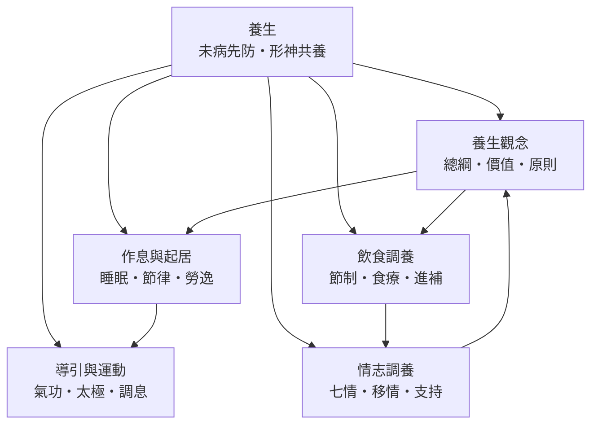

# 養生

> 隸屬：第一層 [醫]　·　相關分類：[中醫學]、[食療養生]、[膳食指南]　·　子分類總表見 [README]

> 對應維基百科：[中文維基百科：養生](https://zh.wikipedia.org/wiki/%E9%A4%8A%E7%94%9F_(%E9%81%93%E6%95%99))　·　[English Wikipedia: Yangsheng (Daoism)](https://en.wikipedia.org/wiki/Yangsheng_%28Daoism%29)

養生是在疾病發生之前，主動調攝生活以維持與增進健康的理論與實踐。它與治療的分界線很清楚：醫生處理已經失衡的身體，養生處理尚未失衡的身體；用中醫的話說，養生是「治未病」的學問。這門學問不需要高深的技術門檻——它由四件人人每天都會做的事構成：怎麼睡、怎麼動、怎麼吃、怎麼處理情緒，再加上一套統攝這四件事的觀念系統。因此本分類的五個子分類，正好對應「觀念先行、起居為本、飲食為養、導引為動、情志為樞」的完整結構。

## 核心問題

養生的核心問題是：**在無法避免衰老的前提下，如何延緩失能、減少疾病、維持生活品質**。傳統理論用三個概念回答：

1. **精、氣、神**：把生命活動概括為物質基礎（精）、功能動力（氣）與精神活動（神）三個層面，養生即養此三者。
2. **陰陽平衡**：健康是動態平衡而非靜止狀態，過勞是陽的耗散、過逸是陰的停滯，兩者都會致病。
3. **順應自然**：人的節律嵌在四時晝夜的節律之中，「起居有常，不妄作勞」是順應，晝夜顛倒是違逆。

現代預防醫學用另一套語言回答同一批問題：睡眠衛生、身體活動量（如每週 150 分鐘中等強度運動）、膳食平衡與壓力管理。值得注意的是，兩套體系在行為處方上高度重疊，差異主要在解釋框架；這也是養生成為傳統與現代最容易對話的領域的原因。

## 因果鏈

1. **先秦的思想準備**：《黃帝內經》提出「法於陰陽，和於術數，食飲有節，起居有常，不妄作勞」的總綱，《老子》《莊子》提供清靜無為、形神相守的哲學基礎——養生一開始就是哲學與醫學的合體。
2. **導引術的技術化**：馬王堆漢墓出土的《導引圖》繪有四十餘個動作，證明漢代已有成套的身體練習；[華佗] 將其總結為五禽戲，使「運動養生」從零散動作變成可傳授的套路。
3. **起居節律的系統化**：曆法與 [二十四節氣] 的成熟，使「四時起居」有精確的時間表——何時起臥、何時進補、何時收斂，都有曆法依據。
4. **食養與食療的分途**：唐代孫思邈《備急千金要方》設「食治」專卷，主張「食療不愈，然後命藥」，確立了食物先於藥物的調養次序，這條路線後來發展為龐大的食療傳統。
5. **情志致病理論的確立**：「七情內傷」被納入病因學，怒傷肝、思傷脾成為解釋心身疾病的框架，調養因此不僅是身體的事。
6. **世俗化與大眾化**：宋代以後養生從道家修煉走入士大夫的日常生活，陳直《養老奉親書》等著作把養生對象擴展到老人與常人，出現了大量面向普通人的操作守則。
7. **現代驗證與挑戰**：睡眠科學、運動醫學與身心醫學對傳統主張進行檢驗——規律作息、適度運動與壓力管理獲得強力支持，而部分誇張的修煉主張則被證偽或降級。
8. **當代的整合**：今天的養生位於傳統智慧、預防醫學與健康產業的交匯處；真正的挑戰不再是「要不要養生」，而是如何在資訊噪音中分辨有證據的建議。

## 子分類的定位與相互驅動

### 養生觀念

養生觀念是整個體系的**總綱**：「治未病」確立了養生的目的（在疾病之前介入），「形神共養」確立了範圍（身體與心理並重），「因時因地因人」確立了方法（反對一體適用的處方）。沒有這一層，具體的技術就會退化成零散的偏方；反過來，作息、飲食等技術的成敗經驗，又不斷回頭修正觀念的表述。

### 作息與起居

作息與起居是養生的**基底**：睡眠與節律是每天必然發生的行為，其健康影響遠大於任何進補。傳統的「日出而作、子午有度」對應現代睡眠科學的晝夜節律研究；睡眠不足對免疫、代謝與情緒的損害，正是「起居無常則百病叢生」的現代註腳。作息失序的人，練什麼導引、吃什麼補品都事倍功半——因此它是其他子分類的前提。

### 導引與運動

導引與運動是養生中**主動的身體介入**：氣功、太極拳、八段錦以緩慢、協調、配合呼吸為特徵，現代研究支持其對平衡能力、血壓與情緒的改善。「動以養形、靜以養神」的框架，使它與純體能訓練有明顯區別；而運動依賴作息提供恢復時間，又受身體狀態制約，因此它與 [作息與起居] 互為條件。

### 飲食調養

飲食調養是養生中**最日常的介入**：「節制」是總原則，「辨證食療」是個體化方法，「季節進補」是時間策略。傳統食養強調「五穀為養、五果為助」的結構，與現代膳食指南的平衡理念同構；然而進補文化也製造了大量誤用——它必須由 [安全與規範] 式的常識把關，並以 [作息與起居] 的穩定為發揮作用的前提。

### 情志調養

情志調養是養生中**最容易被忽略的一環**：「怒傷肝、思傷脾」的框架把情緒納入健康管理的核心，與現代心身醫學、壓力生理學互相印證——長期壓力確實透過神經內分泌途徑損害心血管與免疫功能。情志失調會直接破壞睡眠與飲食節律，因此它是連接其他子分類的樞紐；移情易性（轉移與轉化情緒）的傳統技術，也與現代心理學的調節策略相通。

## 範例：一位現代上班族的傳統養生方案

以一位睡眠不足、壓力大、久坐的上班族為例，五個子分類依次登場：

1. **觀念先行**：先確立目標——不是吃某種補品，而是把「治未病」落實為可執行的日常，接受「改變是漸進的、方案是個人化的」。
2. **起居為本**：固定起床時間、睡前一小時離開螢幕、週末補眠不超過一小時；把「子午流注」的原理簡化為「睡眠時間要穩定且足量」。
3. **導引為動**：每天二十分鐘八段錦或散步，重點是「不使極」——以能恢復為度，而非追求運動量。
4. **飲食為養**：三餐定時、晚餐七分飽、減少夜間咖啡因；冬季進補前先評估體質，而非照搬網路配方。
5. **情志為樞**：以運動與社交做「移情易性」，工作壓力以記錄與傾訴拆解；若失眠持續，尋求專業幫助而非自行加大保健品劑量。

這個方案的每一條都同時有傳統依據與現代證據，這正是養生分類的價值：提供一張兩個體系都能讀懂的地圖。

## 容易混淆之處

- **養生不等於吃補品**：補品只是飲食調養的一小部分；作息與情志的影響遠大於多數保健品。
- **養生不等於養生產品的消費**：健康產業販售的是焦慮的解藥，養生傳統給的是行為準則；兩者常被故意混淆。
- **「清靜無為」不是不動**：傳統的「靜」指心神安定，形體仍須導引活動；把養生理解成躺平，是對「靜養」的最大誤讀。
- **因人而異不是玄學**：體質與生活條件的差異使方案必須個人化，這與現代精準預防的邏輯相同，而非拒絕證據的藉口。
- **養生不能替代就醫**：「治未病」的邊界是疾病未成；已經確診的疾病，治療方案必須交給醫療體系。

## 延伸閱讀

- [中醫學]：養生理論所屬的醫學體系。
- [食療養生]：食物與健康關係的專門分類。
- [膳食指南]：現代營養學的飲食建議框架。
- [針灸]：傳統治療手段，與養生術互相補充。
- [健身運動]：現代身體訓練體系，可與導引對照。

## 連結定義

[醫]: ../../科技/README.md
[README]: README.md
[中醫學]: ../../科技/中醫學/README.md
[食療養生]: ../食療養生/README.md
[膳食指南]: ../../科技/膳食指南/README.md
[針灸]: ../../科技/針灸/README.md
[健身運動]: ../健身運動/README.md
[二十四節氣]: ../../時/二十四節氣/README.md
[作息與起居]: 作息與起居.md
[華佗]: ../../人/醫學家/華佗.md
[安全與規範]: ../../科技/中草藥/安全與規範.md