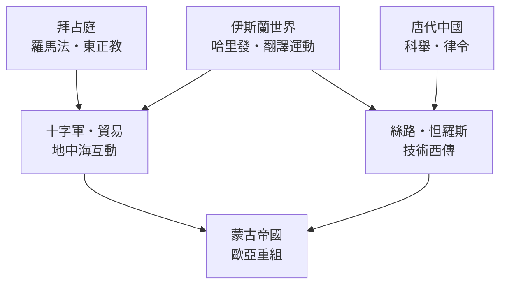

# 中古世界

> 隸屬：[古代史] › [古代史]　·　狀態：初稿

> 對應維基百科：[中文維基百科：中世纪](https://zh.wikipedia.org/wiki/%E4%B8%AD%E4%B8%96%E7%BA%AA)　·　[English Wikipedia: Post-classical history](https://en.wikipedia.org/wiki/Post-classical_history)

中古世界指古典秩序崩潰後至近代黎明前（約 500 至 1500 年）的全球格局。它不是歐洲專屬的「中世紀」，而是拜占庭、伊斯蘭世界、唐代中國與其他區域並立的多元體系。

這一時代的主題是「繼承與改寫」：[拜占庭]保存羅馬法與基督教帝國，[伊斯蘭世界]吸收並超越希臘波斯遺產，[唐代中國]把秦漢官僚制推向成熟。三者之間的征戰與貿易（十字軍、絲路、香料路）使舊大陸重新連成網絡。

本子分類下設三個孫分類：[拜占庭]、[伊斯蘭世界]與[唐代中國]，分別代表古典遺產的三種繼承路線。

## 技術與理論的關聯

- 拜占庭查士丁尼（527 至 565 年在位）以《民法大全》法典化羅馬法、以聖索菲亞大教堂定形拜占庭建築，是古典遺產最直接的法律與藝術儲存庫。
- 7 世紀伊斯蘭興起，在百年內建立從伊比利到中亞的哈里發帝國，其翻譯運動（8 至 10 世紀）把希臘哲學與科學譯成阿拉伯文，成為後來歐洲文藝復興的二手來源。
- 唐代（618 至 907 年）以科舉、律令與兩稅法構成官僚社會的成熟模板，長安是當時世界最大的國際都市。
- 751 年怛羅斯之戰阿拔斯擊敗唐軍，造紙術西傳，是技術跨文明傳播的標誌性事件。
- 1054 年基督教東西教會大分裂、1096 年起十字軍東征，顯示三個繼承體系之間的宗教與地緣張力。
- 1206 年成吉思汗建蒙古帝國、1258 年蒙古攻陷巴格達，中古秩序被草原帝國重組，歐亞一體化空前——這也是通往近代的世界體系前奏。

## 孫分類

| 孫分類 | 狀態 |
| --- | --- |
| [拜占庭] | 初稿 |
| [伊斯蘭世界] | 初稿 |
| [唐代中國] | 初稿 |

## 範例

1453 年君士坦丁堡陷落是中古世界的落幕鐘聲：鄂圖曼以巨型火砲轟塌狄奧多西城牆，延續千年的羅馬帝國就此終結。同一年，英法百年戰爭也告結束——火藥與常備軍把世界推入近代門檻。

751 年怛羅斯之戰後，被俘唐軍工匠把造紙術帶到撒馬爾罕，紙廠隨即設於巴格達（約 794 年）。書寫成本驟降使阿拔斯的翻譯運動與政府文書得以規模化——一場邊境戰役改變了兩個文明的資訊基礎設施。

## 前因後果

- 前因：[古典時代]的三大體系在 3 至 6 世紀相繼過載崩解。
- 瓶頸：古典遺產（法律、哲學、官僚技術）需要新的載體，舊大陸需要新的連接方式。
- 解法：拜占庭以帝國與教會保存，伊斯蘭以翻譯與商路改寫，唐以復古創新擴展。
- 後果：三體系的互動（貿易、戰爭、技術傳播）累積出蒙古時代與近代初期的世界網絡，本概念因此成為[古代史]通向[近代史]的橋樑。

## 與相鄰分類的關聯

- 與[拜占庭]的關係：羅馬法的千年儲存室。
- 與[伊斯蘭世界]的關係：中古後期舊大陸最強的連接者與學術中介。
- 與[唐代中國]的關係：官僚文明的成熟形態與東亞模板。
- 與[近代史]的關聯：航海技術、火藥與商業網絡都成熟於中古，近代只是其放大。
- 與[世界史]的關聯：中古世界是「歐亞整體史」寫法的主要試驗場。

## 容易混淆之處

- 「中古」不等於「黑暗」：伊斯蘭黃金時代與盛唐都是高度繁榮的社會。
- 拜占庭人自稱「羅馬人」：拜占庭是後世學者所起的名字。
- 中古的下限不統一：君士坦丁堡陷落（1453 年）、哥倫布（1492 年）、宗教改革（1517 年）各有支持者。

## 技術要點

- 斷代以拜占庭、伊斯蘭與東亞各自的王朝年表為骨架，再以互動事件（怛羅斯、十字軍）對齊。
- 錢幣學與窖藏分析追蹤迪納厄斯與開元通寶的流通半徑，量化舊大陸貿易。
- 伊斯蘭地理學文獻（伊本·胡爾達茲比赫《道里邦國志》）提供 9 世紀貿易路線的第一手描述。
- 敦煌文書與吐魯番文書使中古絲路社會史得以量化研究。
- 沉船考古（如勿里洞沉船）證實 9 世紀阿拉伯—中國直航的規模。
- 氣候代用資料顯示「中世紀氣候異常期」（約 900 至 1300 年）與北大西洋漁業、維京擴張的關聯。

## 常見的論爭

- 拜占庭的「衰落敘事」：帝國晚期的行政韌性與文化活力近年被重新評價，1204 年第四次十字軍才是真正的斷層。
- 伊斯蘭黃金時代的動力：翻譯運動是精英工程還是社會性知識擴散，學界解釋不一。
- 唐宋變革論：內藤湖南主張中古貴族制在唐宋之際轉為近世平民社會，斷代位置至今有爭議。

## 延伸閱讀

- [拜占庭]：羅馬遺產的東方儲存庫。
- [伊斯蘭世界]：中古連接者。
- [唐代中國]：東亞模板。
- [近代史]：中古之後的下一步。

## 連結定義

[古代史]: 古代史.md
[拜占庭]: 拜占庭.md
[伊斯蘭世界]: 伊斯蘭世界.md
[唐代中國]: 唐代中國.md
[古典時代]: 古典時代.md
[近代史]: ../近代史/README.md
[世界史]: ../世界史/README.md