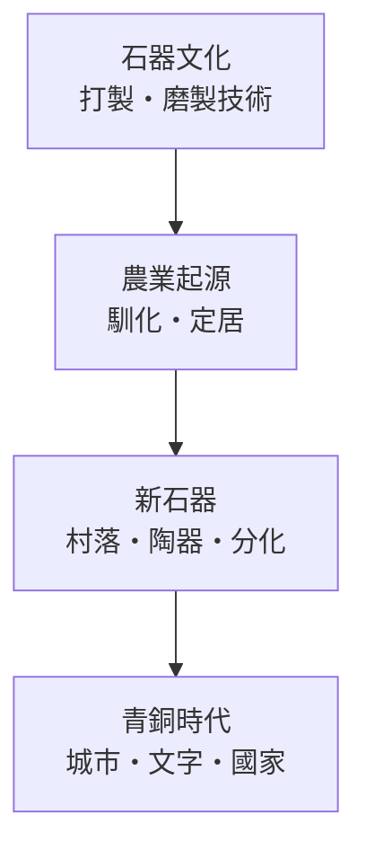
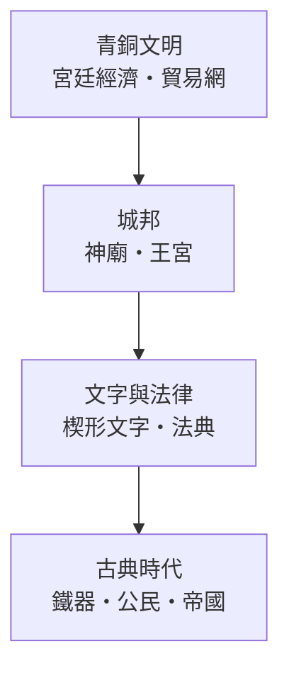
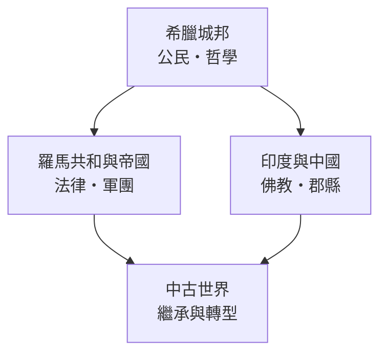
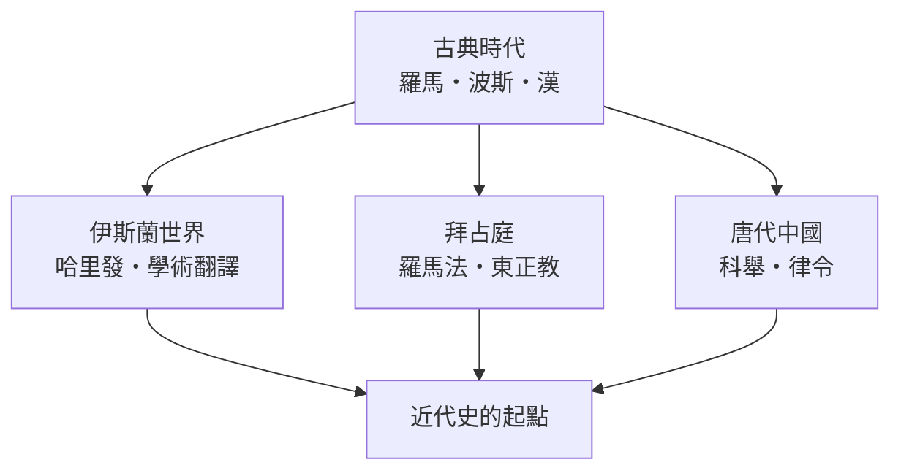

# 古代史

> 隸屬：第一層 [事]　·　相關分類：[世界史]、[戰爭史]、[宗教學]、[歷史]　·　子分類總表見 [README]

> 對應維基百科：[中文維基百科：古代史](https://zh.wikipedia.org/wiki/%E5%8F%A4%E4%BB%A3%E5%8F%B2)　·　[English Wikipedia: Ancient history](https://en.wikipedia.org/wiki/Ancient_history)

古代史研究文字發明（約西元前 3200 年）之後到西元 476 年西羅馬帝國滅亡（或以 1453 年拜占庭陷落為終點）之間的人類社會。它回答的核心問題是：人類如何從分散的採集狩獵群體，一步步組織出城市、國家、法律、宗教與帝國這些延續至今的制度。與[世界史]的宏觀框架相比，古代史更聚焦在「制度化」這個關鍵躍遷；與[戰爭史]聚焦衝突事件不同，古代史把戰爭視為制度競爭的結果而非起點。

## 核心問題

古代史處理的第一個問題是**剩餘**：農業使單位土地養活的人口超過生產者自身，於是出現了不務農的祭司、戰士與統治者。第二個問題是**紀錄**：文字使行政、契約與法律可以脫離人的記憶而存在，國家因此能跨世代延續。第三個問題是**整合**：城邦、王國與帝國不斷試驗「一個權威能管理多少人、多大的疆域」，從蘇美的城邦、埃及的王朝、波斯的行省制，一路試到羅馬的法律體系。這三個問題彼此驅動：剩餘養官僚，官僚需要文字，文字擴大整合的規模。

## 因果鏈

1. 氣候穩定與[農業起源]使定居成為可能，人口密度上升，村落擴張為聚落。
2. 灌溉與防洪需要跨村落的協調，催生神廟與祭司階層，這是最早的常設權威。
3. 剩餘糧食累積後，[青銅文明]在美索不達米亞、埃及、印度河流域與黃河流域先後成形，宮廷與神廟成為經濟中心。
4. 行政記帳的需求催生[文字與法律]，從兩河流域的楔形文字到[漢摩拉比法典]，統治第一次可以「寫下來」。
5. 青銅與鐵器的傳播改變軍事平衡，[城邦]與領土國家競爭，戰俘與貿易帶動文化傳播。
6. 地中海世界出現[希臘城邦]的公民政治實驗，随后被[羅馬共和與帝國]以法律與軍團整合成橫跨三洲的秩序。
7. 同一時期，[印度與中國]發展出以宗教解脫與官僚郡縣為軸心的另兩套整合方案。
8. 古典秩序在 3 至 6 世紀相繼承壓：西羅馬於 476 年終結，歐洲轉入[中古世界]，而[拜占庭]、[伊斯蘭世界]與[唐代中國]接手保存並改寫了古典遺產。

## 子分類的定位與相互驅動

### 史前時代

[史前時代]涵蓋文字出現之前的數百萬年，[石器文化]以打製與磨製石器劃分技術階段，[農業起源]解釋人類為何放棄流動的採集生活，[新石器]則是定居、陶器、家畜與社會分化同時出現的轉型期。沒有這一段積累，後面一切城市與國家都無從談起。

### 青銅時代

[青銅時代]是第一個「國際體系」的時代：[青銅文明]以宮廷經濟與長程貿易連結各河流域，[城邦]顯示了小規模政治體的極限與韌性，[文字與法律]則把權威物化為文書與法典。這個子分類的瓶頸——青銅依賴遠距離錫銅貿易、宮廷經濟脆弱——正解釋了西元前 1200 年前後的普遍崩潰，也逼出了其後鐵器時代的重來。

### 古典時代

[古典時代]以西元前 8 世紀至西元 5 世紀的地中海為主軸：[希臘城邦]試驗公民政治與哲學，[羅馬共和與帝國]把法律、道路與軍團變成統治技術，[印度與中國]則展示孔雀王朝的佛教護持與秦漢郡縣官僚制的另類答案。三個區域互相輝映，構成「軸心時代」的思想爆發。

### 中古世界

[中古世界]接住古典崩潰後的殘局：[拜占庭]保存羅馬法與基督教傳統近千年，[伊斯蘭世界]在 7 至 10 世紀建立從大西洋到中亞的新秩序並吸收希臘學術，[唐代中國]以科舉與律令制展現成熟官僚社會。這三個繼承者相互征戰也相互貿易，把古代史的遺產傳遞給近代以前的世界。

## 範例

以[羅馬共和與帝國]為例可以看出古代史的典型節奏。西元前 509 年羅馬驅逐國王建立共和，經過平民與貴族兩百年的鬥爭，《十二銅表法》於西元前 451 年公布，法律首次成文而公開。西元前 31 年的亞克興海戰後，[凱撒]的繼承者屋大維在前 27 年獲得「奧古斯都」尊號，共和外殼下的帝國體制成形。帝國以道路、軍團與行省治理地中海，直到 395 年東西分治、476 年西羅馬末帝被廢。同一邏輯也出現在東方：秦始皇於前 221 年統一六國，以郡縣取代封建，與羅馬不約而同地回答了「大疆域如何治理」的問題。

再以[文字與法律]為例：西元前 3200 年左右蘇美書記為記帳而刻下楔形文字，兩千年後《漢摩拉比法典》刻在玄武岩石柱上公開展示——從會計符號到成文法，正好是古代史「剩餘→紀錄→整合」三步的縮影。

## 容易混淆之處

- **古代史不等於世界古代各國史**：它是一個以「制度如何成形」為軸的比較框架，而不是各文明史的疊加。
- **史前時代屬於本概念但無文字**：學界以物質文化界定史前，與「文字之後的古代史」接續而非重疊。
- **476 年是慣例而非斷裂**：西羅馬滅亡是行政事件的終點，地中海經濟與[拜占庭]延續甚久，斷代各有異說。
- **「中古世界」不是「黑暗時代」**：拜占庭、伊斯蘭與唐代都是高度發達的社會，「黑暗」只是西歐的局部經驗。

## 延伸閱讀

- [世界史]：把古代放進長時段的整體框架。
- [戰爭史]：古代戰爭與國家形成的軍事面。
- [宗教學]：從多神到一神的思想制度史。
- [歷史]：史學方法與史料批判的總入口。

## 連結定義

[README]: README.md
[事]: ../README.md
[世界史]: ../世界史/README.md
[戰爭史]: ../戰爭史/README.md
[宗教學]: ../宗教學/README.md
[歷史]: ../歷史/README.md
[史前時代]: 史前時代.md
[農業起源]: 農業起源.md
[石器文化]: 石器文化.md
[新石器]: 新石器.md
[青銅時代]: 青銅時代.md
[青銅文明]: 青銅文明.md
[城邦]: 城邦.md
[文字與法律]: 文字與法律.md
[古典時代]: 古典時代.md
[希臘城邦]: 希臘城邦.md
[羅馬共和與帝國]: 羅馬共和與帝國.md
[印度與中國]: 印度與中國.md
[中古世界]: 中古世界.md
[拜占庭]: 拜占庭.md
[伊斯蘭世界]: 伊斯蘭世界.md
[唐代中國]: 唐代中國.md
[凱撒]: ../../人/政治人物/凱撒.md
[漢摩拉比法典]: 文字與法律.md