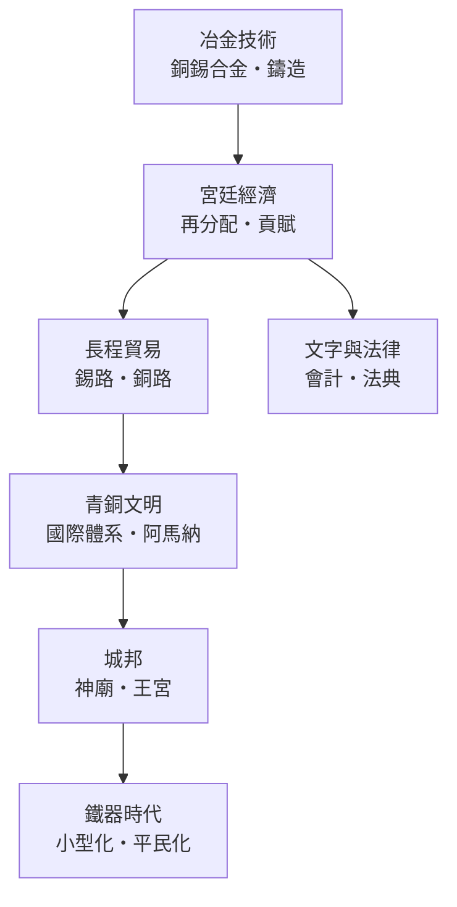

# 青銅時代

> 隸屬：[古代史] › [古代史]　·　狀態：初稿

> 對應維基百科：[中文維基百科：青铜时代](https://zh.wikipedia.org/wiki/%E9%9D%92%E9%93%9C%E6%97%B6%E4%BB%A3)　·　[English Wikipedia: Bronze Age](https://en.wikipedia.org/wiki/Bronze_Age)

青銅時代約自西元前 3300 年始於西南亞，止於各地鐵器普及（西亞約前 1200 年、中國約前 500 年、美洲始終未進入）。它的定義是技術的，也是社會的：冶金需要專業分工與長程貿易，從而催生了城市、王權與成文法。

青銅是銅錫合金，錫礦稀少且常遠離銅礦，這迫使青銅時代社會建立橫跨數千公里的原料網絡——從康瓦爾到阿富汗的錫、從塞浦路斯到阿拉伯的銅。可以說，青銅時代是人類第一個「全球化」時代。

本子分類下設三個孫分類：[青銅文明]處理宮廷經濟與國際體系，[城邦]處理小規模政治體的組織形態，[文字與法律]處理這個時代最重要的兩項制度發明。

## 技術與理論的關聯

- 冶金鏈條（採礦、選礦、熔煉、合金、鑄造）需要專職工匠與資源調度，是宮廷經濟最早的成員之一，也是王權炫耀性消費的核心。
- 青銅時代的「國際體系」以阿馬納書信（前 14 世紀埃及與巴比倫、赫梯、米坦尼諸王的往來）為代表，諸王互稱兄弟，以聯姻、禮物與大使維繫均勢。
- 錫的稀缺驅動長程貿易：烏魯布倫沉船（約前 1300 年）載有十噸銅錠與一噸錫，是地中海貿易的直接物證。
- 青銅時代崩潰（約前 1200 至前 1150 年）使東地中海諸宮廷體系在數十年內相繼瓦解，識字、建築與貿易規模急縮，史稱「第一個黑暗時代」。
- 鐵器替代青銅的原因不在硬度而在原料普及：鐵礦到處皆有，武士不再依賴宮廷供給武器，政治結構因此小型化、平民化。
- 文字從會計符號進化為文學與法典（[吉爾伽美什史詩]、《漢摩拉比法典》），思想第一次可以跨世代累積。

## 孫分類

| 孫分類 | 狀態 |
| --- | --- |
| [青銅文明] | 初稿 |
| [城邦] | 初稿 |
| [文字與法律] | 初稿 |

## 範例

烏魯布倫沉船（土耳其外海，1982 年發掘）是青銅時代貿易的縮影：船載約十噸塞浦路斯銅錠、一噸錫（可鑄十一噸青銅）、玻璃錠、象牙、琥珀與邁錫尼陶器，學者推測這是一艘王室商船。錫與銅產地相距數千公里，一次航程即串起中亞、兩河與愛琴海。

西元前 1200 年前後數十年間，赫梯帝國滅亡、烏加里特城毀於火（城王家檔案的最後一塊泥板是求援未寄出的信）、埃及擊退「海上民族」。整個東地中海宮廷體系在一代人之內解體，希臘線形文字 B 的識字能力中斷四百年，直到古風時代才重新出現。

## 前因後果

- 前因：[新石器]時代的人口與技術積累到冶金門檻，銅石並用期完成過渡。
- 瓶頸：銅軟、錫遠，單一社群無法自給，必須組織長程交換與專業分工。
- 解法：宮廷與神廟以再分配經濟調度資源，文字與法律使調度可以紀錄與執行。
- 後果：城市與帝國成為常態；青銅體系的脆弱性（貿易中斷即崩潰）在約前 1200 年總爆發，鐵器時代以其反面（原料普及、政治小型化）接棒。

## 與相鄰分類的關聯

- 與[青銅文明]的關係：宮廷經濟與國際體系是青銅時代社會組織的最高形態。
- 與[城邦]的關係：城邦顯示同一技術條件下另一種小型政治解法。
- 與[文字與法律]的關係：會計文字與成文法是青銅時代治理的軟體。
- 與[史前時代]的關係：青銅時代接續新石器，把定居革命升級為城市革命。
- 與[世界史]的關聯：青銅時代崩潰是長時段「系統性危機」的最早案例。

## 容易混淆之處

- 青銅時代不是「同時開始」：愛琴海、印度河與美洲的節奏相差千年，美洲更始終沒有青銅。
- 鐵器初期並不優於青銅：早期塊煉鐵軟於淬火青銅，其優勢是原料便宜與分布普遍。
- 「崩潰」是宮廷體系的崩潰，農村人口與技術並未消失，只是組織規模縮小。

## 技術要點

- 分期以文化區（愛琴、安納托利亞、黎凡特、埃及、印度河、黃河）各自的早中晚三期為骨架。
- 鉛同位素分析可判定金屬錠的礦源，是重建貿易路線的核心工具。
- 泥板文書（楔形文字阿卡德語為國際語）提供外交、會計與法律的第一手史料。
- 沉船考古（烏魯布倫、加利利海角）直接保存貿易品的組合，補足陸上遺址的偏差。
- 宮廷檔案中的配給名單可重建人口、勞動組織與儲備規模，是古代經濟史的量化基礎。
- 氣候代用指標（洞穴石筍、湖泊沉積）顯示約前 1200 年的乾旱期，是崩潰研究的重要假說之一。

## 常見的論爭

- 青銅時代崩潰的原因：系統性互賴崩解、乾旱、地震群發、「海上民族」入侵與鐵器技術變遷，各說並存，主流趨向多因素連鎖。
- 印度河文明是否屬於「青銅文明」：其城市高度發達卻無宮殿王墓、文字未解，社會組織模式仍有爭議。
- 中國青銅時代的獨立性：二里頭至殷墟的冶金傳承是否受西亞影響，技術傳播與本土起源之辯持續中。

## 延伸閱讀

- [青銅文明]：本子分類的核心條目。
- [城邦]：小規模政治體的形態學。
- [文字與法律]：青銅時代的制度發明。
- [世界史]：把青銅時代放進長時段框架。

## 連結定義

[古代史]: 古代史.md
[青銅文明]: 青銅文明.md
[城邦]: 城邦.md
[文字與法律]: 文字與法律.md
[世界史]: ../世界史/README.md
[史前時代]: 史前時代.md
[新石器]: 新石器.md
[吉爾伽美什史詩]: 青銅文明.md