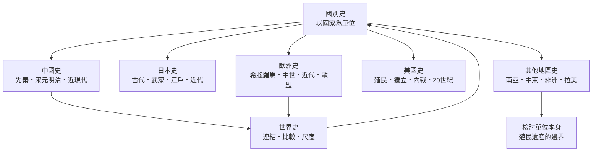

# 國別史

> 隸屬：第一層 [事]　·　相關分類：[歷史]、[世界史]、[朝代]　·　子分類總表見 [README]

> 對應維基百科：[中文維基百科：國別史](https://zh.wikipedia.org/wiki/%E5%9C%8B%E5%88%A5%E5%8F%B2)　·　[English Wikipedia: Historiography](https://en.wikipedia.org/wiki/Historiography)

國別史是以「國家」（或準國家的政治共同體）為單位書寫歷史的傳統。它是歷史學最古老的組織方式之一：司馬遷為列國立世家，中國歷代修前朝正史，歐洲自十九世紀蘭克學派起把檔案館與民族國家綁定，使「一國一史」成為專業史學的預設格式。

這種寫法的優點很實際：檔案按國家保管、教育按國家編課綱、認同按國家培養，國別史因此是最有制度支撐的史學形式。它的缺點也同樣實際：移民、貿易、瘟疫與帝國邊疆等跨國現象被切碎，而「國家」本身是歷史的產物，把它當成永恆的分析單位，會把現代邊界倒投影回古代。

本分類的子分類按地區與國家劃分：中國史、日本史、歐洲史、美國史與其他地區史。它們與世界史的關係是互補的：國別史提供深度與檔案細節，世界史提供連結與尺度；二十世紀後半葉以來的大趨勢，是兩者在「國家的歷史」與「歷史中的國家」之間尋求平衡。

## 核心問題

國別史的核心困難在於「單位的正當性」。法國史從哪一年開始？若從 843 年凡爾登條約算起，法蘭西王國與今日法國的疆域、政體與人口幾乎無連續性可言。同樣的問題適用於所有國家史：我們研究的其實是「一塊土地上的人群的變遷」，而國家只是其中一個變數。

- 單位的歷史性：國家本身有興亡，國別史必須說明國家何時出現、如何成形，而不是假設它一直在場。
- 認同與敘事：國別史常承擔塑造國民認同的功能，這既是它受重視的原因，也是它被批評「官方化」的原因。
- 跨界現象的安置：海外貿易、戰爭、瘟疫與宗教傳播都跨國界，國別史要設法在單位內安置這些「不守規矩的對象」。
- 比較的需要：單一國家的經驗無法自我檢驗，「法國革命」的意義要到與美國革命、俄國革命的比較中才顯現。

## 因果鏈

1. **瓶頸：口傳與地方記憶無法支撐大型政治體**。國家需要跨越世代的合法性敘事，於是官修史書出現——中國的「正史」傳統（從《史記》到《明史》二十四史）是最長壽的版本。
2. **檔案國家化**：近代國家建立集中檔案館（法國大革命後 1790 年代建立國家檔案館），史料按政權組織，史學方法隨之國家化。
3. **專業化與民族史學**：十九世紀蘭克確立檔案批判方法，各國大學成立歷史講座，「國民史」成為教科書與學科的標準形態。
4. **反省與修正**：年鑑學派以區域、人口與經濟取代國家為單位；霍布斯邦等馬克思史學家把階級與結構放在政權之前。
5. **新國家的自我書寫**：去殖民化產生逾百個新國家，它們立刻面對「從自己的視角寫自己」的任務，國別史的地理版圖因此擴張。
6. **當代的再平衡**：全球史與跨國史興起後，國別史並未消失，而是轉型——「在連結中的國家」成為新寫法，例如以鴉片、棉花或移民為線索重寫國家史。

## 子分類的定位與相互驅動

### [中國史]

中國史是連續性最強的國別史：文字、官僚與編史傳統跨三千年延續。它的分期（先秦、秦漢至隋唐、宋元明清、近現代）本身就是「以政權與社會形態切分」的示範，為其他地區的分期提供參照，也提供「為何中國再統一」這類比較問題的標的。

### [日本史]

日本史的特點是「弧島的連續與斷裂」：政治權力從古代貴族轉到武家政權（1192 年鎌倉幕府起），再經江戶的和平與鎖國，到近代急速換軌（1868 年明治維新）。它與中國史的長期互動（文字、律令、佛教東傳）使它成為「接收與改造」研究的最佳案例。

### [歐洲史]

歐洲史的單位問題最突出：從羅馬帝國到民族國家，政治單位反覆重組。希臘羅馬提供法律與政治遺產，中世紀王國與教會提供二元結構，近代國家的形成（1648 年西發里亞體系）與歐盟（1993 年）顯示單位的持續演化。它與世界史的關係因此特別密切。

### [美國史]

美國史是「移民社會的國別史」：從十三殖民地到獨立（1776 年）、憲法（1787 年）、內戰（1861 至 1865 年）與二十世紀的全球角色，其敘事主軸是憲政整合與公民權擴張。它同時是移民史與全球化敘事的核心節點，單位內外互動最頻繁。

### [其他地區史]

其他地區史（南亞、中東、非洲、拉丁美洲）提醒我們：以「國家」為單位在這些地區常是殖民遺產——非洲的邊界多為 1884 至 1885 年柏林會議所劃。這個子分類因此承擔著「檢討單位本身」的批判功能。

## 大事年表

| 年份 | 事件 |
| --- | --- |
| 前 221 年 | 秦統一，中央集權官僚制的長期範本確立 |
| 646 年 | 日本大化改新，仿唐律令制的國家改造 |
| 843 年 | 凡爾登條約三分法蘭克王國，歐洲國家格局的遠源 |
| 1215 年 | 英國《大憲章》，限制王權的憲政傳統起點 |
| 1648 年 | 西發里亞和約，主權國家體系的制度起點 |
| 1776 年 | 美國獨立宣言，第一個現代共和國的誕生 |
| 1868 年 | 明治維新開始，非西方國家的制度換軌示範 |
| 1947 年 | 印度獨立，去殖民化改變國別史的地理版圖 |
| 1993 年 | 馬斯垂克條約生效，歐盟讓「超國家」進入國別史討論 |
| 2001 年 | 中國加入 WTO，最大規模的單一國家融入全球體系 |

## 範例

以「同一事件在兩種單位下的樣貌」為例：鴉片戰爭（1840 至 1842 年）。在中國史敘事中，它是「近代史的開端」與主權受損的起點（《南京條約》割香港、開五口）；在英國史敘事中，它常被縮減為貿易糾紛的插曲；在全球史敘事中，它是白銀流動、走私網絡與英國財政（鴉片稅收占英屬印度收入約一成）的多方交會。三種寫法各有根據，並置閱讀才能得到完整圖像——這正是國別史與世界史分工的縮影。

另一例是「日本史中的謝恩節」。1872 年明治政府引入西方曆法（格里曆），舊曆節慶系統錯位，民間產生在元旦過「兩個新年」的現象。曆法這個看似技術的細節，牽動的是時間秩序、國家權力與日常生活——國別史若只寫政權更替就會漏掉這一層，這說明好的國別史必須包含社會與文化。

## 容易混淆之處

- **國別史不等於「只有政治」**。好的國別史包含人口、經濟、環境與日常生活；「帝王將相史」是它的退化形態。
- **「國家」的內涵隨時代變**。中世紀的王國、近代的王朝國家與現代民族國家是不同物件，用今日的國家概念套古代是時代錯置。
- **國別史不是認同工具的代名詞**。它承擔認同功能是事實，但作為學科，它的標準是證據與可檢驗性，與紀念性敘事必須分開。

## 延伸閱讀

- 霍布斯邦《民族與民族主義》（1990 年）
- 史蒂芬·伯格《歐洲史的邊界》相關研究（1990 年代）
- 葛劍雄《統一與分裂：中國歷史的啟示》（1989 年）

## 連結定義

[事]: ../README.md
[歷史]: ../歷史/README.md
[世界史]: ../世界史/README.md
[朝代]: ../../時/朝代/README.md
[README]: README.md
[中國史]: 中國史.md
[日本史]: 日本史.md
[歐洲史]: 歐洲史.md
[美國史]: 美國史.md
[其他地區史]: 其他地區史.md