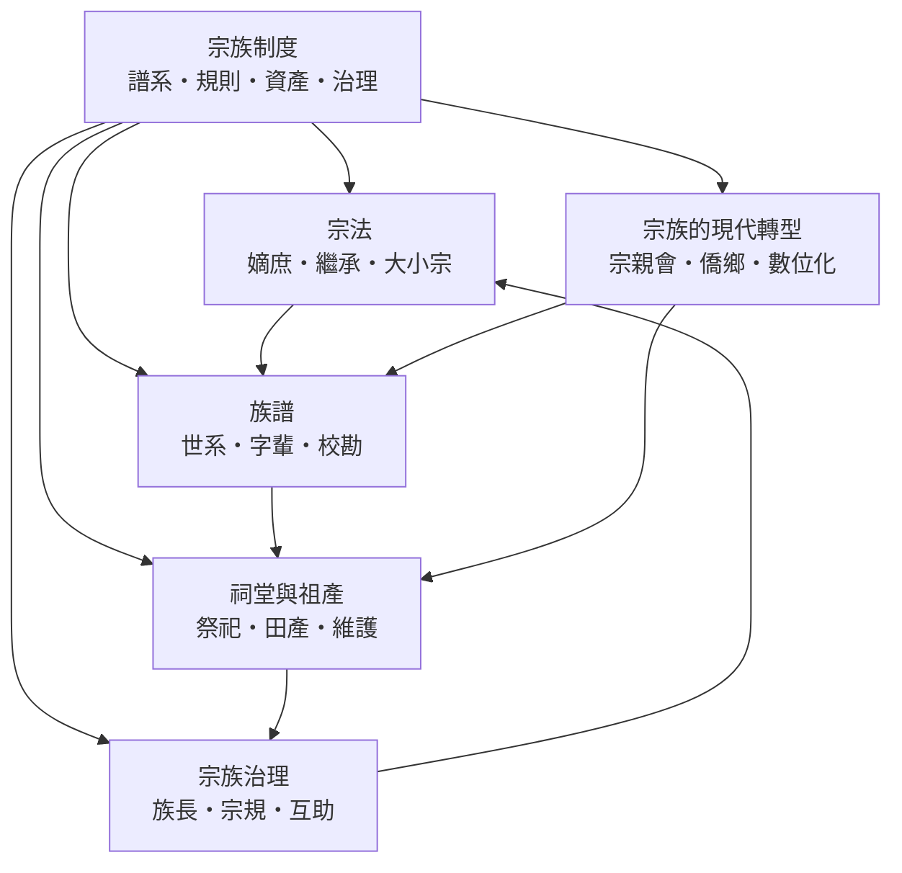

# 宗族制度

> 隸屬：第一層 [人]　·　相關分類：[社會學]、[人類學]、[民法]、[婚姻]、[傳統民居]、[人口結構]、[倫理學]、[歷史]　·　子分類總表見 [README]

> 對應維基百科：[中文維基百科：宗族](https://zh.wikipedia.org/wiki/%E5%AE%97%E6%97%8F)　·　[English Wikipedia: Lineage (anthropology)](https://en.wikipedia.org/wiki/Lineage_%28anthropology%29)

宗族制度研究的是：**以共同父系祖先為軸心，把成百上千個家庭組織成一個有譜系、有規章、有財產、有祭祀與有糾紛裁決機制的大群體**。它不同於 [婚姻] 所處理的「家庭形成」，也不同於 [社會學] 中一般所謂的「家庭結構」：家庭是生活與撫養的單位，宗族則是把眾多家庭跨世代綁在一起的制度。在中國傳統社會，宗族既是親屬組織，也是準政治與準經濟組織——它登記人口、教育子弟、經營田產、調解糾紛，甚至在明清時期承擔了部分基層治理的功能。

本概念的核心張力在於：宗族靠什麼把鬆散的血緣關係變成可運作的組織？答案是四套互相咬合的裝置。第一是**譜系的書寫**（[族譜]），把口傳的祖先記憶固定成可查核的世系檔案；第二是**繼承的規則**（[宗法]），用嫡庶與大宗小宗的區分，回答「誰是祖先祭祀權的合法繼承人」；第三是**財產與空間**（[祠堂與祖產]），用祠堂這個建築與祭田這筆不能分割的公產，給宗族一個聚會的場所與一筆經常收入；第四是**治理**（[宗族治理]），用族長、宗規與互助網絡，把規範變成日常執行。到了二十世紀，這套制度在國家法律、革命運動與海外移民的衝擊下重組為 [宗族的現代轉型]。

閱讀本概念時，建議把握一條主線：**宗族是「觀念（祖先崇拜）→ 文件（族譜）→ 規則（宗法與宗規）→ 資產（祠堂與祭田）→ 執行（族長與房長）」的一條制度鏈**。任何一環缺席，整個體系就會退化成單純的親屬稱謂系統。這條鏈也是五個子分類相互驅動的原因。

## 核心問題

### 一、血緣如何變成組織

親屬關係人人都有，但親屬關係本身不構成組織。宗族制度要解決的第一個問題是：如何把「同姓」或「同祖」的辨識標準，轉換成成員資格、義務與權利的清單。[族譜] 提供成員登記，[宗法] 提供繼承順位，兩者合起來，才能回答「這個人是不是族人、屬於哪一房、在祭祀與財產上有何地位」。

### 二、財產如何在世代與房分之間流動而不分散

分家使家產不斷細分，但宗族需要一筆不會被分掉的公共財。[祠堂與祖產] 中的祭田設計，正是為此而生：田產登記在祖先名下，收益專供祭祀與助學，任何房分不得私自變賣。這使宗族在分家壓力下仍能維持集體行動的能力。

### 三、基層秩序由誰維持

帝國時期的國家政權一般只到縣一級，縣以下的戶口、賦稅、糾紛與教化，很大程度交由宗族、里甲與士紳承擔。[宗族治理] 處理的正是這個「皇權不下縣」的空白：族長如何產生、宗規如何執行、族產如何分配、族人如何互助。

### 四、制度如何在現代國家與跨國遷移中存活

二十世紀的土地改革、民法繼承制度的採行與都市化，逐一拆解了宗族的物質基礎；但海外移民又把宗親組織帶到東南亞與北美。[宗族的現代轉型] 說明宗族如何從「治理單位」轉型為「文化社團與認同網絡」。

## 因果鏈

1. **祖先崇拜提供觀念基礎**：商周時期的祖先祭祀使「誰有資格祭祀哪一代祖先」成為必須回答的問題，祭祀權與政治繼承權在此階段是同一件事。
2. **宗法確立繼承規則**：西周封建以嫡長子繼承為核心，把諸侯、卿大夫與士的傳承整理成大宗與小宗的層級；[嫡庶之分] 與 [長子繼承] 由此成為此後兩千餘年貴族與士族內部排序的通用語法。
3. **科舉與士族的地方化**：宋代以後科舉取代門閥，士人回鄉建祠、修譜、置田，把原本屬於貴族的宗法下放到平民士紳階層；[大宗小宗] 的觀念被重新解釋為「始遷祖以下的房支結構」。
4. **族譜使宗族可稽核**：印刷術普及使修譜成本下降，明代以降「三十年一修譜」成為常規；[世系記載]、[排行字輩] 與 [譜系校勘] 把成員資格變成可查驗的文件問題，宗族因此能在大範圍內辨識同宗。
5. **祠堂與祭田使宗族有形**：嘉靖九年（[1530年]）朝廷採納禮臣之議，奏准民間得祭祀始祖、建家廟，各地祠堂自此大量興建，各地祠堂大量興建；[祠堂功能]、[田產與祖業] 與 [祭田維護] 給了宗族固定的聚會空間與經常性收入，集體行動自此有物質支撐。
6. **宗規承接基層治理**：明清時期國家默許宗族執行家法、調解糾紛、管理戶口與賦稅；[族長與房長]、[宗規] 與 [族人互助] 構成縣以下的準行政體系。
7. **國家法律與革命運動的重構**：二十世紀初《大清民律草案》以降，個人權利本位的繼承法逐步取代宗祧繼承；1949 年後的土地改革沒收族產、祠堂改作公用，宗族的治理功能被國家行政與合作社取代。
8. **全球化與數位化下的重生**：海外移民在僑居地建立宗親會與會館，成為 [宗親會]、[海外宗族] 的載體；1990 年代以後大陸重修族譜、重開祠堂，[數位族譜] 與基因檢測則改變了世系驗證的技術條件。

## 子分類的定位與相互驅動

- **[宗法]** 是**規則層**的子分類：它提供整套體系的「憲法」——[嫡庶之分] 決定誰的後代排序在前，[長子繼承] 決定主祭權與爵位、家業的傳遞，[大宗小宗] 則把全族整理成以始祖為根、以各代嫡長為幹的樹狀結構。沒有宗法，修譜與建祠都失去正當性依據。
- **[族譜]** 是**文件層**的子分類：它把宗法的規則落成檔案。[世系記載] 登記誰屬於這個族，[排行字輩] 用共享的命名系統讓陌生人也能互相辨識輩分，[譜系校勘] 處理抄錄與攀附造成的錯誤。族譜既是成員名冊，也是後世研究人口史與移民史的核心史料。
- **[祠堂與祖產]** 是**資產層**的子分類：[祠堂功能] 提供祭祀、議事與懲戒的物理空間，[田產與祖業] 使宗族擁有不隨分家分割的公共財，[祭田維護] 則確保這筆財產的收益持續供給祭祀與助學。祠堂使宗族「看得見」，祖產使宗族「養得活」。
- **[宗族治理]** 是**執行層**的子分類：[族長與房長] 構成人事系統，[宗規] 提供罰則與儀節，[族人互助] 以義莊、義學與賑濟把規範變成族人實際感受到的福利。治理層把前三個子分類的觀念、文件與資產，轉成日常運作。
- **[宗族的現代轉型]** 是**變遷層**的子分類：[宗親會] 把宗族改組為現代社團法人，[海外宗族] 展示宗族網絡如何隨移民跨國延展，[數位族譜] 則以資料庫與基因檢測改寫世系驗證。它也回頭影響其他子分類——僑匯資助修祠修譜，現代社團重新詮釋宗規。

五者構成一個封閉但可升級的迴路：宗法定資格，族譜記成員，祖產供經費，治理作執行；治理的糾紛裁決又回頭修正宗法與譜系。現代轉型則是把這套迴路移植到社團法人、跨國網絡與資料庫的介面上。

## 範例

### 徽州：以商業利潤供養的宗族

明清時期的 [徽州]（今安徽黃山一帶）是宗族制度的極端案例。徽州山多田少，男性大量外出經商，「徽商」把鹽業、典當與茶葉的利潤持續匯回鄉里，用於買田、建祠與修譜。其結果是：一個村往往就是一個單姓宗族——如歙縣棠樾鮑氏以牌坊群聞名，婺源與黟縣的宗祠至今保存完好。徽州宗族把商業收益轉成 [祭田維護] 與義學，子弟讀書應試成功後再回饋族產，形成「商—儒—族」的循環；現存徽州文書中的賣田契、分家闔書與族規，正是 [宗族治理] 運作的直接檔案。

### 福建土樓：防禦性聚居的宗族空間

閩西南山區的 [福建土樓] 是宗族空間化的另一個案例。一座大型圓樓可容納數百人，通常由單一姓氏的宗族興建，底層作廚房、二層藏糧、三四層住人，中央的天井設祖堂——整座建築就是「祠堂＋住宅＋堡壘」的三合一。土樓的選址講究風水、造價昂貴且需數年完工，只有具備強大 [田產與祖業] 與 [族人互助] 能力的宗族才負擔得起；它同時回應了明清時期闽粤沿海的械鬥與海盜威脅。2008 年福建土樓列入《世界遺產名錄》，宗族居住形態由此成為世界級的文化景觀。

## 容易混淆之處

- **宗族不等於大家庭**：宗族可以橫跨十幾個世代、數千個分散各處的家庭；把它想像成「住在一起的一大家人」會完全錯過其跨地域、跨世代的組織性質。
- **宗族與氏族、家族的差別**：家族以個別家庭為中心向外擴展，氏族（clan）是同姓的泛稱，宗族（lineage）則要求成員能以族譜追溯至共同的具體祖先——可考的譜系是宗族的定義性條件。
- **同姓不等於同宗**：古代有養子、改姓、賜姓與聯宗，族譜中的世系未必全為血緣事實；[譜系校勘] 的存在正說明攀附與訛誤是常態而非例外。
- **宗法不僅是繼承法**：它同時是祭祀權的分配規則與社會排序的語法；只從財產繼承角度理解，會遺漏「主祭權」在傳統社會中的核心地位。
- **祠堂不等於廟**：祠堂祭祀的是特定宗族的祖先，廟供奉的是區域性神祇；兩者在組織歸屬與經費來源上完全不同。
- **現代宗親會不是傳統宗族的直接延續**：宗親會多按姓氏而非可考世系組織，成員資格寬鬆得多；把兩者等同會誇大傳統制度的連續性。

## 延伸閱讀

- [社會學]：宗族作為基層組織與社會資本的分析框架。
- [人類學]：漢人親屬制度與繼嗣群（descent group）的比較研究。
- [民法]：現代繼承制度如何取代宗祧繼承。
- [婚姻]：婚姻與繼嗣的雙向構成。
- [傳統民居]：祠堂、土樓與聚落空間的建築面相。
- [人口結構]：族譜資料在人口史研究中的應用。

## 連結定義

[人]: ../../人/README.md
[README]: README.md
[社會學]: ../社會學/README.md
[人類學]: ../人類學/README.md
[民法]: ../民法/README.md
[婚姻]: ../婚姻/README.md
[傳統民居]: ../../物/傳統民居/README.md
[人口結構]: ../人口結構/README.md
[倫理學]: ../倫理學/README.md
[歷史]: ../歷史/README.md
[宗法]: 宗法.md
[族譜]: 族譜.md
[祠堂與祖產]: 祠堂與祖產.md
[宗族治理]: 宗族治理.md
[宗族的現代轉型]: 宗族的現代轉型.md
[嫡庶之分]: 嫡庶之分.md
[長子繼承]: 長子繼承.md
[大宗小宗]: 大宗小宗.md
[世系記載]: 世系記載.md
[排行字輩]: 排行字輩.md
[譜系校勘]: 譜系校勘.md
[祠堂功能]: 祠堂功能.md
[田產與祖業]: 田產與祖業.md
[祭田維護]: 祭田維護.md
[族長與房長]: 族長與房長.md
[宗規]: 宗規.md
[族人互助]: 族人互助.md
[宗親會]: 宗親會.md
[海外宗族]: 海外宗族.md
[數位族譜]: 數位族譜.md
[徽州]: ../../地/徽州.md
[福建土樓]: ../../物/福建土樓.md
[1530年]: ../../時/1530年.md