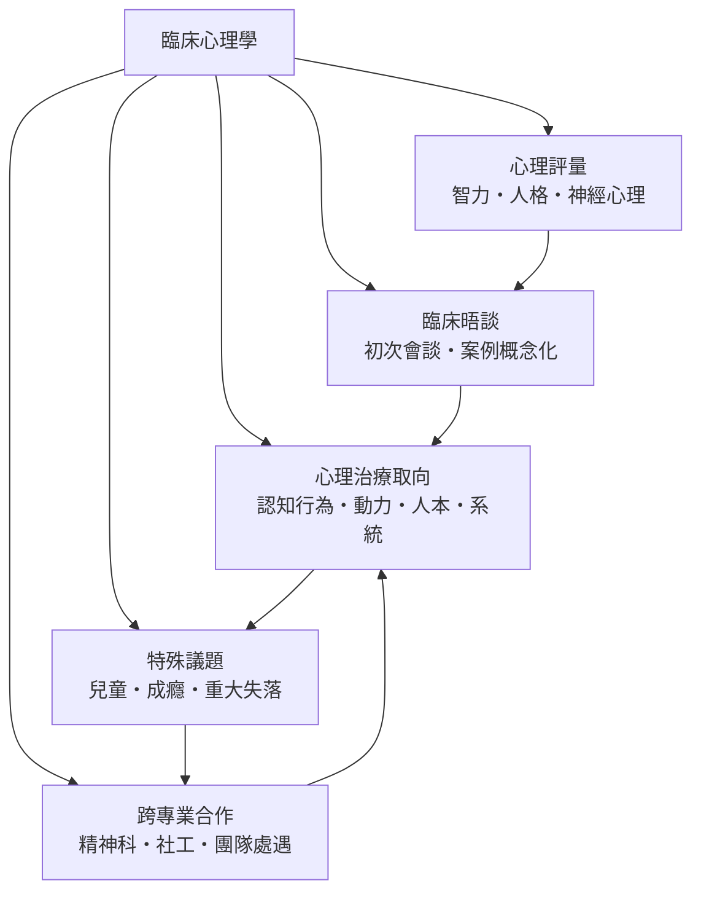

# 臨床心理學

> 隸屬：第一層 [醫]　·　相關分類：[心理學]、[心理治療]、[發展心理學]　·　子分類總表見 [README]

> 對應維基百科：[中文維基百科：臨床心理學](https://zh.wikipedia.org/wiki/%E8%87%A8%E5%BA%8A%E5%BF%83%E7%90%86%E5%AD%B8)　·　[English Wikipedia: Clinical psychology](https://en.wikipedia.org/wiki/Clinical_psychology)

臨床心理學是**把心理科學用於評估、診斷輔助、治療與預防心理困擾的應用專業**。它處理的對象從焦慮、憂鬱到人格與神經心理損傷；它的核心問題不是「這個人怎麼了」的獵奇，而是：**用什麼測量、什麼理論、什麼程序，才能把一個人的困擾轉成可評估的問題，再用有證據的方法協助他改變**。

因此，臨床心理學與 [精神醫學] 的分工不在「誰管心病」，而在**工具與訓練**：精神科醫師受醫學訓練、握有處方權，臨床心理師受心理科學訓練、專長在 [心理評量] 與 [心理治療取向] 的實作；兩者共享個案、共用診斷語言，卻在評估與介入上互補。這條界線一旦劃定，帶來的是持續的專業張力：證據支持的心理治療需要時間與技術，而醫療體系的給付與流程未必配合。

本概念的問題是：**一門從實驗心理學分支出來的專業，如何建立自己的評估工具、治療技術與科學標準，又如何在實證與人本之間維持平衡**。

## 核心問題：從困擾到問題陳述

臨床心理學的核心問題可以拆成三個層次：

1. **評量的層次**：把「我很難過」「我跟家人處不好」轉成有信度效度的分數與結構化觀察。**沒有 [心理評量]，一切介入都在對著模糊的目標開火**。
2. **概念化的層次**：用理論（行為、認知、動力、系統）把評量資料組織成「這個人的困擾如何維持」的因果假說。同一份資料在不同理論下會長出不同治療計畫，**理論不是裝飾，是解釋引擎**。
3. **介入與驗證的層次**：選擇有證據的 [心理治療] 方法、設定可測量的目標、並用 [療效評估] 檢查是否真的有效。**沒有回饋迴路的治療只是陪伴**。

三層的順序不能顛倒：先測量、再概念化、後介入；介入的結果又回頭修正概念化——這正是臨床心理學自稱「科學專業」而非「助人手藝」的理由。

## 因果鏈

1. **誕生於實驗室（[1896年]）**：美國心理學家 Witmer 在賓州大學開設第一個心理診所，處理學習困難兒童，提出「臨床心理學」一詞。**心理學第一次把實驗室方法開處方給具體的個人**。

2. **測驗運動與軍隊團體測驗（[1917年]）**：美國參戰後，Army Alpha 與 Beta 團體智力測驗在短期內篩檢數百萬新兵。**大量施測的需求逼出標準化測驗的工業化生產**，[心理評量] 從此成為臨床心理學的看家本領。

3. **精神分析的主導與戰後擴張（1920–1950 年代）**：退伍軍人安置需求使美國大量補助臨床心理訓練，分析取向解釋框架盛行；臨床心理師取得與精神科合作的正式身分。**專業地位的成長先於療效證據的成熟**。

4. **行為治療與科學化（1950–1960 年代）**：制約原理被系統應用於恐懼與強迫行為，[羅杰斯] 的人本取向同時提出「治療關係本身有療效」並以錄音與對照組檢驗。**心理治療第一次被當作可測量的變項**。

5. **認知轉向與手冊化（1970–1980 年代）**：[貝克] 的認知治療把「自動化思考」變成可操作、可訓練、可做對照試驗的介入單位；治療手冊化使療效研究可以複製。**證據基礎治療（EBP）的時代開始**。

6. **治療師—病人配對與共同因素（1990 年代）**：研究發現不同手冊化治療的療效差異小，治療關係、共感與病人投入等共同因素貢獻可觀。**手冊不是全部：人際品質回到舞臺中央**。

7. **數位化與個人化（2000 年代至今）**：網路認知行為治療、生態瞬時評估與機器學習風險預測改變服務形式；同時可及性、文化適配與跨專業協作成為新的瓶頸。**下一輪競爭不在新理論，而在把有效治療送到需要的人手上**。

## 子分類的定位與相互驅動

- [心理評量] 是**測量地基**：智力、人格與神經心理測驗把構念轉成分數，並用 [效度檢驗] 確保分數真的量到目標。每一次評量都直接輸入 [臨床晤談] 的案例概念化；測量的弱點會沿著整條鏈放大。

- [臨床晤談] 是**資料樞紐**：初次會談、概念化與治療計畫把測驗分數、主訴與生活史縫合成一個因果假說。概念化的品質決定選哪一個 [心理治療取向]；**晤談是評量與治療之間的翻譯器**。

- [心理治療取向] 是**介入引擎**：認知行為、心理動力、人本與系統家族各以不同機制解釋並處理困擾。取向之間的療效比較研究反過來要求評量與晤談更精確，也逼出「共同因素」的問題。

- [特殊議題] 是**適配層**：兒童、青少年、成癮與重大失落要求修改技術、調整程序甚至更換目標（如家長代替兒童作為改變單位）。**沒有適配層，手冊化治療在真實人群就會失靈**。

- [跨專業合作] 是**制度出口**：與 [精神科醫師]、社工、職能治療的團隊處遇把心理介入放進醫療與社區體系；分工與轉介規則的成熟度，決定個案會不會在各專業之間掉進縫隙。

## 範例：一位失眠的上班族走完五個子分類

以「35 歲工程師長期失眠並疑慮『腦子壞掉了』」為例：

1. **[心理評量] 建立基線**：失眠嚴重度量表（ISI）18 分（中度），貝克憂鬱量表 14 分（輕度），排除明顯認知損傷後，測量結果指出問題主要在生理激發與憂慮，而非情緒疾患本身。
2. **[臨床晤談] 完成概念化**：初次會談發現睡眠日記顯示「臥床 9 小時、實睡 6 小時」，維持機轉是「補眠與提早上床」——對失眠的合理反應正是失眠的維持原因。**概念化指出的是維持迴路，不是性格缺陷**。
3. **[心理治療取向] 選擇介入**：選認知行為治療之失眠模組（CBT-I）：睡眠限制、刺激控制與憂慮時段化；比藥物更符合作證據的第一線選擇。
4. **[特殊議題] 的適配**：病人輪班工作，睡眠限制需改為「班表內錨點法」；對「腦子壞掉」的健康焦慮用行為實驗處理而非直接駁斥。
5. **[跨專業合作] 收尾**：睡眠檢查排除呼吸中止症（與 [精神科醫師] 或胸腔科轉介）、職場勞健配合（與 [社工] 資源），八週後 ISI 降至 7 分，轉為每月維持追蹤。**五個環節各自正確，加起來才是療效**。

## 容易混淆之處

- **臨床心理師不等於精神科醫師**：前者非醫師、不開藥，專長評量與心理治療；後者執行醫療與藥物處置。
- **臨床心理學不等於諮商心理學**：兩者重疊，但臨床端傳統上更聚焦重性疾患、醫院與測驗，諮商端更聚焦生涯、發展與適應議題（各國法規分工不同）。
- **心理測驗分數不是標籤**：智力或人格分數是當下情境的估計，有測量誤差，不該用來替人定性。
- **有證據的治療不等於對每個人都有效**：療效研究說的是「平均而言優於對照」，個別病人需要概念化與調整，這正是專業的價值。
- **共同因素不等於「理論無所謂」**：關係品質重要，但特定疾患（如恐慌、失眠）的特定技術仍有明確的額外療效。

## 延伸閱讀

- [心理學]：理論與方法的母學科。
- [精神醫學]：診斷、藥物與團隊處遇的醫療端夥伴。
- [心理治療]：介入技術的總覽概念。
- [發展心理學]、[兒童發展]：兒童青少年評量與治療的發展常模來源。
- [社會心理學]：污名、求助行為與治療關係的社會機制。
- [神經科學]：神經心理評量與腦行為關係的基礎。

## 連結定義

[醫]: ../../科技/README.md
[README]: README.md
[心理學]: ../心理學/README.md
[心理治療]: ../../科技/心理治療/README.md
[發展心理學]: ../發展心理學/README.md
[兒童發展]: ../兒童發展/README.md
[社會心理學]: ../社會心理學/README.md
[神經科學]: ../../科技/神經科學/README.md
[精神醫學]: ../../科技/精神醫學/README.md
[心理評量]: 心理評量.md
[效度檢驗]: 效度檢驗.md
[心理治療取向]: 心理治療取向.md
[臨床晤談]: 臨床晤談.md
[療效評估]: 療效評估.md
[特殊議題]: 特殊議題.md
[跨專業合作]: 跨專業合作.md
[精神科醫師]: 精神科醫師.md
[社工]: 社工.md
[1896年]: ../../時/1896年.md
[1917年]: ../../時/1917年.md
[羅杰斯]: ../../人/心理學家/羅杰斯.md
[貝克]: ../../人/心理學家/貝克.md