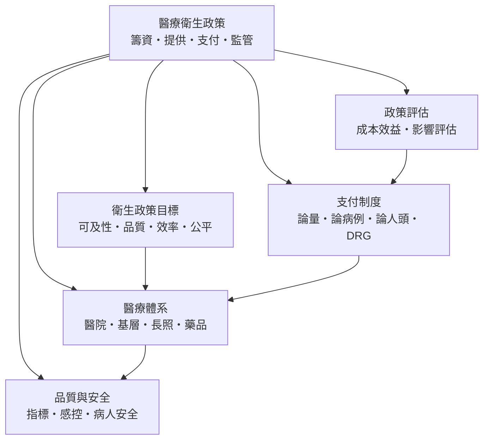

# 醫療衛生政策

> 隸屬第一層 [醫]　·　相關分類：[公共衛生]、[流行病學]、[經濟學]、[公共行政]　·　子分類總表見 [README]

> 對應維基百科：[中文維基百科：衛生政策]　·　[English Wikipedia: Health policy]

醫療衛生政策研究的是「一個社會如何組織、出錢、監管它的醫療照護」。臨床醫學與公共衛生回答「怎麼診斷、怎麼治療、怎麼預防」；政策則回答更上位的分配問題——錢從哪裡來（稅收、保險費、自費）、服務由誰提供（公立醫院、私人診所、保險公司）、品質如何被保證（認證、指標、法規）、以及誰能夠得到服務（給付範圍、就醫障礙）。醫療是一種特殊財貨：需求不確定、資訊嚴重不對稱（醫師比病人懂）、且有強烈的外部性與公平訴求，因此沒有任何國家採用純市場機制；但純公營又會面臨排隊與效率問題。整個醫療衛生政策史，就是各國在「政府 vs 市場」「公平 vs 效率」「品質 vs 成本」三條張力軸上反覆調整的制度實驗史。

## 核心問題：錢、人、品質、可近性

任何醫療體系都要同時回答四個問題，政策的本質就是這四題的答案組合：

1. **籌資（financing）**：錢從哪來？貝弗里奇模式（稅收）、俾斯麥模式（社會保險）、市場保險、自費，或混合。籌資方式決定了風險分攤的廣度——稅收制讓全民分攤，商業保險讓付得起的人分攤。
2. **提供（provision）**：服務由誰提供？公立、私立非營利、私立營利，或混合；醫師是受薪者（英國 NHS 醫院醫師）還是開業執業者（台灣診所）。
3. **支付（payment）**：錢怎麼流向提供者？論量計酬鼓勵多做、總額預算與論病例計酬鼓勵省成本、論人頭鼓勵預防——每一種支付制度都在重塑醫師的行為。
4. **監管（regulation）**：品質、藥證、醫院設立、人力訓練由誰把關？缺乏監管時，市場不對稱資訊會讓低品質服務驱逐高品質服務。

這四題互相牽制：籌資採稅收制的國家常配套總額預算（英國），社會保險國家常配論病例計酬（德國、日本），這不是偶然而是制度邏輯的連動。

## 因果鏈

1. **前現代的濟貧與瘟疫應對**：工業化前的醫療救濟依附教會與濟貧法，[公共衛生] 尚未與醫療分家；瘟疫時的隔離令是國家介入醫療事務最早的形態。
2. **[1883年] 德國俾斯麥創立社會健康保險**：為對抗工人運動，德國以強制保險把醫療從救濟變成勞工權利，開創「就業連結、勞資共同分攤」的俾斯麥模式，奧地利、日本、法國先後仿效。
3. **[1942年] [貝弗里奇報告]**：戰時英國提出「從搖籃到墳墓」的社會安全藍圖，主張以稅收建立統一醫療服務；[1948年] 英國國民保健署（[NHS]）成立，確立貝弗里奇模式。
4. **[1948年] 世界衛生組織成立**：健康被界定為基本人權，「人人享有衛生保健」成為國際政策目標；1978 年阿拉木圖宣言再確認基層照護是達成此目標的策略。
5. **成本危機與支付改革**：戰後醫療技術飛躍使支出成長快於經濟成長，開放式論量計酬被懷疑是元兇；美國 [1983年] 導入 [DRG] 論病例計酬、各國相繼採行總額預算，政策焦點從「擴大覆蓋」轉向「控制成本」。
6. **品質與病人安全運動**：1999 年美國醫學會報告《To Err Is Human》估計每年因 [病人安全] 事件（可預防醫療錯誤）死亡的人數接近交通事故，催生了安全制度、根本原因分析與公開揭露規範——品質從醫師個人德性變成可測量的系統屬性。
7. **評估與實證政策**：隨機對照試驗與成本效益分析被引入政策圈，英國 NICE（1999 年成立）以每健康生命年成本門檻決定給付，各國政策進入「先評估再給付」的時代。
8. **全民覆蓋與長照時代的到來**：多數已開發國家完成全民健保，人口老化把重心推向長期照護與整合照護；台灣 [1995年] 開辦 [全民健康保險]，以單一保險人與晶片卡在五年內達成逾九成九覆蓋率，成為後進國家的參考樣板。

## 子分類的定位與相互驅動

- [衛生政策目標] 是**羅盤**：可及性、品質、效率、公平四個目標定義了「政策做得好不好」的判準；任何支付改革或體系重整都要先回答「這會讓哪個目標變好、哪個目標受損」。沒有目標架構，政策辯論就淪為利益角力。
- [醫療體系] 是**載體**：醫院、基層照護、長期照護與藥品供應是政策的實體網路；目標再高尚，若體系缺基層、缺藥師、缺長照床位，政策就落不了地。體系的結構（家醫制、轉診制）又反過來決定支付制度能怎麼設計。
- [支付制度] 是**槓桿**：錢是最強的行為誘因，論量、論病例、論人頭各有副作用；它直接影響醫療體系裡服務的量與型態——導入 DRG 後住院日數下降就是支付重塑體系的實例。
- [品質與安全] 是**剎車與後照鏡**：成本控制政策（總額、DRG）可能誘發過早出院或省略必要照護，品質指標與病人安全制度就是監測這些副作用、把政策拉回目標的機制。
- [政策評估] 是**校正器**：成本效益分析、影響評估與國際比較讓政策從意識形態之爭變成可檢驗的命題；評估結果又回饋到目標排序與支付制度調整，形成政策學習迴路。

## 範例：三種制度樣板與台灣

1. **英國（貝弗里奇／稅收制）**：[NHS] 以一般稅收支應、就醫免費，覆蓋與公平性佳；代價是總額固定下的候診排隊，英國以 NICE 的成本效益門檻與基層家醫守門員制度管理需求。
2. **德國（俾斯麥／社會保險）**：約百個法定疾病基金競爭收保，勞資分攤保費，醫院與門診分立；覆蓋普及且選擇自由，但管理成本高於單一保險人。
3. **美國（混合／市場為主）**：雇主保險、老人醫療保險（Medicare）、貧民醫療補助（Medicaid）與未保險人口並存，醫療支出占 GDP 約百分之十七為全球最高，但覆蓋與健康結果並未同步領先——常被政策文獻引為「高支出、低效率」的對照組。
4. **台灣（單一保險人）**：[全民健康保險] 於 [1995年] 開辦，單一保險人、全民強制納保、以論量計酬起家後逐步加入論病例計酬與總額預算；行政成本約百分之一遠低於多保險人體系，但也面對總額下的財務張力與藥價差爭議。

三種樣板說明：沒有完美制度，只有「目標權重」不同的取捨——英國重公平、德國重團結與選擇、台灣重效率與可近性。

## 容易混淆之處

- **醫療衛生政策不等於公共衛生**：公共衛生管「讓疾病不發生」的群體手段；衛生政策管「醫療資源怎麼組織與分配」。菸害防制法偏向公共衛生立法，健保給付範圍則是衛生政策。
- **全民健保不等於公營醫療**：台灣健保是社會保險、醫院多為私立；英國 NHS 是公營提供。籌資制度與提供制度是兩個獨立維度。
- **免費就醫並非真的免費**：稅收或保費只是把帳單換了形式；政策討論的重點是誰分攤、分攤多少、以及自付額對就醫行為的抑制效果。
- **效率不只是省錢**：壓低支出但讓可預防疾病惡化，反而總成本上升；政策評估中的「效率」指每單位健康產出的成本。

## 延伸閱讀

- [公共衛生]：政策的上游——預防與群體健康的科學基礎。
- [流行病學]：政策評估所需的證據方法論。
- [經濟學]：資訊不對稱、外部性與誘因設計的分析工具。
- [公共行政]：政策執行、官僚組織與治理。
- [保險]：風險分攤與道德風險的原理。

## 連結定義

[醫]: ../../科技/README.md
[README]: README.md
[公共衛生]: ../../科技/公共衛生/README.md
[流行病學]: ../../科技/流行病學/README.md
[經濟學]: ../經濟學/README.md
[公共行政]: ../公共行政/README.md
[保險]: ../保險/README.md
[衛生政策目標]: 衛生政策目標.md
[醫療體系]: 醫療體系.md
[支付制度]: 支付制度.md
[品質與安全]: 品質與安全.md
[政策評估]: 政策評估.md
[病人安全]: 品質與安全.md
[貝弗里奇報告]: 貝弗里奇報告.md
[NHS]: 英國國民保健署.md
[全民健康保險]: 全民健康保險.md
[DRG]: 支付制度.md
[1883年]: ../../時/1883年.md
[1942年]: ../../時/1942年.md
[1948年]: ../../時/1948年.md
[1983年]: ../../時/1983年.md
[1995年]: ../../時/1995年.md
[中文維基百科：衛生政策]: https://zh.wikipedia.org/wiki/%E8%A1%9B%E7%94%9F%E6%94%BF%E7%AD%96
[English Wikipedia: Health policy]: https://en.wikipedia.org/wiki/Health_policy
