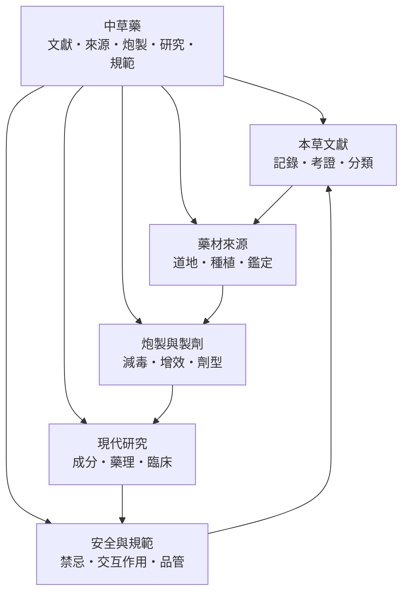

# 中草藥

> 隸屬：第一層 [醫]　·　相關分類：[中醫學]、[藥理學]、[植物學]　·　子分類總表見 [README]

> 對應維基百科：[中文維基百科：中草藥](https://zh.wikipedia.org/wiki/%E4%B8%AD%E8%8D%89%E8%97%AF)　·　[English Wikipedia: Chinese herbology](https://en.wikipedia.org/wiki/Chinese_herbology)

中草藥是在中醫理論指導下使用的動物、植物與礦物藥材及其製劑的總稱。它解決的核心問題是：當身體失衡時，用什麼、用多少、怎麼處理才能把失衡拉回來。要回答這個問題，必須同時處理五件事——歷代累積的文獻與經驗如何記錄與考證（[本草文獻]）、藥材從哪裡來（[藥材來源]）、生藥如何加工成可用之藥（[炮製與製劑]）、其成分與作用機制能否被現代科學檢驗（[現代研究]）、以及如何保證安全與品質（[安全與規範]）。這五件事互相依賴：文獻告訴我們用什麼，來源決定了品質的起點，炮製決定了藥性與劑型，現代研究決定了它能否被國際接受，安全規範則決定了它能否合法地被使用。

## 核心問題

中草藥的核心問題不是「哪種草能治病」，而是**如何把一個天然物變成劑量明確、品質穩定、安全可控的藥物**。傳統的答案由四個概念支撐：

1. **四氣五味**：藥性分寒、熱、溫、涼四氣，味分辛、甘、酸、苦、鹹五味；氣味組合決定藥物的功能傾向。
2. **歸經**：藥物作用傾向於特定的臟腑經絡，例如桔梗被認為「載藥上行」入肺經。
3. **配伍**：多味藥按「君、臣、佐、使」組成方劑，彼此增效、制毒或引經。
4. **炮製**：生藥經蒸、炒、炙、煅等處理改變藥性，例如生地黃清熱涼血，製成熟地黃後轉為補血滋陰。

用現代語言說，這套體系企圖在缺乏化學分析工具的時代，用經驗歸納完成**藥效分類、標靶選擇、組方設計與前處理工藝**四項任務。現代藥理學則用另一步驟重新回答同一批問題：有效成分是什麼、作用受體在哪裡、劑量反應關係如何、不良反應有哪些。

## 因果鏈

1. **先有藥，後有書**：遠古的採藥經驗靠口耳相傳，直到東漢時期彙集成《神農本草經》，收藥三百六十五種，首次把藥物按上、中、下三品系統分類，本草學從此有了文本傳統。
2. **官修本草的出現**：唐代由政府頒行《新修本草》（659 年），是國家層級的藥典雛形——文獻從私人家學變成公共標準，藥材規格第一次有了全國一致的依據。
3. **集大成的考證**：[李時珍] 自 [1578年] 完成初稿、至 [1596年] 在金陵刊行的《本草綱目》收藥一千八百餘種，逐條辨正前人錯誤，確立「以綱挈目」的分類體系，也成為後世植物學與藥物考證的基準。
4. **藥材商品化與道地觀念**：需求擴大後，藥材成為商品，「道地藥材」（特定產區品質最佳，如寧夏枸杞、懷慶地黃）成為品質的經驗標準，這是最早的「來源—品質」對應關係。
5. **炮製工藝的體系化**：煎、丸、散、膏、丹等劑型與蒸炒炙煅的炮製法逐漸固定成規範，解決了「生藥不能直接入藥」「藥效無法保存」的問題。
6. **化學與藥理學的介入**：十九世紀末以來，嗎啡、奎寧、麻黃鹼等成分被分離與鑑定，證明植物藥的療效來自特定分子；青蒿素的發現（獲 2015 年諾貝爾生理學或醫學獎）把這條路線推到高峰。
7. **標準化與法規化**：藥典、炮製規範、GAP 種植與重金屬農殘限量相繼建立，中草藥從經驗商品轉為受法規管制的藥品，同時暴露出許多過去被忽略的安全問題。
8. **現代的整合課題**：今天的核心矛盾是「複方、整體、辨證」的傳統框架與「單體、靶點、隨機對照試驗」的現代框架之間的落差，這正是當前中草藥研究的主戰場。

## 子分類的定位與相互驅動

### 本草文獻

本草文獻是整個體系的**記憶體**：《神農本草經》、《本草綱目》等典籍累積了藥名、產地、炮製、禁忌與功效的紀錄，也保存了大量已被後世推翻的錯誤。沒有文獻，經驗無法累積與檢驗；正因為文獻把錯誤也記了下來，後人才有考證與修正的對象，[現代研究] 也常常從文獻線索中找到篩選方向，青蒿素的靈感即來自東晉葛洪《肘後備急方》的一句記載。

### 藥材來源

藥材來源是品質的**起點**：同一個藥名可能對應多個物種（例如市售「金銀花」曾長期混用山銀花），基原錯了，後面全部落空。道地產區、栽培方式與性狀鑑定構成傳統的品質體系；現代的 DNA 條碼鑑定則把「辨藥」從師徒經驗變成可複製的實驗室流程。來源的問題會直接驅動 [炮製與製劑] 的工藝調整與 [安全與規範] 的限量制定。

### 炮製與製劑

炮製是傳統的**藥品加工工程**：附子經長時間蒸煮使劇毒的雙酯型生物鹼水解減毒，何首烏經黑豆汁蒸製改變成分譜——這些都是「以工藝換安全與藥效」的實例。劑型方面，湯劑見效快、丸劑藥力緩，現代的顆粒劑與濃縮製劑則試圖在便利與療效間找平衡。炮製決定了「進入身體的到底是什麼」，因此是連接 [藥材來源] 與 [現代研究] 的樞紐。

### 現代研究

現代研究是傳統經驗的**翻譯與檢驗層**：用植物化學分離有效成分、用藥理模型驗證作用、用藥動學描述吸收代謝、用毒理評估風險。它一方面讓青蒿素這類成果進入國際主流，另一方面也不斷發現「傳統用法為何有效」的機制解釋（例如黃連素抑制腸道菌群調節代謝）。研究結果會回頭修正文獻記載，並為 [安全與規範] 提供科學依據。

### 安全與規範

安全與規範是體系的**底線**：馬兜鈴酸腎病、含重金屬礦物藥的濫用、中藥與西藥的交互作用（如銀杏與抗凝血藥併用增加出血風險），都迫使各國建立藥典標準、不良反應通報與品質管制制度。規範不只限制壞藥，也推動上游改革——農殘與重金屬限量逼出了 GAP 規範化種植，品質標準逼出了指標成分定量。沒有這一層，前面四層的成果都無法被社會信任。

## 範例：一味藥的完整旅程——以附子為例

1. **文獻**：《神農本草經》列附子為下品（多毒，不可久服），歷代本草反覆記載其回陽救逆之效與中毒之險。
2. **來源**：附子為烏頭（*Aconitum carmichaelii*）子根的加工品，以四川江油為道地產區，採收季節與規格直接影響生物鹼含量。
3. **炮製**：生附子劇毒，經膽巴浸、蒸煮等加工成鹽附子、黑順片、白附片，劇毒的烏頭鹼大量水解為毒性低的苯甲醯烏頭原鹼與烏頭原鹼——傳統「久煎」與現代毒理學在此完全吻合。
4. **現代研究**：強心成分去甲烏藥鹼已被分離鑑定，藥理研究解釋了「回陽救逆」的強心與抗休克基礎。
5. **安全規範**：藥典對烏頭鹼限量、用量與先煎要求都有明文規定，臨床仍偶有自行加量致中毒的案例——說明規範必須與教育並行。

## 容易混淆之處

- **天然不等於安全**：烏頭、馬兜鈴、雷公藤都是天然植物，也都能致死；「純天然無副作用」是行銷話術，不是藥理學陳述。
- **中草藥不等於中醫**：本草是中醫的工具之一，但把中草藥脫離辨證、當作替代西藥的保健品使用，往往正是不良反應的來源。
- **本草文獻不等於考證結論**：古籍記載的是歷代認知，其中夾雜訛誤與張冠李戴；使用文獻必須經過品種考證。
- **有效成分不等於整味藥**：單體研究解釋得了部分機制，但複方的協同、菌群代謝與多靶點作用未必能由單一成分完全代表。
- **保健食品與藥品的法律地位不同**：前者不需療效證明，後者需通過審查；同一種植物在兩種身分下受的管制完全不同。

## 延伸閱讀

- [中醫學]：中草藥所服務的理論體系，辨證論治是處方的前提。
- [藥學]：藥物製劑、品管與藥事管理的現代學科框架。
- [針灸]：同屬中醫治療手段，與藥物治療互補。
- [生物製藥]：現代藥物開發流程，可與中草藥研發路徑對照。
- [公共衛生]：藥品管制、不良反應監測的制度脈絡。
- [神農本草經]：本草傳統的起點文本。
- [本草綱目]：本草文獻的集大成之作，詳見其條目。

## 連結定義

[醫]: ../README.md
[README]: README.md
[中醫學]: ../中醫學/README.md
[藥理學]: ../藥理學/README.md
[植物學]: ../植物學/README.md
[藥學]: ../藥學/README.md
[針灸]: ../針灸/README.md
[生物製藥]: ../生物製藥/README.md
[公共衛生]: ../公共衛生/README.md
[本草文獻]: 本草文獻.md
[藥材來源]: 藥材來源.md
[炮製與製劑]: 炮製與製劑.md
[現代研究]: 現代研究.md
[安全與規範]: 安全與規範.md
[神農本草經]: 神農本草經.md
[本草綱目]: 本草綱目.md
[李時珍]: ../../人/醫學家/李時珍.md
[1578年]: ../../時/1578年.md
[1596年]: ../../時/1596年.md