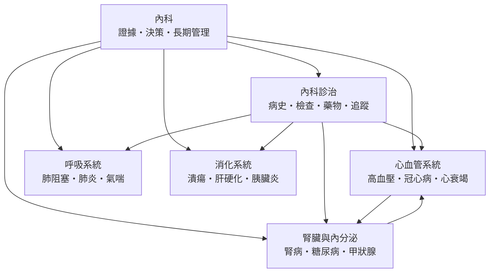

# 內科

> 隸屬：第一層 [醫]　·　相關分類：[病理學]、[藥理學]、[生理學]、[流行病學]　·　子分類總表見 [README]

> 對應維基百科：[中文維基百科：內科學]　·　[English Wikipedia: Internal medicine]

內科學是以藥物與非手術方法診斷與治療成人疾病的臨床主科。與 [外科] 以手術解決結構問題不同，內科處理的是**功能與代謝的失序**——血壓太高、血糖失控、氣道發炎、肝臟纖維化。它是醫學知識密度最高的科別之一，因為它的對象幾乎涵蓋所有器官系統的慢性與急性疾病。本概念的五個子分類按器官與方法組織：共同的方法學（[內科診治]），以及三大系統（[心血管系統]、[呼吸系統]、[消化系統]）與代謝核心（[腎臟與內分泌]）。

## 核心問題：從證據到處方的決策鏈

內科學的中心模型是：**症狀 → 鑑別診斷 → 檢查收斂 → 治療與追蹤 → 調整**。

1. **症狀**：病人帶來的往往是模糊主訴——「喘」「脹」「累」，而非疾病名稱。
2. **鑑別診斷**：醫師依流行病學與病理機轉列出可能原因，並依風險排序。
3. **檢查收斂**：檢驗與影像逐一證實或排除，鑑別清單不斷縮短。
4. **治療與追蹤**：藥物、生活型態介入後，以客觀指標（血壓、糖化血紅素、肺功能）驗證效果。
5. **調整**：效果不佳或出現副作用時回到第二步，決策是迴圈而非直線。

量化指標貫穿全程：例如高血壓的診斷門檻以血壓 $140/90$ mmHg 為傳統參考，糖化血紅素以百分比反映近三個月的平均血糖控制；這些數字不是診斷的全部，而是把模糊主訴變成可比較、可追蹤對象的座標。

## 因果鏈

1. **問診與理學檢查的奠基**：在儀器出現之前，視診、聽診、觸診與病史詢問就是內科的全部工具，這套方法至今仍是每一個診間的起點。
2. **實驗室醫學的加入**：血液化學、血液學與微生物培養把代謝與感染的證據量化，鑑別診斷從經驗猜測變成證據排除。
3. **影像診斷的普及**：X 光、超音波與電腦斷層讓胸腔、腹腔與心臟的結構可以非侵入地檢視，大幅提高診斷收斂速度。
4. **藥理學的爆發**：抗生素、降血壓藥、降血糖藥與制酸劑問世，內科第一次擁有能真正改變慢性病程的武器，而不再只能症狀處理。
5. **慢性病時代的到來**：感染性疾病受控後，高血壓、糖尿病與肺阻塞成為主要負擔，內科的重心從「治癒急性病」轉向「長期管理」。
6. **實證醫學的建制**：隨機對照試驗與系統性回顧成為治療決策的標準，指引取代個人經驗成為基準。
7. **風險分層與預防**：流行病學找出可修正的危險因子，內科的任務向前延伸到篩檢與一級預防。
8. **數位與個人化**：連續監測資料與基因分型讓「同病同治」走向「同病異治」，內科正處於決策模式再度轉變的門檻。

## 子分類的定位與相互驅動

- [內科診治] 是**方法**：病史、理學檢查、檢驗判讀與用藥原則是所有系統次專科共用的工具箱。
- [心血管系統] 是**主流**：高血壓與動脈硬化是全球死因首位的主軸，其風險因子管理是內科預防思想的代表。
- [呼吸系統] 是**介面**：肺是唯一接觸外界空氣的內臟，感染、過敏與吸入性傷害在此交會。
- [消化系統] 是**化工廠**：消化、吸收與代謝的失序牽動全身營養與藥物處理。
- [腎臟與內分泌] 是**調控核心**：腎臟調節體液與電解質，內分泌調節代謝速率，兩者失調都會反噬其他所有系統——例如糖尿病同時傷害腎、心與血管。

## 範例：一次多系統的內科會診

七十歲病人因「越來越喘」住院，三個子分類在同一張病歷上交會：

1. **內科診治**：病史詢問發現喘在平躺時加重、夜間需坐起；理學檢查聽到雙側肺底囉音與下肢水腫——鑑別清單縮小到心衰竭與腎病。
2. **心血管系統**：心臟超音波顯示左心室收縮功能下降，診斷心衰竭； NT-proBNP 數值顯著升高支持診斷。
3. **腎臟與內分泌**：腎功能檢驗顯示腎絲球濾過率下降，長期糖尿病是共同兇手；利尿劑劑量須依腎功能調整。
4. **呼吸系統**：胸部 X 光的水腫表現需與肺阻塞急性發作鑑別，肺功能檢查在出院後補做。
5. **整合**：三種藥物（利尿劑、血管收縮素轉換酶抑制劑、降糖藥）之間有交互作用，治療是整體最適化而非單科最佳化。

## 容易混淆之處

- **內科與全科不同**：內科學是成人疾病的方法學，兒童疾病屬 [兒科] 的專業領域。
- **症狀消失不等於治癒**：高血壓用藥後血壓正常，代表的是「控制中」而非「好了」，擅自停藥是常見的嚴重錯誤。
- **檢驗異常不等於疾病**：單次血糖偏高可能是採檢前進食所致，診斷需要重複測量與標準條件。
- **指引不是處方**：臨床指引基於平均效果，個別病人的合併症、年齡與偏好都可能合理偏離指引。
- **多科併存是常態**：老年病人常同時有心、腎、糖三種問題，單一器官思維會造成藥物堆疊。

## 延伸閱讀

- [病理學]：疾病機轉的基礎科學。
- [藥理學]：內科治療武器的原理。
- [流行病學]：風險因子與篩檢的證據來源。
- [外科]：結構性介入的對照科別。
- [醫療衛生政策]：慢性病管理的制度環境。

## 連結定義

[醫]: ../README.md
[README]: README.md
[病理學]: ../病理學/README.md
[藥理學]: ../藥理學/README.md
[生理學]: ../生理學/README.md
[流行病學]: ../流行病學/README.md
[外科]: ../外科/README.md
[兒科]: ../兒科/README.md
[醫療衛生政策]: ../../社會/醫療衛生政策/README.md
[內科診治]: 內科診治.md
[心血管系統]: 心血管系統.md
[呼吸系統]: 呼吸系統.md
[消化系統]: 消化系統.md
[腎臟與內分泌]: 腎臟與內分泌.md
[中文維基百科：內科學]: https://zh.wikipedia.org/wiki/%E5%85%A7%E7%A7%91%E5%AD%B8
[English Wikipedia: Internal medicine]: https://en.wikipedia.org/wiki/Internal_medicine
