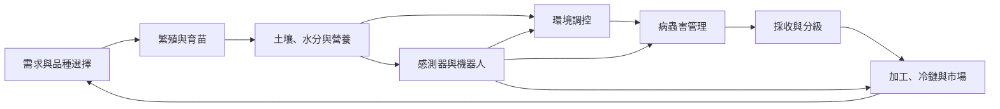

# 園藝

園藝是以觀賞、食用、綠化或研究為目的，選擇植物品種並有計畫地繁殖、栽培、管理與利用的生產及生活領域；它同時是一套技術、產業、科學研究方法與文化實踐。

> 對應維基百科：[中文維基百科：园艺](https://zh.wikipedia.org/wiki/%E5%9B%AD%E8%89%BA)　·　[English Wikipedia: Horticulture](https://en.wikipedia.org/wiki/Horticulture)

## 概念與範圍

園藝以植物生長為核心，但不限於種植；它還包括品種保存、苗圃繁殖、設施栽培、病蟲害防治、採後處理、景觀設計與園藝教育。

園藝首先解決的是植物生長條件不穩定的問題。

人們透過選種、土壤管理、灌溉與溫度控制，降低氣候、土壤及生物壓力造成的產量波動，使植物能依特定季節或計畫供應。

其次，園藝提供食物、觀賞材料、綠化環境與文化服務。

果實、蔬菜、花卉、苗木及草皮可作為商品，而公園、庭院與校園則具有景觀、教育及身心舒適等功能。

農學是研究農作物生產與農業資源管理的學科，與園藝有大量共同技術。

[作物栽培][作物栽培]通常偏重稻麥、豆類及大宗油料作物等田間生產；園藝則更重視單位面積的品質、觀賞價值、供應時點與管理精度，但兩者的界線並非絕對。

例如，番茄、馬鈴薯與甘藍可以採一般作物方式栽培，也可以進入溫室、盆器或hydroponic系統而具有明顯的園藝性質。

園藝的產品可分為營養用途、觀賞用途、景觀用途及研究用途。

營養用途包括蔬果、藥草與香草；觀賞用途包括切花、盆花、球根及觀葉植物；景觀用途包括草坪、灌木、喬木與水生植物。

園藝也保存和利用遺傳多樣性。

所謂品種，是經人工選擇或育種形成、能在一定程度上穩定表現特定性狀的栽培植物群體；同一物種內可以存在數百至數萬種品種。

全球約有三萬種植物具有食用價值，但日常栽培主要集中於數十種物種。

高度集中的物種結構雖有利於標準化生產，卻也使農業更容易受到單一病害、氣候異常或市場價格變動影響。

園藝因此兼具工業化與多樣性保存兩種 seemingly tension 的任務。

## 歷史形成與主要轉折

園藝的基礎形成於新石器時代。

早期人類選擇容易採收、耐儲存及繁殖表現良好的野生植物，將其逐步改造為栽培作物，開始出現種子篩選、整地、施肥與 simple irrigation 技術。

古代灌溉文明進一步推動園藝。

美索不達米亞、埃及、印度河流域及中國先秦時期的灌溉與農書，都顯示園藝早於現代科學形成，並與水利、土壤和節氣知識緊密相連。

中國北魏賈思勰所著《齊民要術》記載蔬菜、果樹、苗木及田間管理方法，是早期中國農業知識系統化的代表之一。

園藝與觀賞植物交易也在城市發展中擴張。

十六至十八世紀，歐洲植物園、專業苗圃、宮廷園藝和海外植物交換網絡興起，植物由原生地被带到新的氣候區，馴化、選種與栽培技術因而加速累積。

1630年代的荷蘭鬱金香投機熱是商品化園藝的重要歷史事件。

交易價格短期急升又崩落，顯示觀賞植物除具有文化與美學價值，也能成為高度金融化、可跨地域交易的商品。

遺傳學的形成受到園藝雜交的直接刺激。

1856年至1863年間，格雷戈爾·孟德爾在修道院庭院進行豌豆人工授粉試驗，觀察並記錄七項相對明顯的性狀，之後提出分離律與顯性律，為現代遺傳學奠定基礎。

植物病理學、土壤學和化學肥料也在十九至二十世紀迅速發展。

早期農學家逐步區分環境、營養、病原與昆蟲對植物的作用，化學工業則提供可大量生產的氮、磷、鉀肥料，使單位土地產量上升。

然而，單純增加投入也帶來土壤酸化、地下水污染及生態單一化，迫使園藝重新重視平衡。

二十世紀的溫室、塑料薄膜、育種與輸送技術重塑了園藝產業。

自育雜交品種、節水灌溉、溫室gas環境控制、冷鏈運輸和自動化設備，使園藝能跨越自然季節限制，並以更精確的方式供應市場。

第二次世界大戰後，发达國家的園藝產品供應由季節性轉向全年性。

市場對鮮蔬、切花與盆花的穩定需求，促使企業投資玻璃溫室、育種、採後處理及跨國物流，也使能源成本、勞動短缺與環境負擔成為產業的重要議題。

二十一世紀的園藝 increasingly 結合感測技術、資訊系統與機器人。

精準農業是指利用資料協助耕作決策的做法；當它進入園藝後，溫室、苗圃和果園可依即時資料調整灌溉、施肥、通風及採收工作。

## 植物選擇、繁殖與育種

選種是從既有族群中保留符合目標性狀的個體，育種則是有目的地創造或改變品種的遺傳組合。

兩者都需要對莖長、花色、果味、產量、抗病性、耐熱性或成熟期等性狀進行觀察。

有性繁殖利用花粉與卵細胞結合產生種子，優點是能產生新的遺傳組合。

然而，種子後代不一定完全保留親本特徵，因此珍貴品種、砧木及無性系材料常需以其他方式繁殖。

無性繁殖是從母株的一部分形成新個體，使後代通常能維持母株性狀。

扦插是把枝葉或芽插入介質中，使其形成新根與新芽；嫁接則是把一段植物枝條接到另一植株的切口上，使兩者的維管組織連通。

這類方法常用於難以以種子穩定繁殖的園藝品種。

嫁接還能把植株的地上部與根系分開配置，例如以抗病砧木承接甜橙或蘋果品種，以調整樹勢、土壤適應力或果實品質。

組織培養是在無菌環境中利用植物組織或細胞培養出新植株。

它可大量複製無病毒材料、建立種質資源保存庫，並支援育種材料的快速繁殖，但設備、培養基與污染控制成本較高。

種質資源是可用於作物改良與育種的遺傳材料總稱。

妥善保存地方品種、老栽品種及野生近緣種，可避免重要抗病、耐逆境或適應地方氣候的基因在品種更替中消失。

植物新品種權是赋予育種者對新品種繁殖與商業利用之合法權利的制度。

它能鼓勵私人企業投入長期育種，但若權利與種子保存制度失衡，也可能限制農民留種或增加用種成本。

## 土壤、根系與營養管理

土壤是由礦物颗粒、有機質、孔隙、水分和生物共同組成的栽培介質，不只是泥土。

根部需要氧氣、水分、養分及適宜的機械支持，因此土壤質地、深度、團粒結構與排水能力都會影響植物生長。

[土壤改良][土壤改良]是針對土壤限制進行物理、化學或生物調整的作業。

沙土通常保水與保肥能力較弱，黏土則可能排水和通氣不足；有機質、堆肥、 cover crop（覆蓋作物）及適量無機肥料可改善這些問題。

堆肥是將有機廢棄物經微生物分解而形成的穩定材料，含有部分植物可利用的養分，也能提高土壤保水與生物活性。

植物需要氮、磷、鉀等大量營養元素，也需要鈣、鎂、硫、鐵、錳、硼等較少量元素。

缺氮常使葉片顏色變淡，缺磷可能限制生長與根系發育，缺鉀則常影響果實充實與逆境耐受力，但症狀也可能由水分、光照或病害造成，不能只憑外觀下結論。

酸鹼值是衡量土壤或溶液酸性的指標。

多數蔬果適合接近中性至微酸性的環境；酸鹼值失調會使特定養分難以被根部吸收，並可能提高某些元素的毒性。

肥料可以改善營養供應，但過量使用可能造成根系灼傷、土壤鹽化及養分流入 waterways。

土壤鹽化是水中的可溶性鹽在地面累積，使根部吸水困難的現象，在溫室與乾旱地區尤其需要注意。

因此，園藝不應把單次高產量當作唯一目標，而應同時考量養分平衡、灌溉水质及長期土壤功能。

## 水分、溫度與設施栽培

[灌溉][灌溉]是以人工方式補充作物所需水分的作業。

它能保障關鍵生長期的供水，但也可能帶來水資源消耗、鹽分累積與病原傳播，因此須依作物種類、土壤、氣象與生育期調整。

滴灌是讓水沿管線逐滴或少量排出、直接供應根區的灌溉方式。

相較於全面漫灌，滴灌通常能減少蒸發、降低葉面潮濕及用水量，但阻塞、鹽分分布和初始設計仍需管理。

蒸散作用是植物由葉片散失水分、並由根部吸收水分以維持運輸的過程。

蒸散量受光照、溫度、濕度、風速與作物覆蓋率影響，可作為估算灌溉需求的重要依據。

溫室是使用透明材料提高內部溫度或維持環境的設施。

現代溫室還能透過通風、遮陽、蒸發冷卻、補光與二氧化碳管理，調整溫度、光照、濕度和氣體濃度。

水耕是讓植物根系直接接觸養液或薄層養液、而非一般土壤的栽培方法。

介質栽培則以椰殼纖維、岩棉、樹皮或珍珠岩等材料固定根部並供應養液，兩者都屬於設施栽培的重要形式。

受控環境農業是透過設備主動調節作物環境的生產方式。

它能提高土地與能源使用效率，並支持都市近距離生產，但高度依賴電力、設備維護與專業操作。

感測器可即時量測溫度、濕度、土壤含水量、養液濃度與光照，控制器再依規則或模型操作設備。

這些資料也能用於預測病害、安排灌溉及辨識植株生長偏差。

然而，設備並非越多越好；感測器若未經校準、資料未經整理，或模型沒有經過當地氣候與品種驗證，可能反而造成錯誤決策。

## 病蟲害與雜草管理

植物病理學是研究植物疾病成因、傳播方式與防治方法的學科。

植物病害可由真菌、細菌、病毒、線蟲、藻類或非生物環境因素引起，辨別病原與 stresses 是防治的第一步。

病徵是植物生病時可直接觀察到的異常，徵狀則是病害造成的外觀表現。

例如，葉斑、腐爛、萎凋與徒長可能分別與不同病原或環境問題有關，管理時不能只看單一症狀。

綜合病蟲害管理是整合預防、監測、品種抗性、生物防治與必要化學藥劑，以降低有害生物危害的策略。

它通常依序執行田間調查、風險預測、排除病源與感染途徑、保護天敵，最後才依核准範圍施用農藥。

生物防治是利用天敵、病原或競爭性生物抑制害蟲或雜草。

例如，捕食性昆蟲可吃掉蚜蟲，寄生蜂可攻擊害蟲，但引入或釋放前必須評估生態風險。

抗病育種是將可辨識的抗病基因或抗性組合導入品種。

抗病性可減少藥劑使用，但在病原族群變化或單一抗性基因被克服後，保護效果可能下降，因此最好配置多個抗性來源。

雜草會競爭水分、養分與光照，也可能 hosts 害蟲或病原。

覆蓋、輪作、機械除草與選擇性除草劑各有成本與影響，管理方案須依作物排列、土壤及勞動條件選擇。

農藥殘留是處理後仍存在於作物、土壤或環境中的化合物或代謝物。

嚴格遵守安全採收間隔、輪替作用機制及個人防護，可降低暴露風險，但監測制度仍需涵蓋環境與非農業用途。

## 整枝、採收與採後處理

整枝是修剪或引導枝條生長方向與分布的作業。

它可調整受光面積、通風、樹形、果實负载及採收便利性，但修剪強度過大會減少葉面積並延後成熟。

果樹常採杯狀形、中心枝幹形或半導向形等樹型。

不同樹型影響遮光、樹冠通氣、機械作業、灌溉配置及更新速度，必須與品種、土壤和栽植密度共同設計。

採收成熟度是判斷採收時機的標準。

番茄可依轉色期、硬度與糖酸比分批採收；葉菜則常在品質與運輸耐受性之間折衷，過早採收會失水，過晚採收則可能老化或變纖維。

採後處理是植物離開田間後，為維持品質所進行的分級、清洗、預冷、包裝與儲運作業。

預冷是迅速移除田間熱量的處理，有助於降低呼吸消耗、延後萎凋，但不同作物對溫度與濕度的需求並不相同。

冷鏈是從採收、加工到消費端全程維持適當低溫的物流系統。

它能降低微生物繁殖與品質損失，但若不同產品共用設備而未分隔，allergens、化學藥劑或病原也可能交叉污染。

加工則可把易腐損的園藝產品轉為冷凍、罐裝、乾燥、醬渍或發酵產品。

這可延長保存期限並調節季節供需，但加工也會改變營養組成、風味、能耗與包裝需求。

## 主要類型與生產組織

蔬菜園藝以葉菜、根莖類、果菜類、豆類及食用菌為主。

不同類型的生長速度、貯藏條件與市場規格差異很大，因此常需要分批播種、分區管理及分級包裝。

[果樹][果樹]園藝包括蘋果、柑橘、桃、葡萄、梨、荔枝與熱帶果樹。

果樹生產週期長、地上部與根系關係複雜，品種、砧木、樹齡、授粉配置及果實品質是主要技術重點。

[花卉][花卉]園藝包括切花、盆花、球根、蘭花、觀葉植物及草坪材料。

花卉消費常與節慶、婚禮、祭祀、園藝設計及居家裝飾相關，因此花形、色彩、香氣、花期與耐運性同等重要。

苗圃是繁殖和培育幼苗、砧木、盆花與園林樹木的專業場所。

它需要精細的介質、水肥管理、病害檢疫及出貨分級，是植物供應鏈中連接育種與終端使用者的重要環節。

樹木園藝培育喬木、灌木、藤本與地被植物，供公園、道路、学校、庭院及建築景觀使用。

行道樹是種植於道路兩側、兼具遮蔭、景觀與都市生態功能的樹木，其選擇還須考慮枝高、根系、allergens 與維護需求。

草坪是經常修剪、灌溉或滾壓以維持短草表面的園藝地景。

傳統草坪可提供活動空間，但高頻維護可能增加用水、化肥與能源需求，因此低輸入草種、混合草種與原生植物替代方案受到重視。

園藝生產可由家庭園圃、合作社與小農經營，也可由大型溫室、苗圃、果園及跨國供應鏈完成。

小單元較能保留多樣作物與地方市場，規模化則有利於分級、加工、設備投資及穩定供應，兩者並非完全互斥。

## 生態功能與資源循環

園藝植物可提供花粉、 nectar、種子、庇護場所與食物來源，因而支持昆蟲、鳥類及土壤生物。

授粉是花粉由傳粉者或風力送达可受精柱頭的過程，特定果樹與蔬菜的產量因而可能受授粉條件影響。

提高花卉多樣性與連續開花，可讓傳粉者在不同月份獲得資源，但外來入侵種則可能破壞原有群聚。

園藝也能形成微氣候。

微氣候是局部地區因樹木、牆面、屋頂、土壤與水分條件形成的特定溫濕環境；樹冠與垂直綠化可提供遮蔭，並在適當設計下降低熱累積。

綠化對污染的改善效果有限。

植物可以截留部分塵粒、吸收少量污染物並增加土壤活性，但若以園藝取代污染源治理，可能高估其效果，因此仍須從交通、能源與工業排放處理污染。

都市園藝可縮短部分蔬果的供應距離。

屋頂農場、陽台菜園與社區共耕可增加居民參與、供應新鮮產品並利用閒置空間，但建築承重、風害、用水與權責分配都需評估。

土壤有機質管理能促進碳留存與保水。

適當增加有機質可改善土壤結構、減少灌溉需求，並把植物殘體中的部分碳保存在土壤中，但碳儲存效果仍取決於分解條件與長期管理。

養分循環是讓廢棄物中的資源返回生產過程的做法。

落葉、修剪物、病株、廚餘與牲畜糞便若經適當處理，可轉為堆肥、培養基或土壤改良材料；然而病原種子、鹽分與重金屬必須先被評估。

園藝生產也消耗能源。

溫室加熱、冷藏、補光、塑膠膜、肥料製造與長距離運輸都可能形成溫室氣體排放，因此節能設備應與整體產量及外包運費一起評估。

## 產業、科學與相鄰領域的互相驅動

園藝的市場需求推動了植物科學與工程技術。

高密度溫室需要更抗病、耐弱光且穩定坐果的品種，因此促進育種、基因標記利用與植物生理研究；新的育種成果又使原本不適合的氣候區或季節能生產特定作物。

食品加工與物流技術反過來改變了園藝品種需求。

若採後處理能延長保存時間，生產者便可採用產量較高但货架壽命較短的品種；若市場偏好長期儲運，育種目標就會轉向硬度、脫水耐性與風味維持。

城市綠化需求推動景觀規劃、植物復育及公共衛生研究。

樹木健康與花粉監測可改善居民環境，而城市設計提出的降溫、滲水及食物需求，又促使育種者篩選適合都市環境的植物。

[科技][科技]領域的感測器、機器人與預測模型加速了精準管理。

機器人可協助採收、搬運與除草，電腦視覺可辨識成熟果實和病害，數位孿生則是以數值模型模擬實體系統；這些工具減少重複巡檢，但新資料也要求更嚴格的品質控制與隱私規範。

保育生物學與園藝在種質保存上互相支援。

地方栽培品種常保有野生族群已失去的抗逆境基因，保存這些品種可讓育種者調用多樣來源；反過來，保育種苗與混植也能提高景觀及生產地的生態韌性。

## 具體案例：遺傳學與溫室番茄

1856年至1863年的豌豆雜交試驗，是園藝推動基礎科學的典型案例。

孟德爾人工控制花粉來源，逐株觀察種子形狀、顏色、莖高及花色等性狀，並在後代中尋找可重複的比例。

這種針對花色與種子形態的控制，使原本被視為經驗性育種的現象能被量化，並成為統計學與遺傳學的重要證據。

另一個例子可用於說明現代溫室管理中的數量關係。

假設一座占地面積為 1,000 平方米的玻璃溫室，經當地試驗確認番茄平均每平方公尺每年可收穫 25 公斤，則總產量為 `$ A = 25 \times 1{,}000 = 25{,}000\ \text{公斤} $`。

若其中 90% 符合大小、裂果及色澤等商品規格，可售產量便為 22,500 公斤，而分級、搬運與包裝造成的損耗約為 2,500 公斤。

這項試算顯示，總產量、商品率與運銷損耗是三個不同問題，不能只看溫室表面產量。

若要提高商品率，管理人員可依苗期、开花、坐果與轉色階段調整灌溉，避免水分波動造成裂果。

根部含水量與溫度可由介質感測器監測，濕度感測器則協助判斷是否需要通風，以降低真菌性病害風險。

在採收端，電腦視覺可估算成熟果實比例，機器人可把已成熟果實直接放入分級設備，減少反覆搬運。

然而，增加感測器與自動化設備也會提高折舊、維修及電力需求，因此是否採用仍須以每公斤商品成本、能源消耗和人工風險共同評估。

## 產量、品質與永續性衡量

園藝產量可分為總生物量、商品產量與最終可售產量。

總生物量是植物形成的全部重量；商品產量符合市場大小與外觀規格；可售產量則再扣除採收、分級、包裝、運輸與儲存損耗。

品質不只等於外觀。

糖度、酸度、硬度、香氣、營養成分、纖維質地與污染物殘留，都可能影響產品是否適合鮮食、加工或儲運。

投入產出比是比較每單位產量所需土地、水、肥料、能源、勞動與資本的方法。

只計算種子、肥料和短期人工，可能掩蓋土壤退化、疾病爆發、設備折舊及外包運費等較長期的成本。

生命周期評估會從原料取得、生產、加工、運輸、使用到廢棄，計算各階段的環境負擔。

對溫室番茄而言，冬季供應可能節省土地與運輸，卻增加加熱與補光能源；不同方案必須依氣候、电力来源 和市場距離比較。

水足跡是直接與間接使用水資源的總量，養分足跡則是消耗或釋放氮、磷等養分的總量。

兩者有助於揭露 seemingly water-efficient 卻造成地下水枯竭或養分污染的生產方式。

可追溯性是能從產品回到原料、批次、產地與處理紀錄的能力。

它可用於處理召回、驗證有機或地理標示，以及分析某一病害或品質問題的來源。

## 主要挑戰

氣候變遷會提高熱浪、乾旱、暴雨與病害風險。

園藝需要更精準的水分管理、耐逆境品種與可移動或可調度的生產設施，但溫室與冷藏也可能增加能源負擔。

生物多樣性下降是另一項重大風險。

單一栽培品種的大規模使用使遺傳背景趨於相似；一旦新病原具有廣泛寄主範圍或能突破既有抗性，損失可能迅速擴大。

土地與水資源競爭也會加劇。

都市擴張、工業需求與農業爭水，使溫室生產不能只依賴增加抽取量，而需提高灌溉效率、使用再生水源並降低營養流失。

勞動短缺與職業安全是設施園藝的重要問題。

高架採收、溫室高溫、化學藥劑與重複性操作可能造成傷害；自動化可降低部分負擔，但仍需要重新設計工作流程與訓練方式。

種子市場集中和技術取得不平等可能影響農民自主性。

少數品種或專利材料若完全掌握供應鏈，農民面臨成本上升與風險集中，因此種子保存、品種登錄及公共育種具有制度重要性。

智慧農業資料也面臨品質、資訊安全與演算法偏誤問題。

感測器故障、標示資料不一致或模型只適用於特定地區時，自動決策可能放大錯誤，必須保留人工覆核與停機機制。

## 發展方向

未來園藝會以韌性、資源效率與生物多樣性並重，而非單純追求最高產量。

育種目標將由耐病、耐熱、耐鹽、耐乾旱、耐淹水及降低化肥需求等功能並重。

基因編輯是直接修改特定遺傳位點的技術，可用於加速育種與調整性狀，但仍須依生物安全、倫理及法律制度評估。

智慧管理將更精準地整合感測器、天氣預測、影像辨識與作業排程。

其核心不是完全無人化，而是讓每一項操作都能根據可驗證的資料進行，減少不必要的水、肥與藥劑。

機器人將優先承擔高風險、重複或需要一致性的工作。

例如夜間採收、除草、搬運及噴霧，而 delicate 品種仍可能需要人工判斷品質與花朵狀態。

多年生作物、混植與生態輪作可提高土壤覆蓋和生物多樣性。

多年生植物能在多年內持續維持根系與生物量，混植則可分散單一病蟲害風險，但管理、收穫與市場規格會更複雜。

都市園藝會與建築、雨水管理及公共健康更緊密結合。

屋頂與社區共耕可提供食物、教育和社交空間，但成功條件包括安全用水、合理租金、健康環境規範及居民共同決策。

循環設計將讓有機廢棄物、塑膠材料、熱量與水在不同系統間再利用。

堆肥、生物炭、太陽能供熱、熱回收與低排放肥料可降低廢棄與能源成本，但必須避免污染物質在循環中累積。

園藝最終仍是一種平衡植物需求、環境限制與人類價值的活動。

只有把生物學知識、土地與水管理、設備技術、供應鏈及文化需求整合起来，才能同時維持產量、品質與長期生態健康。

## 連結定義

[作物栽培]: ../作物栽培/README.md
[土壤改良]: ../土壤改良/README.md
[灌溉]: ../灌溉/README.md
[果樹]: ../果樹/README.md
[花卉]: ../花卉/README.md
[科技]: ../README.md